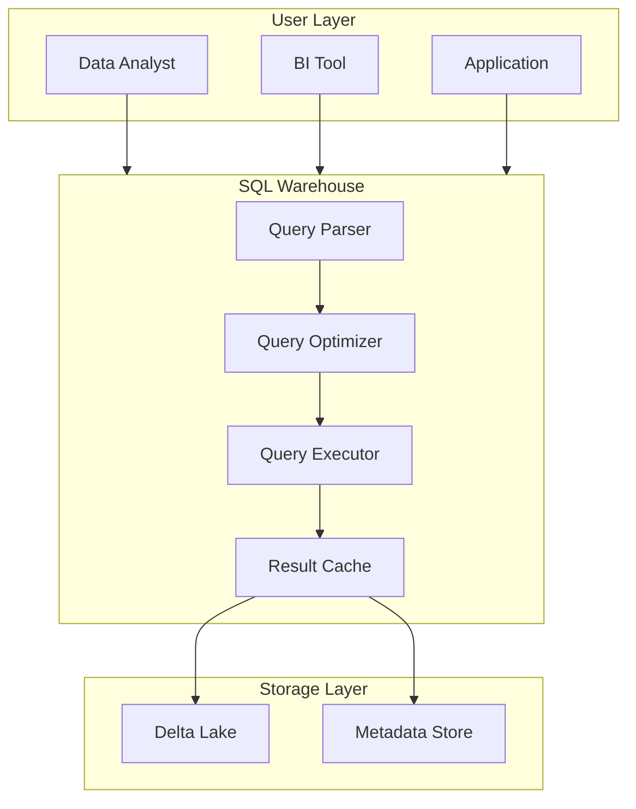
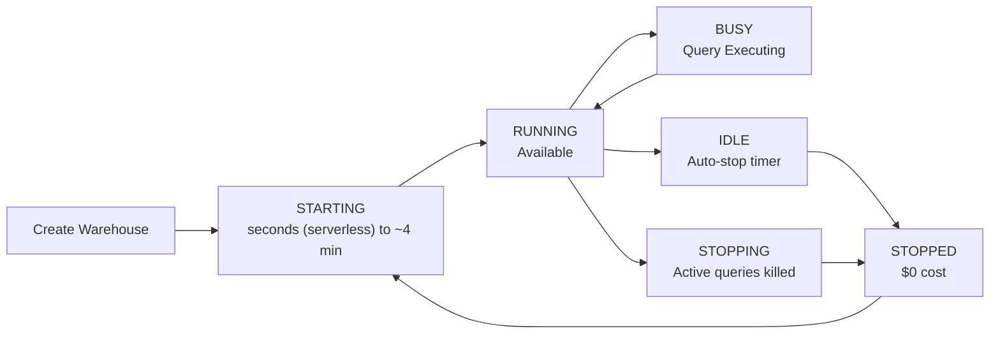

# SQL Warehouses

## Overview

A SQL warehouse (formerly SQL endpoint) is the compute that runs SQL in Databricks SQL. The SQL editor, AI/BI dashboards, alerts, Genie, and BI tools all send their queries to a warehouse, which plans and executes them with Photon against data governed by Unity Catalog. Section 4 of the October 2025 exam guide asks you to "explain the role a SQL Warehouse plays in query execution".

> [!abstract]
>
> - Three types: **serverless**, **pro**, and **classic**
> - Size (workers per cluster) controls query latency; scaling (min/max clusters) controls concurrency
> - Auto stop shuts idle warehouses down: 10 minutes default for serverless, 45 minutes for pro and classic

> [!tip] What the Exam Tests
>
> - What a warehouse does when a query runs, and which features each type has
> - Size vs number of clusters
> - Default auto stop values and start-up times

---

## SQL Warehouse Architecture



## SQL Warehouse Types

Databricks SQL supports **serverless**, **pro**, and **classic** warehouses.

| | Serverless | Pro | Classic |
| :--- | :---: | :---: | :---: |
| Photon | Yes | Yes | Yes |
| Predictive I/O | Yes | Yes | No |
| Intelligent Workload Management (IWM) | Yes | No | No |
| Typical start-up time | 2–6 seconds | About 4 minutes | About 4 minutes |
| Compute runs in | Databricks account | Your cloud account | Your cloud account |

- **Serverless** is the default type in the UI for eligible workspaces and the usual choice for bursty, interactive, and dashboard workloads. Through the API with default parameters, the default is classic.
- **Pro** suits workloads that must run in your own cloud account; it supports features such as Lakehouse Federation that classic does not.
- **Classic** is the most basic type, and it scales less responsively than serverless.
- Lakehouse Federation, Genie, and other newer features need a **pro or serverless** warehouse.

> [!note] Platform update (Oct 2026)
> A fourth, Beta serverless type, **Lakehouse Real-Time (Lakehouse//RT)**, targets low-latency, high-concurrency `SELECT` workloads ([release notes, June 30, 2026](https://docs.databricks.com/aws/en/release-notes/product/2026/june)). It is not on the exam.

## SQL Warehouse Configuration

### Size and Scaling

**Size** sets the number of workers in each cluster. A bigger size lowers the latency of heavy queries. The default size is X-Large.

| Size | Workers (classic and pro) |
| :--- | :---: |
| 2X-Small | 1 |
| X-Small | 2 |
| Small | 4 |
| Medium | 8 |
| Large | 16 |
| X-Large | 32 |
| 2X-Large | 64 |
| 3X-Large | 128 |
| 4X-Large | 256 |
| 5X-Large (Public Preview, pro and serverless) | 512 |

**Scaling** sets the minimum and maximum number of clusters. More clusters let more queries run at once; Databricks recommends about one cluster for every 10 concurrent queries.

- Pro and classic add clusters based on the estimated time to process running and queued queries (for example, 2–6 minutes of load adds one cluster), scale up if a query waits 5 minutes in the queue, and scale down after 15 minutes of low load.
- Serverless uses IWM: it starts a query immediately when capacity exists and provisions clusters quickly when queues grow.
- Every warehouse type queues at most 1,000 queries.

### Auto Stop

| Type | Default | Minimum |
| :--- | :---: | :---: |
| Serverless | 10 minutes | 5 minutes in the UI (1 minute through the API) |
| Pro and classic | 45 minutes | 10 minutes |

The idle timer runs only when no queries are running.

## Cost Model

Warehouses consume DBUs (Databricks Units) while they run; larger sizes and more clusters consume more. Rates depend on the warehouse type, cloud, and contract, so check the [pricing page](https://www.databricks.com/product/pricing/databricks-sql) rather than memorising a number.

### Cost Optimization Strategies

1. **Right-size your warehouse**: Start small, monitor usage, scale gradually
2. **Use auto-scaling**: Let Databricks scale to demand, pay only for what you use
3. **Set auto-stop**: Pause warehouses during off-hours automatically
4. **Share warehouses**: Multiple teams on one warehouse reduces per-team cost
5. **Use result caching**: Repeat queries return cached results instantly

## SQL Warehouse Lifecycle



### State Descriptions

| State | Cost | Action | Duration |
|-------|------|--------|----------|
| **RUNNING** | Yes | Accepting queries | Ongoing |
| **IDLE** | Yes | No queries, countdown to stop | Until auto-stop timeout |
| **STOPPED** | No | No cost, can restart | Indefinite |
| **STARTING** | Limited | Initialization, queries queued | 2–6 seconds (serverless); about 4 minutes (pro, classic) |
| **STOPPING** | No | Graceful shutdown initiated | 1-2 minutes |

## Query Execution & Performance

### Query Processing Pipeline

```text
SQL Query (Text)
    ↓
Parsing (Check syntax)
    ↓
Semantic Analysis (Resolve tables, columns)
    ↓
Logical Planning (Build query tree)
    ↓
Query Optimization (Rewrite for efficiency)
    ↓
Physical Planning (Execute strategy)
    ↓
Execution (Run on distributed cluster)
    ↓
Results (Return to client)
```

### Query Timeout and Concurrency

```sql
-- Set query timeout (5 minutes)
SET STATEMENT_TIMEOUT = 300;  -- seconds

-- Check active queries
SELECT * FROM system.query.history
WHERE start_time > CURRENT_TIMESTAMP - INTERVAL 1 HOUR
ORDER BY start_time DESC;
```

## Result Caching

| Cache | Where | Lifetime |
| :--- | :--- | :--- |
| Local result cache | In memory, per cluster | Cluster lifetime, up to 24 hours per entry; cleared on stop |
| Remote result cache | Serverless only, shared by all warehouses in the workspace | 24 hours; survives restarts |
| Disk cache | Local SSDs, data read from storage | Like the local cache |

Result caches are invalidated when the underlying tables are updated. See [Photon & Query Performance](../03-analyzing-queries/01-photon-and-query-performance.md) for details and for `SET use_cached_result = false`.

## SQL Warehouse Monitoring

### Key Metrics to Track

| Metric | What It Measures | Healthy Range | Action If High |
|--------|------------------|---------------|-----------------|
| **Query Latency** | Time from submission to completion | < 30s for dashboards | Check the query profile |
| **Concurrency** | Queries running simultaneously | About 10 per cluster | Raise the maximum number of clusters |
| **Queue Wait Time** | Time query waits before execution | < 5 seconds | Add warehouse capacity |
| **Warehouse Utilization** | % time warehouse is busy | 60-80% | Right-size or consolidate |
| **Cache Hit Rate** | % of queries using cached results | > 40% for dashboards | Optimize caching strategy |

### Monitoring via Databricks UI

```sql
-- Query performance history
SELECT
    statement_id,
    executed_by,
    statement_text,
    total_duration_ms,
    produced_rows,
    start_time
FROM system.query.history
WHERE compute.warehouse_id = 'abc123'
ORDER BY start_time DESC
LIMIT 100;
```

## SQL Warehouse Best Practices

### **Right-sizing for Your Workload**

```sql
-- Start with Small warehouse for analytics
-- Monitor query performance and scale up as needed
-- Use Small → Medium → Large progression
```

### **Query Optimization**

```sql
-- ❌ Inefficient - full table scan
SELECT * FROM large_table WHERE col IS NOT NULL;

-- ✅ Efficient - column projection and predicate pushdown
SELECT id, name, amount
FROM large_table
WHERE status = 'active' AND date >= '2024-01-01';
```

### **Use Appropriate Data Types**

```sql
-- ❌ Storage waste - string instead of integer
CREATE TABLE users (id STRING, name STRING, age STRING);

-- ✅ Appropriate types
CREATE TABLE users (id INT, name STRING, age INT);
```

### **Cluster Large Tables**

```sql
-- Liquid clustering replaces partitioning and ZORDER for new tables
CREATE TABLE sales (
    id INT,
    amount DECIMAL(10,2),
    sale_date DATE
)
CLUSTER BY (sale_date);

SELECT SUM(amount)
FROM sales
WHERE sale_date >= '2024-01-01';  -- files outside the range are skipped
```

See [Delta History & Liquid Clustering](../03-analyzing-queries/02-delta-history-and-liquid-clustering.md).

### **Schedule Peak Workloads**

- Run heavy analytical jobs during off-peak hours
- Dashboard refreshes during business hours (smaller warehouse)
- Batch jobs overnight (larger warehouse, cost-optimized)

### **Use Multiple Warehouses**

```yaml
# Example warehouse strategy

dashboards:
  size: Small
  purpose: Interactive dashboards
  cost: Low

batch_jobs:
  size: Large
  purpose: Heavy analytical processing
  cost: Higher but time-limited

testing:
  size: 2X-Small
  purpose: Development and testing
  cost: Minimal
```

## Use Cases

- **Large Scale Transformations**: Leveraging Spark SQL distributed execution semantics to transform multi-terabyte datasets efficiently.
- **Cost Management**: Right-sizing SQL warehouses and configuring auto-stop to control DBU spend while maintaining query performance for dashboards and ad-hoc analysis.

## Common Issues & Errors

### OOM Errors

**Scenario:** Data skew causes an executor to run out of memory.
**Fix:** Use Adaptive Query Execution (AQE) and review joining logic.

### Query Timeout on Large Datasets

**Scenario:** Queries on large, unclustered tables time out on small SQL warehouses.
**Fix:** Scale up the warehouse size or add `WHERE` filters to reduce data scanned. Use `EXPLAIN` to check scan size before running.

## Exam Tips

- Know the three warehouse types and their features: IWM is serverless-only; Predictive I/O is pro and serverless; Photon is everywhere
- Size = latency of each query; max clusters = concurrency
- Auto stop defaults: 10 minutes serverless, 45 minutes pro and classic
- Result caches last up to 24 hours and are invalidated when tables change
- Scaling mid-query does not affect running queries; only new queries use the scaled size

## Key Takeaways

- **Role**: the warehouse is the compute that plans and runs every Databricks SQL query, with Photon
- **Three types**: serverless (UI default), pro, classic
- **Start-up**: 2–6 seconds serverless; about 4 minutes pro and classic
- **Size vs scaling**: workers per cluster vs number of clusters (about one per 10 concurrent queries)
- **Auto stop**: 10 minutes (serverless) / 45 minutes (pro, classic) by default
- **Monitoring**: query history and `system.query.history`

## Related Topics

- [SQL Essentials](../../../shared/fundamentals/sql-essentials.md) - Core SQL concepts for Databricks
- [Spark Fundamentals](../../../shared/fundamentals/spark-fundamentals.md) - Understanding the compute engine behind SQL warehouses
- [Performance Optimization Cheat Sheet](../../../shared/cheat-sheets/performance-optimization.md) - Quick reference for tuning queries

## Official Documentation

- [SQL warehouse types](https://docs.databricks.com/aws/en/compute/sql-warehouse/warehouse-types)
- [Create a SQL warehouse](https://docs.databricks.com/aws/en/compute/sql-warehouse/create)
- [SQL warehouse sizing, scaling, and queuing behavior](https://docs.databricks.com/aws/en/compute/sql-warehouse/warehouse-behavior)

---

**[↑ Back to Section](./README.md) | [Next: Query Editor, Assistant & Execution →](./02-query-editor.md)**
