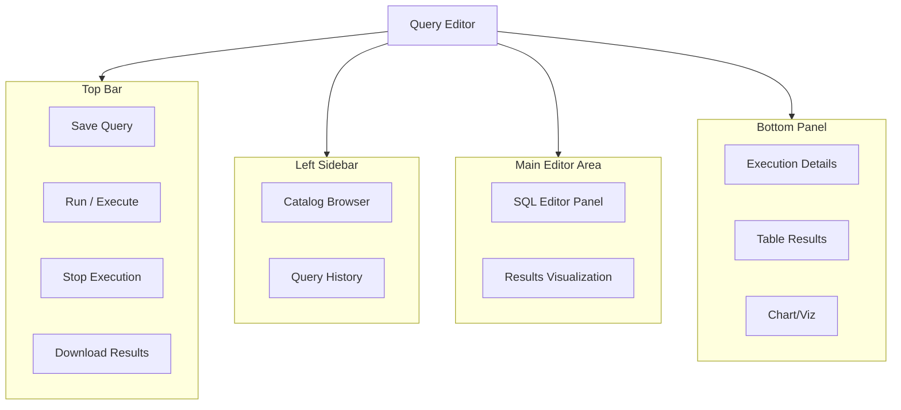
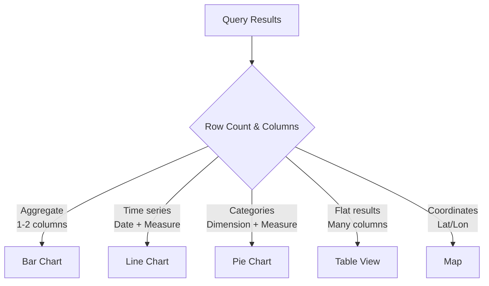

# Query Editor, Assistant & Execution

## Overview

The Databricks SQL Query Editor is a web-based IDE for writing, executing, and visualizing SQL queries. It provides syntax highlighting, autocomplete, result visualization, and performance insights.

> [!abstract]
>
> - The SQL editor: writing, running, saving, and visualizing queries
> - Named parameter markers (`:name`); legacy `{{ }}` only in the legacy editor
> - Databricks Assistant (now Genie Code) for writing and debugging SQL

> [!tip] What the Exam Tests
>
> - Which assistant command explains a query (`/explain`) and which fixes an error (`/fix`)
> - Current parameter syntax vs legacy mustache syntax
> - Where query history lives and how to open a query profile

---

## Query Editor Interface



## Writing Queries

### Editor Features

**Syntax Highlighting**: Automatic color-coding for SQL keywords

```sql
SELECT      -- Blue (keyword)
    id,     -- White (identifier)
    name,   -- White (identifier)
    100     -- Green (number)
FROM users;
```

**Autocomplete**: Type Ctrl+Space for suggestions

```sql
SELECT * FROM sales WHERE [Ctrl+Space]
-- Suggests: date_created, status, amount, customer_id, etc.
```

**Query Templates**: Pre-built patterns for common tasks

### Multi-statement Editor

Execute multiple SQL statements in sequence:

```sql
-- Statement 1: Create a temporary view
CREATE TEMPORARY VIEW active_users AS
SELECT * FROM users WHERE status = 'active';

-- Statement 2: Query the view
SELECT COUNT(*) as active_count FROM active_users;

-- Statement 3: Clean up (optional)
DROP VIEW active_users;
```

### Comments

```sql
-- Single-line comment
/*
   Multi-line comment
   Can span multiple lines
   Useful for documentation
*/

SELECT
    id,           -- Customer ID
    name,         -- Full name
    email         /* Email address
                     Primary contact */
FROM customers;
```

## Query Execution

### Running Queries

1. **Execute Full Query**: Ctrl+Enter or Cmd+Enter
2. **Execute Selected Text**: Select code block + Ctrl+Enter
3. **Execute Line**: Cursor on line + Ctrl+Enter
4. **Stop Execution**: Click Stop button or Ctrl+Alt+C

### Execution Flow

```text
User submits query
    ↓
Query sent to warehouse
    ↓
Parser checks syntax
    ↓
Optimizer creates execution plan
    ↓
Executor runs on cluster
    ↓
Results collected
    ↓
Display in UI / Cache
```

### Execution Information

```sql
-- View query execution details
SELECT * FROM system.query.history
WHERE statement_id = 'abc123'
LIMIT 1;

-- Returns columns such as executed_by, compute.warehouse_id, total_duration_ms,
--          produced_rows, start_time, end_time
```

## Parameters in Queries

### Named parameter markers (current syntax)

Type a colon followed by a name to add a parameter. A widget appears above the results; use its gear icon to set the type (String, Integer, Decimal, Date, or Timestamp).

```sql
SELECT *
FROM sales
WHERE region = :region             -- String: Databricks adds the quotes
  AND order_date >= :start_date;   -- Date
```

| Need | Pattern |
| :--- | :--- |
| Date range | Date or Timestamp type with a Range widget: `BETWEEN :date_range.min AND :date_range.max` |
| Column name as a parameter | `IDENTIFIER(:column_name)` |
| Several values | Pass a comma-separated string and use `array_contains(TRANSFORM(SPLIT(:list, ','), s -> TRIM(s)), col)` |

> [!note] Legacy syntax
> Double-curly-brace **mustache** parameters (`'{{ region }}'`) work only in the **legacy** SQL editor. Databricks recommends named parameter markers for new queries, and a mustache query copied into a notebook, an AI/BI dashboard dataset, or a Genie Agent must be converted before it will run. In the conversion, the quotes go away: `'{{date_param}}'` becomes `:date_param`.

Dashboard parameters, filters, and testing are covered in [Dashboard and Query Parameters](../02-creating-dashboards-and-visualizations/05-parameters.md).

## Databricks Assistant (Genie Code)

> [!note] Platform update (Oct 2026)
> The exam guide says **Databricks Assistant**. Databricks renamed it **Genie Code** on March 11, 2026 ([release notes](https://docs.databricks.com/aws/en/release-notes/product/2026/march)). The slash commands below work under either name.

The assistant is available in notebooks, the SQL editor, and the file editor. Use it to write, explain, and debug queries.

| Command / action | What it does |
| :--- | :--- |
| `/explain` | Explains the code in a cell or query, step by step |
| `/fix` | Proposes fixes for code errors in a diff view |
| **Diagnose error** | Button on a failed cell; runs `/fix` automatically |
| **Quick Fix** | Suggests a one-line fix for simple errors ("Accept and run") |
| `/optimize` | Suggests performance improvements for SQL queries |
| `/doc` | Adds comments to code |
| `/prettify` | Formats SQL for readability |
| `/findTables`, `/findQueries` | Finds relevant tables or queries using Unity Catalog metadata |

Source: [Get coding help from Genie Code](https://docs.databricks.com/aws/en/notebooks/code-assistant) (checked 2026-10-26).

## Result Visualization

### Auto-generated Visualizations

Databricks automatically suggests visualizations based on result shape:



### Chart Configuration

```yaml
Table Results Tab:
  Display: Raw SQL results in table format
  Sorting: Click column headers
  Filtering: Built-in quick filters
  Export: Download as CSV/JSON

Visualization Tab:
  Chart Type: Bar, Line, Area, Pie, etc.
  Aggregation: Automatic or manual
  Grouping: X-axis, Y-axis
  Formatting: Colors, labels, legend
```

### Customizing Visualizations

```sql
-- Pie chart: category distribution
SELECT category, COUNT(*) as count
FROM products
GROUP BY category;

-- Line chart: trend over time
SELECT
    DATE_TRUNC('day', created_at) as day,
    COUNT(*) as daily_count
FROM transactions
GROUP BY DATE_TRUNC('day', created_at)
ORDER BY day;

-- Scatter plot: correlation analysis
SELECT
    age,
    income,
    purchase_amount
FROM customers;
```

## Saving and Sharing Queries

### Save Query

```text
File → Save Query
Name: "Q1 Sales Analysis by Region"
Folder: /Queries/Analytics/
```

### Query Metadata

```text
Query Name: Q1 Sales Analysis by Region
Description: Analyzes regional sales performance YoY
Last Modified: Feb 20, 2024
Author: analyst@company.com
Warehouse: prod_warehouse
```

### Sharing Queries

```yaml
Access Levels:
  Owner: Full edit/delete access
  Editor: Can modify and run
  Viewer: Can view and run only

Share With:
  - Individual users
  - Groups
  - Teams
  - Everyone (organization-wide)
```

## Query History

### Accessing Query History

Navigation: SQL Editor → History sidebar

```sql
-- Query history stored in system table
SELECT
    statement_id,
    executed_by,
    statement_text,
    statement_type,      -- SELECT, INSERT, UPDATE, etc.
    total_duration_ms,
    produced_rows,
    execution_status,
    error_message,
    compute.warehouse_id,
    start_time,
    end_time
FROM system.query.history
WHERE start_time > CURRENT_TIMESTAMP - INTERVAL 7 DAYS
ORDER BY start_time DESC;
```

### API Access to Query History

```python
# Python: Fetch query history programmatically

from databricks.sql import connect

conn = connect(
    host="dbc-abc123.cloud.databricks.com",
    http_path="/sql/1.0/warehouses/abc123",
    auth_type="pat",
    token="dapi..."
)

cursor = conn.cursor()
cursor.execute("""
SELECT statement_id, statement_text, total_duration_ms
FROM system.query.history
LIMIT 10
""")

for row in cursor.fetchall():
    print(row)
```

## Performance Insights

### Query Metrics

**Execution Time (ms)**: Total time from submission to completion

```text
Parse Time:        5 ms  (syntax checking)
Planning Time:     20 ms (optimization)
Execution Time:    450 ms (actual computation)
Total:             475 ms
```

### Optimization Suggestions

```sql
-- Query plan analysis
EXPLAIN SELECT * FROM sales WHERE status = 'active';

-- Output:
--   Filter [status#1 = 'active']
--   └─ Scan parquet [id#0, status#1, amount#2]
--      PushedFilters: [Status = 'active']
--      Metrics: 150 rows, 2.3 MB
```

### Performance Tips

| Issue | Cause | Solution |
|-------|-------|----------|
| Slow query | Full table scan | Add WHERE clause filter |
| Slow join | Exploding join or missing join key | Check row counts per operator in the query profile |
| OOM error | Too much data in memory | Add LIMIT, partition, sample |
| Timeout | Query too complex | Break into steps, materialize intermediate |

## Notebook vs Query Editor

### Query Editor

- **Best for**: Ad-hoc SQL queries, quick analysis
- **Interface**: Web-based, SQL-focused
- **Results**: Visualizations, charts
- **Sharing**: Shareable query links
- **Collaboration**: Comments on queries

```text
Query Editor
├─ Single file = SQL queries
├─ Auto-visualization
├─ Quick execution
└─ Results management
```

### SQL Notebook

- **Best for**: Complex workflows, documentation
- **Support**: SQL + Python cells
- **Control**: More granular, step-by-step
- **Versioning**: Git integration possible
- **Format**: Supports Markdown cells

```text
SQL Notebook
├─ Multiple cells
├─ SQL + Markdown + Python
├─ Rich documentation
└─ Version history
```

## Keyboard Shortcuts

| Shortcut | Action | Platform |
|----------|--------|----------|
| Ctrl+Enter / Cmd+Enter | Execute query | Common |
| Ctrl+Alt+C | Cancel query | Windows/Linux |
| Cmd+Alt+C | Cancel query | macOS |
| Ctrl+Space | Autocomplete | Common |
| Ctrl+/ | Toggle comment | Common |
| Ctrl+H | Show shortcut help | Common |
| Ctrl+S / Cmd+S | Save query | Common |

## API-based Query Execution

### Python: SqlAlchemy

```python
from sqlalchemy import create_engine, text

engine = create_engine(
    "databricks:///?http_path=/sql/1.0/warehouses/abc123&"
    "catalog=main&schema=analytics"
)

with engine.connect() as conn:
    result = conn.execute(text("""
        SELECT * FROM sales
        WHERE amount > :min_amount
    """), min_amount=1000)

    for row in result:
        print(row)
```

### REST API

```bash
# Execute SQL query via REST API

curl -X POST \
  https://dbc-abc123.cloud.databricks.com/api/2.0/sql/statements \
  -H "Authorization: Bearer dapi..." \
  -d '{
    "warehouse_id": "abc123",
    "statement": "SELECT COUNT(*) FROM sales"
  }'

# Response includes execution_id for polling
# {"statement_id": "xyz789", "state": "RUNNING", ...}

```

## Use Cases

- **Ad-hoc Data Exploration**: Analysts use the query editor to quickly explore datasets, test hypotheses, and prototype queries before embedding them in dashboards.
- **Parameterized Reporting**: Building reusable queries with named parameter markers (`:region`) that non-technical stakeholders can filter without modifying SQL code.
- **Debugging**: Using `/explain` and `/fix` (Diagnose error) from Databricks Assistant, now Genie Code, to understand and repair a failing query.

## Common Issues & Errors

### Query Results Truncated

**Scenario:** Query editor shows partial results for large result sets.
**Fix:** The editor limits displayed rows (default 1000). Use `LIMIT` to control output or export full results to a file.

## Exam Tips

- Parameter syntax is a named marker, `:parameter_name`; `{{ }}` is legacy-editor only
- Databricks Assistant (now Genie Code): `/explain` explains, `/fix` repairs errors, `/optimize` tunes
- Understand that Ctrl+Enter (Cmd+Enter on macOS) executes the full query or selected text
- Result caches keep entries for up to 24 hours and are invalidated when underlying tables change
- Account-wide query history is in the `system.query.history` system table (admins by default)

## Key Takeaways

- **Query Editor**: Web IDE for SQL development with visualization
- **Parameters**: Dynamic queries using named markers (`:parameter_name`)
- **Assistant**: `/explain`, `/fix`, `/optimize` — now called Genie Code
- **Autocomplete**: Suggestions for tables, columns, functions
- **Execution**: Ctrl+Enter runs query, results auto-visualized
- **Query History**: UI per workspace; `system.query.history` for SQL analysis
- **Visualization**: Auto-suggested based on result shape (table, chart, etc.)
- **Sharing**: Queries shareable with fine-grained access controls
- **API**: Programmable via Python SqlAlchemy, REST API, or CLI

## Related Topics

- [SQL Essentials](../../../shared/fundamentals/sql-essentials.md) - Core SQL concepts used in the query editor
- [SQL Functions Cheat Sheet](../../../shared/cheat-sheets/sql-functions.md) - Quick reference for common SQL functions
- [Dashboard and Query Parameters](../02-creating-dashboards-and-visualizations/05-parameters.md) - Deep dive into parameterized queries
- [Photon and Query Performance](../03-analyzing-queries/01-photon-and-query-performance.md) - Query history, query profile, and caching

## Official Documentation

- [Write queries and explore data in the SQL editor](https://docs.databricks.com/aws/en/sql/user/sql-editor/)
- [Work with query parameters](https://docs.databricks.com/aws/en/sql/user/queries/query-parameters)
- [Mustache parameter syntax (legacy)](https://docs.databricks.com/aws/en/sql/user/sql-editor/mustache-parameters)
- [Get coding help from Genie Code](https://docs.databricks.com/aws/en/notebooks/code-assistant)

---

**[← Previous: SQL Warehouses](./01-sql-warehouses.md) | [↑ Back to Section](./README.md) | [Next: Joins & Set Operations →](./03-joins-and-set-operations.md)**
