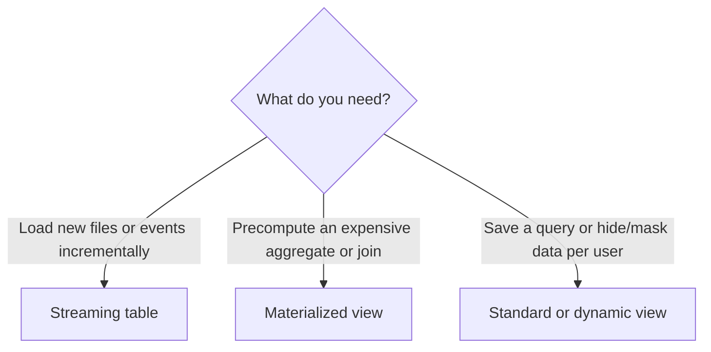

# Materialized Views & Streaming Tables

## Overview

Section 4 of the October 2025 exam guide asks you to "create a materialized view, including knowing when to use Streaming Tables and Materialized Views, and differentiate between dynamic and materialized views". All three objects can be created from a Databricks SQL warehouse.

> [!abstract]
>
> - **Standard view**: stores only a query; runs it on every read
> - **Dynamic view**: a standard view that filters rows or masks columns per user
> - **Materialized view (MV)**: stores query results and refreshes them, incrementally when possible
> - **Streaming table (ST)**: appends only the new rows from an append-only source on each refresh

> [!tip] What the Exam Tests
>
> - Streaming tables for continuously arriving data; materialized views for complex queries over data that changes
> - Refresh options: manual, `SCHEDULE`, `TRIGGER ON UPDATE`
> - A dynamic view computes at read time; a materialized view does not

---

## Choosing the Object



| | Standard / dynamic view | Materialized view | Streaming table |
| :--- | :--- | :--- | :--- |
| Stores data | No | Yes (a Unity Catalog managed table) | Yes (a Unity Catalog table) |
| When computed | Every read | On refresh | On refresh, new rows only |
| Typical source | Any tables | Tables that change (updates, deletes) | Append-only sources: files, Kafka |
| Typical use | Reuse logic, row/column security | Fast dashboards over heavy queries | Ingesting raw files into bronze |

## Materialized Views

```sql
-- Manual refresh
CREATE OR REPLACE MATERIALIZED VIEW main.gold.daily_revenue AS
SELECT order_date, region, SUM(amount) AS revenue   -- aggregate columns need aliases
FROM main.sales.orders
GROUP BY order_date, region;

REFRESH MATERIALIZED VIEW main.gold.daily_revenue;        -- synchronous
REFRESH MATERIALIZED VIEW main.gold.daily_revenue ASYNC;  -- returns immediately

-- Refresh whenever the source table changes
CREATE OR REPLACE MATERIALIZED VIEW main.gold.open_tickets
  TRIGGER ON UPDATE AS
SELECT status, COUNT(*) AS tickets FROM main.support.tickets GROUP BY status;

-- Refresh on a schedule
CREATE OR REPLACE MATERIALIZED VIEW main.gold.revenue_by_region
  SCHEDULE CRON '0 30 3 * * ?' AT TIME ZONE 'UTC' AS
SELECT region, SUM(amount) AS revenue FROM main.sales.orders GROUP BY region;
```

- A refresh merges only the changes when it can (incremental refresh); otherwise it recomputes fully. A cost model chooses by default.
- Creates and refreshes run on a serverless pipeline that Databricks creates for you; the warehouse only coordinates. You can see these pipelines under **Jobs & Pipelines** (pipeline type MV/ST).
- Limitations to remember: no identity columns, and no time travel queries on an MV.

## Streaming Tables

```sql
CREATE OR REFRESH STREAMING TABLE main.bronze.sales_events
  SCHEDULE EVERY 1 hour
AS SELECT * FROM STREAM read_files('/Volumes/main/raw/sales_events/', format => 'json');

REFRESH STREAMING TABLE main.bronze.sales_events;        -- process new data now
REFRESH STREAMING TABLE main.bronze.sales_events FULL;   -- reprocess everything
```

Each refresh evaluates only the rows that arrived since the last update and appends them. `STREAM read_files` uses Auto Loader, so each file is processed once. Avoid `FULL` refreshes on sources such as Kafka that do not keep their history.

## Dynamic Views vs Materialized Views

A **dynamic view** is a view whose query uses functions such as `is_account_group_member()` to decide, per user, which rows or column values to return:

```sql
CREATE VIEW main.hr.employees_v AS
SELECT name,
       department,
       CASE WHEN is_account_group_member('hr_admins') THEN salary ELSE NULL END AS salary
FROM main.hr.employees;
```

Because it runs at read time, every user sees current data filtered for them. A materialized view stores one precomputed result for everyone, so it is the wrong tool for per-user security.

> [!note] Platform update (Oct 2026)
> MVs and STs created outside a pipeline are called **standalone** materialized views and streaming tables in the current docs. Inside a pipeline they belong to **Lakeflow Spark Declarative Pipelines** (the exam guide's "Delta Live Tables"; renamed from Lakeflow Declarative Pipelines on November 12, 2025 — [release notes](https://docs.databricks.com/aws/en/release-notes/product/2025/november)). The SQL is the same.

## Use Cases

- **Fast dashboards**: An MV with a nightly schedule backs a dashboard that used to aggregate a large fact table on every load.
- **File ingestion**: An ST with `STREAM read_files` loads new JSON files from a volume every hour.
- **Per-user access**: A dynamic view shows salaries only to HR admins.

## Common Issues & Errors

### MV create fails on an aggregate

**Scenario:** `CREATE MATERIALIZED VIEW ... AS SELECT region, SUM(amount) FROM ...` fails.
**Fix:** Give aggregate and expression columns an alias (`SUM(amount) AS revenue`).

### Streaming table reloads duplicates after a full refresh

**Scenario:** A `FULL` refresh re-reads every file.
**Fix:** Use a normal refresh for incremental loads; use `FULL` only when you really need to rebuild.

## Exam Tips

- Continuously arriving, append-only data → streaming table
- Frequent, complex queries over data that changes → materialized view
- `TRIGGER ON UPDATE` refreshes an MV when its source changes; `SCHEDULE` refreshes on a timetable
- Dynamic view = computed per user at read time; MV = stored result

## Key Takeaways

- **Views** store logic, **MVs** store results, **STs** store appended rows
- MV and ST refreshes run on Databricks-managed serverless pipelines
- `STREAM read_files` gives Auto Loader in SQL

## Related Topics

- [Creating Tables & Delta Time Travel](./06-creating-tables-and-time-travel.md)
- [Data Modeling with Databricks SQL](../09-data-modeling-with-databricks-sql/01-data-modeling-overview.md) - Where views and MVs fit in a model
- [Access Control & Security](../07-securing-data/01-access-control.md) - Row filters, column masks, and dynamic views

## Official Documentation

- [Use standalone materialized views](https://docs.databricks.com/aws/en/views/materialized)
- [Use standalone streaming tables](https://docs.databricks.com/aws/en/tables/streaming)
- [Create a dynamic view](https://docs.databricks.com/aws/en/views/dynamic)

---

**[← Previous: Creating Tables & Delta Time Travel](./06-creating-tables-and-time-travel.md) | [↑ Back to Section](./README.md) | [Next: Federated Queries →](./08-federated-queries.md)**
