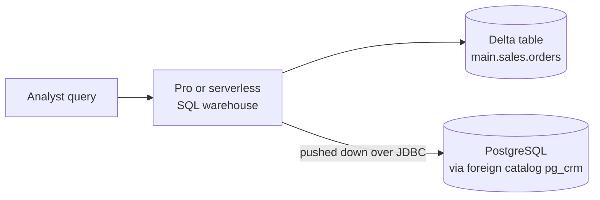

# Federated Queries (Lakehouse Federation)

## Overview

Section 4 of the October 2025 exam guide asks you to query "cross-system analytics by joining data from a Delta table and a federated data source". Lakehouse Federation gives governed, **read-only** access to external databases through Unity Catalog **foreign catalogs**, so you can join their tables to Delta tables without copying data.

> [!abstract]
>
> - A **connection** stores how to reach the external system; a **foreign catalog** exposes its tables in Unity Catalog
> - Query federation pushes queries down to the source over JDBC
> - Foreign tables are read-only and use the normal three-level names

> [!tip] What the Exam Tests
>
> - The steps: connection → foreign catalog → grants → query
> - Joining a foreign table to a Delta table in one query
> - Compute requirements: pro or serverless SQL warehouse

---

## How It Works



1. Create a **connection** in Unity Catalog with the access credentials and JDBC URL (needs metastore admin or `CREATE CONNECTION`).
2. Create a **foreign catalog** from the connection (needs `CREATE CATALOG` on the metastore and ownership of, or `CREATE FOREIGN CATALOG` on, the connection).
3. **Grant** privileges on the foreign catalog's tables, as for any catalog.
4. **Query** with three-level names. Filters are pushed down to the source database.

```sql
-- Steps 1-2 (usually done by an admin)
CREATE CONNECTION pg_conn TYPE postgresql
OPTIONS (host 'pg.example.com', port '5432', user secret('crm', 'user'), password secret('crm', 'pwd'));

CREATE FOREIGN CATALOG pg_crm USING CONNECTION pg_conn OPTIONS (database 'crm');

-- Step 4: join a federated table with a Delta table
SELECT c.segment,
       SUM(o.amount) AS revenue
FROM main.sales.orders AS o              -- Delta table in Unity Catalog
JOIN pg_crm.public.customers AS c        -- table in PostgreSQL, not copied
  ON o.customer_id = c.customer_id
WHERE o.order_date >= '2026-01-01'
GROUP BY c.segment;
```

## Requirements and Limits

| Item | Requirement |
| :--- | :--- |
| Workspace | Unity Catalog enabled |
| SQL warehouse | **Pro or serverless**, version 2023.40 or above (classic is not supported) |
| Clusters | Databricks Runtime 13.3 LTS or above, standard or dedicated access mode |
| Writes | Not supported — foreign catalogs are read-only |

Query federation sources include MySQL, PostgreSQL, Teradata, Oracle, Amazon Redshift, Salesforce Data 360, Snowflake, Microsoft SQL Server, Azure Synapse, Google BigQuery, and Databricks. **Catalog federation** is a second mode that reads foreign tables directly in object storage (for example from a Hive metastore or AWS Glue).

## Federation vs Other Options

| Need | Use |
| :--- | :--- |
| Query an operational database in place, ad hoc | Lakehouse Federation |
| Load data into Delta for heavy, repeated analytics | Ingestion (`COPY INTO`, Auto Loader, Lakeflow Connect) |
| Receive data another organization shares | Delta Sharing (now OpenSharing) |

## Use Cases

- **Ad hoc enrichment**: Joining CRM segments in PostgreSQL to Delta order history for a one-off analysis.
- **Proof of concept**: Exploring an operational database before deciding what to ingest.

## Common Issues & Errors

### Federated query fails on one warehouse

**Scenario:** A query on a foreign catalog works on one warehouse and fails on another.
**Fix:** Use a pro or serverless SQL warehouse; classic warehouses do not support Lakehouse Federation.

### Insert into a foreign table fails

**Scenario:** `INSERT INTO pg_crm.public.customers ...` returns an error.
**Fix:** Foreign catalogs are read-only. Write to the source system directly, or ingest the data into Delta.

## Exam Tips

- "Join without copying data" + external database → Lakehouse Federation
- Connection → foreign catalog → grant → query
- Pro or serverless warehouse only; read-only

## Key Takeaways

- Federation exposes external tables as `catalog.schema.table` in Unity Catalog
- Queries are pushed down to the source, so data stays where it is
- Unity Catalog grants and lineage apply to foreign catalogs too

## Related Topics

- [Joins & Set Operations](./03-joins-and-set-operations.md)
- [Importing Data](../08-importing-data/01-importing-data-overview.md) - When to ingest instead of federate
- [Lakehouse Federation (DE Pro)](../../data-engineer-professional/02-data-ingestion-and-acquisition/08-lakehouse-federation.md) - Deeper engineering view

## Official Documentation

- [What is Lakehouse Federation?](https://docs.databricks.com/aws/en/query-federation/)
- [Run federated queries on PostgreSQL](https://docs.databricks.com/aws/en/query-federation/postgresql)

---

**[← Previous: Materialized Views & Streaming Tables](./07-materialized-views-and-streaming-tables.md) | [↑ Back to Section](./README.md)**
