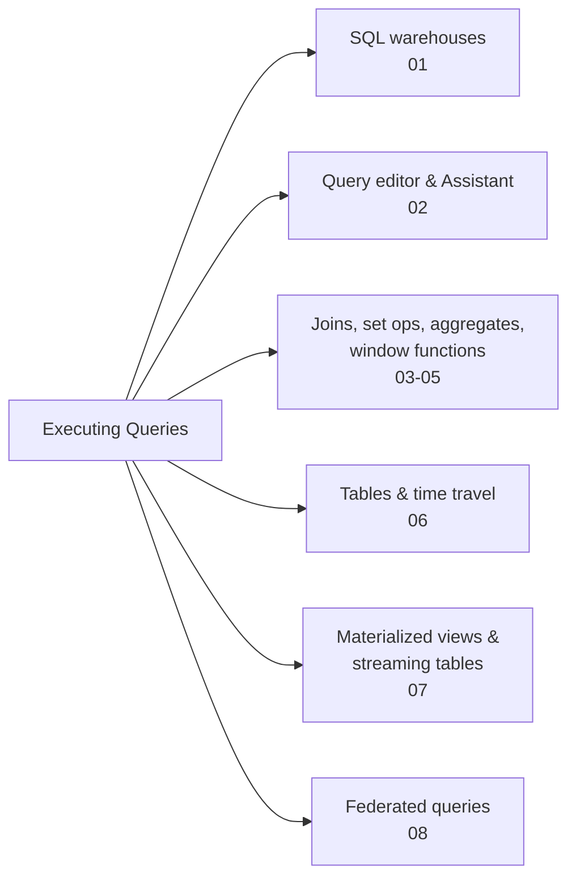

# Executing Queries Using Databricks SQL and Warehouses (20 % of Exam)

The largest domain in the October 2025 blueprint (Section 4 in the PDF). It covers the SQL warehouse that runs every query, the SQL editor and Databricks Assistant, the SQL you write (joins, set operations, aggregates, sorting, filtering), creating tables and views, time travel, and federated queries.

## Topics Overview

## Section Contents

| File | Topic | Priority |
| :--- | :--- | :--- |
| [01-sql-warehouses.md](./01-sql-warehouses.md) | Role of a SQL warehouse; serverless vs pro vs classic; size, scaling, auto stop | High |
| [02-query-editor.md](./02-query-editor.md) | SQL editor, named parameters, Databricks Assistant (now Genie Code), query history | High |
| [03-joins-and-set-operations.md](./03-joins-and-set-operations.md) | Join types, composite keys, `UNION` / `UNION ALL` / `INTERSECT` / `EXCEPT` | High |
| [04-aggregations-grouping.md](./04-aggregations-grouping.md) | `COUNT`, `AVG`, `approx_count_distinct`, summary statistics, `GROUP BY`, sorting and filtering | High |
| [05-window-functions.md](./05-window-functions.md) | Ranking, `LAG`/`LEAD`, running totals, `QUALIFY` | Medium |
| [06-creating-tables-and-time-travel.md](./06-creating-tables-and-time-travel.md) | Managed and external tables, CTAS with `read_files`, `CREATE OR REPLACE`, time travel | High |
| [07-materialized-views-and-streaming-tables.md](./07-materialized-views-and-streaming-tables.md) | Materialized views vs streaming tables vs dynamic views | High |
| [08-federated-queries.md](./08-federated-queries.md) | Lakehouse Federation: joining a Delta table with an external database | Medium |

## Exam Guide Coverage

| Exam-guide skill (Section 4) | Where it is covered |
| :--- | :--- |
| Utilize Databricks Assistant within a Notebook or SQL Editor to facilitate query writing and debugging | [02 — Query editor](./02-query-editor.md) |
| Explain the role a SQL Warehouse plays in query execution | [01 — SQL warehouses](./01-sql-warehouses.md) |
| Querying cross-system analytics by joining data from a Delta table and a federated data source | [08 — Federated queries](./08-federated-queries.md) |
| Create a materialized view, including knowing when to use Streaming Tables and Materialized Views, and differentiate between dynamic and materialized views | [07 — MVs & streaming tables](./07-materialized-views-and-streaming-tables.md) |
| Perform aggregate operations such as count, approximate count distinct, mean, and summary statistics | [04 — Aggregations](./04-aggregations-grouping.md) |
| Write queries to combine tables using various join operations ... as well as set operations like union and union all | [03 — Joins & set operations](./03-joins-and-set-operations.md) |
| Perform sorting and filtering operations on a table | [04 — Aggregations, sorting & filtering](./04-aggregations-grouping.md) · [05 — Window functions](./05-window-functions.md) |
| Create managed tables and external tables, including creating tables by joining data from multiple sources (e.g., CSV, Parquet, Delta tables) | [06 — Creating tables](./06-creating-tables-and-time-travel.md) · [Tables & Schemas](../06-managing-data/01-tables-schemas.md) |
| Use Delta Lake's time travel to access and query historical data versions | [06 — Time travel](./06-creating-tables-and-time-travel.md) |

> [!note]
> Window functions are not named in the exam guide. They are kept here because they support the sorting, filtering, and "fix a query" skills.

## Key Concepts

| Concept | Why it matters |
| :--- | :--- |
| **SQL warehouse** | The compute behind the SQL editor, dashboards, alerts, Genie, and BI tools; runs Photon |
| **Serverless vs pro vs classic** | Serverless starts in seconds and has IWM; pro and classic take about 4 minutes; federation needs pro or serverless |
| **Size vs scaling** | Size = workers per cluster (latency); max clusters = concurrency |
| **Databricks Assistant (Genie Code)** | `/explain`, `/fix`, `/optimize` help write and debug SQL |
| **`UNION` vs `UNION ALL`** | `UNION` removes duplicates; `UNION ALL` keeps them |
| **`approx_count_distinct`** | Fast HyperLogLog++ estimate of distinct values |
| **`CREATE OR REPLACE TABLE`** | Keeps history and grants; `DROP` + `CREATE` loses them |
| **Materialized view vs streaming table** | MV precomputes a query; ST appends new rows from an append-only source |
| **Time travel** | `VERSION AS OF` / `TIMESTAMP AS OF`; limited by `VACUUM` |

## Related Resources

- [Databricks SQL documentation](https://docs.databricks.com/aws/en/sql/)
- [SQL functions cheat sheet (shared)](../../../shared/cheat-sheets/sql-functions.md)
- [Window functions code examples (shared)](../../../shared/code-examples/sql/window_functions.md)
- [Practice questions — Executing Queries](../resources/practice-questions/01-executing-queries.md)

---

**[↑ Back to Data Analyst Associate](../README.md) | [Next: Creating Dashboards and Visualizations →](../02-creating-dashboards-and-visualizations/README.md)** *(first domain — no previous)*
