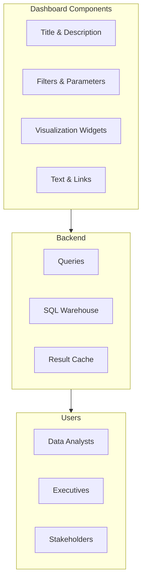
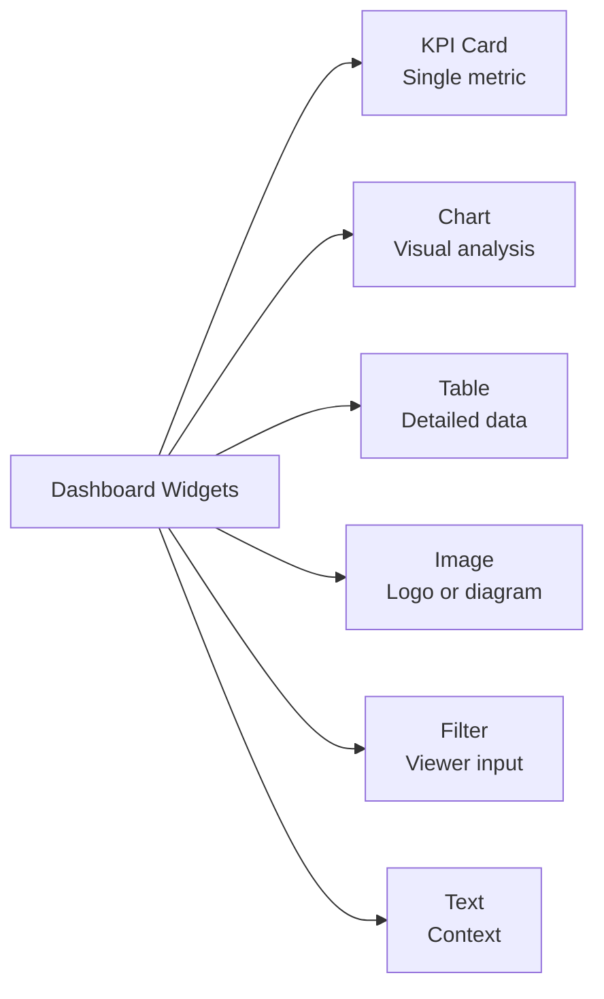

# AI/BI Dashboards & Dashboard Design

## Overview

Dashboards are interactive collections of visualizations that communicate data insights. In Databricks the current product is **AI/BI dashboards** (previously called Lakeview dashboards). Section 6 of the October 2025 exam guide asks you to "build dashboards using AI/BI Dashboards, including multi-tabs/page layouts, multiple data sources/datasets, and widgets (visualizations, text, images)".

> [!abstract]
>
> - A dashboard has a **Data** tab (datasets) and a **canvas** with one or more **pages**
> - Widgets: visualizations, filters, text, and images
> - Drafts are edited; **published** versions are shared with shared or individual data permissions

> [!tip] What the Exam Tests
>
> - Adding pages and multiple datasets to one dashboard
> - Which widget fits which need (counter, table, chart, text, image, filter)
> - Scheduling refreshes and subscriptions

> [!note] Legacy dashboards
> Legacy Databricks SQL dashboards are no longer supported: you can no longer create them, and Databricks recommends AI/BI dashboards ([legacy dashboards page](https://docs.databricks.com/aws/en/sql/user/dashboards/)).

---

## AI/BI Dashboard Anatomy

| Part | What it is |
| :--- | :--- |
| **Data tab** | Defines the dashboard's **datasets** — from tables, views, or custom SQL queries. A dashboard can have many datasets, and datasets travel with the dashboard when it is shared, imported, or exported. |
| **Pages** | New dashboards start with one page ("Untitled page"); add more with the plus icon beside the page title. Hidden pages stay visible to authors in the draft and are excluded when you publish. |
| **Widgets** | Visualizations, filters, text, and images placed on a page. Each visualization reads from one dataset. |
| **Filters and parameters** | Global, page-level, and widget-level filters; parameters (`:name`) change the dataset query itself — see [Parameters](./05-parameters.md). |
| **Draft vs published** | Authors edit the draft; viewers see the published version. |
| **Genie** | A Genie Agent can be published with a dashboard for natural-language exploration. |

Sources: [AI/BI dashboards](https://docs.databricks.com/aws/en/dashboards/), [Author dashboards](https://docs.databricks.com/aws/en/dashboards/manage/) (checked 2026-10-26).

## Dashboard Architecture



## Creating Dashboards

### Dashboard Basic Setup

```yaml
Create Dashboard:
  Name: "Sales Performance Dashboard"
  Description: "Weekly sales metrics and trends"
  Permissions:
    Owner: analyst_team@company.com
    Viewers: everyone@company.com

Dashboard Settings:
  Refresh Schedule: Every 8 hours
  Timezone: America/New_York
  Layout: Grid (auto-resizing)
  Color Theme: Light/Dark
```

### Dashboard Navigation

**UI Structure:**

```text
[Dashboard Name]
├─ Filters/Parameters (top bar)
├─ Title & Description
├─ Row 1: KPI Cards
├─ Row 2: Charts & Trends
├─ Row 3: Detailed Metrics
└─ Row 4: Drill-down Tables
```

## Dashboard Widgets

### Widget Types



### KPI Card Widget

```sql
-- Query for KPI card (single number)
SELECT COUNT(*) as total_orders
FROM orders
WHERE order_date >= CURRENT_DATE - 30;

-- Output: 1,245
```

**Widget Configuration:**

```yaml
Type: Scalar (Number)
Format: 1,234 (with thousand separator)
Font Size: Large (for prominence)
Color: Green/Red based on threshold
Icon: Up arrow (for trend)
Comparison: "↑ 15% vs last month"
```

### Time Series Chart

```sql
-- Daily revenue trend
SELECT
    DATE_TRUNC('day', order_date) as day,
    SUM(amount) as revenue,
    COUNT(*) as order_count
FROM orders
WHERE order_date >= CURRENT_DATE - 90
GROUP BY DATE_TRUNC('day', order_date)
ORDER BY day;
```

**Visualization Configuration:**

```yaml
Type: Line Chart
X-axis: day (time)
Y-axis: revenue (quantity)
Series: Multiple lines (order_count on secondary Y)
Zoom: Enable
Legend: Display
Colors: Brand colors (blue #0066CC)
Tooltip: Show on hover
```

### Category Comparison (Bar Chart)

```sql
-- Revenue by region
SELECT
    region,
    SUM(amount) as revenue,
    COUNT(DISTINCT customer_id) as customers
FROM orders
GROUP BY region
ORDER BY revenue DESC;
```

**Visualization Configuration:**

```yaml
Type: Bar Chart
X-axis: region (categories)
Y-axis: revenue (quantity)
Sort: Descending by revenue
Colors: Sequential gradient
Drill-down: Click region for detailed view
Show Values: On bars
```

### Progress Against a Target

AI/BI dashboards have no gauge visualization. Show progress with a **counter** (which can compare a value against an offset value) or a bar chart of actual vs target.

```sql
SELECT
    SUM(amount) AS actual,
    500000 AS target,
    ROUND(SUM(amount) * 100.0 / 500000, 1) AS pct_of_target
FROM orders
WHERE order_date >= CURRENT_DATE - 30;
```

## Dashboard Layout & Design

### Grid System

```text
Dashboard 12-column grid:
┌─ ─ ─ ─ ─ ─ ─ ─ ─ ─ ─ ─┐
│ KPI  │ KPI  │ KPI  │KPI │  (Row 1: 3 cols each)
├─ ─ ─ ─ ─ ─ ─ ─ ─ ─ ─ ─┤
│            │            │  (Row 2: 6 cols each)
│   Chart 1  │  Chart 2   │
│            │            │
├─ ─ ─ ─ ─ ─ ─ ─ ─ ─ ─ ─┤
│                          │  (Row 3: 12 cols full width)
│        Data Table        │
└─ ─ ─ ─ ─ ─ ─ ─ ─ ─ ─ ─┘
```

### Design Best Practices

**1. Visual Hierarchy**

```text
Dashboard Structure:
├─ 1. Title (prominent, at top)
├─ 2. Key metrics (KPIs first, largest)
├─ 3. Trends (time-series charts)
├─ 4. Details (filtered data, tables)
└─ 5. Context (definitions, links)
```

**2. Color Coding**

```text
Standard Colors:
  Green: Positive, good, exceeds target
  Yellow: Caution, meets target
  Red: Negative, below target
  Blue: Neutral information
  Gray: Disabled/unavailable states
```

**3. Information Density**

```text
❌ Too dense:
├─ 20+ charts on one page
├─ No white space
└─ Hard to scan

✅ Balanced:
├─ 5-8 key visualizations
├─ Clear sections
├─ White space for focus
└─ Easy to scan
```

## Interactivity & Parameters

### Dashboard Filters

```sql
-- Query with multiple parameters
SELECT
    DATE_TRUNC('day', order_date) as day,
    region,
    SUM(amount) as revenue
FROM orders
WHERE order_date BETWEEN :date_range.min AND :date_range.max   -- date range parameter
  AND (region = :selected_region OR :selected_region IS NULL)
GROUP BY DATE_TRUNC('day', order_date), region;
```

**Filter Widget Configuration:**

```yaml
Parameter: date_range
  Type: Date (range)
  Widget: Date range picker

Parameter: selected_region
  Type: Dropdown
  Options: North, South, East, West, All
  Default: All
```

### Drill-down Navigation

```sql
-- Dashboard query (summary level)
SELECT
    region,
    COUNT(*) as orders,
    SUM(amount) as revenue
FROM orders
GROUP BY region;

-- Drill-down query (detail level, triggered by click)
SELECT
    region,
    store_id,
    COUNT(*) as orders,
    SUM(amount) as revenue
FROM orders
WHERE region = :selected_region
GROUP BY region, store_id;
```

**Navigation Configuration:**

```yaml
Dashboard:
  - Regional Summary (click for drill)
    └─ Link to Store Detail Dashboard
         with parameter: region_filter = selected_region
```

## Refresh Strategy

### Scheduled Refresh

Click **Schedule** on the dashboard and set the frequency, start time, and time zone (or use cron syntax). By default the scheduled run uses the dashboard's SQL warehouse; another warehouse can be chosen in the advanced settings. Details: [Alerts & Scheduling](./03-alerts-scheduling.md).

### Query Caching

Dashboard queries benefit from the warehouse result caches, which keep results for up to 24 hours and are invalidated when the underlying tables change.

## Sharing & Collaboration

### Permission Levels

| Level | Can do |
| :--- | :--- |
| CAN VIEW / CAN RUN | View the published dashboard and interact with filters |
| CAN EDIT | Edit the draft, manage subscribers |
| CAN MANAGE | Everything, including permissions |

Users outside the workspace (but in the account) are limited to CAN RUN. Sharing methods, publishing credentials, and embedding are covered in [Sharing & Collaboration](./04-sharing-collaboration.md).

### Subscriptions

Schedules can have up to 100 subscribers. Email subscribers get a PDF snapshot (optionally with CSV, TSV, or Excel attachments). Slack and Microsoft Teams destinations, set up by a workspace admin, get a PNG snapshot, a link, and a PDF.

## Dashboard Performance

### Query Optimization

```sql
-- ❌ Inefficient - full table scan
SELECT * FROM orders;

-- ✅ Optimized - with filters
SELECT
    region,
    SUM(amount)
FROM orders
WHERE order_date >= CURRENT_DATE - 30
GROUP BY region;
```

### Monitoring Refresh Time

```yaml
Dashboard Performance:
  Query runtime: Should be < 5 seconds
  Dashboard load: < 2 seconds

  Optimization:
  - Reduce data range (fewer days)
  - Aggregate pre-computed tables
  - Use LIMIT for large datasets
  - Partition tables by date
```

## Dashboard Naming & Organization

### Naming Convention

```text
Good names:
  "Sales Performance - Weekly"
  "Customer Churn Analysis"
  "Inventory by Location"

Poor names:
  "Dashboard 1"
  "Report123"
  "Sales"
```

### Folder Organization

```text
Dashboards/
├── Sales/
│   ├── Daily Performance
│   ├── Regional Analysis
│   └── Customer Segmentation
├── Finance/
│   ├── Budget vs Actual
│   └── Cash Flow
└── Operations/
    ├── Inventory
    └── Supply Chain
```

## Use Cases

- **Executive KPI Monitoring**: Building a dashboard with KPI cards, trend lines, and regional breakdowns that auto-refreshes for leadership review.
- **Self-service Reporting**: Creating parameterized dashboards that let business users filter by date range, region, or product category without writing SQL.

## Common Issues & Errors

### Dashboard Shows Stale Data

**Scenario:** Dashboard displays yesterday's numbers despite new data being loaded.
**Fix:** Check the refresh schedule. Dashboards do not auto-refresh unless a schedule is configured. Click "Refresh" or set an automatic refresh interval.

## Exam Tips

- One dashboard can have several pages and several datasets; widgets include visualizations, filters, text, and images
- Refresh frequency depends on use case; configure it with **Schedule**
- A shared parameter can filter multiple widgets simultaneously when used in each widget's query
- Editing a shared dashboard updates it for all viewers with access
- Optimize load time by filtering queries (date range), pre-aggregating data, and leveraging result caching

## Key Takeaways

- **Dashboard**: Collection of visualizations with interactivity
- **AI/BI dashboards**: the current product; legacy dashboards are retired
- **Data tab + pages**: many datasets, many pages per dashboard
- **Widgets**: visualizations, filters, text, images
- **Refresh**: Schedule button; subscribers get snapshots
- **Permissions**: CAN VIEW / CAN RUN, CAN EDIT, CAN MANAGE
- **Sharing**: Via email, links, or groups
- **Performance**: Queries should run < 5 seconds
- **Drill-down**: Navigate from summary to detail

## Related Topics

- [Visualizations & Chart Types](./02-visualizations.md) - Choosing the right chart type for dashboard widgets
- [Alerts & Scheduling](./03-alerts-scheduling.md) - Automating dashboard refresh and alert notifications
- [SQL Essentials](../../../shared/fundamentals/sql-essentials.md) - Writing efficient queries for dashboard widgets

## Official Documentation

- [AI/BI dashboards](https://docs.databricks.com/aws/en/dashboards/)
- [Author dashboards](https://docs.databricks.com/aws/en/dashboards/manage/)
- [Schedule dashboards for periodic updates](https://docs.databricks.com/aws/en/dashboards/schedule-subscribe)

---

**[↑ Back to Section](./README.md) | [Next: Visualizations & Chart Types →](./02-visualizations.md)**
