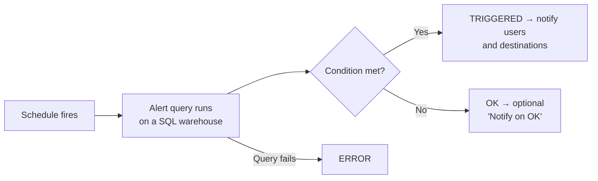

# Alerts & Scheduling

## Overview

Alerts notify people when query results meet a condition; schedules keep dashboards fresh and deliver snapshots. Section 6 of the October 2025 exam guide asks you to "schedule an automatic dashboard refresh" and to "configure an alert with a desired threshold and destination".

> [!abstract]
>
> - A **Databricks SQL alert** = a query + a condition + a schedule + notifications
> - Alert states: **OK**, **TRIGGERED**, **ERROR**
> - A **dashboard schedule** refreshes a dashboard and can send snapshots to subscribers
> - Notification destinations (Slack, Microsoft Teams, webhooks, email lists) are set up by workspace admins

> [!tip] What the Exam Tests
>
> - Building an alert for "notify me when the 15-minute average exceeds X"
> - Choosing a schedule that meets a notification requirement
> - Scheduling a dashboard and subscribing a channel

---

## How an Alert Works



Alerts run their query on a schedule and evaluate the condition each time. They are not evaluated on a continuous stream, so the schedule sets how quickly you hear about a problem.

## Creating an Alert (latest alerts)

1. Open **Alerts** in the sidebar and click **Create Alert**.
2. Write the alert query in the editor, choose a SQL warehouse, and run it.
3. Set the **condition**: a column, the value to check (the first row's value, or an aggregate across rows such as `SUM` or `AVG`), an operator such as `>`, and a threshold (a static value by default). Click **Test condition**.
4. Add **notifications**: users or notification destinations. Optionally turn on **Notify on OK** and choose whether to repeat notifications until the alert returns to OK.
5. Set the **schedule** with the drop-downs or Quartz cron syntax.

```sql
-- Alert query: average sensor temperature over the last 15 minutes
SELECT AVG(temperature_c) AS avg_temp_15m
FROM iot.readings
WHERE reading_ts >= current_timestamp() - INTERVAL 15 MINUTES;
-- Condition: avg_temp_15m (first value)  >  85   →  notify #plant-alerts (Slack destination)
-- Schedule: every 5 minutes
```

- **Templates**: **Customize template** changes the subject and body; the standard editor uses `{{VARIABLE_NAME}}` placeholders such as `ALERT_NAME`, `ALERT_STATUS`, and `QUERY_RESULT_TABLE`. (These template placeholders are not query parameters.)
- **Legacy alerts**: The latest alerts write the query inside the alert, so an existing saved query cannot be reused. Legacy and latest alerts can be used side by side during the transition, and the latest alerts no longer have the legacy `UNKNOWN` state.
- **Jobs**: A **SQL alert task** in Lakeflow Jobs evaluates an alert inside a workflow and lets downstream tasks branch on the result (GA June 29, 2026).

## Notification Destinations

| Destination | Notes |
| :--- | :--- |
| Users (email) | Pick workspace users directly |
| Email distribution lists | Configured by admins as destinations |
| Slack, Microsoft Teams | Configured by workspace admins; used by alerts and dashboard subscriptions |
| Webhook | Receives a JSON payload after a state change |

Only workspace admins can create notification destinations; authors then select them.

## Scheduling a Dashboard

1. Open the dashboard and click **Schedule** (upper right).
2. Set the frequency, start time, and time zone, or enable cron syntax.
3. By default, the scheduled run uses the dashboard's SQL warehouse; choose another one under advanced settings.
4. Add **subscribers**: workspace users, email distribution lists, or Slack and Teams destinations (up to 100 subscribers; a destination counts as one).

| Subscriber type | Receives |
| :--- | :--- |
| Email | PDF snapshot, optional CSV, TSV, or Excel attachments |
| Slack / Microsoft Teams | PNG snapshot in the channel, a link to the dashboard, and a PDF |

Editors need at least CAN EDIT to manage other subscribers; any user with at least CAN VIEW can subscribe themselves.

## Materialized Views for Scheduled Computation

When a dashboard is slow because every load recomputes a heavy query, precompute it in a materialized view with a refresh schedule:

```sql
CREATE OR REPLACE MATERIALIZED VIEW main.gold.daily_sales
  SCHEDULE CRON '0 0 2 * * ?' AT TIME ZONE 'UTC' AS
SELECT DATE_TRUNC('DAY', order_date) AS order_day,
       region,
       COUNT(*)    AS orders,
       SUM(amount) AS revenue
FROM main.sales.orders
GROUP BY ALL;
```

See [Materialized Views & Streaming Tables](../01-executing-queries-databricks-sql-warehouses/07-materialized-views-and-streaming-tables.md).

## Use Cases

- **Equipment protection**: An alert on a 15-minute average temperature, checked every 5 minutes, posts to a Slack destination.
- **Weekly executive pack**: A Monday 8 AM dashboard schedule emails a PDF snapshot to a distribution list.

## Common Issues & Errors

### Alert never notifies

**Scenario:** The data meets the condition, but nobody is notified.
**Fix:** Check that the alert has a schedule, that the condition's column and aggregation match the query result, and that notifications list a user or destination.

### Slack destination missing

**Scenario:** An author cannot find a Slack channel in the alert's notification list.
**Fix:** A workspace admin must create the Slack notification destination first.

## Exam Tips

- Alert = query + condition (value, operator, threshold) + schedule + destination
- Alerts poll on a schedule; pick a frequency shorter than the required notification time
- Dashboards refresh on a **Schedule**; subscribers get snapshots
- Admins create notification destinations; authors select them

## Key Takeaways

- **States**: OK, TRIGGERED, ERROR
- **Condition**: first value or an aggregate (`SUM`, `AVG`, ...) vs a threshold
- **Destinations**: users, email lists, Slack, Teams, webhooks
- **Dashboard schedules**: frequency + time zone + warehouse + subscribers (≤ 100)
- **MVs**: precompute heavy dashboard queries on a schedule

## Related Topics

- [AI/BI Dashboards & Dashboard Design](./01-dashboards.md)
- [Visualizations & Chart Types](./02-visualizations.md)
- [Materialized Views & Streaming Tables](../01-executing-queries-databricks-sql-warehouses/07-materialized-views-and-streaming-tables.md)

## Official Documentation

- [Databricks SQL alerts](https://docs.databricks.com/aws/en/sql/user/alerts/)
- [Create an alert](https://docs.databricks.com/aws/en/sql/user/alerts/create)
- [Schedule dashboards for periodic updates](https://docs.databricks.com/aws/en/dashboards/schedule-subscribe)

---

**[← Previous: Visualizations & Chart Types](./02-visualizations.md) | [↑ Back to Section](./README.md) | [Next: Sharing & Collaboration →](./04-sharing-collaboration.md)**
