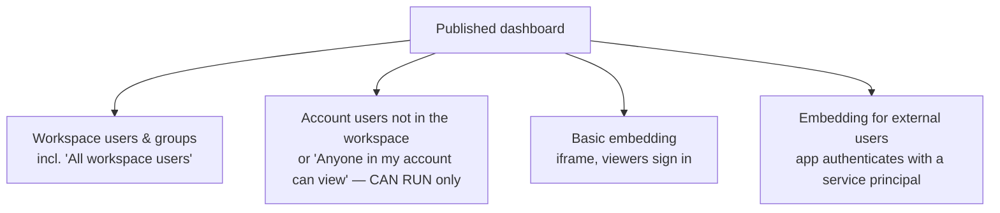

# Sharing & Collaboration

## Overview

Section 6 of the October 2025 exam guide asks you to "configure permissions through the UI to share dashboards with workspace users/groups, external users through shareable links, and embed dashboards in external apps". This file covers dashboard permission levels, publishing credentials, account-level sharing, and the two kinds of embedding.

> [!abstract]
>
> - Dashboard permission levels: CAN VIEW / CAN RUN, CAN EDIT, CAN MANAGE
> - Publishing with **shared data permissions** (publisher's credentials, the default) or **individual data permissions** (viewer's credentials)
> - Share with workspace users and groups, or with **account users** outside the workspace
> - **Basic embedding** (viewers sign in) vs **embedding for external users** (service principal)

> [!tip] What the Exam Tests
>
> - Which option lets people outside the workspace see a dashboard
> - Why row filters "don't work" on a dashboard published with shared permissions
> - Which embedding option works for customers without Databricks accounts

---

## Permission Levels

| Level | Can do |
| :--- | :--- |
| CAN VIEW / CAN RUN | Open the published dashboard, use filters |
| CAN EDIT | Edit the draft, manage subscribers |
| CAN MANAGE | Everything, including permissions |

Workspace admins hold CAN MANAGE on all workspace objects, and creators get CAN MANAGE on what they create. Objects in a folder inherit the folder's permissions. Only workspace admins can transfer dashboard ownership, and ownership grants no special privileges.

## Publishing and Data Permissions

| Publish option | Whose credentials run the queries | Effect |
| :--- | :--- | :--- |
| **Share data permissions** (default) | The publisher's (or a service principal's) | Viewers see what the publisher can see; row filters evaluate the publisher |
| **Individual data permissions** | Each viewer's | Row filters and column masks apply per viewer; viewers need access to the data |

Compute access always comes from the publisher's credentials.

## Sharing Methods

- **Workspace users and groups**: Add them in the **Share** dialog, or use the *All workspace users* group.
- **Account users ("external" to the workspace)**: Share with specific account users, or turn on *Anyone in my account can view*. They sign in with email, a one-time passcode, or SSO and are limited to CAN RUN. Workspace-bound catalogs show no data to them.
- **Shareable link**: Copy the link from the **Share** dialog. Access is still limited to the people you shared with — it is not an anonymous public link.

## Embedding

| | Basic embedding | Embedding for external users |
| :--- | :--- | :--- |
| Viewers | Must sign in with Databricks credentials | No Databricks account needed |
| How | iframe code from the **Share** dialog | Your app authenticates with a service principal and OAuth secret; tokens last one hour |
| Genie | Supported | Not supported |

- Only **published** dashboards can be embedded in external applications.
- Workspace admins must define the **allowed surfaces** for embedding.
- For external users, Databricks recommends individual data permissions with the needed access granted to the service principal.
- If an iframe does not load, check that third-party cookies are enabled.

## Collaboration

- Several authors can work on the same **draft**; viewers see only what is **published**.
- **Schedules and subscriptions** distribute snapshots by email, Slack, or Teams — see [Alerts & Scheduling](./03-alerts-scheduling.md).
- Saved queries use the same ACL model: CAN VIEW, CAN RUN, CAN EDIT, CAN MANAGE.

## Use Cases

- **Partner portal**: Customers without Databricks accounts view an embedded dashboard through a service principal.
- **Regional sales**: A dashboard published with individual data permissions so each rep's row filter applies.
- **Account-wide KPIs**: A published dashboard shared with *Anyone in my account can view*.

## Common Issues & Errors

### Shared dashboard shows "Permission Denied"

**Scenario:** A colleague opens the dashboard link but cannot see data.
**Fix:** Check the dashboard permission (at least CAN VIEW / CAN RUN). If it was published with individual data permissions, the viewer also needs `SELECT` on the tables plus `USE CATALOG` and `USE SCHEMA`.

### Everyone sees every region

**Scenario:** A row filter limits each rep to one region, but the dashboard shows all regions.
**Fix:** The dashboard runs with the publisher's credentials. Republish with individual data permissions.

## Exam Tips

- People in the account but not the workspace → share with account users (CAN RUN)
- No Databricks account → embedding for external users with a service principal
- Basic embedding still requires sign-in
- Shared data permissions (default) = publisher's credentials

## Key Takeaways

- **Levels**: CAN VIEW/RUN, CAN EDIT, CAN MANAGE
- **Publish**: shared vs individual data permissions
- **Reach**: workspace → account users → embedded (basic or external)
- **Admins**: create notification destinations and allowed embedding surfaces

## Related Topics

- [Access Control & Security](../07-securing-data/01-access-control.md) - Unity Catalog privileges, row filters, and column masks
- [AI/BI Dashboards & Dashboard Design](./01-dashboards.md)
- [Genie sharing and distribution](../04-developing-sharing-maintaining-genie-spaces/03-benchmarks-monitoring-and-sharing.md)

## Official Documentation

- [Share a dashboard](https://docs.databricks.com/aws/en/dashboards/share)
- [Embed a dashboard](https://docs.databricks.com/aws/en/dashboards/embed)
- [Access control lists](https://docs.databricks.com/aws/en/security/auth/access-control/)

---

**[← Previous: Alerts & Scheduling](./03-alerts-scheduling.md) | [↑ Back to Section](./README.md) | [Next: Dashboard and Query Parameters →](./05-parameters.md)**
