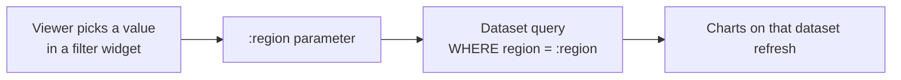

# Dashboard and Query Parameters

## Overview

Parameters let viewers pass values into a query without editing SQL. Section 6 of the October 2025 exam guide asks you to "work with parameters in SQL queries and dashboards, including defining, configuring, and testing parameters". Current Databricks surfaces — the SQL editor, AI/BI dashboards, notebooks, and Genie — use **named parameter markers** (`:name`). The double-curly-brace **mustache** syntax (`{{ name }}`) is legacy.

> [!abstract]
>
> - Named parameter markers: `:region`, `:start_date`, `:date_range.min`
> - Dashboard parameters: String, Date, Date and Time, Numeric; single value, multiple values, and date ranges
> - Test a parameter by typing a value under its name and running the dataset query
> - Field filters vs parameters: Databricks recommends considering filters first

> [!tip] What the Exam Tests
>
> - Recognising current (`:name`) vs legacy (`{{ name }}`) syntax
> - Multi-select (`array_contains`) and date range (`.min` / `.max`) patterns
> - How a parameter reaches the `WHERE` clause of the query behind a chart

---

## Named Parameter Markers

```sql
SELECT order_id, customer_name, amount, order_date
FROM sales.orders
WHERE region = :region                -- String: Databricks adds the quotes
  AND amount >= :min_amount           -- Numeric
  AND order_date >= :start_date;      -- Date
```

- **SQL editor**: type a colon and a name; a widget appears above the results. Set the type with the gear icon: String, Integer, Decimal, Date, or Timestamp. Date and Timestamp can use a Range widget.
- **AI/BI dashboard dataset**: click **Add parameter** or type the marker in the dataset query. Types are String, Date, Date and Time, and Numeric (Decimal or Integer).
- Do **not** wrap a marker in quotes: `WHERE region = :region`, not `'{{ region }}'`.

### Common patterns

```sql
-- Multi-select parameter (Allow multiple selections = on) — passed as an array
WHERE array_contains(:categories, category) OR :categories IS NULL

-- Date range parameter — exposes .min and .max
WHERE l_shipdate BETWEEN :ship_date.min AND :ship_date.max OR :ship_date IS NULL

-- Column name as a parameter
SELECT IDENTIFIER(:metric_column) FROM sales.orders
```

`OR :param IS NULL` handles the "All" selection.

## Parameters in AI/BI Dashboards



1. In the **Data** tab, add the marker to the dataset query (or click **Add parameter**).
2. On the canvas, add a **filter widget** and bind it to the parameter. Parameters can also be set on visualization widgets.
3. Choose single value, multiple values (turn on **Allow multiple selections**), or a date range.
4. **Query-based parameters** let authors offer a static or dynamic list of values for viewers to choose from.

### Testing a parameter

To test the query, type a value into the text field under the parameter name and run it. Running the query also saves that value as the parameter's **default**. Test normal values, an empty or "All" selection, and a value that returns no rows.

### Filters vs parameters

| | Field filter | Parameter |
| :--- | :--- | :--- |
| What it changes | Filters the dataset's results by a field | Changes the query text itself |
| Cascading (region → city) | Supported | Not the recommended tool |
| Large datasets | Often performs better | Re-runs the query |
| Use when | Plain filtering | The value must go inside the SQL (calculations, functions, `IDENTIFIER`) |

Databricks recommends considering field filters first.

## Legacy: Mustache Syntax

> [!warning] Legacy only
> Mustache parameters work **only in the legacy SQL editor**. AI/BI dashboards do not support them, and a mustache query copied into a notebook, a dashboard dataset, or a Genie Agent must be converted to named markers before it runs. Databricks recommends named markers for all new queries.

| Legacy (mustache) | Current (named marker) |
| :--- | :--- |
| `WHERE region = '{{ region }}'` | `WHERE region = :region` |
| `WHERE order_date = '{{ date_param }}'` | `WHERE order_date = :date_param` |
| `WHERE status IN ({{ statuses }})` (multi-select with a quotation option) | `WHERE array_contains(:statuses, status)` |

Legacy widget types were Text, Number, Dropdown List, Query-Based Dropdown List, and Date and Time.

## Use Cases

- **Self-service filtering**: A region selector and date range on a sales dashboard.
- **Metric switcher**: An `IDENTIFIER(:metric_column)` parameter lets viewers choose which measure to chart.
- **Migration**: Converting legacy `{{ }}` queries before moving them into dashboards or Genie.

## Common Issues & Errors

### Query copied from the legacy editor fails

**Scenario:** A query with `'{{ region }}'` errors in a dashboard dataset.
**Fix:** Convert it to `:region` and remove the quotes.

### Multi-select returns nothing

**Scenario:** `WHERE category IN (:categories)` returns no rows with several values selected.
**Fix:** A multi-select parameter is an array. Use `array_contains(:categories, category)`.

## Exam Tips

- Current syntax is `:name`; `{{ name }}` is legacy-editor only
- Multi-select → `array_contains(:param, col)`; date range → `:param.min` / `:param.max`
- Test by typing a value under the parameter name and running; that value becomes the default
- Prefer field filters for plain filtering and cascading

## Key Takeaways

- **Named markers** everywhere: SQL editor, dashboards, notebooks, Genie
- **String values** are quoted for you
- **Filter widgets** pass viewer choices into parameters
- **Legacy mustache** must be converted before use outside the legacy editor

## Related Topics

- [Query Editor, Assistant & Execution](../01-executing-queries-databricks-sql-warehouses/02-query-editor.md) - Parameters in the SQL editor
- [AI/BI Dashboards & Dashboard Design](./01-dashboards.md) - Datasets, pages, and filters
- [Tuning Genie Agents](../04-developing-sharing-maintaining-genie-spaces/02-tuning-genie-spaces.md) - Parameterized example queries in Genie

## Official Documentation

- [Work with query parameters](https://docs.databricks.com/aws/en/sql/user/queries/query-parameters)
- [Work with dashboard parameters](https://docs.databricks.com/aws/en/dashboards/parameters)
- [Mustache parameter syntax (legacy)](https://docs.databricks.com/aws/en/sql/user/sql-editor/mustache-parameters)

---

**[← Previous: Sharing & Collaboration](./04-sharing-collaboration.md) | [↑ Back to Section](./README.md)**
