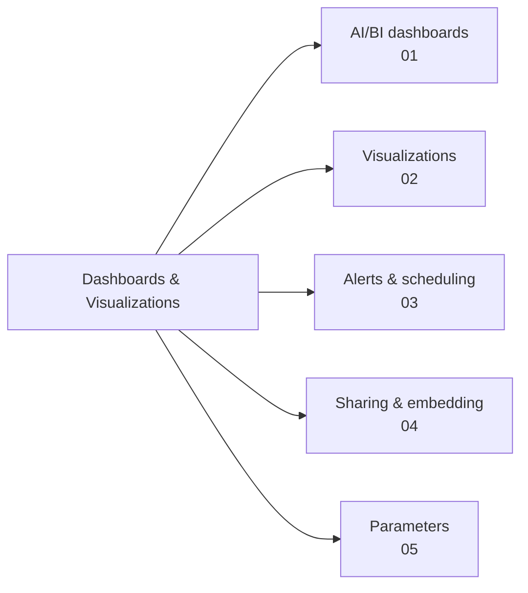

# Creating Dashboards and Visualizations (16 % of Exam)

AI/BI dashboards, visualizations in notebooks and the SQL editor, parameters, sharing and embedding, scheduled refreshes, and alerts. The second-largest domain in the October 2025 blueprint (Section 6 in the PDF, titled "Working with Dashboards and Visualizations in Databricks").

## Topics Overview

## Section Contents

| File | Topic | Priority |
| :--- | :--- | :--- |
| [01-dashboards.md](./01-dashboards.md) | AI/BI dashboard anatomy: Data tab, datasets, pages, widgets, filters | High |
| [02-visualizations.md](./02-visualizations.md) | Creating visualizations in notebooks and the SQL editor; choosing the chart type | High |
| [03-alerts-scheduling.md](./03-alerts-scheduling.md) | SQL alerts (condition, threshold, destination), dashboard schedules and subscriptions | High |
| [04-sharing-collaboration.md](./04-sharing-collaboration.md) | Permission levels, publishing credentials, account users, basic and external embedding | High |
| [05-parameters.md](./05-parameters.md) | Named parameter markers, dashboard parameters, testing, legacy mustache syntax | High |

## Exam Guide Coverage

| Exam-guide skill (Section 6) | Where it is covered |
| :--- | :--- |
| Build dashboards using AI/BI Dashboards, including multi-tabs/page layouts, multiple data sources/datasets, and widgets (visualizations, text, images) | [01 — Dashboards](./01-dashboards.md) |
| Create visualizations in notebooks and the SQL editor | [02 — Visualizations](./02-visualizations.md) |
| Work with parameters in SQL queries and dashboards, including defining, configuring, and testing parameters | [05 — Parameters](./05-parameters.md) · [Query editor](../01-executing-queries-databricks-sql-warehouses/02-query-editor.md) |
| Configure permissions through the UI to share dashboards with workspace users/groups, external users through shareable links, and embed dashboards in external apps | [04 — Sharing & embedding](./04-sharing-collaboration.md) |
| Schedule an automatic dashboard refresh | [03 — Alerts & scheduling](./03-alerts-scheduling.md) |
| Configure an alert with a desired threshold and destination | [03 — Alerts & scheduling](./03-alerts-scheduling.md) |
| Identify the effective visualization type to communicate insights clearly | [02 — Visualizations](./02-visualizations.md) |

## Key Concepts

| Concept | Why it matters |
| :--- | :--- |
| **AI/BI dashboards** | The current dashboarding product (previously Lakeview); legacy dashboards can no longer be created |
| **Dataset vs widget** | Datasets live on the Data tab; widgets (visualizations, filters, text, images) sit on pages |
| **Named parameter markers** | `:name` in dataset queries; `{{ }}` is legacy-editor only |
| **Shared vs individual data permissions** | Whether queries run as the publisher or as each viewer |
| **Embedding** | Basic (viewers sign in) vs external users (service principal) |
| **Schedules and subscriptions** | Refresh on a schedule; send PDF/PNG snapshots to email, Slack, or Teams |
| **SQL alerts** | Query + condition + schedule + notification destination; states OK, TRIGGERED, ERROR |

## Related Resources

- [AI/BI dashboards documentation](https://docs.databricks.com/aws/en/dashboards/)
- [Databricks SQL alerts documentation](https://docs.databricks.com/aws/en/sql/user/alerts/)
- [Practice questions — Dashboards and Visualizations](../resources/practice-questions/02-dashboards-visualizations.md)

---

**[← Previous: Executing Queries](../01-executing-queries-databricks-sql-warehouses/README.md) | [↑ Back to Data Analyst Associate](../README.md) | [Next: Analyzing Queries →](../03-analyzing-queries/README.md)**
