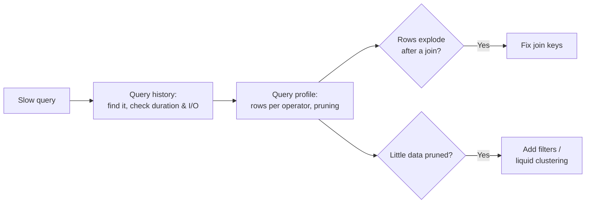

# Photon & Query Performance

## Overview

Section 5 of the October 2025 exam guide asks you to "understand the features, benefits, and supported workloads of Photon", to "identify poorly performing queries ... such as Query Insights, Query Profiler log", and to "utilize query history and caching to reduce development time and query latency". These tools all work on the queries that SQL warehouses and serverless compute run.

> [!abstract]
>
> - **Photon**: the Databricks-native vectorized query engine; the default engine on every SQL warehouse
> - **Query history**: every query with its status, duration, rows, and I/O; filterable; `system.query.history` for SQL
> - **Query profile**: operator-level metrics that expose exploding joins and full scans, plus performance insights
> - **Caches**: local and remote result caches and the disk cache

> [!tip] What the Exam Tests
>
> - What Photon speeds up, what it does not support, and how to tell it ran
> - Where to look for a slow or failed query
> - When a cached result is (and is not) used

---

## Photon

Photon is the Databricks-native vectorized query engine. It runs SQL and DataFrame workloads with no code changes and is **the default engine for all SQL warehouses**.

| Benefit | How |
| :--- | :--- |
| Faster joins and aggregations | Hash joins instead of sort-merge joins; redesigned columnar shuffle |
| Faster scans | Filter pushdown, dictionary pruning, row-group skipping |
| Faster writes | Native Parquet writer for Delta, Iceberg, and Parquet (wide tables benefit most) |
| BI concurrency | Disk cache and efficient execution for many concurrent queries |

**Supported workloads**: SQL analytics and BI, ETL, Lakeflow pipelines, stateless streaming, and feature engineering.

**Not supported**: UDFs, RDD APIs, Dataset APIs, and stateful streaming. Unsupported operations **fall back to the Spark runtime** and the results stay correct; queries that already run in under about two seconds gain little.

**Did it run in Photon?** In the query profile, the execution details show the percentage of task time spent in Photon, and Photon operators are coloured differently from standard Spark operators.

## Query History

Open **Query History** in the sidebar.

- Filter by **user, date range, compute, duration, query status, statement type, statement ID, and query tags**.
- The details panel shows status, wall-clock duration, aggregated task time, rows, and I/O, with **See query profile**.
- With serverless compute enabled, history also includes SQL and Python run on serverless compute for notebooks and jobs.
- For account-wide analysis in SQL, query the `system.query.history` system table (admins by default):

```sql
SELECT statement_id, executed_by, total_duration_ms, execution_status, statement_text
FROM system.query.history
WHERE start_time >= current_timestamp() - INTERVAL 1 DAY
ORDER BY total_duration_ms DESC
LIMIT 20;
```

## Query Profile and Performance Insights

The query profile visualizes how a query ran. Open it from query history, the SQL editor, a notebook cell (on a SQL warehouse or serverless compute), the Lakeflow pipelines UI, or the jobs UI.

- Each operator shows metrics such as **time spent, rows, and peak memory**; you can switch the metric shown on the graph.
- Filter icons show the **percentage of data pruned** during scans.
- Databricks names **exploding joins** and **full table scans** as common mistakes the profile helps you find.
- **Performance insights** (the exam guide says "Query Insights") appear in the query details panel and the profile's *Performance insights* tab. **Optimize** opens Genie Code (formerly Databricks Assistant) to rewrite the query or summarise recommended actions.
- `EXPLAIN` shows the plan **before** running; the profile shows what **actually** happened.



## Caching

| Cache | Scope | Lifetime |
| :--- | :--- | :--- |
| Databricks SQL UI cache | Per user, results shown in the SQL UI (not AI/BI dashboards) | Up to 7 days |
| Local result cache | In memory, per cluster | Cluster lifetime or until full; entries 24 hours; cleared on stop or restart |
| Remote result cache | **Serverless only**; shared by all warehouses in the workspace | 24 hours; survives stops and restarts |
| Disk cache | Local SSDs, data files read from storage | Like the local cache |

- Lookup order: local result cache → remote result cache → run the query.
- Result caches are **invalidated when the underlying tables are updated**; the disk cache is invalidated when it detects changes.
- To time a query honestly, run `SET use_cached_result = false` (testing and benchmarking only).

## Use Cases

- **Triage**: Filter query history by status and user to find yesterday's failed queries.
- **Tuning**: Use the query profile to spot a join that multiplies rows, then fix the join keys.
- **Development speed**: Re-running an unchanged query during development returns from the result cache.

## Common Issues & Errors

### A query is slower than its neighbours

**Scenario:** One dashboard query takes minutes while others take seconds.
**Fix:** Open its query profile. Look for operators with huge row counts (exploding join) or scans with little pruning (full table scan).

### Benchmark numbers look too good

**Scenario:** A query "runs" in milliseconds during testing.
**Fix:** It hit a result cache. Run `SET use_cached_result = false` before timing.

## Exam Tips

- Photon is on by default for SQL warehouses; UDFs fall back to Spark
- Query history = list and filters; query profile = one query in depth
- Remote result cache: serverless-only, shared across warehouses, survives restarts
- Caches are invalidated when the tables change

## Key Takeaways

- **Photon** accelerates joins, aggregations, scans, and writes without code changes
- **Query history** and `system.query.history` find problem queries
- **Query profile** and performance insights explain them
- **Caches** cut latency for repeated, unchanged queries

## Related Topics

- [SQL Warehouses](../01-executing-queries-databricks-sql-warehouses/01-sql-warehouses.md)
- [Delta History & Liquid Clustering](./02-delta-history-and-liquid-clustering.md)
- [Fixing Queries](./03-fixing-queries.md)

## Official Documentation

- [What is Photon?](https://docs.databricks.com/aws/en/compute/photon)
- [Query history](https://docs.databricks.com/aws/en/sql/user/queries/query-history)
- [Query profile](https://docs.databricks.com/aws/en/sql/user/queries/query-profile)
- [Query caching](https://docs.databricks.com/aws/en/sql/user/queries/query-caching)

---

**[↑ Back to Section](./README.md) | [Next: Delta History & Liquid Clustering →](./02-delta-history-and-liquid-clustering.md)**
