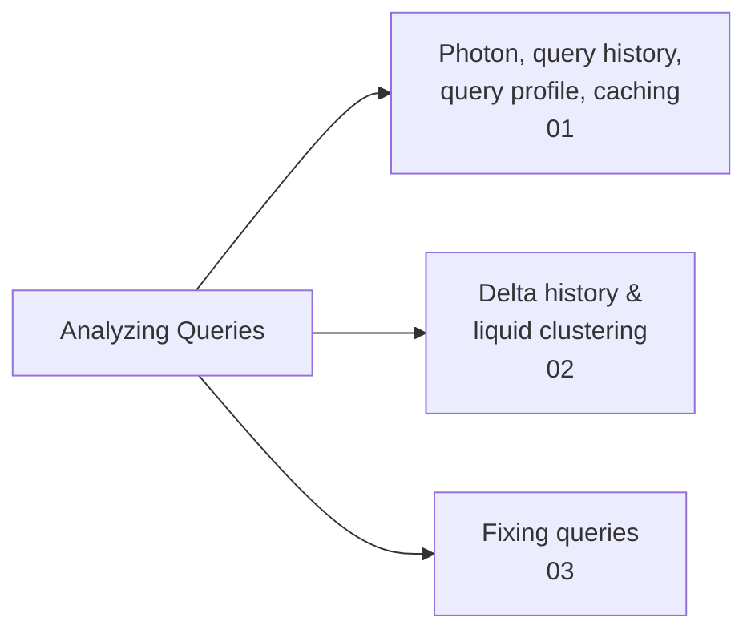

# Analyzing Queries (15 % of Exam)

How to find, explain, and fix slow or wrong queries: Photon, query history, the query profile, caching, Delta Lake history, liquid clustering, and common SQL mistakes (Section 5 in the PDF).

> [!note]
> Until October 2026 this folder held joins, aggregations, window functions, and query parameters. Those skills belong to other sections of the exam guide, so they moved to [Executing Queries](../01-executing-queries-databricks-sql-warehouses/README.md) and [Creating Dashboards and Visualizations](../02-creating-dashboards-and-visualizations/README.md).

## Topics Overview

## Section Contents

| File | Topic | Priority |
| :--- | :--- | :--- |
| [01-photon-and-query-performance.md](./01-photon-and-query-performance.md) | Photon features and limits, query history, `system.query.history`, query profile, performance insights, caches | High |
| [02-delta-history-and-liquid-clustering.md](./02-delta-history-and-liquid-clustering.md) | `DESCRIBE HISTORY`, comparing versions, `RESTORE`, liquid clustering, `OPTIMIZE` | High |
| [03-fixing-queries.md](./03-fixing-queries.md) | Common grouping, NULL, join, and filter mistakes and their fixes | High |

## Exam Guide Coverage

| Exam-guide skill (Section 5) | Where it is covered |
| :--- | :--- |
| Understand the Features, Benefits, and Supported Workloads of Photon | [01 — Photon](./01-photon-and-query-performance.md) |
| Identify poorly performing queries in the Databricks Intelligence platform, such as Query Insights, Query Profiler log, etc. | [01 — Query history & profile](./01-photon-and-query-performance.md) |
| Utilize Delta Lake to audit and view history, validate results, and compare historical results or trends | [02 — Delta history](./02-delta-history-and-liquid-clustering.md) |
| Utilize query history and caching to reduce development time and query latency | [01 — Query history & caching](./01-photon-and-query-performance.md) |
| Apply Liquid Clustering to improve query speed when filtering large tables on specific columns | [02 — Liquid clustering](./02-delta-history-and-liquid-clustering.md) |
| Fix a query to achieve the desired results | [03 — Fixing queries](./03-fixing-queries.md) |

## Key Concepts

| Concept | Why it matters |
| :--- | :--- |
| **Photon** | Vectorized engine, default on SQL warehouses; UDFs fall back to Spark |
| **Query history** | Filter by user, date, compute, status; `system.query.history` for SQL |
| **Query profile** | Rows, time, and memory per operator; shows exploding joins and full scans |
| **Result caches** | Local (per cluster) and remote (serverless, shared, survives restarts); invalidated by table changes |
| **`DESCRIBE HISTORY`** | Who changed a table, how, and when |
| **Liquid clustering** | `CLUSTER BY` up to four filter columns; replaces partitioning and `ZORDER` |

## Related Resources

- [Performance Optimization Cheat Sheet (shared)](../../../shared/cheat-sheets/performance-optimization.md)
- [Delta Lake Commands Cheat Sheet (shared)](../../../shared/cheat-sheets/delta-lake-commands.md)
- [Practice questions — Analyzing Queries](../resources/practice-questions/03-analyzing-queries.md)

---

**[← Previous: Creating Dashboards](../02-creating-dashboards-and-visualizations/README.md) | [↑ Back to Data Analyst Associate](../README.md) | [Next: Developing AI/BI Genie Spaces →](../04-developing-sharing-maintaining-genie-spaces/README.md)**
