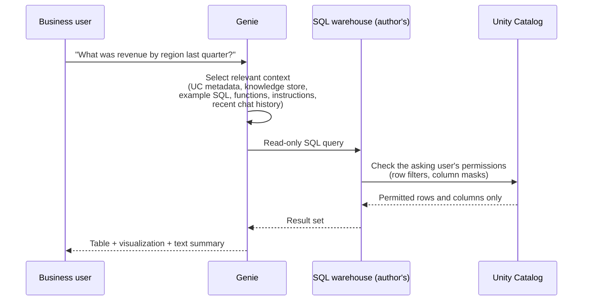
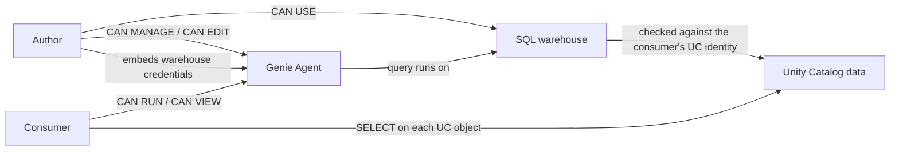

# Genie Agents (Genie Spaces) Overview

## Overview

A **Genie Agent** — called a **Genie space** until July 8, 2026, and still called that in the October 2025 exam guide — is a domain-specific natural-language chat interface over a curated set of Unity Catalog data. An analyst picks the tables, views, or metric views, adds business context (example SQL, SQL functions, SQL expressions, instructions), and shares the agent. Business users ask questions in plain language; Genie writes read-only SQL, runs it on the agent's SQL warehouse, and returns a results table, a visualization, and a text summary.

> [!abstract]
>
> - **Genie Agent** = curated UC datasets + knowledge store + example SQL + SQL functions + text instructions, attached to a pro or serverless SQL warehouse
> - Genie **generates SQL**; the SQL warehouse runs it — the model does not "read the rows" to answer
> - **UC permissions are enforced per asking user**: row filters and column masks apply, even though the query runs on the author's warehouse
> - **Chat mode** answers with one SQL query over structured data; **Agent mode** plans multi-step research and returns a cited report
> - Keep agents small and focused: the official guidance is **five or fewer tables** (hard limit 50)

> [!tip] What the Exam Tests
>
> - The lifecycle: create the space → pick UC data → curate → test → share → monitor and maintain
> - That Genie respects UC permissions for every user, and why that makes it safe for PII-bearing tables
> - Where an answer comes from: generated SQL executed on a SQL warehouse, not the model reasoning over data
> - Prerequisites and permissions for authors versus consumers (warehouse, entitlements, `SELECT`, sharing levels)

---

## The Genie family (October 2026)

Databricks now uses "Genie" for three different products. Only the first is in the Data Analyst exam scope.

| Product | Who it is for | What it does |
| :--- | :--- | :--- |
| **Genie Agents** (formerly Genie spaces) | Analysts curate; business users consume | Natural-language Q&A over a curated set of UC data |
| **Genie One** | Business users | One chat interface across data assets, dashboards, and apps |
| **Genie Code** | Developers and technical practitioners | Coding agent that writes code, pipelines, and dashboards; also suggests table descriptions and example queries when you create a Genie Agent |

## How Genie answers a question

Key points:

- **Context selection.** Genie filters example SQL queries and table/column metadata to find what is relevant to the question. Its context combines Unity Catalog metadata, knowledge-store entries, example SQL, SQL functions, text instructions, and recent chat history.
- **Read-only SQL.** Generated queries are read-only. In most cases they run on the agent's SQL warehouse.
- **Attribution.** Queries are attributed to the end user in query history and on the agent's monitoring page.
- **Conversation context.** Follow-up questions in the same conversation inherit earlier turns ("now only for the North region").
- **Privacy.** What is sent to the models is documented in the Databricks AI trust documentation ("Data sent to the models") — the exam point is that Genie produces SQL; it does not answer by having a model scan your table rows.

## Requirements

| Requirement | Detail |
| :--- | :--- |
| **Data in Unity Catalog** | Managed, external, and foreign tables, views, metric views, and materialized views |
| **SQL warehouse** | **Pro or serverless** (serverless recommended for performance). Classic warehouses are not supported |
| **Partner-powered AI features** | Must be enabled at **both** the account and workspace levels; only an account admin can manage the account setting. Without it, users can see the Genie Agents sidebar icon but cannot open any agent |
| **Author permissions** | Databricks SQL workspace entitlement, `CAN USE` on the warehouse, `SELECT` on the data, and at least `CAN EDIT` on the agent |
| **Consumer permissions** | Consumer access or Databricks SQL entitlement, at least `CAN VIEW` or `CAN RUN` on the agent, and `SELECT` on every UC object the agent uses. **No warehouse permission needed** |

> [!note]
> Unstructured files in UC **volumes** can be analysed too (Beta), but only in **Agent mode**. Consumers can also upload a file to a conversation.

## How many tables? Scope the agent narrowly

The official curation guide says:

- **"Aim for five or fewer tables."**
- Include only the tables needed to answer the questions the agent should handle.
- If a topic needs more, **prejoin** tables into views or **metric views** rather than adding more tables.
- The hard limit is **50** tables, views, or metric views per agent.

Too many tables dilutes the context Genie has to choose from and makes wrong joins more likely. Split broad domains into several focused agents (for example, "Sales pipeline" and "Customer support" instead of one "Company data" agent).

## Create a Genie Agent (current UI)

1. Click **Genie Agents** in the sidebar.
2. Click **New** (upper-right).
3. Select the data sources, then click **Create**.
4. **Genie Code** starts automatically and suggests table descriptions and example queries — accept or edit each suggestion.
5. Open **Configure** to manage data and settings:
   - **Configure → Data**: **Add** tables, remove them with the trash icon, and click a table name to see its **Overview** and **Sample data** tabs.
   - **Configure → Settings**: the fields below.
6. When Genie finds relevant existing workspace queries, a notification appears in the **Data** tab of the **Instructions** panel — click **Review** to accept or reject each one.

| Setting | Purpose |
| :--- | :--- |
| **Title** | Name users see |
| **Default warehouse** | Warehouse that runs generated SQL (pro or serverless) |
| **Tags** (under General) | Organise and find agents |
| **Thumbnail** | Visual identity |
| **Description** | Markdown text explaining what the agent covers |
| **Common questions** | Sample questions shown on the landing page to guide users |

## Chat mode vs Agent mode

| | Chat mode | Agent mode |
| :--- | :--- | :--- |
| **Data** | Structured data only | Structured data plus unstructured files in volumes (Beta) |
| **How it answers** | A single SQL query per question | Builds a research plan, runs multiple SQL queries |
| **Output** | Results table, visualization, text | A report with citations and visualizations |
| **Benchmark scoring** | Compares results to the ground-truth SQL | An LLM judge grades responses using your evaluation notes |
| **Options** | **Inspect** (Public Preview) reviews and may improve the generated SQL before returning it | **Flash** (Beta) favours faster responses for simpler questions |

Agent mode also has its own streaming API endpoint — see [Genie API and Integrations](./04-genie-api-and-integrations.md).

## The permission model in one picture

- Queries run with the **warehouse credentials the author embedded**, so consumers do not need warehouse permissions.
- **Data access is always checked against the asking user's UC permissions.** A user without `SELECT` on a table gets no rows from it; row filters and column masks apply per user.
- Hiding a column in the knowledge store only hides it from Genie's context — users with direct table access can still query it. **Hiding is not a security control**; use UC grants, row filters, and column masks.

## Limits (October 2026)

| Limit | Value |
| :--- | :--- |
| Tables, views, or metric views per agent | 50 (recommended: 5 or fewer) |
| Conversations per agent | 200,000 |
| Messages per conversation | 10,000 |
| Instructions per agent | 100 (each example query, each SQL function, and the general-instructions block count as one) |
| Knowledge-store snippets | 200 |
| Benchmark questions | 500 |

## Use Cases

- **Self-serve analytics** — give a department an agent over its curated tables; analysts stop fielding ad-hoc ticket requests
- **PII-bearing data** — safe to expose because UC row filters and column masks apply to every generated query per user
- **Onboarding analysts** — the agent's example SQL doubles as a living tutorial for the domain
- **Ad-hoc exploration** — quick what-if questions where building a dashboard is not worth it
- **Alongside dashboards** — pair a curated AI/BI dashboard with a Genie Agent for follow-up questions the dashboard does not answer

## Common Issues & Errors

- **Users see the sidebar icon but cannot open any agent** — partner-powered AI features are not enabled at the account and workspace levels
- **Classic SQL warehouse selected** — Genie needs a pro or serverless warehouse
- **Consumer gets empty or partial results** — they lack `SELECT` on an underlying table, or a row filter excludes their rows; this is UC working as designed
- **Too many tables** — answers join the wrong tables; cut to five or fewer, or prejoin into a view or metric view
- **Testing only as the author** — the author's grants can hide permission problems; test as a typical consumer
- **Treating hidden columns as masked** — hidden columns are still readable through direct table access

## Exam Tips

> [!tip]
>
> - **Genie respects UC permissions** — the most common trap. Genie writes the SQL; UC enforces access on execution, per asking user.
> - Genie needs a **pro or serverless** SQL warehouse; consumers do **not** need warehouse permissions.
> - The answer comes from **generated SQL run on a warehouse**, not from the model reading the data.
> - Expect the exam to say "Genie space". Today's UI says "Genie Agent" — they are the same object.

## Key Takeaways

- A Genie Agent (Genie space) is curated UC data plus business context, attached to a pro or serverless SQL warehouse
- Generated SQL is read-only, attributed to the end user, and checked against that user's UC permissions
- Keep each agent narrow — five or fewer tables — and prejoin when a topic needs more
- Chat mode = one SQL query; Agent mode = multi-step research with a cited report

## Related Topics

- [Tuning Genie Agents](./02-tuning-genie-spaces.md)
- [Benchmarks, Monitoring, and Sharing](./03-benchmarks-monitoring-and-sharing.md)
- [Unity Catalog (platform domain)](../05-understanding-databricks-platform/01-unity-catalog.md)
- [Securing Data](../07-securing-data/01-access-control.md)
- [Creating Dashboards](../02-creating-dashboards-and-visualizations/README.md)

## Official Documentation

- [Genie Agents overview](https://docs.databricks.com/aws/en/genie-agents/)
- [Genie Agents concepts](https://docs.databricks.com/aws/en/genie-agents/concepts)
- [Create and manage a Genie Agent](https://docs.databricks.com/aws/en/genie-agents/set-up)
- [Curate an effective Genie Agent](https://docs.databricks.com/aws/en/genie-agents/best-practices)
- [Release note: Genie Spaces renamed to Genie Agents (July 2026)](https://docs.databricks.com/aws/en/release-notes/product/2026/july)

---

**[↑ Back to Section](./README.md) | [Next: Tuning Genie Agents →](./02-tuning-genie-spaces.md)**
