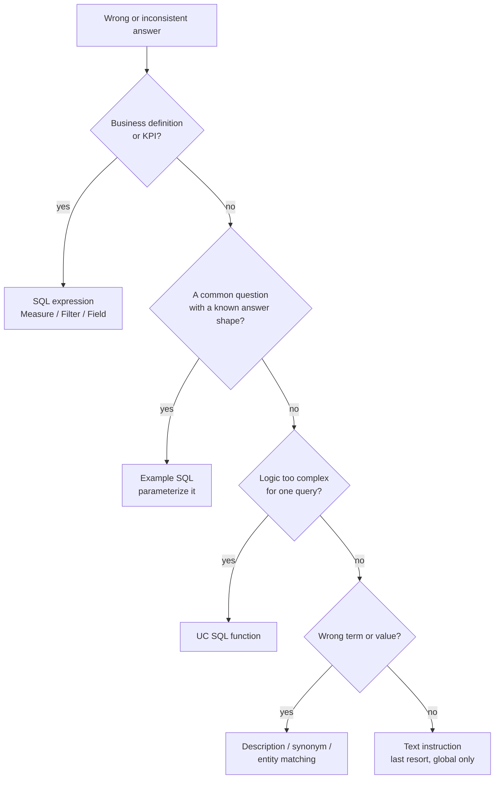

# Tuning Genie Agents (Genie Spaces)

## Overview

A Genie Agent gets more accurate as you give it better *context*. Databricks groups the levers into four families: **Unity Catalog metadata** (outside the agent), the agent's **knowledge store** (descriptions, synonyms, entity matching, joins, SQL expressions), **trusted assets** (parameterized example SQL and UC SQL functions), and **text instructions**. The official curation guide is explicit about priority: *"Prioritize SQL expressions and example SQL over text instructions"* and use text instructions *"only as a last resort when SQL expressions and examples cannot address the need."*

> [!abstract]
>
> - **SQL expressions** (Filter / Measure / Field) and **example SQL** come first — structured SQL is more reliable than prose
> - **Trusted assets** = parameterized example queries + UC SQL functions whose logic an author verified; answers built on them are marked verified
> - **Knowledge store** = agent-scoped descriptions, synonyms, entity matching, join relationships, SQL expressions — it never overwrites UC metadata
> - **Text instructions** = global context only (terminology, fiscal calendar, formatting); last resort for anything else
> - Limits: **100 instructions** (each example, each function, and the general-instructions block count as one) and **200 knowledge-store snippets**

> [!tip] What the Exam Tests
>
> - The name of each curation lever and which problem it solves
> - The priority order: SQL expressions and example SQL before text instructions
> - That curation changes interpretation, never data access — UC still enforces permissions
> - The iterate loop: test → find failures → curate → re-test with benchmarks

---

## The levers at a glance

| Lever | Where in the UI | Best for | Counts toward |
| :--- | :--- | :--- | :--- |
| **UC table/column comments** | Catalog Explorer / `COMMENT ON` (outside the agent) | Meaning of tables and columns for every consumer of the data | — |
| **Table / column descriptions, synonyms** | Configure → Sources → table → pencil icon | Agent-specific wording ("revenue" → `invoice_total`) | Table descriptions: 200 snippets |
| **Entity matching** (value dictionary) | Column pencil → **Advanced** | Users type values that differ from stored values ("Korat" → `Korat Branch`) | — |
| **Join relationships** | Configure → Examples → Add → **Joins** | Telling Genie how tables relate | 200 snippets |
| **SQL expressions** | Configure → Examples → Add → **Filter / Measure / Field** | Reusable business definitions (KPIs, standard filters, derived fields) | 200 snippets |
| **Example SQL** (optionally parameterized) | Configure → **Examples** | Canonical answers to common or complex questions | 100 instructions |
| **SQL functions** | Register in UC, then add to the agent | Logic too complex for a static or parameterized query | 100 instructions |
| **Text instructions** | Configure → **Text** | Global context: terminology, fiscal calendar, formatting rules | 100 instructions (the whole block = 1) |



## Start with Unity Catalog metadata

Genie reads UC metadata first. Clear table and column comments (and informational primary/foreign keys) help every Genie Agent and every other consumer of the data, so fix them in Unity Catalog before adding agent-specific workarounds:

```sql
COMMENT ON TABLE main.sales.orders IS 'One row per customer order. Join to customers on customer_id.';
ALTER TABLE main.sales.orders ALTER COLUMN status COMMENT 'Order status: OPEN, SHIPPED, CANCELLED.';
```

Knowledge-store descriptions are **scoped to the agent** and *do not overwrite* UC metadata. In **Configure → Sources**, editing a table description changes it for this agent only; **Reset** restores the UC description.

## Knowledge store

The knowledge store is "a collection of curated semantic definitions that enhances Genie's understanding of your data."

### Descriptions, synonyms, and hidden columns

- **Table descriptions** — Configure → Sources → click a table → edit the description.
- **Column descriptions and synonyms** — click the pencil icon on a column, edit **Description** and **Synonyms**, click **Save**. Synonyms teach Genie that users say "OS balance" or "exposure" when they mean `outstanding_balance`.
- **Hide columns** — eye icon, or select columns and choose **Actions → Hide selected columns**. Hidden columns are removed from Genie's context only; users with direct table access still see them.

### Format assistance and entity matching

- **Format assistance** gives Genie representative values from a column. It is on by default; turn it off under pencil → **Advanced** (this also disables entity matching for that column).
- **Entity matching** (the value dictionary) maps what users type to the values actually stored. Turn it on under pencil → **Advanced**. It requires format assistance and supports **string columns only**.
  - Limits: **120 columns**, **1,024 values per column**, **127 characters per value**.
  - **Disable it on views that reference row-filtered or masked tables** — stored values could otherwise reveal data a user is not allowed to see.
  - Refresh stored values from the kebab menu with **Refresh prompt matching**.

### Join relationships

Configure → Examples → Add → **Joins**: select the two tables, enter a **Join condition**, and choose **Many to one**, **One to many**, or **One to one**. For complex conditions, choose **Use SQL expression**.

### SQL expressions — Filter, Measure, Field

Configure → Examples → Add → **Filter**, **Measure**, or **Field**. Each has a **Name**, **Code**, **Synonyms**, and **Instructions**.

| Type | Evaluates to | Example name | Example code |
| :--- | :--- | :--- | :--- |
| **Filter** | A boolean condition | `active_customers` | `status = 'ACTIVE' AND deleted_at IS NULL` |
| **Measure** | An aggregation over rows (a KPI) | `revenue` | `SUM(invoice_total)` |
| **Field** | A per-row value (a dimension) | `order_size_band` | `CASE WHEN invoice_total < 100 THEN 'Small' WHEN invoice_total < 1000 THEN 'Medium' ELSE 'Large' END` |

> [!note]
> Some doc pages call Fields "dimensions"; the UI label is **Field**.

## Example SQL queries

Configure → **Examples**. Example queries are what Genie selects from to answer common questions.

- **Title** — use the most typical phrasing of the user's question; it helps Genie match prompts.
- **Focus** — cover logic unique to your organisation and data, not things Genie already does well.
- **Usage guidance** — open a query, click **Usage guidance**, and describe when it applies.

### Parameterized example queries

Click **Add parameter**, or type a colon followed by a name in the editor — the syntax is **`:parameter_name`** (default name `parameter`).

```sql
-- Title: What is the total revenue for a region?
SELECT r.region_name, SUM(o.invoice_total) AS revenue
FROM main.sales.orders o
JOIN main.sales.regions r ON o.region_id = r.region_id
WHERE r.region_name = :region_name
GROUP BY r.region_name
```

Click the gear icon on a parameter to set:

- **Keyword** — editable only in the query text
- **Data type** — String (default), Date, Date and Time, Decimal, or Integer
- **Comment** — valid values or limits ("Full region name, e.g. EMEA")

> [!warning]
> A value that does not match the selected data type can produce inaccurate results. Pick the type deliberately.

## SQL functions

Register a **scalar or table-valued** function in Unity Catalog, then add it to the agent. Use functions for logic too complex for a static or parameterized query. Genie can **call** the function but **cannot view or change** its SQL. Users need `EXECUTE` on the function.

```sql
CREATE OR REPLACE FUNCTION main.sales.at_risk_accounts(min_days_overdue INT COMMENT 'Minimum days overdue')
RETURNS TABLE (account_id STRING, region_name STRING, overdue_amount DECIMAL(18, 2), days_overdue INT)
COMMENT 'Accounts with an invoice overdue by at least min_days_overdue days. Use for collections and credit-risk questions.'
RETURN
  SELECT a.account_id, r.region_name, SUM(i.amount_due), MAX(i.days_overdue)
  FROM main.sales.invoices i
  JOIN main.sales.accounts a ON i.account_id = a.account_id
  JOIN main.sales.regions r ON a.region_id = r.region_id
  WHERE i.days_overdue >= min_days_overdue
  GROUP BY a.account_id, r.region_name;
```

## Trusted assets and verified answers

**Trusted assets** are "parameterized example queries and SQL functions whose exact logic has been verified by an agent author." Answers that use them come from that verified logic, so users can tell a vetted answer from a freshly generated one. In Chat mode, a verified answer appears when the exact text of a parameterized query is used.

- Authors need at least `CAN EDIT` to add or remove trusted assets.
- Users need `EXECUTE` on any function the agent uses.

> [!important]
> Trusted assets are a formal concept in the current docs — not community shorthand. SQL expressions (Filter / Measure / Field) are **knowledge-store** entries, not trusted assets.

## Text instructions

Configure → **Text**. Text instructions are "only for context that should be applied globally" — company-wide terms, fiscal calendars, formatting rules. Rules that apply to only some questions belong in example SQL, functions, SQL expressions, or table comments.

| Pattern | Example |
| :--- | :--- |
| **Define a business term** | `"Active customer" means status = 'ACTIVE' and deleted_at is null.` (better as a Filter SQL expression) |
| **Date semantics** | `"Last quarter" means the previous full calendar quarter, not the trailing 90 days.` |
| **Fiscal calendar** | `The fiscal year starts on February 1.` |
| **Currency** | `Amounts are in the account currency; never add USD and EUR together.` |
| **Formatting** | `Show money with two decimals and the currency code.` |
| **Language** | `Reply in the language of the question.` |

The whole **General instructions** block counts as **one** of the 100 instructions.

## Knowledge mining suggestions

Genie suggests curation from usage: **joins** inferred from keys, and **SQL expressions** derived from answers users gave a thumbs-up or downloaded. Review suggestions at any time and accept the ones that match your definitions.

## A practical tuning order

The docs give no numbered sequence, but their emphasis — resolve inconsistencies during setup, then evaluate — suggests:

1. Fix UC table and column metadata; hide columns Genie does not need.
2. Add example SQL (parameterized where useful) and UC functions for logic that cannot be parameterized.
3. Add SQL expressions for KPIs, standard filters, and derived fields; define joins; turn on entity matching for string columns users type values into.
4. Add text instructions for global context only.
5. Score the agent with **benchmarks**, fix what fails, and re-run — see [Benchmarks, Monitoring, and Sharing](./03-benchmarks-monitoring-and-sharing.md).

To version-control an agent's configuration and promote it across environments, the docs point to **Declarative Automation Bundles** (formerly Databricks Asset Bundles).

## Use Cases

- **KPIs that must be calculated one way** (revenue, churn, NPL ratio) — Measure SQL expression
- **Standard filters** ("active", "open", "excluding test accounts") — Filter SQL expression
- **Recurring question shapes** ("revenue for region X") — parameterized example SQL → verified answers
- **Multi-step business logic** (collections ageing, risk scoring) — UC SQL function
- **Users' vocabulary differs from column names** — synonyms; differs from stored values — entity matching
- **Company-wide conventions** (fiscal year, currency rules) — text instructions

## Common Issues & Errors

- **Encoding rules as long text instructions** — harder to maintain and less reliable than SQL expressions or example SQL
- **Contradictions** between instructions, examples, and SQL expressions — Genie may follow either; keep one definition per rule
- **Parameter type mismatch** — a String parameter compared to a date column gives wrong results
- **Entity matching on views over masked or row-filtered tables** — disable it there
- **Hitting the 100-instruction limit** — every example and function counts; consolidate rather than add near-duplicates
- **Stale curation after a schema change** — re-run benchmarks after every table change

## Best Practices

- Be the agent's first user: ask the questions your users will ask before sharing
- Start small — minimal instructions, a few strong examples — and add as monitoring shows failures
- Put definitions that other tools also need in **UC** (comments, metric views); keep agent-only wording in the knowledge store
- Re-run benchmarks after every curation change

## Exam Tips

> [!tip]
>
> - **Prefer SQL expressions and example SQL over text instructions** — text instructions are the documented *last resort*.
> - **Trusted assets** = parameterized example SQL + UC SQL functions → verified answers.
> - Parameter syntax in example SQL is **`:name`**, not `?` and not `{{name}}`.
> - Curation guides *interpretation*; it never grants or removes *access* — UC does that.

## Key Takeaways

- Fix UC metadata first; the knowledge store adds agent-scoped context without overwriting UC
- SQL expressions (Filter / Measure / Field) and example SQL beat prose instructions
- Trusted assets give verified answers; Genie can call functions but cannot see their SQL
- Watch the limits: 100 instructions, 200 knowledge-store snippets, entity matching 120 × 1,024

## Related Topics

- [Genie Agents Overview](./01-genie-spaces-overview.md)
- [Benchmarks, Monitoring, and Sharing](./03-benchmarks-monitoring-and-sharing.md)
- [Analyzing Queries](../03-analyzing-queries/README.md)
- [Data Modeling with Databricks SQL](../09-data-modeling-with-databricks-sql/README.md) — views and metric views to prejoin data for Genie

## Official Documentation

- [Tune Genie Agent quality](https://docs.databricks.com/aws/en/genie-agents/tune-quality)
- [Curate an effective Genie Agent](https://docs.databricks.com/aws/en/genie-agents/best-practices)
- [Genie Agents concepts](https://docs.databricks.com/aws/en/genie-agents/concepts)

---

**[← Previous: Genie Agents Overview](./01-genie-spaces-overview.md) | [↑ Back to Section](./README.md) | [Next: Benchmarks, Monitoring, and Sharing →](./03-benchmarks-monitoring-and-sharing.md)**
