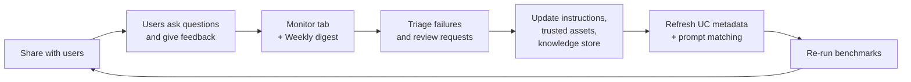

# Genie Benchmarks, Monitoring, and Sharing

## Overview

Building a Genie Agent is the start; most of the work is **keeping it accurate** after real users arrive. This file covers the two halves of the exam's "sharing and maintaining" skills: **distributing** an agent (permission levels, links, embedding, app integrations) and **optimizing** it (tracking questions, accuracy, and feedback in the Monitor tab; validating with benchmarks; refreshing Unity Catalog metadata; updating instructions and trusted assets from stakeholder input).

> [!abstract]
>
> - **Share** grants one of four levels — `CAN MANAGE`, `CAN EDIT`, `CAN RUN`, `CAN VIEW` — to users, groups, or all account users; **Copy link** distributes it
> - **Embed** an agent as an iframe (admin allowlists the domain; author needs `CAN MANAGE`), or integrate it into apps through the Genie API
> - **Benchmarks** = up to 500 test questions with optional ground-truth SQL; Chat mode compares result sets, Agent mode uses an LLM judge
> - The **Monitor** tab shows every question, answer, rating, and user; feedback ("Is this correct?" → Yes / Fix it / Request review) and the Weekly digest drive the next curation round

> [!tip] What the Exam Tests
>
> - Assigning permissions in the UI and distributing agents with links, embedding, and external app integrations
> - Tracking user questions, response accuracy, and feedback to decide what to curate next
> - Validating accuracy with benchmarks and knowing how results are scored
> - Updating instructions and trusted assets from stakeholder input, and refreshing Unity Catalog metadata

---

## The maintenance loop



## Sharing and permissions

Open the agent and click **Share**:

1. Add users or groups, or select **All account users**.
2. Choose a permission level: **CAN MANAGE**, **CAN EDIT**, **CAN RUN**, or **CAN VIEW**.
3. Optionally click **Copy link** to send a direct link.

| Level | Typical holder | What the docs tie to it |
| :--- | :--- | :--- |
| **CAN MANAGE** | Owner / lead analyst | Creators get it automatically; needed to embed the agent and to delete conversations from the monitoring page |
| **CAN EDIT** | Curators | Minimum level to edit the agent, add or remove trusted assets, and run benchmarks |
| **CAN RUN** | Business users | Use the agent (with `SELECT` on the underlying data) |
| **CAN VIEW** | Business users | Use the agent (with `SELECT` on the underlying data) — the docs list "CAN VIEW or CAN RUN" as the consumer minimum |

Remember the other half: sharing the agent does **not** share the data. Each consumer also needs the consumer-access or Databricks SQL entitlement and `SELECT` on every UC object the agent uses. They do **not** need warehouse permission — queries run on the author's embedded warehouse credentials, and UC checks the consumer's own identity.

## Distributing an agent

| Channel | How | Requirements |
| :--- | :--- | :--- |
| **Direct link** | **Share → Copy link** | Recipient has agent access and data access |
| **Embedded iframe** | **Share → Embed space**, copy the iframe code into an internal portal; add `allow="clipboard-write"` so users can copy CSV data and conversation links | A workspace admin adds the host to the allowed embedding surfaces in **Genie access management** settings; the author has `CAN MANAGE`; end users have explicit agent and data access (unauthenticated users are prompted to sign in); embedded users can ask but not edit |
| **OpenSharing** (Beta, June 17, 2026) | Share a Genie Agent with users **outside your organisation** through OpenSharing (formerly Delta Sharing) | Provider-side OpenSharing setup; see the [June 2026 release notes](https://docs.databricks.com/aws/en/release-notes/product/2026/june) |
| **External app integrations** | Call the **Genie Conversation API** from your own app, or add the agent as a resource of a **Databricks App** | See [Genie API and Integrations](./04-genie-api-and-integrations.md) |

> [!warning]
> Add only trusted domains to the embedding allowlist — an embed exposes the agent wherever the host page is reachable.

## Benchmarks

Benchmarks are test questions used **only to score accuracy** — unlike example SQL, they never feed Genie's context.

### Add benchmark questions

1. Click **Benchmarks** near the top of the agent, then **Add benchmark**.
2. Enter the **Question**.
3. Optionally enter a **SQL Answer** — type it, or click **Generate SQL**. UC SQL functions are accepted.
4. Optionally add an **Evaluation note** (guidance for the Agent-mode judge).
5. Optionally click **Run** to try it, then **Add benchmark** to save. Edit later with the pencil icon (**Update question**).

You can also add a question you just reviewed in a conversation as a benchmark.

### Run and score

- Click **Run benchmarks** to run everything, or select questions and click **Run selected**. You need at least `CAN EDIT`.
- Pick **Chat** or **Agent** mode with the toggle at the top right of the **Benchmarks** tab; the mode applies to the whole run.
- Runs continue if you leave the page; results land on the **Evaluations** tab.
- **Each benchmark question runs as a new conversation** — no threaded context from earlier questions.

| Mode | How a result is labelled |
| :--- | :--- |
| **Chat mode** | **Good** when the generated SQL or result set matches the SQL Answer exactly, matches with different row sorting, or numeric values round to the same 4 significant digits. **Bad** for empty results, errors, extra columns, or a different single-cell result. **Manual review needed** when Genie cannot assess correctness or no SQL Answer exists |
| **Agent mode** | An **LLM judge** grades the response using your **Evaluation note**; responses that meet the criteria are **Good** |

> [!note] Why a correct answer can score Bad
> Chat mode compares result sets. If Genie adds a helpful extra column, the result no longer matches and the question is labelled **Bad**. Chat mode compares up to **5,000 rows**; mismatched row order in larger result sets can also produce a false Bad. Open the run, compare **Model output** with **Ground truth**, and fix the label or use **Update ground truth**.

### Review evaluations

The **Evaluations** tab lists runs with **Evaluation name** (a timestamp), **Execution status**, **Accuracy**, and **Created by**. Open a run to compare model output with ground truth and relabel results **Good** or **Bad**. Per-question details are kept for **one week**; the generated and example SQL remain.

**Limit:** 500 benchmark questions per agent.

## Monitoring usage and accuracy

The **Monitor** tab shows every question and answer. Filter by time, rating, user, or status, and click a question to read the whole thread.

| Signal | Where it comes from | What to do with it |
| :--- | :--- | :--- |
| **"Is this correct?"** — **Yes** / **Fix it** / **Request review** | End users, on each answer | "Fix it" and review requests are your curation backlog |
| **Thumbs up / down** | End users | Summarised in the **Weekly digest** |
| **Repeated questions** | Monitor tab | Candidates for example SQL or common questions |
| **Wrong or empty answers** | Monitor tab + benchmarks | Diagnose: missing metadata, missing example, ambiguous term, permission gap |

Conversation visibility is either **Reviewable by agent managers** or **Private** — managers see only the prompts of private conversations. Users with `CAN MANAGE` can delete conversations from the monitoring page. Generated queries are also attributed to the end user in **query history**.

## Optimizing from stakeholder input

A typical round after a week of usage:

1. **Collect** — review "Fix it" and review requests, low ratings, and the Weekly digest; meet the business owner to confirm definitions.
2. **Diagnose** each failure:
   - Wrong term → synonym or column description
   - Wrong KPI logic → Measure / Filter SQL expression, or a trusted asset (parameterized example SQL, UC function)
   - Wrong join → join relationship, or prejoin into a view / metric view
   - Value not recognised → entity matching, then **Refresh prompt matching**
   - Global rule missing → text instruction (last resort)
3. **Refresh Unity Catalog metadata** when the fix belongs to the data itself (it then helps every agent and tool):

   ```sql
   ALTER TABLE main.sales.orders ALTER COLUMN status COMMENT 'OPEN, SHIPPED, or CANCELLED. Exclude CANCELLED from revenue.';
   ```

   In the agent, **Reset** a table description to pull the updated UC description, and run **Refresh prompt matching** after the underlying values change.
4. **Add the failing question as a benchmark** with its correct SQL Answer.
5. **Re-run benchmarks** and confirm accuracy did not regress before telling stakeholders.

## Use Cases

- **Department roll-out** — share with a group at `CAN RUN`, curators at `CAN EDIT`, one owner at `CAN MANAGE`
- **Intranet portal** — embed the agent as an iframe on an allowlisted internal site
- **Regression guard** — run benchmarks after every schema or curation change
- **Quarterly business review** — use the Weekly digest and Monitor filters to report adoption and accuracy

## Common Issues & Errors

- **Agent shared, but users see no data** — they have agent access but lack `SELECT` on the UC objects
- **Embed shows a blank frame** — the host domain is not in the Genie embedding allowlist, or the author lacks `CAN MANAGE`
- **Benchmark marked Bad although the answer is right** — extra columns or row-order differences; review and relabel
- **Benchmarks pass but users still complain** — the benchmark set does not reflect real questions; seed it from the Monitor tab
- **Accuracy drops after a schema change** — stale descriptions and prompt-matching values; refresh UC metadata and prompt matching, then re-run benchmarks

## Best Practices

- Seed benchmarks with real questions from the Monitor tab, not only the ones the author imagined
- Give every benchmark a SQL Answer in Chat mode — questions without one need manual review
- Keep curators (`CAN EDIT`) few and named; give everyone else `CAN RUN` or `CAN VIEW`
- Review "Fix it" and review requests on a fixed cadence (for example, weekly with the digest)

## Exam Tips

> [!tip]
>
> - Four permission levels: **CAN MANAGE / CAN EDIT / CAN RUN / CAN VIEW** — and sharing the agent never grants data access.
> - Distribution = **Copy link**, **iframe embed** (admin allowlist + `CAN MANAGE`), and **external app integrations** via the API.
> - Benchmarks score accuracy; they do **not** improve Genie's answers by themselves.
> - Optimizing = monitor questions + feedback → update instructions / trusted assets → refresh UC metadata → re-validate with benchmarks.

## Key Takeaways

- Sharing has two halves: the agent permission level and the user's own UC data access
- Benchmarks are a regression test; Chat mode compares results, Agent mode uses an LLM judge
- The Monitor tab, user feedback, and the Weekly digest tell you what to curate next
- Fix definitions in Unity Catalog when they belong to the data; keep agent-only wording in the knowledge store

## Related Topics

- [Genie Agents Overview](./01-genie-spaces-overview.md)
- [Tuning Genie Agents](./02-tuning-genie-spaces.md)
- [Genie API and Integrations](./04-genie-api-and-integrations.md)
- [Securing Data](../07-securing-data/01-access-control.md)

## Official Documentation

- [Test and monitor a Genie Agent](https://docs.databricks.com/aws/en/genie-agents/monitor)
- [Create and manage a Genie Agent — sharing](https://docs.databricks.com/aws/en/genie-agents/set-up)
- [Embed a Genie Agent in an external app](https://docs.databricks.com/aws/en/genie-agents/embed)
- [Release notes, June 2026 — share Genie Agents externally using OpenSharing](https://docs.databricks.com/aws/en/release-notes/product/2026/june)

---

**[← Previous: Tuning Genie Agents](./02-tuning-genie-spaces.md) | [↑ Back to Section](./README.md) | [Next: Genie API and Integrations →](./04-genie-api-and-integrations.md)**
