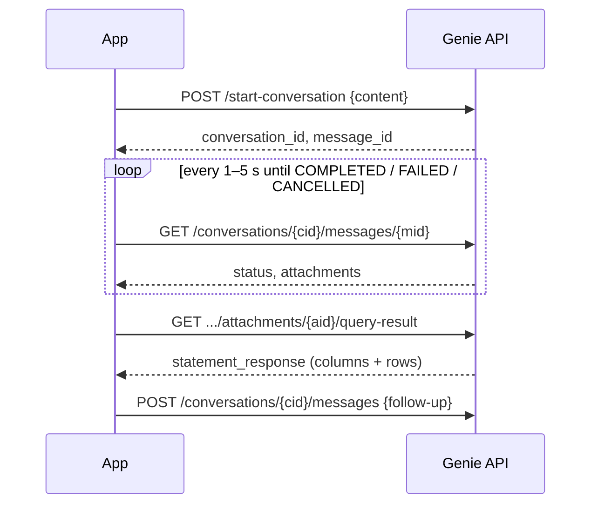

# Genie API and Integrations

## Overview

The exam expects you to know that Genie spaces can be distributed through **embedded links and external app integrations**. In practice that means four routes beyond the Genie UI: an **iframe embed**, the **Genie Conversation API** (REST or the Python SDK), a **Databricks App** that holds the agent as a resource, and **agent tooling** — MCP servers and code agents that call Genie as a tool. Every route keeps the same rule: the question is answered with SQL that Unity Catalog checks against the identity making the call.

> [!abstract]
>
> - **Conversation API** — prefix `/api/2.0/genie/spaces/{space_id}` (the path still says "spaces"); stateful conversations, asynchronous messages you poll until `COMPLETED`, `FAILED`, or `CANCELLED`
> - **Python SDK** — `WorkspaceClient().genie.start_conversation_and_wait(...)` / `create_message_and_wait(...)` / `get_message_attachment_query_result(...)`
> - **Databricks Apps** — add the agent as an app resource (`Can run`), read its ID from an env var, grant the app's service principal `SELECT` on the data
> - **Agents and MCP** — managed MCP endpoint `/api/2.0/mcp/genie/{space_id}`; the Agent Bricks CLI tool kind `genie_agent`

> [!tip] What the Exam Tests
>
> - That Genie can be distributed beyond the UI — embedded links and external app integrations
> - That integrations still enforce UC permissions for the calling identity (a user, or an app's service principal)
> - Deeper API details are not exam-critical for the Data Analyst exam, but appear in the GenAI Engineer exam ("leverage Genie Spaces or conversational API to retrieve data")

---

## Integration options at a glance

| Route | Best for | Identity whose UC permissions apply | Covered |
| :--- | :--- | :--- | :--- |
| **Copy link** | Sharing inside the workspace | Each signed-in user | [03](./03-benchmarks-monitoring-and-sharing.md) |
| **iframe embed** | Internal portals | Each signed-in user | [03](./03-benchmarks-monitoring-and-sharing.md) |
| **Conversation API / SDK** | Custom apps, bots, batch evaluation | The caller (user token or service principal) | Below |
| **Databricks App resource** | A hosted chat app on Databricks | The app's service principal (unless the app uses user authorization) | Below |
| **MCP / agent tool** | Multi-agent systems and code agents | The agent's configured identity (user or app) | Below |

## Conversation API



| Action | Method and path (prefix `/api/2.0/genie/spaces/{space_id}`) |
| :--- | :--- |
| Start a conversation | `POST /start-conversation` |
| Ask a follow-up | `POST /conversations/{conversation_id}/messages` |
| Poll a message | `GET /conversations/{conversation_id}/messages/{message_id}` |
| Fetch a query result | `GET /conversations/{conversation_id}/messages/{message_id}/attachments/{attachment_id}/query-result` |
| Re-run an expired query | `POST /conversations/{conversation_id}/messages/{message_id}/attachments/{attachment_id}/execute-query` |
| Agent mode (streaming, SSE) | `POST /api/2.0/genie/agents/{agent_id}/responses` |

Behaviour to remember:

- **Stateful.** Follow-up messages in the same conversation keep context.
- **Asynchronous.** Poll every 1–5 seconds until a final state; stop after about 10 minutes.
- **No built-in retry.** Add your own queue and exponential backoff (capped at about a minute) to stay within throughput limits.
- **Set up in the UI.** You create and tune the agent in the Databricks UI even if users only reach it through the API.
- **History.** Agent managers can list a space's conversations and fetch their messages.

### Python SDK

```python
import datetime as dt
from databricks.sdk import WorkspaceClient

w = WorkspaceClient()
space_id = "<space-id>"  # Genie Agent → About, or the end of the agent's URL
timeout = dt.timedelta(minutes=10)

msg = w.genie.start_conversation_and_wait(space_id, "What was revenue by region last quarter?", timeout=timeout)
for att in msg.attachments or []:
    if att.text:
        print(att.text.content)  # Genie's text summary
    if att.query:
        print(att.query.query)  # generated SQL
        res = w.genie.get_message_attachment_query_result(
            space_id, msg.conversation_id, msg.message_id, att.attachment_id)
        stmt = res.statement_response
        print([c.name for c in stmt.manifest.schema.columns])
        print(stmt.result.data_array[:5] if stmt.result else [])

follow_up = w.genie.create_message_and_wait(space_id, msg.conversation_id, "Only for EMEA", timeout=timeout)
```

- The `*_and_wait` methods block until the message finishes (the SDK default timeout is 20 minutes — set a shorter one).
- `get_message_attachment_query_result` works only when the message has a query attachment in `EXECUTING_QUERY` or `COMPLETED`; use `execute_message_attachment_query` to re-run an expired result.
- `get_message_query_result` and `execute_message_query` are **deprecated** — use the attachment-based methods.

## Databricks Apps

To build a hosted chat app on Databricks:

1. In the app's **App resources**, click **+ Add resource → Genie Agent**, choose the agent, and pick a permission (**Can run** is enough to submit questions). The default resource key is `genie-space`.
2. Read the agent ID from an environment variable in `app.yaml`:

   ```yaml
   env:
     - name: GENIE_SPACE_ID
       valueFrom: genie-space
   ```

3. Grant the app's **service principal** `USE CATALOG`, `USE SCHEMA`, and `SELECT` on the tables and views the agent uses (and `EXECUTE` on any UC functions).
4. In code, create a `WorkspaceClient()` (it authenticates as the app's service principal) and call the SDK methods above.

> [!warning] Service principal = one set of permissions for everyone
> With service-principal authorization, every app user sees exactly what the service principal can see. For PII-bearing data, use the app's user authorization so Genie runs with each user's own UC permissions. See [Databricks Apps authorization](https://docs.databricks.com/aws/en/dev-tools/databricks-apps/auth).

## MCP and code agents

| Integration | Detail |
| :--- | :--- |
| **Managed MCP server for one agent** | `/api/2.0/mcp/genie/{space_id}` — a workspace admin enables **Managed MCP Servers** on the Previews page. The bare `/api/2.0/mcp/genie` endpoint (no agent ID) retires on **October 31, 2026** |
| **Built-in Genie One MCP service** | `system.ai.genie_one_mcp` at `https://<host>/ai-gateway/mcp-services/<name>` — generally available |
| **Agent Bricks CLI tool** | In `agent.toml`: `source = { kind = "genie_agent", space_id = "<space-id>" }` with `auth = "user"` or `"app"` |
| **Supervisor Agent subagent** *(legacy since Oct 12, 2026)* | A Genie Agent could be a subagent; end users need access to the agent and its UC data |

These are GenAI Engineer topics — for the Data Analyst exam, remember only that Genie can be called by other applications and agents and that UC still governs the data.

## Use Cases

- **Slack-style or intranet chatbot** built on the Conversation API
- **Batch accuracy checks** — loop benchmark questions through the API and score the answers in MLflow
- **Customer-facing analytics in a Databricks App** with user authorization
- **Multi-agent systems** where a code agent hands structured-data questions to a Genie Agent

## Common Issues & Errors

- **`get_message_attachment_query_result` fails** — called before the message reached `EXECUTING_QUERY` / `COMPLETED`, or the result expired (re-run with `execute_message_attachment_query`)
- **App returns no rows** — the app's service principal lacks `SELECT` (or `USE CATALOG` / `USE SCHEMA`) on the data
- **Throttling under load** — no client-side queue or backoff
- **Broken MCP integration after Oct 31, 2026** — still calling the bare `/api/2.0/mcp/genie` endpoint

## Exam Tips

> [!tip]
>
> - "External app integrations" = Conversation API, Databricks Apps, embedding — all still governed by UC.
> - The API path still says **spaces** even though the product is now Genie Agents.
> - An app using a service principal shows every user the same data — know why user authorization matters.

## Key Takeaways

- Genie is reachable from links, iframes, the Conversation API, Databricks Apps, MCP, and code agents
- The API is stateful and asynchronous: start, poll, fetch the result, follow up
- Whatever the route, Unity Catalog checks the calling identity's permissions

## Related Topics

- [Benchmarks, Monitoring, and Sharing](./03-benchmarks-monitoring-and-sharing.md)
- [Genie Agents Overview](./01-genie-spaces-overview.md)
- [GenAI Engineer Associate](../../genai-engineer-associate/README.md) — multi-agent systems that call Genie

## Official Documentation

- [Use the Genie Agents API](https://docs.databricks.com/aws/en/genie-agents/conversation-api)
- [Genie API reference](https://docs.databricks.com/api/genie/v1/conversation)
- [Python SDK — `w.genie`](https://databricks-sdk-py.readthedocs.io/en/latest/workspace/dashboards/genie.html)
- [Add a Genie Agent resource to a Databricks App](https://docs.databricks.com/aws/en/dev-tools/databricks-apps/genie)
- [Built-in MCP services](https://docs.databricks.com/aws/en/agents/mcp-tools/built-in-mcp-services)
- [Agent Bricks CLI](https://docs.databricks.com/aws/en/agents/custom-agents/agent-bricks-cli)

---

**[← Previous: Benchmarks, Monitoring, and Sharing](./03-benchmarks-monitoring-and-sharing.md) | [↑ Back to Section](./README.md)**
