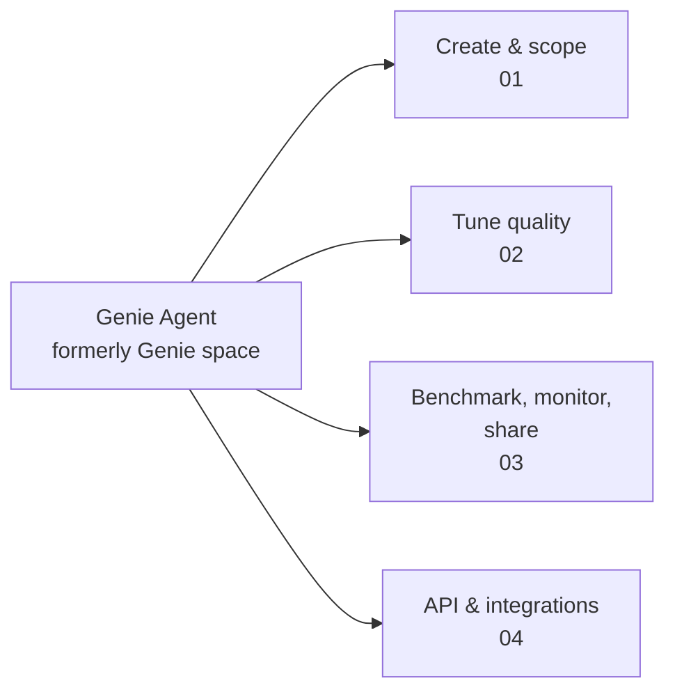

# Developing, Sharing, and Maintaining AI/BI Genie Spaces (12 % of Exam)

> [!important]
> **New in the October 2025 blueprint.** AI/BI Genie is the natural-language analytics surface that sits on top of Unity Catalog. Analysts curate a Genie space over a small set of UC tables; business users ask questions in plain language and Genie generates read-only SQL, runs it on a SQL warehouse, and returns tables, charts, and text.

> [!warning] Product rename — Genie Spaces are now Genie Agents (July 8, 2026)
> Databricks renamed **Genie Spaces** to **Genie Agents** on July 8, 2026. The name changed across the docs; the capabilities did not. The October 2025 exam guide (and therefore the exam) still says **Genie spaces**, and the REST API still uses `/api/2.0/genie/spaces/...`. This section uses both names: "Genie space" when quoting the exam, "Genie Agent" when describing today's UI.

## Topics Overview

## Section Contents

| File | Topic | Priority |
| :--- | :--- | :--- |
| [01-genie-spaces-overview.md](./01-genie-spaces-overview.md) | What a Genie Agent is, how it builds context, requirements, permissions, Chat vs Agent mode | High |
| [02-tuning-genie-spaces.md](./02-tuning-genie-spaces.md) | Text instructions, example SQL, SQL functions, trusted assets, knowledge store | High |
| [03-benchmarks-monitoring-and-sharing.md](./03-benchmarks-monitoring-and-sharing.md) | Benchmarks and scoring, the Monitor tab, user feedback, sharing and permission levels | High |
| [04-genie-api-and-integrations.md](./04-genie-api-and-integrations.md) | Conversation API, Python SDK, Databricks Apps, MCP, agent tools | Medium (exam: "external app integrations"; API depth is GenAI-exam territory) |

## Exam Guide Coverage

The October 2025 exam guide lists four skills for this domain (Section 7 in the PDF):

| Exam-guide skill | Where it is covered |
| :--- | :--- |
| Describe the purpose, key features, and components of AI/BI Genie spaces | [01 — Overview](./01-genie-spaces-overview.md) |
| Create Genie spaces by defining reasonable sample questions and domain-specific instructions, choosing SQL warehouses, curating Unity Catalog datasets (tables, views...), and vetting queries as Trusted Assets | [01 — Overview](./01-genie-spaces-overview.md) (create, warehouse, data) · [02 — Tuning](./02-tuning-genie-spaces.md) (instructions, trusted assets) |
| Assign permissions via the UI and distribute Genie spaces using embedded links and external app integrations | [03 — Sharing](./03-benchmarks-monitoring-and-sharing.md) · [04 — API and integrations](./04-genie-api-and-integrations.md) |
| Optimize AI/BI Genie spaces by tracking user questions, response accuracy, and feedback; updating instructions and trusted assets based on stakeholder input; validating accuracy with benchmarks; refreshing Unity Catalog metadata | [03 — Benchmarks and monitoring](./03-benchmarks-monitoring-and-sharing.md) · [02 — Tuning](./02-tuning-genie-spaces.md) |

## Key Concepts

| Concept | Why it matters |
| :--- | :--- |
| **Genie Agent** (formerly Genie space) | A domain-specific chat interface over curated UC data — tables, views, metric views — plus instructions, examples, and functions |
| **Context** | Genie selects the most relevant UC metadata, knowledge-store entries, example SQL, SQL functions, instructions, and recent chat history for each question |
| **Trusted assets** | Parameterized example queries and UC SQL functions whose exact logic an author verified — answers that use them are marked as verified |
| **Knowledge store** | Agent-scoped semantic definitions — descriptions, synonyms, entity matching, join relationships, SQL expressions — that never overwrite UC metadata |
| **Text instructions** | Plain-text business rules; the official guidance is to use them *only as a last resort* after SQL expressions and example SQL |
| **Benchmarks** | Test questions with ground-truth SQL used only to score accuracy, not to improve Genie's context |
| **Permissions** | Genie runs on the author's warehouse, but every query is checked against the *asking user's* UC permissions — row filters and column masks apply per user |
| **Chat vs Agent mode** | Chat mode answers with one SQL query over structured data; Agent mode plans multi-step research and returns a report with citations |

## Related Resources

- [Genie Agents documentation (official)](https://docs.databricks.com/aws/en/genie-agents/)
- [Unity Catalog Basics (shared)](../../../shared/fundamentals/unity-catalog-basics.md)
- [Unity Catalog cheat sheet (shared)](../../../shared/cheat-sheets/unity-catalog-quick-ref.md)
- [Practice questions — Genie](../resources/practice-questions/06-genie-agents.md)

> [!note]
> Facts in this section were checked against the Databricks Genie Agents documentation on **October 26, 2026**. Genie changes quickly — check the [release notes](https://docs.databricks.com/aws/en/release-notes/product/) before relying on a limit or a UI label.

---

**[← Previous: Analyzing Queries](../03-analyzing-queries/README.md) | [↑ Back to Data Analyst Associate](../README.md) | [Next: Understanding Databricks Platform →](../05-understanding-databricks-platform/README.md)**
