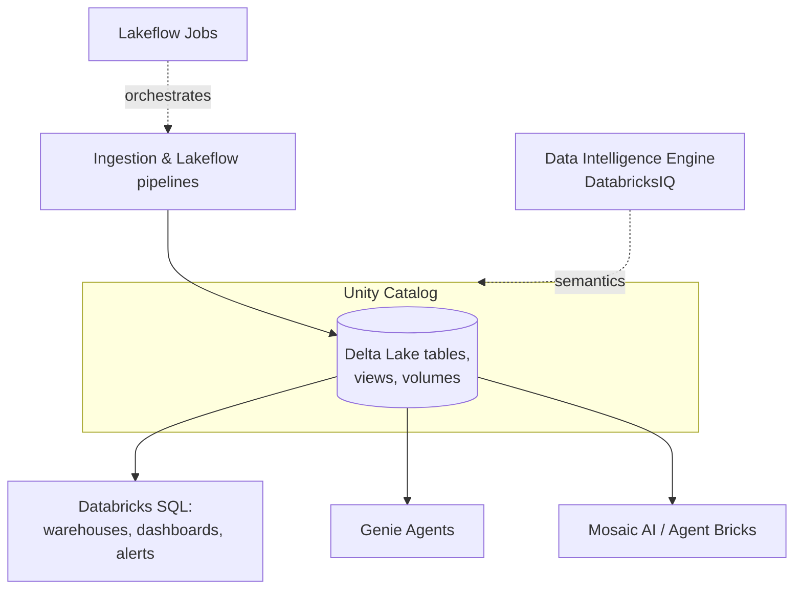

# Platform Components, Catalog Explorer & Marketplace

## Overview

Section 1 of the October 2025 exam guide asks you to "describe the core components of the Databricks Intelligence Platform, including Mosaic AI, DeltaLive tables, Lakeflow Jobs, Data Intelligence Engine, Delta Lake, Unity Catalog, and Databricks SQL", to understand objects such as certified tables and lineage "within the Catalog Explorer interface", and to "describe the role and features of Databricks Marketplace".

> [!note] Platform update (Oct 2026)
> The certification page now calls this domain **"Understanding of Databricks Data + AI Platform"**, and the current docs say "Databricks Data + AI Platform". The PDF still says "Data Intelligence Platform". Same platform, newer name ([certification page](https://www.databricks.com/learn/certification/data-analyst-associate), [What is Databricks?](https://docs.databricks.com/aws/en/introduction/)).

> [!abstract]
>
> - Each core component has one job: store (Delta Lake), govern (Unity Catalog), query (Databricks SQL), transform (declarative pipelines), orchestrate (Lakeflow Jobs), AI (Mosaic AI), and understand (Data Intelligence Engine)
> - Catalog Explorer shows catalogs, schemas, tables, views, volumes, tags, certification, and lineage
> - Marketplace is an open exchange for data and AI products, delivered with Delta Sharing (now OpenSharing)

> [!tip] What the Exam Tests
>
> - Matching a component to a task
> - Reading certified/deprecated badges and the Lineage tab
> - What Marketplace offers and how consumers receive data

---

## Core Components

| Exam-guide name | Current name (Oct 2026) | What it does |
| :--- | :--- | :--- |
| **Delta Lake** | Delta Lake | Open table format: ACID transactions, schema enforcement, history, and time travel on Parquet files |
| **Unity Catalog** | Unity Catalog | Governance for data and AI: access control, lineage, discovery, tags, auditing |
| **Databricks SQL** | Databricks SQL (data warehousing) | SQL warehouses, the SQL editor, AI/BI dashboards, alerts |
| **Delta Live Tables** | **Lakeflow Spark Declarative Pipelines** ("Lakeflow pipelines") | Declarative ETL: define tables, materialized views, and streaming tables; the pipeline handles dependencies, refreshes, and data quality expectations |
| **Lakeflow Jobs** | Lakeflow Jobs | Orchestration: run notebooks, SQL, pipelines, and SQL alert tasks on schedules or triggers, with retries and notifications |
| **Mosaic AI** | AI capabilities grouped under **Agent Bricks** | Build, serve, and evaluate ML models and AI agents |
| **Data Intelligence Engine** | DatabricksIQ | AI layer that learns the semantics of your data, for example generating descriptions and tags in Unity Catalog |

> [!note] Platform update (Oct 2026)
>
> - Delta Live Tables became Lakeflow Declarative Pipelines, which was renamed **Lakeflow Spark Declarative Pipelines** on November 12, 2025 ([release notes](https://docs.databricks.com/aws/en/release-notes/product/2025/november)). The exam still says "DeltaLive tables".
> - On March 27, 2026 the Agent Bricks page became "the umbrella for all Databricks AI capabilities" ([release notes](https://docs.databricks.com/aws/en/release-notes/product/2026/march)); some product names still start with "Mosaic AI".
> - Databricks Assistant is now **Genie Code** (March 11, 2026), and Genie Spaces are now **Genie Agents** (July 8, 2026).
> - The Data Intelligence Engine was introduced as DatabricksIQ in the November 15, 2023 [Data Intelligence Platform announcement](https://www.databricks.com/blog/what-is-a-data-intelligence-platform). The current docs do not use either term.

## Catalog Explorer

Catalog Explorer (**Catalog** in the sidebar) is the UI for Unity Catalog objects.

| What you see | Meaning |
| :--- | :--- |
| Catalogs → schemas → tables, views, volumes, functions, models | The three-level namespace |
| **Managed** vs **external** table | Unity Catalog manages the storage vs you manage the `LOCATION` |
| Views | Saved queries; dynamic views filter or mask per user |
| **Permissions** tab | Grants on the object (needs privileges to change) |
| **Tags** | Key-value labels; governed tags show a lock icon |
| **Certified** badge (check mark) / **deprecated** badge | The system-governed tag `system.certification_status` set to `certified` or `deprecated` |
| **Lineage** tab | Upstream and downstream tables, notebooks, jobs, dashboards; **See Lineage Graph** for the diagram |

Lineage is captured at the table level and, where possible, the column level. Viewing it requires at least `BROWSE` on the parent catalog. Lineage in Catalog Explorer is kept indefinitely; lineage system tables keep a rolling year. Renaming an object breaks its lineage. How to tag, certify, and search is covered in [Discovering, Tagging & Cleaning Data](../06-managing-data/02-discovering-tagging-and-cleaning-data.md).

## Databricks Marketplace

Marketplace is "an open exchange where data providers, software vendors, and technology partners publish offerings" that customers access from their workspace.

- **Products**: datasets, AI models, notebooks, apps, and MCP servers.
- **Listings**: free sample data or commercial products; in the public marketplace or a private exchange; some are instant, others need provider approval.
- **Delivery**: through Delta Sharing (renamed **OpenSharing** on June 10, 2026 — [release notes](https://docs.databricks.com/aws/en/release-notes/product/2026/june)). Datasets usually arrive as catalogs of tabular data, so there is no copy pipeline to build.
- **Who**: anyone can browse the Open Marketplace, but requesting products needs a Databricks workspace. Providers need a premium, Unity Catalog-enabled workspace.

## Use Cases

- **Explaining the platform**: Mapping a stakeholder's request ("schedule this", "govern that", "share this") to the right component.
- **Choosing trusted data**: Picking the certified table in Catalog Explorer and checking its lineage before building a dashboard.
- **Enriching data**: Adding a Marketplace dataset without writing ingestion code.

## Common Issues & Errors

### Lineage tab is empty

**Scenario:** A table shows no lineage.
**Fix:** Lineage appears only for reads and writes through supported interfaces, is lost after renames, and is unavailable before September 1, 2024. You also need `BROWSE` on the catalog.

### Marketplace "Get access" is unavailable

**Scenario:** An analyst browsing the public Marketplace cannot request a dataset.
**Fix:** Request products from Marketplace inside a Databricks workspace.

## Exam Tips

- Delta Lake = storage format; Unity Catalog = governance; Databricks SQL = warehousing and BI
- "DeltaLive tables" on the exam = Lakeflow Spark Declarative Pipelines today
- Certified badge = `system.certification_status` tag, not a quality test
- Marketplace data is shared live, not copied

## Key Takeaways

- Learn the exam names **and** the current names
- Catalog Explorer is where you read certification, tags, and lineage
- Marketplace delivers data products as shared catalogs

## Related Topics

- [Unity Catalog](./01-unity-catalog.md)
- [Discovering, Tagging & Cleaning Data](../06-managing-data/02-discovering-tagging-and-cleaning-data.md)
- [Importing Data](../08-importing-data/01-importing-data-overview.md) - Marketplace and Delta Sharing as data sources

## Official Documentation

- [What is Databricks?](https://docs.databricks.com/aws/en/introduction/)
- [What is Databricks Marketplace?](https://docs.databricks.com/aws/en/marketplace/)
- [View data lineage using Unity Catalog](https://docs.databricks.com/aws/en/data-governance/unity-catalog/data-lineage)
- [Flag data as certified or deprecated](https://docs.databricks.com/aws/en/data-governance/unity-catalog/certify-deprecate-data)

---

**[← Previous: Connections & Integrations](./02-connections.md) | [↑ Back to Section](./README.md)**
