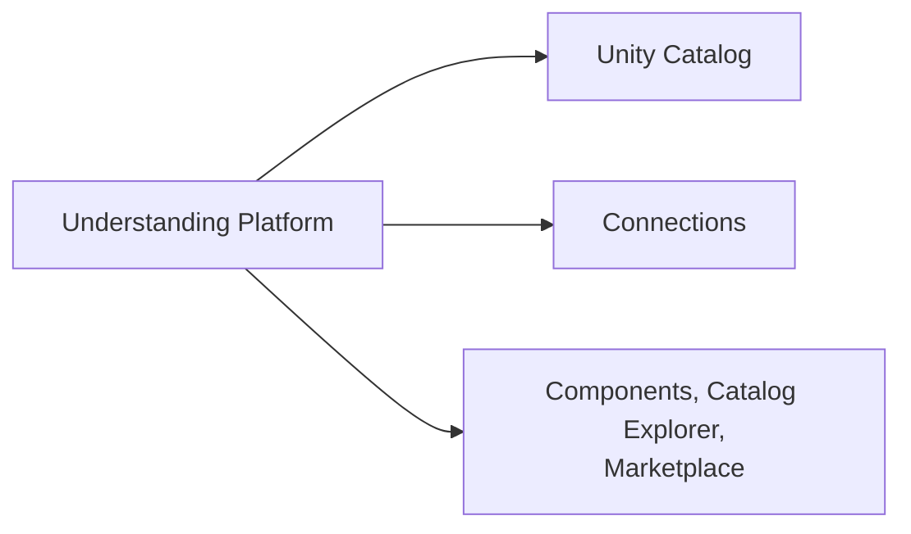

# Understanding of Databricks Data + AI Platform (11 % of Exam)

The platform's core components, how Unity Catalog organises data, what Catalog Explorer shows (certified tables, lineage), Databricks Marketplace, and how analysts connect from external tools (Section 1 in the PDF).

> [!note] Platform update (Oct 2026)
> The exam guide PDF names this domain "Understanding of Databricks Data Intelligence Platform". The [certification page](https://www.databricks.com/learn/certification/data-analyst-associate) now says **"Understanding of Databricks Data + AI Platform"**, matching the current docs. The weight (11 %) is unchanged.

## Topics Overview

## Section Contents

| File | Topic | Priority |
| :--- | :--- | :--- |
| [01-unity-catalog.md](./01-unity-catalog.md) | UC architecture for analysts: three-level namespace, catalogs, schemas, tables | High |
| [02-connections.md](./02-connections.md) | JDBC / ODBC / Power BI / Tableau connection setup, OAuth + PAT auth | Medium |
| [03-platform-components-and-marketplace.md](./03-platform-components-and-marketplace.md) | Core components (exam names and current names), Catalog Explorer, certified tables, lineage, Marketplace | High |

## Exam Guide Coverage

| Exam-guide skill (Section 1) | Where it is covered |
| :--- | :--- |
| Describe the core components of the Databricks Intelligence Platform, including Mosaic AI, DeltaLive tables, Lakeflow Jobs, Data Intelligence Engine, Delta Lake, Unity Catalog, and Databricks SQL | [03 — Platform components](./03-platform-components-and-marketplace.md) |
| Understand catalogs, schemas, managed and external tables, access controls, views, certified tables, and lineage within the Catalog Explorer interface | [01 — Unity Catalog](./01-unity-catalog.md) · [03 — Catalog Explorer](./03-platform-components-and-marketplace.md) |
| Describe the role and features of Databricks Marketplace | [03 — Marketplace](./03-platform-components-and-marketplace.md) |

## Key Concepts

| Concept | Why it matters |
| :--- | :--- |
| **Three-level namespace** | `catalog.schema.object` — every UC object addressed this way |
| **Catalog vs metastore** | A workspace is bound to one metastore; many catalogs live in the metastore |
| **Data + AI Platform** | Current name for what the PDF calls the Data Intelligence Platform |
| **Delta Live Tables → Lakeflow Spark Declarative Pipelines** | Same declarative ETL product; renamed November 12, 2025 |
| **Certified tables** | `system.certification_status` = `certified` shows a check mark in Catalog Explorer |
| **Marketplace** | Data and AI products delivered live with Delta Sharing (now OpenSharing) |
| **Connection options for BI tools** | OAuth for human users; PAT or service-principal OAuth for service accounts |

## Related Resources

- [Unity Catalog Basics (shared)](../../../shared/fundamentals/unity-catalog-basics.md)
- [Unity Catalog cheat sheet (shared)](../../../shared/cheat-sheets/unity-catalog-quick-ref.md)
- [Platform Architecture (shared)](../../../shared/fundamentals/platform-architecture.md)
- [Databricks integrations docs](https://docs.databricks.com/aws/en/integrations/)
- [Practice questions — Platform](../resources/practice-questions/05-databricks-platform.md)

---

**[← Previous: Developing AI/BI Genie Spaces](../04-developing-sharing-maintaining-genie-spaces/README.md) | [↑ Back to Data Analyst Associate](../README.md) | [Next: Managing Data →](../06-managing-data/README.md)**
