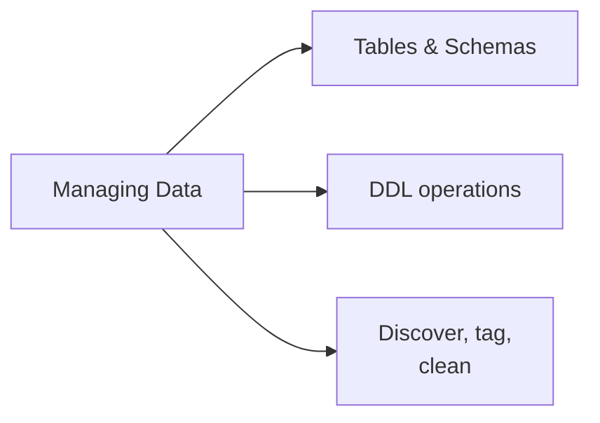

# Managing Data (8 % of Exam)

Managing Unity Catalog data from the analyst's perspective (Section 2 in the PDF): discovering and certifying datasets, tagging and lineage in Catalog Explorer, cleaning data in SQL, and the tables and schemas underneath.

## Topics Overview

## Section Contents

| File | Topic | Priority |
| :--- | :--- | :--- |
| [01-tables-schemas.md](./01-tables-schemas.md) | `CREATE / ALTER / DROP` tables and schemas; managed vs external | Medium |
| [02-discovering-tagging-and-cleaning-data.md](./02-discovering-tagging-and-cleaning-data.md) | Certified datasets, tags, lineage, and SQL data cleaning | High |

## Exam Guide Coverage

| Exam-guide skill (Section 2) | Where it is covered |
| :--- | :--- |
| Use Unity Catalog to discover, query, and manage certified datasets | [02 — Discovering & certifying](./02-discovering-tagging-and-cleaning-data.md) |
| Use the Catalog Explorer to tag a data asset and view its lineage | [02 — Tagging & lineage](./02-discovering-tagging-and-cleaning-data.md) |
| Perform data cleaning on Unity Catalog Tables in SQL, including removing invalid data or handling missing values | [02 — Cleaning data](./02-discovering-tagging-and-cleaning-data.md) |

## Key Concepts

| Concept | Why it matters |
| :--- | :--- |
| **Managed vs external tables** | Managed = UC owns the storage; external = UC owns metadata, you own storage |
| **`CREATE OR REPLACE TABLE`** | Replace a Delta table while keeping its history and grants |
| **Certified data** | `system.certification_status` = `certified`; search `certificationStatus:certified` |
| **Tags** | `APPLY TAG` needed; column tags via `ALTER TABLE ... ALTER COLUMN ... SET TAGS` |
| **Cleaning** | `DELETE ... WHERE`, `COALESCE`, `try_cast`, `DISTINCT`, `QUALIFY ROW_NUMBER() = 1` |
| **`CREATE TABLE AS SELECT` (CTAS)** | Materialise a query result as a new Delta table |
| **`ALTER TABLE` operations** | Rename columns, change types (limited), add comments, set properties |
| **Drop semantics** | `DROP TABLE` on managed = deletes data; on external = deletes only metadata |

## Related Resources

- [Delta Lake cheat sheet (shared)](../../../shared/cheat-sheets/delta-lake-commands.md)
- [Unity Catalog cheat sheet (shared)](../../../shared/cheat-sheets/unity-catalog-quick-ref.md)
- [Practice questions — Managing Data](../resources/practice-questions/06-managing-data.md)

---

**[← Previous: Understanding Databricks Platform](../05-understanding-databricks-platform/README.md) | [↑ Back to Data Analyst Associate](../README.md) | [Next: Securing Data →](../07-securing-data/README.md)**
