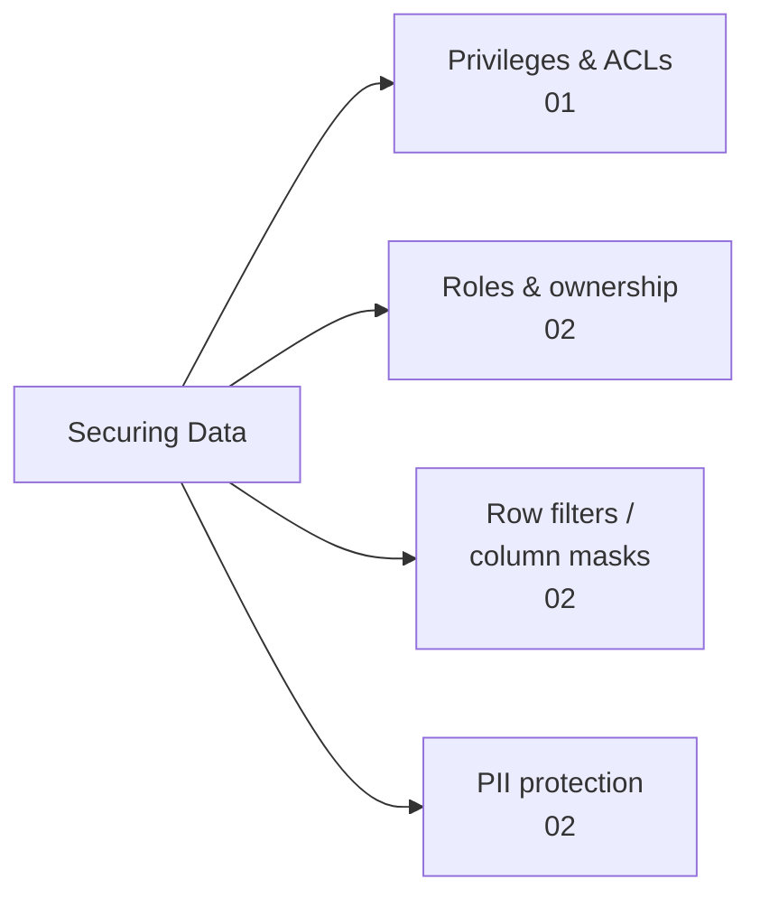

# Securing Data (8 % of Exam)

Unity Catalog roles, privileges, and ownership; the three-level namespace including volumes; row filters, column masks, and dynamic views; workspace object permissions; and PII protection (Section 9 in the PDF).

## Topics Overview

## Section Contents

| File | Topic | Priority |
| :--- | :--- | :--- |
| [01-access-control.md](./01-access-control.md) | Authentication, workspace object ACLs, `GRANT` / `REVOKE`, privilege inheritance | High |
| [02-ownership-fine-grained-access-and-pii.md](./02-ownership-fine-grained-access-and-pii.md) | Admin roles, ownership and `MANAGE`, namespace and volumes, row filters, column masks, ABAC, PII checklist | High |

## Exam Guide Coverage

| Exam-guide skill (Section 9) | Where it is covered |
| :--- | :--- |
| Use Unity Catalog roles and sharing settings to ensure workspace objects are secure | [02 — Roles & ownership](./02-ownership-fine-grained-access-and-pii.md) · [01 — Workspace ACLs](./01-access-control.md) · [Dashboard sharing](../02-creating-dashboards-and-visualizations/04-sharing-collaboration.md) |
| Understand how the 3-level namespace (Catalog / Schema / Tables or Volumes) works in the Unity Catalog | [02 — Namespace](./02-ownership-fine-grained-access-and-pii.md) · [Unity Catalog](../05-understanding-databricks-platform/01-unity-catalog.md) |
| Apply best practices for storage and management to ensure data security, including table ownership and PII protection | [02 — Ownership & PII](./02-ownership-fine-grained-access-and-pii.md) |

## Key Concepts

| Concept | Why it matters |
| :--- | :--- |
| **Owner vs grantee** | Owners have all privileges and can grant; grantees have only what they were granted |
| **`MANAGE`** | Manage privileges, transfer ownership, or drop without owning |
| **Inheritance** | Catalog- and schema-level grants apply to current and future children |
| **No `DENY` in Unity Catalog** | `DENY` exists only for the legacy `hive_metastore`; use `REVOKE` |
| **Row filter** | SQL UDF that returns TRUE/FALSE per row, attached to the table |
| **Column mask** | SQL UDF that returns the original or a masked value, one per column |
| **ABAC policies** | Tag-based rules across many tables; Databricks' recommendation at scale |
| **Volumes** | Third-level objects for files: `/Volumes/<catalog>/<schema>/<volume>/` |

## Related Resources

- [Unity Catalog cheat sheet (shared)](../../../shared/cheat-sheets/unity-catalog-quick-ref.md)
- [Row filters and column masks documentation](https://docs.databricks.com/aws/en/data-governance/unity-catalog/filters-and-masks/)
- [Practice questions — Securing Data](../resources/practice-questions/07-securing-data.md)

---

**[← Previous: Managing Data](../06-managing-data/README.md) | [↑ Back to Data Analyst Associate](../README.md) | [Next: Importing Data →](../08-importing-data/README.md)**
