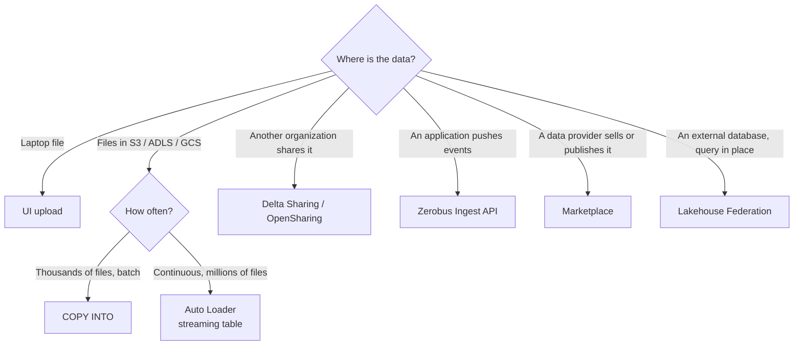

# Importing Data Overview

## Overview

Section 3 of the October 2025 exam guide asks you to "explain the approaches for bringing data into Databricks, covering ingestion from S3, data sharing with external systems via Delta Sharing, API-driven data intake, the Auto Loader feature, and Marketplace", and to "use the Databricks Workspace UI to upload a data file to the platform". The exam tests the *what* and *when* of each path, not deep configuration.

> [!abstract]
>
> - **UI upload** — small local files into a managed Delta table, or any files into a volume
> - **S3 (cloud storage)** — governed by external locations or volumes; loaded with `COPY INTO`, `read_files`, or Auto Loader
> - **Auto Loader** — incremental, exactly-once file ingestion; in SQL via streaming tables with `STREAM read_files`
> - **Delta Sharing (now OpenSharing)** — live, read-only data shared between organizations and platforms
> - **API-driven intake** — push records over an API (Zerobus Ingest) or files through the Files API / SDKs
> - **Marketplace** — data products delivered as shared catalogs

> [!tip] What the Exam Tests
>
> - Which path fits a scenario: one-off, repeatable batch, continuous, shared, pushed by an app, or bought/downloaded
> - `COPY INTO` is idempotent; Auto Loader scales to millions of files
> - Supported formats and limits of the UI upload

> [!note] Platform update (Oct 2026)
> Databricks renamed **Delta Sharing** to **OpenSharing** on June 10, 2026 ([release notes](https://docs.databricks.com/aws/en/release-notes/product/2026/june)). The exam still says Delta Sharing.

---

## Choosing a Path



## Path 1 — UI Upload

**Create or modify a table**: **+ New** → **Add or upload data** → **Create or modify a table**.

- Formats: CSV, TSV, JSON, Avro, Parquet, and text (`.csv`, `.tsv`/`.tab`, `.json`, `.avro`, `.parquet`, `.txt`); zip and tar are not supported.
- Up to **10 files at a time**, total under **2 GB**.
- Creates or overwrites a **managed Delta table**; you can preview and adjust the schema.
- Needs a running compute resource (SQL warehouse, serverless, or dedicated compute) and permission to create tables in the schema.

**Upload files to a volume**: **+ New** → **Add or upload data** → **Upload files to a volume** (or **Add data** in Catalog Explorer). Any format, up to 5 GB per file in the UI; needs `WRITE VOLUME`. Then select files in the volume and click **Create table**.

## Path 2 — Ingesting from S3 (Cloud Object Storage)

Unity Catalog governs cloud storage through **external locations** (a path plus a storage credential) and **volumes**. With access in place:

```sql
-- Batch, idempotent: re-runs skip files already loaded
COPY INTO main.bronze.orders
FROM 's3://acme-raw/orders/'
FILEFORMAT = CSV
FORMAT_OPTIONS ('header' = 'true', 'inferSchema' = 'true')
COPY_OPTIONS ('mergeSchema' = 'true');

-- Ad hoc: read files as a table
SELECT * FROM read_files('s3://acme-raw/orders/', format => 'csv');
```

Databricks guidance: use `COPY INTO` for files **in the thousands**; use **Auto Loader** for **millions** of files or more, and when schemas evolve often. `COPY INTO` makes it easier to reload a subset of re-uploaded files. The **add data UI** can also create a managed table from data in an external location.

## Path 3 — Auto Loader

Auto Loader is a Structured Streaming source (`cloudFiles`) that processes new files as they arrive.

- **Exactly once**: discovered files are tracked in a key-value store in the checkpoint; after a failure it resumes from the checkpoint.
- **Formats**: JSON, CSV, XML, Parquet, Avro, ORC, text, binary files.
- **Schema**: infers the schema, detects schema drift, and rescues unexpected data.
- **File discovery**: directory listing by default; file notification mode with file events is recommended for most workloads.
- **In SQL**: a streaming table with `STREAM read_files` uses Auto Loader:

```sql
CREATE OR REFRESH STREAMING TABLE main.bronze.events
  SCHEDULE EVERY 1 hour
AS SELECT * FROM STREAM read_files('/Volumes/main/raw/events/', format => 'json');
```

Databricks recommends Auto Loader in Lakeflow pipelines (Lakeflow Spark Declarative Pipelines) for incremental ingestion.

## Path 4 — Delta Sharing (now OpenSharing)

- A **provider** shares a **share** — a read-only collection of tables (and other assets) — with a **recipient**.
- **No replication**: recipients see the provider's updates in near real time.
- **Databricks-to-Databricks**: a recipient with `CREATE CATALOG` and `USE PROVIDER` (or a metastore admin) creates a catalog from the share, then grants access to their users; shared data is read-only.
- **Open sharing protocol**: recipients on any platform authenticate with bearer tokens or OIDC federation.

## Path 5 — API-Driven Intake

| Need | Option |
| :--- | :--- |
| An application pushes records directly into a Delta table | **Zerobus Ingest** (Lakeflow Connect): push-based streaming API into Unity Catalog managed Delta tables over gRPC SDKs, REST, and other protocols; no message bus |
| A script uploads files | Upload to a **volume** with the Databricks SDK or Files API, then `COPY INTO` or Auto Loader |
| A program runs SQL (for example a `COPY INTO`) | The **SQL Statement Execution API** (`/api/2.0/sql/statements`) runs SQL on a SQL warehouse |

## Path 6 — Databricks Marketplace

Request a data product from Marketplace in your workspace; datasets usually arrive as catalogs of tabular data shared with OpenSharing, so there is nothing to copy. See [Platform Components & Marketplace](../05-understanding-databricks-platform/03-platform-components-and-marketplace.md).

## Related: Lakehouse Federation (No Copy)

Not an ingestion path, but often an alternative: query an external database in place through a foreign catalog — see [Federated Queries](../01-executing-queries-databricks-sql-warehouses/08-federated-queries.md).

## Use Cases

| Scenario | Best path |
| :--- | :--- |
| One-off CSV from a colleague | UI upload |
| Daily batch of a few hundred files in S3 | `COPY INTO` (scheduled) |
| Files landing every few minutes, millions over time | Auto Loader (streaming table) |
| Partner gives live access to their tables | Delta Sharing (OpenSharing) |
| An app streams events into a table | Zerobus Ingest |
| Third-party reference data | Marketplace |

## Common Issues & Errors

- **Schema mismatch on `COPY INTO`** — use `COPY_OPTIONS ('mergeSchema' = 'true')`, or declare the target schema.
- **Upload rejected** — zip/tar files and files over the limits (10 files, 2 GB total) are not accepted by the table upload; use a volume and `COPY INTO`.
- **Access denied on an S3 path** — create or get access to an external location (or volume) covering the path.

## Exam Tips

> [!tip]
>
> - `COPY INTO` is idempotent — re-runs are safe
> - Thousands of files → `COPY INTO`; millions → Auto Loader
> - Delta Sharing = live, read-only, no copy; recipients create a catalog from the share
> - Auto Loader in SQL = streaming table + `STREAM read_files`

## Key Takeaways

- Six paths: UI upload, S3 batch (`COPY INTO`), Auto Loader, Delta Sharing, API intake, Marketplace
- Unity Catalog governs every path (volumes, external locations, shared catalogs)
- Federation queries in place instead of importing

## Related Topics

- [Creating Tables & Delta Time Travel](../01-executing-queries-databricks-sql-warehouses/06-creating-tables-and-time-travel.md) - `read_files` and CTAS
- [Materialized Views & Streaming Tables](../01-executing-queries-databricks-sql-warehouses/07-materialized-views-and-streaming-tables.md)
- [Managing Data](../06-managing-data/01-tables-schemas.md)

## Official Documentation

- [Create or modify a table using file upload](https://docs.databricks.com/aws/en/ingestion/create-or-modify-table)
- [Ingest data from cloud object storage](https://docs.databricks.com/aws/en/ingestion/cloud-object-storage/)
- [COPY INTO](https://docs.databricks.com/aws/en/ingestion/cloud-object-storage/copy-into/)
- [What is Auto Loader?](https://docs.databricks.com/aws/en/ingestion/cloud-object-storage/auto-loader/)
- [What is OpenSharing?](https://docs.databricks.com/aws/en/delta-sharing/)
- [Zerobus Ingest overview](https://docs.databricks.com/aws/en/ingestion/zerobus-overview)

---

**[↑ Back to Section](./README.md)**
