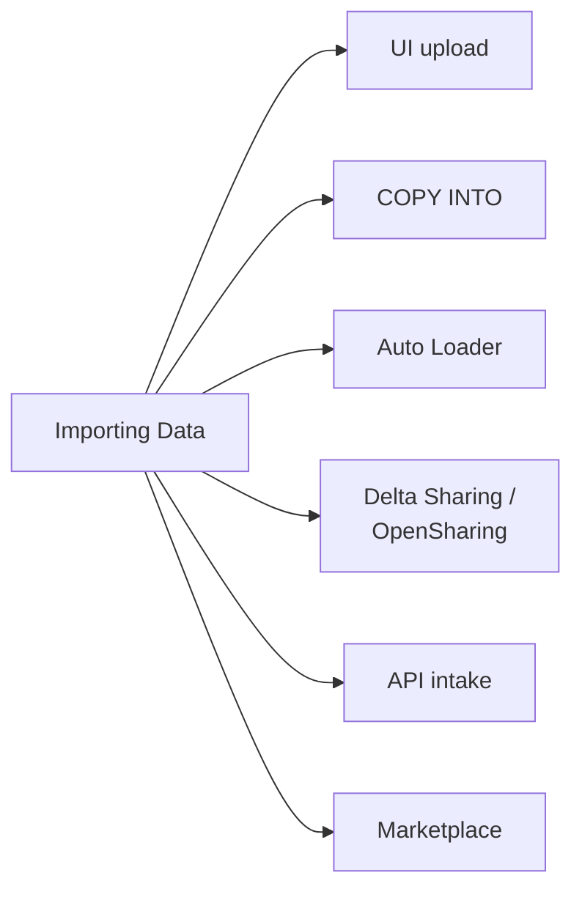

# Importing Data (5 % of Exam)

The paths for getting data into Databricks (Section 3 in the PDF): UI upload, ingestion from S3 with `COPY INTO`, Auto Loader, Delta Sharing (now OpenSharing), API-driven intake, and Marketplace.

## Topics Overview

## Section Contents

| File | Topic | Priority |
| :--- | :--- | :--- |
| [01-importing-data-overview.md](./01-importing-data-overview.md) | UI upload, S3 with `COPY INTO`, Auto Loader, Delta Sharing, Zerobus Ingest, Marketplace | High |

## Exam Guide Coverage

| Exam-guide skill (Section 3) | Where it is covered |
| :--- | :--- |
| Explain the approaches for bringing data into Databricks, covering ingestion from S3, data sharing with external systems via Delta Sharing, API-driven data intake, the Auto Loader feature, and Marketplace | [01 — Paths 2–6](./01-importing-data-overview.md) |
| Use the Databricks Workspace UI to upload a data file to the platform | [01 — Path 1](./01-importing-data-overview.md) |

## Key Concepts

| Concept | Why it matters |
| :--- | :--- |
| **UI file upload** | CSV / TSV / JSON / Avro / Parquet / text, up to 10 files under 2 GB, into a managed Delta table |
| **`COPY INTO`** | Idempotent batch load from S3 or a volume; skips files already loaded |
| **Auto Loader** | Incremental, exactly-once file ingestion; millions of files; `STREAM read_files` in SQL |
| **Delta Sharing (OpenSharing)** | Live, read-only sharing across organizations and platforms; no copy |
| **Zerobus Ingest** | Push-based API that writes records into Unity Catalog Delta tables |
| **Marketplace** | Data products delivered as shared catalogs |

## Related Resources

- [Ingest data from cloud object storage](https://docs.databricks.com/aws/en/ingestion/cloud-object-storage/)
- [What is OpenSharing?](https://docs.databricks.com/aws/en/delta-sharing/)
- [Practice questions — Importing Data](../resources/practice-questions/08-importing-data.md)

> [!note]
> The Data Analyst exam tests the *what* and *when* of each path, not deep configuration. Unlike older versions of this guide, Auto Loader **is** in scope: it is named in the exam guide.

---

**[← Previous: Securing Data](../07-securing-data/README.md) | [↑ Back to Data Analyst Associate](../README.md) | [Next: Data Modeling with Databricks SQL →](../09-data-modeling-with-databricks-sql/README.md)**
