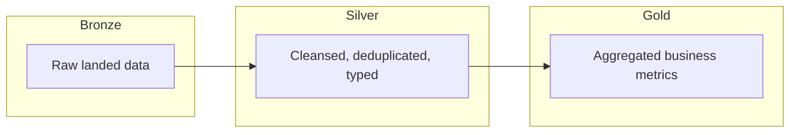
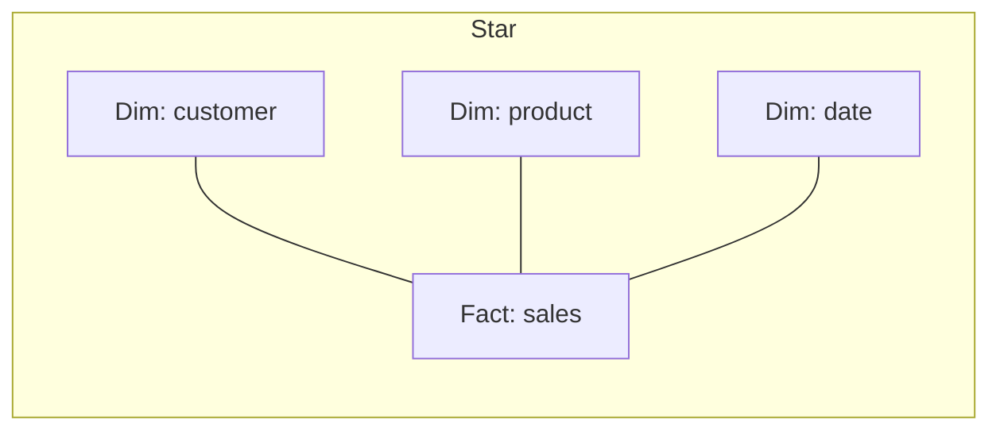
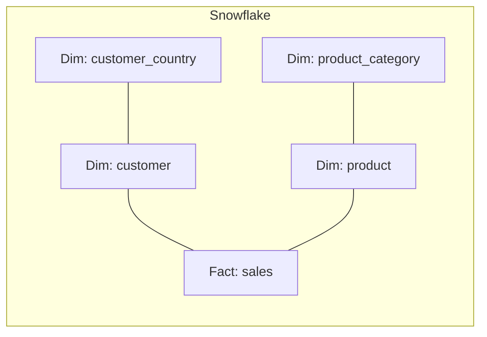
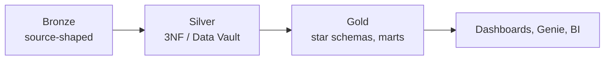

# Data Modeling with Databricks SQL Overview

## Overview

Section 8 of the October 2025 exam guide asks you to "apply industry-standard data modeling techniques, such as star, snowflake, and data vault schemas, to analytical workloads" and to "understand how industry-standard models align with the Medallion Architecture". This file covers the **medallion architecture**, **dimensional modelling** (star and snowflake), **Data Vault**, how they map to medallion layers, and the views and materialised views analysts use to shape data.

> [!abstract]
>
> - **Medallion** — Bronze (raw) → Silver (cleansed) → Gold (aggregated). Analysts mostly query Gold
> - **Star schema** — central fact table + dimension tables; the BI default
> - **Snowflake schema** — star with normalised dimensions
> - **Data Vault** — hubs, links, and satellites; write-optimised, usually in Silver
> - **View** — saved query; runs on read; no storage cost
> - **Materialised view** — pre-computed result; refreshes on schedule or trigger; trades storage for read speed

> [!tip] What the Exam Tests
>
> - The medallion vocabulary and what each layer typically contains
> - Star vs snowflake — when to prefer each
> - Data Vault building blocks and where each model sits in the medallion architecture
> - View vs materialised view trade-off (compute on read vs storage + scheduled refresh)
> - That **Gold** tables are usually what analysts query, not Bronze

---

## Medallion architecture (analyst lens)



- **Bronze** — raw, unvalidated data as it arrived; analysts rarely query it directly
- **Silver** — validated, cleaned, and enriched; data modelling often starts here
- **Gold** — highly refined data, modelled dimensionally with relationships and measures; powers dashboards, analytics, ML, and apps

Medallion is a recommended best practice, not a requirement ([medallion docs](https://docs.databricks.com/aws/en/lakehouse/medallion)).

## Star vs snowflake





| Aspect | Star | Snowflake |
| :--- | :--- | :--- |
| Joins per query | Few (one per dimension) | Many (one per normalised level) |
| Storage | Dimensions duplicated | Dimensions normalised |
| Maintenance | Easier | More flexible |
| Query speed | Faster (fewer joins) | Slower (more joins) |
| Default for BI | ✓ | When normalisation is critical |

## Data Vault

Data Vault is a modelling style built for many changing sources and full history.

| Table type | Holds |
| :--- | :--- |
| **Hub** | A core business entity (customer, product, order), keyed by its business key |
| **Link** | Only the join keys that relate hubs (like a factless fact table) |
| **Satellite** | Descriptive attributes of a hub or link, with their history |

```sql
-- Hub key: a hash of the business key (md5, sha2, and hash are available)
SELECT md5(UPPER(TRIM(customer_number))) AS customer_hk,
       customer_number,
       current_timestamp()             AS load_ts,
       'crm'                           AS record_source
FROM main.bronze.crm_customers;
```

Data Vault is **write-optimised**: new sources add hubs, links, and satellites with little rework, but answering a business question can need many joins. That is why teams publish star schemas on top of it for BI. Query-helper tables (point-in-time and bridge tables) are built for the presentation layer.

## How Models Align with the Medallion Architecture

| Layer | Typical model |
| :--- | :--- |
| **Bronze** | Source-shaped tables (landing / staging) |
| **Silver** | 3NF-like models and **Data Vault** (raw vault → business vault) |
| **Gold** | **Kimball star schemas** (or snowflake), data marts, aggregates |

Databricks guidance places "the Data Vault modeling style of hub, link and satellite tables" in the Silver layer, and "Kimball style star-schema based data models or Inmon style Data marts" in the Gold layer ([Databricks blog, June 2022](https://www.databricks.com/blog/2022/06/24/data-warehousing-modeling-techniques-and-their-implementation-on-the-databricks-lakehouse-platform.html); [Data Vault on Databricks](https://www.databricks.com/blog/2022/06/24/prescriptive-guidance-for-implementing-a-data-vault-model-on-the-databricks-lakehouse-platform.html)).



## View vs materialised view

| Aspect | Standard view | Materialised view |
| :--- | :--- | :--- |
| **Storage** | None — query stored, runs on read | Result stored as Delta data |
| **Read cost** | Re-executes every read | Reads the materialised result (fast) |
| **Freshness** | Always current | Refreshed on schedule, trigger, or `REFRESH MATERIALIZED VIEW` |
| **When to use** | Lightweight aliasing, security wrapper, dynamic filters | Expensive aggregates, dashboards, frequently re-read queries |
| **Cost trade-off** | Compute every read | Storage + scheduled compute |

```sql
-- Standard view
CREATE OR REPLACE VIEW main.gold.active_customers AS
SELECT * FROM main.silver.customers WHERE status = 'ACTIVE';

-- Materialised view (refresh manually or on a schedule)
CREATE OR REPLACE MATERIALIZED VIEW main.gold.monthly_revenue AS
SELECT date_trunc('month', order_date) AS month,
       SUM(total) AS revenue
FROM main.silver.orders
GROUP BY 1;
```

## Use Cases

- **Dashboard backing tables** → Gold layer + materialised views
- **Cross-system reporting** → Gold star schema with curated metrics
- **Ad-hoc exploration** → Silver layer with standard views for filters
- **Frequently re-aggregated reports** → materialised view to amortise compute

## Common Issues & Errors

- **Querying Bronze directly** for dashboards — slow, brittle, often missing cleaning
- **Stale materialised views** — set a refresh schedule that matches business freshness needs
- **Overusing snowflake** — extra joins for marginal normalisation benefit
- **Renaming a column referenced by views** — views may break silently until queried

## Exam Tips

> [!tip]
>
> - Analysts default to **Gold**. Bronze and Silver are usually engineer-touched.
> - Star wins for BI by default; snowflake only when normalisation matters.
> - **View = compute on read; MV = storage + scheduled compute**. Pick based on read frequency vs freshness need.
> - Data Vault = hubs (business keys), links (relationships), satellites (attributes + history); usually Silver.
> - Star schemas usually live in Gold, on top of a cleaned Silver layer or a Data Vault.
> - Streaming tables (`CREATE STREAMING TABLE`) are the third option next to views and MVs — see [Materialized Views & Streaming Tables](../01-executing-queries-databricks-sql-warehouses/07-materialized-views-and-streaming-tables.md).

## Key Takeaways

- Medallion = Bronze / Silver / Gold quality layering
- Star = BI default; snowflake = normalised dimensions
- Data Vault (Silver) → star schemas (Gold)
- View = no storage, slow read; MV = storage, fast read
- Analysts mostly query Gold

## Related Topics

- [Managing Data](../06-managing-data/01-tables-schemas.md)
- [Medallion Architecture (shared)](../../../shared/fundamentals/medallion-architecture.md)

## Official Documentation

- [`CREATE VIEW`](https://docs.databricks.com/aws/en/sql/language-manual/sql-ref-syntax-ddl-create-view)
- [Use standalone materialized views](https://docs.databricks.com/aws/en/views/materialized)
- [What is the medallion lakehouse architecture?](https://docs.databricks.com/aws/en/lakehouse/medallion)
- [Star schema (Databricks glossary)](https://www.databricks.com/glossary/star-schema)

---

**[↑ Back to Section](./README.md)**
