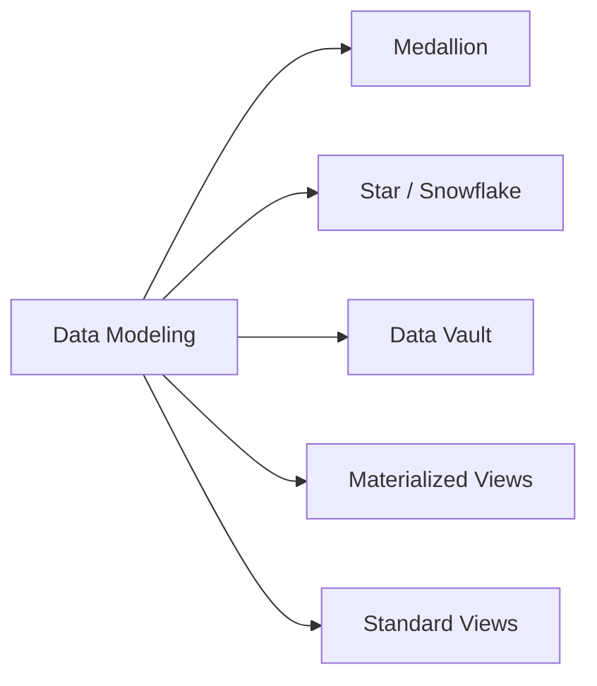

# Data Modeling with Databricks SQL (5 % of Exam)

Industry-standard models — star, snowflake, and Data Vault — and how they align with the medallion architecture (Section 8 in the PDF), plus views and materialised views for shaping data.

## Topics Overview

## Section Contents

| File | Topic | Priority |
| :--- | :--- | :--- |
| [01-data-modeling-overview.md](./01-data-modeling-overview.md) | Medallion, star vs snowflake, Data Vault, model-to-layer mapping, views vs MVs | High |

## Exam Guide Coverage

| Exam-guide skill (Section 8) | Where it is covered |
| :--- | :--- |
| Apply industry-standard data modeling techniques, such as star, snowflake, and data vault schemas, to analytical workloads | [01 — Star vs snowflake, Data Vault](./01-data-modeling-overview.md) |
| Understand how industry-standard models align with the Medallion Architecture | [01 — Models and medallion layers](./01-data-modeling-overview.md) |

## Key Concepts

| Concept | Why it matters |
| :--- | :--- |
| **Medallion (Bronze / Silver / Gold)** | Multi-hop layering — analysts typically query Gold |
| **Star schema** | Central fact table + dimension tables; the analyst-friendly canonical shape |
| **Snowflake schema** | Star with normalised dimension tables — more joins, more flexibility |
| **Data Vault** | Hubs, links, satellites; write-optimised; usually in Silver, with star schemas in Gold |
| **Standard view** | Lightweight saved query; runs on read |
| **Materialised view** | Pre-computed result, refreshed on a schedule or on change — costs storage, saves compute on read |
| **Incremental MV refresh** | When the source is Delta and the query is expressible incrementally, Databricks SQL refreshes only the changed rows — cheaper than full recompute |
| **Streaming table** | Appends new rows from append-only sources on each refresh; see [Materialized Views & Streaming Tables](../01-executing-queries-databricks-sql-warehouses/07-materialized-views-and-streaming-tables.md) |

## Related Resources

- [Medallion Architecture (shared)](../../../shared/fundamentals/medallion-architecture.md)
- [SQL functions cheat sheet (shared)](../../../shared/cheat-sheets/sql-functions.md)
- [Practice questions — Data Modeling](../resources/practice-questions/09-data-modeling.md)

---

**[← Previous: Importing Data](../08-importing-data/README.md) | [↑ Back to Data Analyst Associate](../README.md)**
