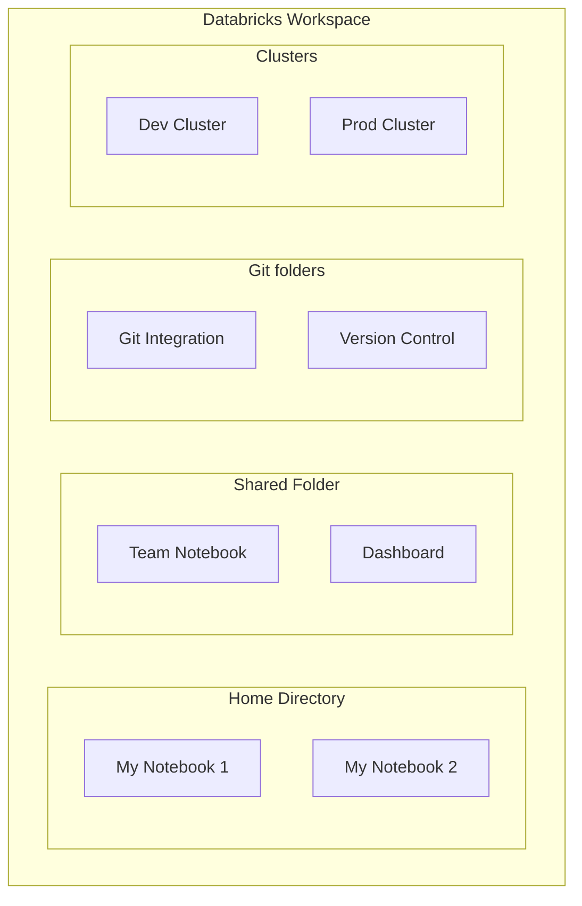

# Databricks Workspace

## Overview

The Databricks workspace is your collaborative environment for developing, testing, and deploying data engineering solutions. It provides unified tools for SQL, Python, R, and Scala development.

> [!abstract]
>
> - The workspace brings notebooks, files, Git folders, jobs, and data objects together in one browser UI
> - Magic commands (`%sql`, `%python`, `%md`, `%run`, `%pip`) change the language or behaviour of a single cell
> - `dbutils.widgets` parameterize notebooks so Lakeflow Jobs can pass values in

> [!tip] What the Exam Tests
>
> - Supports the Domain 1 core-components skill: workspace, notebooks, and collaboration
> - Mixing languages in one notebook, and `%run` vs `dbutils.notebook.run()`
> - Git integration (Git folders) is tested in Domain 5. See [Git Folders](../05-implementing-cicd/01-git-folders.md)

---

## Workspace Architecture



## Workspace Organization

### Directory Structure

| Path | Purpose | Access |
|------|---------|--------|
| `/Users/{email}/` | Personal home directory | Only you |
| `/Shared/` | Team-accessible folder | All workspace users |
| Git folder (formerly a Repo) | A workspace folder backed by a remote Git repository | Users with access to the folder |

### Best Practices

```text
Workspace Root/
├── /Shared/
│   ├── /datasets/               # Shared data references
│   ├── /dashboards/             # BI dashboards
│   ├── /team-notebooks/         # Collaborative notebooks
│   └── /production-jobs/        # Job definitions
├── /Shared/git/
│   └── /data-platform/          # Git folder (formerly a Repo) for pipeline code
└── /Users/
    └── {your-email}/
        ├── /dev/                # Personal development
        ├── /experiments/        # Ad-hoc analysis
        └── /dashboards/         # Personal dashboards
```

## Notebooks

Notebooks are the primary development tool in Databricks.

### Notebook Features

- **Multiple Languages**: SQL, Python, R, Scala in same notebook
- **Magic Commands**: Control notebook behavior
- **Collaborative**: Real-time multi-user editing
- **Version History**: Automatic revision snapshots of the notebook
- **Publishing**: Share as HTML or embed dashboards

### Language Magic Commands

```markdown
%python  # Switch to Python
%sql     # Switch to SQL
%r       # Switch to R
%scala   # Switch to Scala
%md      # Markdown formatting
%sh      # Shell commands
```

### Key Notebook Capabilities

```python
# Display formatted output

display(df)  # Better than df.show()

# Databricks widgets for interactive dashboards

dbutils.widgets.text("param_name", "default_value")
dbutils.widgets.dropdown("env", "dev", ["dev", "prod"])

# Access parameters in code

env = dbutils.widgets.get("env")

# File system operations

dbutils.fs.ls("/Volumes/main/raw/landing/")  # List files in a UC volume
dbutils.fs.mv("/path/src", "/path/dst")  # Move files
dbutils.fs.cp("/path/src", "/path/dst", True)  # Copy recursively
```

## Git Folders (formerly Repos)

**Databricks Git folders** (formerly Databricks Repos) are workspace folders backed by a remote Git repository. They are a visual Git client for creating branches, committing and pushing, pulling, merging, and resolving conflicts in the workspace UI. The exam tests this workflow in **Domain 5 — Implementing CI/CD**. See [Git Folders](../05-implementing-cicd/01-git-folders.md) for the full branch → commit & push → pull request flow.

### Branching Strategy for Data Engineering

```text
main (production)
├── dev
│   ├── feature/new-pipeline
│   └── feature/optimization
├── staging
└── hotfix/urgent-fix
```

## Clusters

Clusters provide the compute for running notebooks and jobs.

### Cluster Types

| Type | Use Case | Duration |
|------|----------|----------|
| **All-Purpose** | Interactive development | Hours to days |
| **Jobs** | Automated batch/streaming | Minutes to hours |
| **SQL Warehouse** | SQL queries & BI tools | Always on |

### Personal Compute (Single-User Cluster)

```text
# Faster startup for personal

Cluster config:
- Single worker node
- Pre-installed libraries
- Shared with no one
```

### Shared Multi-Workspace Cluster

```text
# For team collaboration

Cluster config:
- Multiple workers
- Shared libraries
- Audit logging enabled
```

## Collaboration Features

### Real-Time Collaboration

```text
Alice opens notebook → Bob opens same notebook
→ Both see cursor positions
→ Edits appear in real-time
→ Auto-merge compatible changes
```

### Comments and Discussion

```markdown
<!-- Inline comments on cells -->
Click on cell → Comments icon → Add comment
@mention team members for notifications
Resolve comments when addressed
```

### Notebook Sharing

- **View-only**: Share link for read access
- **Edit permission**: Grant editing rights
- **Folder sharing**: Permission inheritance

## Administration & Security

### Access Control

```text
Admins can control:
- User & group management
- Workspace features (notebooks, clusters, jobs)
- Data access via UC (Unity Catalog)
- External connectivity
```

### Multi-Factor Authentication (MFA)

```text
Admin console → Security
→ Enforce MFA for all users
→ Support SCIM provisioning
```

### Audit Logs

```text
Workspace Admin Console → Audit log
Captures:
- Who accessed what, when
- Login/logout activities
- Resource creation/deletion
- Settings changes
```

## Common Workspace Tasks

1. **Create a notebook**: `Workspace > Create > Notebook`
2. **Run a notebook**: Press `Run all` or `Ctrl+Alt+Enter`
3. **Export notebook**: Download as DBC, PDF, or HTML
4. **Move notebook**: Drag to folder or use `Move` option
5. **Clone notebook**: Right-click > `Clone`
6. **Publish notebook**: Share as HTML dashboard

## Use Cases

- **Collaborative Notebook Development**: Multiple data engineers work simultaneously in shared notebooks during sprint development, using real-time co-editing and inline comments for code reviews.
- **Git-Integrated CI/CD Pipelines**: Using Git folders (formerly Repos) to connect notebooks to GitHub/GitLab, enabling pull request workflows, branch-based development, and automated testing before promoting code to production.

## Common Issues & Errors

### Widget Default Used Instead of the Job's Value

**Scenario:** A notebook run by a Lakeflow Job keeps processing the widget's default date instead of the date passed by the job.
**Fix:** The job's task parameter name must match the widget name exactly (`dbutils.widgets.get("run_date")` reads a `run_date` parameter). Check the task's parameters in the run details.

### Notebook Session Timeout

**Scenario:** A notebook session times out after inactivity, and unsaved work in cells is lost.
**Fix:** Keep code in a Git folder (formerly Repos) and commit regularly, so changes are always saved to Git ([Git Folders](../05-implementing-cicd/01-git-folders.md)).

## Exam Tips

- Know the difference between the Home directory (`/Users/{email}/`), the Shared folder, and Git folders (formerly Repos)
- Understand magic commands (`%python`, `%sql`, `%md`, etc.) for switching languages within a notebook
- Global temporary views use the `global_temp` database and persist across sessions; regular temp views are session-scoped

## Key Takeaways

- **Workspace isolation**: Each workspace is independent
- **Workspace object permissions** (notebooks, folders) are separate from Unity Catalog data privileges
- **Notebook versions**: Revision history is saved automatically
- **Git folders** (formerly Repos): Git integration for production code. Tested in Domain 5
- **Multi-language support**: SQL + Python in same notebook

## Related Topics

- [Lakehouse Architecture](./01-lakehouse-architecture.md)
- [Compute and Clusters](./03-compute-clusters.md)
- [Databricks Workspace (Shared)](../../../shared/fundamentals/databricks-workspace.md)

## Official Documentation

- [Navigate the workspace](https://docs.databricks.com/aws/en/workspace/)
- [Databricks notebooks](https://docs.databricks.com/aws/en/notebooks/)
- [Databricks Git folders](https://docs.databricks.com/aws/en/repos/)

---

**[← Previous: Lakehouse Architecture](./01-lakehouse-architecture.md) | [↑ Back to Databricks Intelligence Platform](./README.md) | [Next: Compute and Clusters →](./03-compute-clusters.md)**
