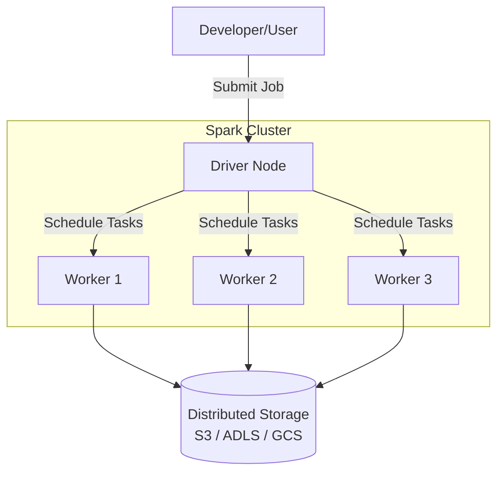
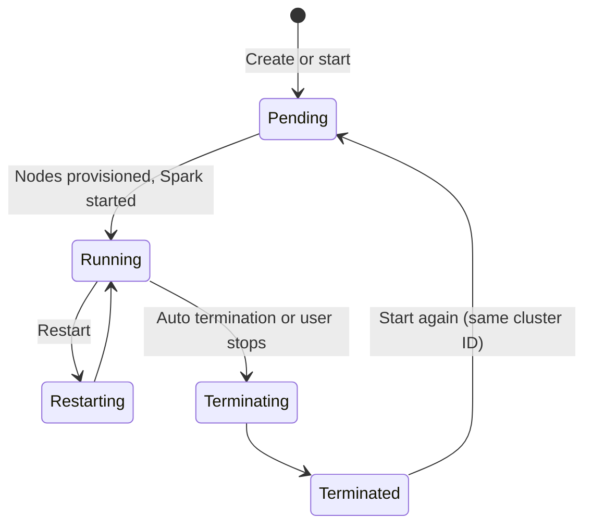

# Compute and Clusters

## Overview

Compute clusters provide scalable processing power for your notebooks and jobs. Understanding cluster types, configuration, and costs is critical for data engineers.

> [!abstract]
>
> - **All-purpose compute** is interactive and shareable. **Jobs compute** is created per run and terminated afterwards
> - **Serverless compute** (notebooks, jobs, pipelines) is managed by Databricks, starts fast, and always runs the latest runtime
> - **SQL warehouses**: serverless (about 2–6 s startup, recommended), pro, and classic. They autoscale by adding clusters for concurrency

> [!tip] What the Exam Tests
>
> - Exam guide skill: understand the compute services, their characteristics, limitations, and cost models, and pick the best option for a workload
> - Classic scenario: many concurrent ad hoc SQL users on curated tables → **serverless SQL warehouse** with autoscaling
> - Cost levers: job vs all-purpose compute, auto termination, pools, spot instances, serverless pay-per-use

---

## Cluster Architecture

## Compute Services at a Glance

| Compute | Who manages it | Startup | Typical workload | Cost model |
| :--- | :--- | :--- | :--- | :--- |
| **Serverless compute** (notebooks, jobs, Lakeflow pipelines) | Databricks. Resources aren't provisioned in your cloud account | Fast | Most new notebooks, jobs, and pipelines | DBUs for the work done, with idle time minimized. Track it in `system.billing.usage` |
| **All-purpose compute** (classic) | You: node types, workers, runtime, policies | Minutes | Interactive development, shared exploration | DBUs plus cloud VM cost while it runs, including idle time until auto termination |
| **Jobs compute** (classic) | You define it in the job; it's created for the run and terminated at the end | Minutes (faster from a pool) | Scheduled production jobs | Pay only while the run executes. Priced as a separate jobs SKU from all-purpose compute ([price list](https://www.databricks.com/product/pricing)) |
| **SQL warehouse** — serverless / pro / classic | Serverless: Databricks. Pro/classic: your cloud account | Serverless about 2–6 s; pro/classic about 4 min | BI dashboards, ad hoc SQL, many concurrent users | DBUs per warehouse size while running; auto stop ends idle billing |
| **Instance pool** | You | Seconds for clusters drawn from warm instances | Classic clusters that must start fast | You pay the cloud provider for idle instances in the pool |

A **DBU** (Databricks Unit) "is a normalized unit of processing power" used for measurement and pricing, billed at per-second granularity ([Databricks pricing](https://www.databricks.com/product/pricing)). It is not "one hour on one worker". The DBU rate depends on the compute type and instance size.

### Serverless compute

- "Serverless compute is available by default in most workspaces and does not require enablement". Workspaces without Unity Catalog must upgrade first
- **Versionless**: "Serverless workloads always run on the latest runtime version"
- Libraries are managed with **environments**, not cluster libraries. Most Spark properties can't be set (see [Spark Tuning Parameters](../03-data-transformation-and-modeling/07-spark-tuning-parameters.md))
- Estimate cost by benchmarking a representative workload and querying `system.billing.usage`. Charges can take up to 24 hours to appear

Source: [Connect to serverless compute](https://docs.databricks.com/aws/en/compute/serverless/).

### Classic compute configuration

| Setting | What the docs say |
| :--- | :--- |
| **Access mode** | **Auto** (default) picks **Standard** unless you choose an ML runtime, GPU, or DBR below 14.3, in which case it picks **Dedicated**. Standard = multiple users with isolation (Python, SQL, Scala). Dedicated = one user or group (adds R) |
| **Runtime** | Latest version for all-purpose compute. An **LTS** version for operational jobs. The **ML** runtime for data science |
| **Photon** | Enabled by default on DBR 9.1 LTS and above |
| **Autoscaling** | Min and max workers. Don't also enable `spark.dynamicAllocation.enabled` |
| **Auto termination** | Inactivity period of 10–10,000 minutes (0 opts out) |
| **Spot instances** | The driver is always on-demand. Workers can use spot |
| **Single node** | No workers. Spark runs locally on the driver, for small data and single-machine libraries |

Source: [Compute configuration reference](https://docs.databricks.com/aws/en/compute/configure), [Manage classic compute](https://docs.databricks.com/aws/en/compute/clusters-manage).

### SQL warehouse types

| Type | Photon | Predictive I/O | Intelligent Workload Management | Startup |
| :--- | :---: | :---: | :---: | :--- |
| **Serverless** | Yes | Yes | Yes | About 2–6 seconds |
| **Pro** | Yes | Yes | No | About 4 minutes |
| **Classic** | Yes | No | No | About 4 minutes |

- Databricks recommends **serverless** for ETL, BI, and exploratory analysis, "especially when query demand varies widely"
- **Scaling**: the default is a minimum and maximum of one cluster. Raise the maximum to serve more concurrent users
- **Auto stop** defaults: 10 minutes (serverless), 45 minutes (pro and classic)

Sources: [SQL warehouse types](https://docs.databricks.com/aws/en/compute/sql-warehouse/warehouse-types), [Create a SQL warehouse](https://docs.databricks.com/aws/en/compute/sql-warehouse/create).

## Choosing Compute for a Workload

| Scenario | Best choice | Why not the others |
| :--- | :--- | :--- |
| Many analysts running ad hoc SQL on curated Delta tables all day | **Serverless SQL warehouse** with autoscaling (raise max clusters) | Job compute is for scheduled ETL. A fixed all-purpose cluster can't balance concurrency against cost |
| Nightly ETL notebook with no one watching | **Serverless jobs** or **jobs compute** | All-purpose compute keeps billing between commands and is meant for interactive use |
| Interactive exploration and debugging | **Serverless notebook** or **all-purpose compute** | Jobs compute exists only for a run |
| Small dataset, pandas or scikit-learn | **Single-node** compute | Workers add cost without benefit |
| Classic job that must start within seconds | **Instance pool** (or serverless) | A cold classic cluster takes minutes to provision |
| Code needs R, a GPU, or a custom init script | **Classic** compute (dedicated access mode where required) | Serverless doesn't expose these controls |

## Cluster Lifecycle

- "When you start a terminated compute, Databricks re-creates the compute with the same ID", reinstalls libraries, and reattaches notebooks
- The compute **event log** keeps lifecycle events for 60 days. Startup failures are covered in [Compute Troubleshooting](../06-troubleshooting-monitoring-and-optimization/05-compute-troubleshooting.md)

## Cost Optimization

| Lever | Effect |
| :--- | :--- |
| Jobs compute or serverless for scheduled work | No paying for idle interactive clusters |
| Auto termination on all-purpose compute | Stops forgotten clusters from running overnight |
| Auto stop on SQL warehouses | Ends billing after the idle period |
| Spot workers | Cheaper, interruptible capacity for fault-tolerant work. The driver stays on-demand |
| Pools | Faster starts. Idle pool instances still cost cloud VM money |
| Compute policies | Admins cap node types, worker counts, and settings |
| `system.billing.usage` | Find which jobs, warehouses, and users drive spend |

## Use Cases

- **Right-Sizing for Cost Optimization**: Selecting appropriate node types and auto-scaling ranges based on workload profiling to balance performance and cost for both interactive development and production jobs.
- **Cluster Pools for Fast Startup**: Pre-provisioning idle instances in cluster pools so that job clusters spin up in under a minute, enabling tight SLA adherence for time-sensitive data pipelines.

## Common Issues & Errors

### Scheduled Jobs Running on All-Purpose Compute

**Scenario:** Nightly jobs are attached to a shared all-purpose cluster that stays up all day, and the monthly bill is high.
**Fix:** Run scheduled work on serverless jobs or jobs compute, which exist only for the run. Keep all-purpose compute for interactive work and set auto termination.

### Auto-Termination Kills Long-Running Jobs

**Scenario:** A cluster's auto-termination setting shuts down the cluster while a long-running job is still executing, causing the job to fail.
**Fix:** Increase the auto-termination timeout for interactive clusters running long workloads, or use dedicated job clusters that only terminate when the job completes.

### Cluster Startup Time Delays

**Scenario:** Job clusters take 5-10 minutes to provision, causing unacceptable latency for time-sensitive pipelines.
**Fix:** Use serverless jobs compute, or an instance pool so classic clusters draw from pre-warmed instances.

## Exam Tips

- Many concurrent ad hoc SQL users → **serverless SQL warehouse** with autoscaling. Scheduled ETL → serverless jobs or jobs compute
- Jobs compute is created for a run and terminated afterwards, so you never pay for idle interactive time
- A DBU is a normalized unit of processing power, billed per second. It is not "one hour on one worker"
- Serverless SQL warehouses start in seconds. Pro and classic take minutes
- Spot instances apply to workers. The driver is always on-demand

## Key Takeaways

- **Serverless** (notebooks, jobs, pipelines, SQL warehouses) is managed by Databricks, starts fast, and always runs the latest runtime
- **All-purpose** compute is for interactive work. **Jobs compute** is for scheduled runs
- **SQL warehouses**: serverless is recommended. Scale out with max clusters for concurrency
- **Cost levers**: auto termination, auto stop, spot workers, pools, policies, and `system.billing.usage`

## Related Topics

- [Databricks Workspace](./02-databricks-workspace.md)
- [Spark Fundamentals (Shared)](../../../shared/fundamentals/spark-fundamentals.md)
- [Performance Optimization (Shared)](../../../shared/cheat-sheets/performance-optimization.md)

## Official Documentation

- [Compute configuration reference](https://docs.databricks.com/aws/en/compute/configure)
- [Connect to serverless compute](https://docs.databricks.com/aws/en/compute/serverless/)
- [SQL warehouse types](https://docs.databricks.com/aws/en/compute/sql-warehouse/warehouse-types)
- [Databricks pricing](https://www.databricks.com/product/pricing)

---

**[← Previous: Databricks Workspace](./02-databricks-workspace.md) | [↑ Back to Databricks Intelligence Platform](./README.md) | [Next: Delta Lake Fundamentals →](./04-delta-lake-fundamentals.md)**
