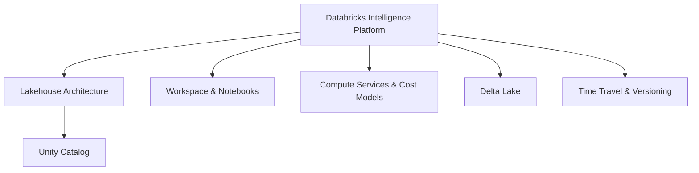

# Databricks Intelligence Platform (6 % of Exam)

Domain 1 of the August 2026 blueprint covers two skills. The first is knowing the platform's core components: the lakehouse architecture, Delta Lake, and Unity Catalog. The second is choosing the right compute service for a workload based on its characteristics, limitations, and cost model. The weight is small, but every other domain builds on this vocabulary.

> [!note] Platform update (Oct 2026)
> The certification page now calls the platform the **Databricks Data + AI Platform**. The exam's domain name is still "Databricks Intelligence Platform", so expect that wording in question stems ([certification page](https://www.databricks.com/learn/certification/data-engineer-associate)).

## Topics Overview

## Section Contents

| File | Topic | Priority |
| :--- | :--- | :--- |
| [01-lakehouse-architecture.md](./01-lakehouse-architecture.md) | Lakehouse concept, medallion layers, Unity Catalog's role | High |
| [02-databricks-workspace.md](./02-databricks-workspace.md) | Workspace organization, notebooks, magic commands, widgets | Medium |
| [03-compute-clusters.md](./03-compute-clusters.md) | All-purpose, job, serverless, and SQL warehouse compute; cost models | High |
| [04-delta-lake-fundamentals.md](./04-delta-lake-fundamentals.md) | ACID transactions, transaction log, DML, schema enforcement | High |
| [05-time-travel-versioning.md](./05-time-travel-versioning.md) | `DESCRIBE HISTORY`, `VERSION AS OF`, `RESTORE`, clones | High |

## Official Skill Coverage (August 2026)

| Exam-guide skill (paraphrased) | Where it is covered |
| :--- | :--- |
| Core platform components: architecture, Delta Lake, Unity Catalog | [01](./01-lakehouse-architecture.md), [04](./04-delta-lake-fundamentals.md), [05](./05-time-travel-versioning.md), [UC basics](../07-governance-and-security/01-unity-catalog-basics.md) |
| Compute services: characteristics, limitations, cost models, choosing per workload | [03](./03-compute-clusters.md) |

## Key Concepts

- **Lakehouse**: one platform that combines data lake storage with warehouse reliability, serving both BI and AI from a single source of truth
- **Delta Lake**: the default table format. It provides ACID transactions, schema enforcement, and time travel on cloud object storage
- **Unity Catalog**: the governance layer for data and AI assets: access control, lineage, and auditing
- **Compute choice**: all-purpose compute for interactive work, jobs compute or serverless jobs for scheduled pipelines, SQL warehouses (serverless recommended) for BI and ad hoc SQL

## Related Resources

- [Databricks Workspace Fundamentals](../../../shared/fundamentals/databricks-workspace.md)
- [Platform Architecture](../../../shared/fundamentals/platform-architecture.md)
- [Delta Lake Basics](../../../shared/fundamentals/delta-lake-basics.md)
- [Delta Lake Commands Cheat Sheet](../../../shared/cheat-sheets/delta-lake-commands.md)

## Next Steps

Proceed to [02 — Data Ingestion and Loading](../02-data-ingestion-and-loading/README.md) to learn how data gets into Unity Catalog tables.

---

**[← Back to Certification](../README.md) | [Next: Data Ingestion and Loading →](../02-data-ingestion-and-loading/README.md)**
