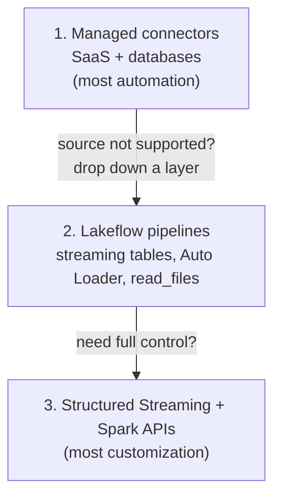
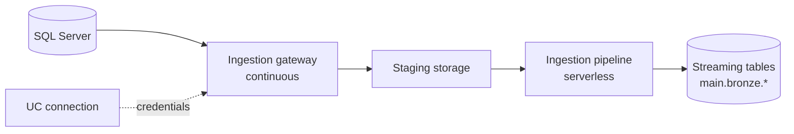

# Ingestion Patterns and Lakeflow Connect

## Overview

Every pipeline starts with getting data into a Unity Catalog-governed table. This file covers the three ingestion **patterns** (batch, streaming, incremental) and the **sources** the exam names: local files, Lakeflow Connect standard connectors, and Lakeflow Connect managed connectors. It also covers how to **choose** between Auto Loader, Lakeflow Connect, partner connectors, and hand-written code.

> [!abstract]
>
> - **Batch** loads a bounded set of data per run. **Streaming** processes records continuously as they arrive. **Incremental** processes only what is new since the last run, either as triggered micro-batches or a scheduled `COPY INTO`
> - **Local files** go in through the **Add or upload data** UI, either into a UC volume or straight into a new managed table
> - **Standard connectors** (cloud object storage, Kafka, Kinesis, Pub/Sub, SFTP) are customizable and run with Auto Loader, `read_files`, streaming tables, or Structured Streaming. **Managed connectors** (SaaS apps and databases) are fully managed ingestion pipelines on serverless compute
> - Databricks recommends **starting with the most managed layer** and moving down a layer only when it can't meet your requirement

> [!tip] What the Exam Tests
>
> - Exam guide skills: ingestion patterns and sources (local files, standard and managed connectors), configuring Lakeflow Connect, and choosing an ingestion method by volume, frequency, data type, and governance needs
> - Recognising which connector layer fits a scenario: a SaaS source maps to a managed connector, files in cloud storage map to Auto Loader, and a database with an unsupported connector maps to JDBC
> - The building blocks of a managed database connector: connection, ingestion gateway, and ingestion pipeline

---

## The three ingestion patterns

| Pattern | What runs | Typical Databricks tool | Latency vs cost |
| :--- | :--- | :--- | :--- |
| **Batch (full)** | Reads the whole source each run and overwrites or replaces the target | `CREATE OR REPLACE TABLE ... AS SELECT`, `spark.read` + `mode("overwrite")` | Simple, but cost grows with source size |
| **Incremental batch** | Each scheduled run processes only data that arrived since the last run, then stops | `COPY INTO`, Auto Loader with `trigger(availableNow=True)`, streaming tables refreshed on a schedule | Low cost, latency equal to the schedule |
| **Streaming** | A long-running query processes new records continuously | Auto Loader or Kafka with a `processingTime` trigger, continuous pipelines | Lowest latency, compute is always on |

The difference between "incremental" and "streaming" is how often the work runs, not which API you use. The same Auto Loader stream becomes an incremental batch job when you run it with `availableNow` from a scheduled Lakeflow Job.

```python
# Same source, two patterns — only the trigger differs
stream = (spark.readStream.format("cloudFiles")
    .option("cloudFiles.format", "json")
    .option("cloudFiles.schemaLocation", "/Volumes/main/raw/_schemas/orders")
    .load("/Volumes/main/raw/landing/orders"))

# Incremental batch: process everything new, then stop (schedule with Lakeflow Jobs)
(stream.writeStream
    .option("checkpointLocation", "/Volumes/main/raw/_checkpoints/orders")
    .trigger(availableNow=True)
    .toTable("main.bronze.orders"))

# Streaming: check for new files every minute until stopped
# (stream.writeStream ... .trigger(processingTime="1 minute") ...)
```

> [!note]
> `Trigger.Once` is deprecated in Databricks Runtime 11.3 LTS and above. Use `availableNow` for incremental batch workloads ([trigger intervals](https://docs.databricks.com/aws/en/structured-streaming/triggers)).

## Importing local files

The exam guide lists local files as a source. The Databricks UI offers two paths:

| Path | Result | Requirements |
| :--- | :--- | :--- |
| **New → Add or upload data → Upload files to a volume** | Files land in a Unity Catalog volume (`/Volumes/<catalog>/<schema>/<volume>/...`) | `WRITE VOLUME` on the volume; `USE CATALOG` and `USE SCHEMA` on the parents |
| **Create table** from uploaded files in Catalog Explorer | A Unity Catalog **managed table** created from the files | `CREATE TABLE` on the target schema and a running SQL warehouse |

- UI uploads have a **5 GB per-file limit**. Use the Databricks SDK for Python for larger files
- Notebooks also offer **File → Upload files to volume**
- Once files are in a volume, any reader can load them: `read_files`, `COPY INTO`, or Auto Loader

```sql
-- Read a CSV that was uploaded to a volume
SELECT * FROM read_files(
  '/Volumes/main/raw/uploads/customers.csv',
  format => 'csv',
  header => true
);
```

## Lakeflow Connect: three layers

Lakeflow Connect offers connectors for local files, enterprise applications, databases, cloud storage, and message buses. All of them are governed by Unity Catalog and orchestrated with Lakeflow Jobs ([What is Lakeflow Connect?](https://docs.databricks.com/aws/en/ingestion/overview)).



### Standard connectors (customizable)

Standard connectors are the customizable SQL and Spark ingestion paths for:

- **Cloud object storage** (S3, ADLS, GCS, UC volumes): Auto Loader, `read_files`, streaming tables, `COPY INTO`
- **Message buses**: Apache Kafka, Amazon Kinesis, Google Pub/Sub (Structured Streaming and Lakeflow pipelines)
- **SFTP servers**

You write the ingestion logic yourself, which gives you full control over transformations, schema handling, and triggers.

A standard-connector example for a message bus:

```python
from pyspark.sql.functions import col

events = (spark.readStream
    .format("kafka")
    .option("kafka.bootstrap.servers", "broker1:9092")
    .option("subscribe", "orders")
    .option("startingOffsets", "latest")
    .load()
    # key and value always arrive as binary — cast or deserialize them
    .select(col("key").cast("string"), col("value").cast("string").alias("json"),
            "topic", "partition", "offset", "timestamp"))

(events.writeStream
    .option("checkpointLocation", "/Volumes/main/raw/_checkpoints/kafka_orders")
    .trigger(processingTime="30 seconds")
    .toTable("main.bronze.kafka_orders"))
```

The Kafka source returns `key`, `value` (both binary), `topic`, `partition`, `offset`, `timestamp`, and `timestampType` ([Connect to Apache Kafka](https://docs.databricks.com/aws/en/connect/streaming/kafka)).

### Managed connectors (fully managed)

Managed connectors "build on Lakeflow pipelines, offering even more automation for the most popular data sources" ([Lakeflow Connect overview](https://docs.databricks.com/aws/en/ingestion/overview)). Connector categories include:

| Category | Examples from the docs |
| :--- | :--- |
| SaaS | Salesforce, HubSpot, Jira, Workday, Microsoft Dynamics 365 |
| Database (CDC) | MySQL, PostgreSQL, SQL Server, Oracle |
| Query-based | Query the source directly, with no CDC setup |
| File source | Google Drive, SharePoint |
| Streaming | RabbitMQ |

New connectors arrive often, many in Beta first. Check the [Lakeflow Connect connector list](https://docs.databricks.com/aws/en/ingestion/lakeflow-connect/) before assuming a source is or isn't supported.

## Configuring a managed connector

A managed connector produces an ingestion pipeline governed by Unity Catalog ([connector concepts](https://docs.databricks.com/aws/en/ingestion/lakeflow-connect/)). Its components:

| Component | What it is |
| :--- | :--- |
| **Connection** | A Unity Catalog securable that stores the source's authentication details |
| **Ingestion gateway** *(database connectors only)* | Runs as a continuous task in its own job and stages change data for continuous change capture |
| **Ingestion pipeline** | Reads the source (or the staged changes) and writes to the destination; query-based pipelines run on serverless compute by default |
| **Destination tables** | **Streaming tables** in the catalog and schema you choose |



Typical configuration steps:

1. **Create the connection** in Catalog Explorer, or programmatically with the Connections API or `databricks connections create --json ...`. Connectors whose only authentication option is browser-based OAuth (OAuth U2M) can't be created programmatically
2. **Create the ingestion pipeline**: pick the connection, the source objects (tables or reports), and the destination catalog and schema
3. **Add a schedule**: "For each schedule that you add to a pipeline, Lakeflow Connect automatically creates a job for it," with the ingestion pipeline as a task. You can add downstream tasks to that job
4. **Deploy as code** (optional): ingestion pipelines can be deployed with Declarative Automation Bundles (see [Domain 5](../05-implementing-cicd/02-declarative-automation-bundles.md))

The first run ingests everything you selected. Later runs use change tracking to ingest only what changed, when the source supports it. Monitor cost with the `system.billing.usage` system table.

### Direct writes from applications (Zerobus Ingest)

Lakeflow Connect also has a push-based path. The **Zerobus Ingest** API lets applications write records directly to streaming tables, with no file landing zone or message bus in between ([What is Lakeflow Connect?](https://docs.databricks.com/aws/en/ingestion/overview)). It isn't named in the exam guide, but it's useful context when a scenario describes an application that should push events straight into a table.

## Partner connectors

When neither a managed connector nor a standard connector fits, Databricks lists **validated ingestion partners**, some of which are available through **Partner Connect**. Choose a partner tool when your organization already licenses it for a source Databricks doesn't cover natively. The trade-off is a second vendor to manage, plus governance that starts only once the data lands in Unity Catalog.

## Choosing an ingestion method

| Requirement in the scenario | Best fit | Why |
| :--- | :--- | :--- |
| Files keep arriving in S3/ADLS/GCS, schema may drift, thousands to billions of files | **Auto Loader** (or a streaming table with `STREAM read_files`) | Scalable file discovery, exactly-once checkpointing, schema evolution |
| SQL-only team, periodic loads of a modest, known set of files | **`COPY INTO`** | Idempotent SQL command, no streaming concepts required |
| Salesforce or Workday objects | **Managed connector** | No code. Incremental, serverless, governed |
| Operational database with CDC support | **Managed database connector** (gateway + pipeline) | Continuous change capture without custom code |
| Kafka, Kinesis, or Pub/Sub events | **Standard connector** (Structured Streaming or a Lakeflow pipeline) | Low-latency streaming with your own parsing |
| Source with only a JDBC driver or a REST API | **Notebook code** scheduled by Lakeflow Jobs | See [03-jdbc-rest-and-semi-structured-ingestion.md](./03-jdbc-rest-and-semi-structured-ingestion.md) |
| One-off spreadsheet from a business user | **Upload to a volume / Create table UI** | Fastest path for small, local files |
| You must *not* copy the data | **Lakehouse Federation** or **OpenSharing** | Query or share in place instead of ingesting |

Decision dimensions the exam guide calls out: **data volume, ingestion frequency, data types, and governance needs with Unity Catalog**. Every option above lands data in UC-governed tables. Managed connectors also keep the source credentials in a UC connection, so access to the source is governed too.

## Landing zones in Unity Catalog

Every source in the exam guide ends in "Unity Catalog-governed tables". The raw files that feed those tables should be governed too:

| Landing option | Path form | Governing privilege | Notes |
| :--- | :--- | :--- | :--- |
| **Managed volume** | `/Volumes/<catalog>/<schema>/<volume>/...` | `READ VOLUME` / `WRITE VOLUME` | UC manages the storage location |
| **External volume** | `/Volumes/<catalog>/<schema>/<volume>/...` over an external location | `READ VOLUME` / `WRITE VOLUME` | Points at existing cloud storage |
| **External location** (direct path) | `s3://...`, `abfss://...`, `gs://...` | `READ FILES` / `WRITE FILES` | Databricks recommends volumes over direct path access |
| DBFS root / DBFS mounts | `dbfs:/...`, `/mnt/...` | None (legacy) | **Deprecated.** Databricks recommends UC volumes, external locations, or workspace files instead |

```sql
-- A landing volume for raw vendor files, readable by the ingestion service principal
CREATE VOLUME IF NOT EXISTS main.raw.landing;
GRANT READ VOLUME, WRITE VOLUME ON VOLUME main.raw.landing TO `ingest-sp`;
```

Sources: [UC privileges reference](https://docs.databricks.com/aws/en/data-governance/unity-catalog/manage-privileges/privileges), [What is DBFS?](https://docs.databricks.com/aws/en/dbfs/).

## Worked scenarios

**Scenario 1: nightly partner drops.** A partner writes about 200 CSV files to an S3 prefix each night. The schema occasionally gains a column. The analytics team wants the data by 6 AM and no compute running during the day.

- Use Auto Loader with `availableNow` (incremental batch), scheduled by a Lakeflow Job or started by a file arrival trigger
- Not a managed connector, because the source is files rather than a SaaS app or database
- Not `COPY INTO` alone. It works, but schema drift handling and very large file counts favour Auto Loader

**Scenario 2: CRM objects for sales reporting.** Sales leadership wants Salesforce accounts and opportunities refreshed hourly, and the team has no spare engineers.

- Use the **Salesforce managed connector** with an hourly schedule. Lakeflow Connect creates the job and lands streaming tables
- Custom REST code would work, but it fails the "least operational overhead" requirement

**Scenario 3: a legacy on-premises database with no managed connector.** The source is reachable over the network and has a JDBC driver.

- Use a **JDBC read in a notebook**, parallelized with `partitionColumn` and bounds, written to a UC table and scheduled with Lakeflow Jobs
- If the database is supported by Lakehouse Federation and the data must not be copied, federate instead of ingesting

## Use Cases

- **SaaS CRM replication**: a managed Salesforce connector lands objects as streaming tables in `main.bronze`, refreshed hourly by the job Lakeflow Connect creates for the schedule
- **Database CDC offload**: a SQL Server managed connector keeps Bronze tables close to real time without custom change-tracking code
- **Analyst spreadsheet onboarding**: a business user uploads a CSV to a volume and creates a managed table from Catalog Explorer, with no code involved
- **IoT file drops**: devices write JSON to cloud storage and Auto Loader ingests it incrementally into Bronze

## Common Issues & Errors

### Writing a Custom Poller for a Supported SaaS Source

**Scenario:** A team writes a notebook that pages through a SaaS REST API every hour, and keeps hitting rate limits and schema changes.
**Fix:** Check the managed connector list first. Databricks recommends starting with the most managed layer, and a managed connector handles incremental reads and schema handling for you.

### Connector Can't Be Created From CI

**Scenario:** A bundle deployment fails to create a connection for a source that authenticates only through browser-based OAuth.
**Fix:** Connectors that support only OAuth U2M must be created interactively, for example in Catalog Explorer. Create the connection once, then reference it from the pipeline definition.

### Upload Rejected for a Large File

**Scenario:** A 9 GB CSV upload through the UI fails.
**Fix:** The UI upload limit is 5 GB per file. Use the Databricks SDK for Python, or land the file in cloud storage and ingest it with Auto Loader.

### Re-ingesting Everything on Every Run

**Scenario:** A nightly notebook reads the whole landing directory with `spark.read` and overwrites the Bronze table. Run time grows every week as files accumulate.
**Fix:** Switch to an incremental pattern: Auto Loader with `availableNow`, or `COPY INTO`. Both track which files they have already processed, so each run handles only new arrivals.

### Raw Files Landed in DBFS Mounts

**Scenario:** A new pipeline lands vendor files under `/mnt/vendor/` because an old notebook did, and auditors ask who can read them.
**Fix:** DBFS mounts are deprecated and aren't governed by Unity Catalog. Land files in a UC volume or external location, and grant `READ VOLUME` or `READ FILES` to the identities that need them.

## Exam Tips

> [!tip] Exam Tips
>
> - The phrase "most managed" or "least operational overhead" usually points to a **managed connector** (SaaS or database) or **Auto Loader** (files)
> - Managed connectors write to **streaming tables**, run on **serverless** compute, and are scheduled through an auto-created **Lakeflow Job**
> - The **ingestion gateway** exists only for **database** connectors
> - `availableNow` turns a stream into an incremental batch run. `Trigger.Once` is deprecated
> - If the scenario says the data must *not* be copied, ingestion is the wrong answer. Use Lakehouse Federation or sharing instead

## Key Takeaways

- Batch, incremental, and streaming differ in how often the work runs and how much it processes
- Local files go in through a volume upload or the Create table UI, with a 5 GB per-file UI limit
- Standard connectors are customizable code paths. Managed connectors are fully managed pipelines
- A managed connector is built from a UC connection, a gateway (databases only), an ingestion pipeline, and streaming tables
- Choose by volume, frequency, data type, and governance, and start at the most managed layer

## Related Topics

- [COPY INTO and Auto Loader](./02-copy-into-and-auto-loader.md)
- [JDBC, REST, and Semi-Structured Ingestion](./03-jdbc-rest-and-semi-structured-ingestion.md)
- [Gold Layer Objects (streaming tables)](../03-data-transformation-and-modeling/06-gold-layer-objects.md)
- [Medallion Architecture](../../../shared/fundamentals/medallion-architecture.md)

## Official Documentation

- [What is Lakeflow Connect?](https://docs.databricks.com/aws/en/ingestion/overview)
- [Lakeflow Connect connector concepts](https://docs.databricks.com/aws/en/ingestion/lakeflow-connect/)
- [Ingest with SQL and Spark APIs (standard connectors)](https://docs.databricks.com/aws/en/ingestion/)
- [Work with files in Unity Catalog volumes](https://docs.databricks.com/aws/en/volumes/volume-files)
- [Configure Structured Streaming trigger intervals](https://docs.databricks.com/aws/en/structured-streaming/triggers)

---

**[↑ Back to Data Ingestion and Loading](./README.md) | [Next: COPY INTO and Auto Loader →](./02-copy-into-and-auto-loader.md)**
