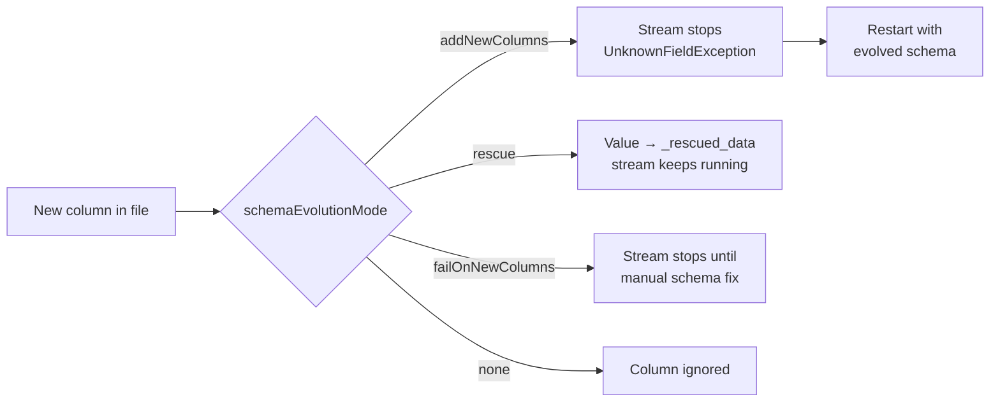

# COPY INTO and Auto Loader

## Overview

Databricks has two file-ingestion tools for cloud object storage (S3, ADLS, GCS) and Unity Catalog volumes. **`COPY INTO`** is an idempotent SQL command. **Auto Loader** is a Structured Streaming source called `cloudFiles`. Both load files incrementally into Unity Catalog-governed Delta tables. They differ in scale, schema handling, and how they discover files.

> [!abstract]
>
> - **`COPY INTO`** is retriable and idempotent: files already loaded are skipped on later runs. `COPY_OPTIONS ('mergeSchema' = 'true')` evolves the target schema
> - **Auto Loader** tracks discovered files in a RocksDB store inside the checkpoint, giving exactly-once processing. It can process billions of files
> - **Schema handling**: `cloudFiles.schemaLocation` enables inference and evolution. `cloudFiles.schemaEvolutionMode` controls what happens when new columns appear. `_rescued_data` captures values that don't fit the schema
> - **File detection**: directory listing (the default) or file notification mode. Databricks recommends file notification with **file events** for most workloads

> [!tip] What the Exam Tests
>
> - Exam guide skills: `COPY INTO` for incremental loads into UC tables, and Auto Loader with schema enforcement and evolution in directory listing or file notification mode
> - Why a re-run of `COPY INTO` loads zero new rows, and how to force a reload
> - Each `schemaEvolutionMode` value and its behaviour when a new column arrives
> - When Auto Loader beats `COPY INTO`: scale, continuous arrival, and schema drift

---

## COPY INTO

### Syntax

```sql
COPY INTO target_table
FROM 'source_path_or_volume'
FILEFORMAT = JSON | CSV | XML | AVRO | ORC | PARQUET | TEXT | BINARYFILE
[ VALIDATE [ ALL | num_rows ROWS ] ]
[ FILES = ('f1.json', 'f2.json') | PATTERN = 'glob' ]
[ FORMAT_OPTIONS ( 'option' = 'value', ... ) ]
[ COPY_OPTIONS ( 'mergeSchema' = 'true', 'force' = 'false' ) ]
```

### Loading into a Unity Catalog table

```sql
-- 1. Create an empty placeholder table; COPY INTO infers the schema on first load
CREATE TABLE IF NOT EXISTS main.bronze.booking_updates;

-- 2. Load JSON from a UC volume, inferring and evolving the schema
COPY INTO main.bronze.booking_updates
FROM '/Volumes/main/raw/landing/booking_updates'
FILEFORMAT = JSON
FORMAT_OPTIONS ('mergeSchema' = 'true', 'multiLine' = 'true')
COPY_OPTIONS ('mergeSchema' = 'true');

-- 3. Re-run tomorrow: only files that arrived since the last run are loaded
```

Key behaviours ([Get started with COPY INTO](https://docs.databricks.com/aws/en/ingestion/cloud-object-storage/copy-into/), [COPY INTO reference](https://docs.databricks.com/aws/en/sql/language-manual/delta-copy-into)):

| Behaviour | Detail |
| :--- | :--- |
| **Idempotent** | "Files in the source location that have already been loaded are skipped," even if they were modified after loading |
| **Schemaless placeholder** | On DBR 11.3 LTS+, create an empty table and set `mergeSchema` in `COPY_OPTIONS` to infer the schema during the load |
| **`force`** | `'force' = 'true'` disables idempotency and reloads files whether or not they were loaded before |
| **`FILES`** | An explicit list of up to **1,000** files. It can't be combined with `PATTERN` |
| **`VALIDATE`** | Checks the data without loading it, which is useful for a dry run |
| **Formats** | CSV, JSON, XML, Avro, ORC, Parquet, text, binary |
| **UC access** | Read from a UC volume or an external location. The target needs `CREATE TABLE` (first load) or `MODIFY` |

> [!note] Recommendation from the docs
> "For a more scalable and robust file ingestion experience, Databricks recommends that SQL users use streaming tables" (`CREATE STREAMING TABLE ... AS SELECT * FROM STREAM read_files(...)`), which use Auto Loader underneath ([COPY INTO](https://docs.databricks.com/aws/en/ingestion/cloud-object-storage/copy-into/)).

## Auto Loader

### What it is

Auto Loader "incrementally and efficiently processes new data files as they arrive in cloud storage" ([Auto Loader overview](https://docs.databricks.com/aws/en/ingestion/cloud-object-storage/auto-loader/)). Key facts:

- It is a **Structured Streaming source** named `cloudFiles`
- Sources: S3, ADLS, GCS, UC volumes, and Azure Blob Storage
- Formats: JSON, CSV, XML, Parquet, Avro, ORC, text, binary file
- Discovered files are recorded in a **RocksDB** key-value store in the **checkpoint**, which "ensures that data is processed exactly once." After a failure, it resumes from the checkpoint
- It works as a continuous stream or as an **incremental batch** with `trigger(availableNow=True)`

### Python pattern

```python
bronze = (spark.readStream
    .format("cloudFiles")
    .option("cloudFiles.format", "json")
    .option("cloudFiles.schemaLocation", "/Volumes/main/raw/_meta/events/schema")
    .option("cloudFiles.inferColumnTypes", "true")
    .option("cloudFiles.schemaHints", "event_ts TIMESTAMP, amount DECIMAL(10,2)")
    .load("/Volumes/main/raw/landing/events"))

(bronze.writeStream
    .option("checkpointLocation", "/Volumes/main/raw/_meta/events/checkpoint")
    .trigger(availableNow=True)            # incremental batch, then stop
    .toTable("main.bronze.events"))
```

### SQL pattern (streaming table)

```sql
CREATE OR REFRESH STREAMING TABLE main.bronze.events
AS SELECT * FROM STREAM read_files(
  '/Volumes/main/raw/landing/events',
  format => 'json'
);
```

Inside a Lakeflow pipeline, the pipeline manages the schema location and checkpoint for you.

### Python pattern inside a Lakeflow pipeline

```python
from pyspark import pipelines as dp

@dp.table(name="bronze_events", comment="Raw events landed by Auto Loader")
def bronze_events():
    return (spark.readStream
        .format("cloudFiles")
        .option("cloudFiles.format", "json")
        .load("/Volumes/main/raw/landing/events"))
```

A streaming read under `@dp.table` defines a **streaming table**. A batch read under `@dp.materialized_view` defines a materialized view. No `schemaLocation` or `checkpointLocation` is needed, because the pipeline manages both.

> [!note] Platform update (Oct 2026)
> "The `dlt` module has been replaced by the `pyspark.pipelines` module." Code that uses `import dlt` and `@dlt.table` still runs, but Databricks recommends `from pyspark import pipelines as dp` ([Python reference](https://docs.databricks.com/aws/en/ldp/developer/python-ref)). The product the exam calls **Lakeflow Declarative Pipelines** was renamed **Lakeflow Spark Declarative Pipelines** on Nov 12, 2025 ([release notes](https://docs.databricks.com/aws/en/release-notes/product/2025/november)).

### More COPY INTO patterns

```sql
-- Dry run: check that the first 10 rows parse, without loading anything
COPY INTO main.bronze.orders
FROM '/Volumes/main/raw/landing/orders'
FILEFORMAT = CSV
VALIDATE 10 ROWS
FORMAT_OPTIONS ('header' = 'true');

-- Load only one vendor's files with a glob pattern
COPY INTO main.bronze.orders
FROM '/Volumes/main/raw/landing/orders'
FILEFORMAT = CSV
PATTERN = 'vendor_a_*.csv'
FORMAT_OPTIONS ('header' = 'true', 'inferSchema' = 'true');
```

### Common options

| Option | Default | Purpose |
| :--- | :--- | :--- |
| `cloudFiles.format` | *(required)* | Source file format |
| `cloudFiles.schemaLocation` | None (required for inference) | Where the inferred schema and its history (`_schemas`) are stored |
| `cloudFiles.inferColumnTypes` | `false` | Infer real types for JSON/CSV/XML. Without it, these columns are read as **strings** |
| `cloudFiles.schemaHints` | None | Override inferred types, or add expected columns, with SQL DDL syntax |
| `cloudFiles.schemaEvolutionMode` | `addNewColumns` (no schema provided) / `none` (schema provided) | What to do when new columns appear |
| `cloudFiles.includeExistingFiles` | `true` | Also process files already in the directory at first start |
| `cloudFiles.maxFilesPerTrigger` | `1000` | Upper bound of new files per micro-batch |
| `cloudFiles.allowOverwrites` | `false` | Whether input-directory file changes may overwrite existing data |

Source: [Auto Loader options](https://docs.databricks.com/aws/en/ingestion/cloud-object-storage/auto-loader/options).

## Schema enforcement and evolution

Auto Loader samples **the first 50 GB or 1,000 files**, whichever limit is reached first, to infer a schema. It stores the schema at `cloudFiles.schemaLocation`. JSON, CSV, and XML columns are inferred as strings unless `cloudFiles.inferColumnTypes` is `true`. Avro and Parquet use the types encoded in the files ([schema inference and evolution](https://docs.databricks.com/aws/en/ingestion/cloud-object-storage/auto-loader/schema)).

### `cloudFiles.schemaEvolutionMode`

| Mode | New column arrives | Stream fails? | Typical use |
| :--- | :--- | :--- | :--- |
| `addNewColumns` *(default without a provided schema)* | Schema updated; columns appended at the end | **Yes**, with `UnknownFieldException`. The restart picks up the new schema | Bronze tables that should track the source |
| `addNewColumnsWithTypeWidening` *(Public Preview, DBR 16.4+)* | As above, plus supported widening such as `int` → `long` | Yes | Sources whose numeric types grow |
| `rescue` | Schema **never** evolves; new columns go into `_rescued_data` | No | Strict downstream contracts |
| `failOnNewColumns` | Schema not updated | **Yes, and stays failed** until you update the schema or remove the file | Change control on schema |
| `none` *(default with a provided schema)* | New columns ignored; no rescue unless `rescuedDataColumn` is set | No | Fixed schemas |



> [!tip]
> Because `addNewColumns` stops the stream by design, Databricks recommends running Auto Loader streams in **Lakeflow Jobs** with retries, so the restart happens automatically.

### The `_rescued_data` column

When Auto Loader infers the schema, it adds a `_rescued_data` column by default. The column holds a JSON blob of values that didn't fit the schema: unknown columns, type mismatches, and case mismatches, plus the source file path. With a provided schema, enable it with `rescuedDataColumn`. Query it to find drift without losing records.

**Schema enforcement** is the other half. Values that don't match the expected type are never silently cast into the wrong column. They are rescued, ignored, or cause a failure, depending on the mode you chose.

## File detection modes

| Mode | How new files are found | Setup | Recommendation |
| :--- | :--- | :--- | :--- |
| **Directory listing** *(default)* | Lists the input directory on each micro-batch | None beyond read access to the data | Quick to start; fine for small directories |
| **File notification** (classic) | Notification and queue services in your cloud account, which Auto Loader can set up for you | Cloud permissions to create those resources | Still supported; file events is preferred |
| **File notification with file events** | File events enabled on the **UC external location** that holds the files | No extra permissions when you set up the stream (DBR 14.3 LTS+) | **Recommended for most workloads** ("more performant and scalable") |

- You can switch modes across stream restarts and keep exactly-once processing
- Discovery order isn't guaranteed in either mode, so don't rely on file arrival order
- `cloudFiles.useIncrementalListing` is **deprecated**. Use file notification with file events instead

Source: [file detection modes](https://docs.databricks.com/aws/en/ingestion/cloud-object-storage/auto-loader/file-detection-modes).

> [!note] Exam wording
> The exam guide refers to using Auto Loader "in batch modes (for example, directory listing or file notification)". Read that as running Auto Loader as an incremental batch (`availableNow`) with either file-discovery mode.

## COPY INTO vs Auto Loader

| Dimension | `COPY INTO` | Auto Loader |
| :--- | :--- | :--- |
| Interface | SQL command | Structured Streaming source (Python/Scala/SQL via `read_files`) |
| File tracking | Tracked internally, so loaded files are skipped on re-runs | RocksDB store in the checkpoint |
| Scale | Periodic loads of a modest, known set of files | Designed for continuous arrival; "can handle billions of files" |
| Schema evolution | `mergeSchema` in `COPY_OPTIONS` | `schemaLocation` + `schemaEvolutionMode` + `_rescued_data` |
| Continuous ingestion | No (re-run on a schedule) | Yes (or `availableNow` batch) |
| Recommended by Databricks for SQL users | Streaming tables recommended instead | Yes (streaming tables use it) |

### Quick decision checklist

1. Is the team SQL-only, with periodic loads of a modest, known set of files? `COPY INTO`, or a streaming table with `read_files`
2. Do files arrive continuously, in high volume, or with a drifting schema? **Auto Loader**
3. Do you need the raw values that don't fit the schema? Auto Loader's `_rescued_data`
4. Does the job have to stop when the schema changes? `failOnNewColumns`
5. Should it keep running with a frozen schema? `rescue` or `none`

## Use Cases

- **SQL-only analysts loading monthly exports**: `COPY INTO` from a volume into a Bronze table, re-run safely each month
- **High-volume clickstream landing**: Auto Loader with file events processes thousands of small JSON files an hour into `main.bronze.clicks`
- **Drift-tolerant vendor feed**: `schemaEvolutionMode = rescue` keeps the Silver contract stable while `_rescued_data` captures unexpected fields for review
- **Scheduled incremental batch**: Auto Loader with `availableNow` triggered by a file arrival trigger, with no idle compute between drops

## Common Issues & Errors

### COPY INTO Loads Zero Rows on a Re-run

**Scenario:** An engineer re-runs `COPY INTO` after fixing a bug in the target table and no rows load.
**Fix:** That is idempotency working as designed. Files already loaded are skipped. To reload intentionally, use `COPY_OPTIONS ('force' = 'true')`, or truncate and reload, after making sure duplicates are handled.

### Auto Loader Stream Stops With UnknownFieldException

**Scenario:** A nightly stream fails after the source adds a column.
**Fix:** With the default `addNewColumns`, the failure is expected. The schema has already been updated in the schema location, so restarting the stream continues. Run it as a Lakeflow Job with retries so the restart is automatic.

### Every Column Is a String

**Scenario:** A JSON Bronze table built with Auto Loader has `amount` and `is_active` typed as `STRING`.
**Fix:** JSON, CSV, and XML infer as strings by default. Set `cloudFiles.inferColumnTypes = true`, or pin types with `cloudFiles.schemaHints`.

### Reusing One Checkpoint for Two Streams

**Scenario:** Two Auto Loader streams share a checkpoint path and skip each other's files.
**Fix:** Each ingestion workload needs its own checkpoint and schema location.

## Exam Tips

> [!tip] Exam Tips
>
> - "Re-run loaded no new rows" → `COPY INTO` idempotency. "Reload anyway" → `'force' = 'true'`
> - "Automatically detect new files and evolve schema at scale" → **Auto Loader**
> - `addNewColumns` **stops** the stream, then evolves on restart. `rescue` never stops and never evolves. `failOnNewColumns` stops until fixed
> - JSON/CSV become strings unless you set `cloudFiles.inferColumnTypes`
> - File notification with **file events** on a UC external location is the recommended discovery mode

## Key Takeaways

- `COPY INTO` is an idempotent SQL load with `mergeSchema` and `force` options
- Auto Loader is the `cloudFiles` streaming source with checkpointed, exactly-once file tracking
- Schema inference samples up to 50 GB or 1,000 files and is stored at `cloudFiles.schemaLocation`
- Five `schemaEvolutionMode` values control drift, and `_rescued_data` keeps the records that don't fit
- Directory listing is the default discovery mode. File notification with file events is the recommended one

## Related Topics

- [Ingestion Patterns and Lakeflow Connect](./01-ingestion-patterns-and-lakeflow-connect.md)
- [JDBC, REST, and Semi-Structured Ingestion](./03-jdbc-rest-and-semi-structured-ingestion.md)
- [Delta Lake Fundamentals (schema enforcement)](../01-databricks-intelligence-platform/04-delta-lake-fundamentals.md)
- [Auto Loader Quick Reference](../../../shared/cheat-sheets/auto-loader-quick-ref.md)

## Official Documentation

- [Get started with COPY INTO](https://docs.databricks.com/aws/en/ingestion/cloud-object-storage/copy-into/)
- [COPY INTO SQL reference](https://docs.databricks.com/aws/en/sql/language-manual/delta-copy-into)
- [What is Auto Loader?](https://docs.databricks.com/aws/en/ingestion/cloud-object-storage/auto-loader/)
- [Auto Loader schema inference and evolution](https://docs.databricks.com/aws/en/ingestion/cloud-object-storage/auto-loader/schema)
- [Auto Loader file detection modes](https://docs.databricks.com/aws/en/ingestion/cloud-object-storage/auto-loader/file-detection-modes)
- [Auto Loader options](https://docs.databricks.com/aws/en/ingestion/cloud-object-storage/auto-loader/options)

---

**[← Previous: Ingestion Patterns and Lakeflow Connect](./01-ingestion-patterns-and-lakeflow-connect.md) | [↑ Back to Data Ingestion and Loading](./README.md) | [Next: JDBC, REST, and Semi-Structured Ingestion →](./03-jdbc-rest-and-semi-structured-ingestion.md)**
