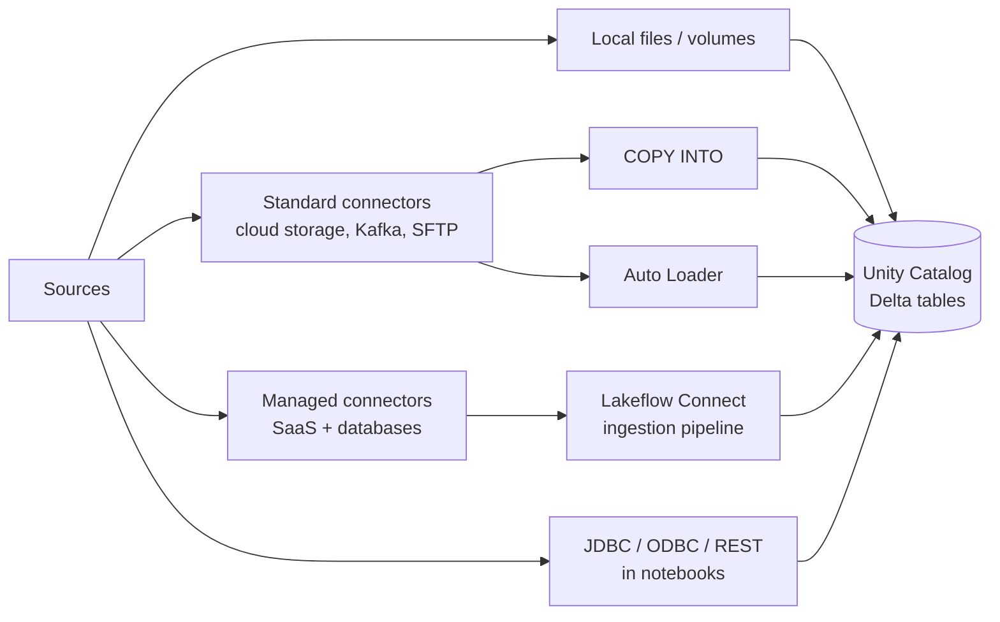

# Data Ingestion and Loading (21 % of Exam)

Domain 2 is the second-largest block on the August 2026 exam. It covers getting data into Unity Catalog-governed tables. You need to know the ingestion patterns (batch, streaming, incremental), where data comes from (local files, Lakeflow Connect standard and managed connectors, JDBC/ODBC and REST clients), and the tools that do the loading (`COPY INTO`, Auto Loader, Lakeflow Connect). You also need to pick the right tool for a given volume, frequency, data type, and governance requirement.

> [!note] Platform update (Oct 2026)
> The exam guide says **Lakeflow Connect standard connectors**. The current docs describe the same layer as "Ingest with SQL and Spark APIs": Auto Loader, `read_files`, streaming tables, and Structured Streaming sources such as Kafka. That page was previously titled "Standard connectors in Lakeflow Connect". The managed connectors are unchanged ([What is Lakeflow Connect?](https://docs.databricks.com/aws/en/ingestion/overview), [Ingest with SQL and Spark APIs](https://docs.databricks.com/aws/en/ingestion/)).

## Topics Overview

## Section Contents

| File | Topic | Priority |
| :--- | :--- | :--- |
| [01-ingestion-patterns-and-lakeflow-connect.md](./01-ingestion-patterns-and-lakeflow-connect.md) | Batch vs streaming vs incremental, local file upload, standard vs managed connectors, choosing a method | High |
| [02-copy-into-and-auto-loader.md](./02-copy-into-and-auto-loader.md) | `COPY INTO`, Auto Loader schema inference/evolution, directory listing vs file notification | High |
| [03-jdbc-rest-and-semi-structured-ingestion.md](./03-jdbc-rest-and-semi-structured-ingestion.md) | JDBC/ODBC and REST clients in notebooks, landing JSON and nested data, Structured Streaming triggers | High |

## Official Skill Coverage (August 2026)

| Exam-guide skill (paraphrased) | Where it is covered |
| :--- | :--- |
| Ingestion patterns (batch, streaming, incremental); importing from local files and Lakeflow Connect standard and managed connectors | [01](./01-ingestion-patterns-and-lakeflow-connect.md), [03 — triggers](./03-jdbc-rest-and-semi-structured-ingestion.md) |
| `COPY INTO` for incremental loads from ADLS/S3/GCS into UC tables | [02](./02-copy-into-and-auto-loader.md) |
| Auto Loader with schema enforcement and evolution; directory listing vs file notification | [02](./02-copy-into-and-auto-loader.md) |
| Configuring Lakeflow Connect for enterprise sources | [01](./01-ingestion-patterns-and-lakeflow-connect.md) |
| JDBC/ODBC or REST clients in notebooks, scheduled with Lakeflow Jobs | [03](./03-jdbc-rest-and-semi-structured-ingestion.md) |
| Choosing between Auto Loader, Lakeflow Connect, partner connectors, and other methods | [01](./01-ingestion-patterns-and-lakeflow-connect.md) |
| Semi-structured and unstructured data (JSON, nested) into UC Delta tables | [03](./03-jdbc-rest-and-semi-structured-ingestion.md), [02](./02-copy-into-and-auto-loader.md) |

## Key Concepts

- **Start with the most managed layer**: Databricks recommends managed connectors first, then Lakeflow pipelines, then Structured Streaming and Spark APIs only if needed
- **`COPY INTO`**: an idempotent, retriable SQL command. Files already loaded are skipped on re-runs
- **Auto Loader (`cloudFiles`)**: a Structured Streaming source. It tracks discovered files in its checkpoint for exactly-once processing and supports schema inference, evolution, and a `_rescued_data` column
- **Lakeflow Connect managed connectors**: a UC connection, an ingestion gateway (database CDC only), and an ingestion pipeline that writes to streaming tables on serverless compute

## Related Resources

- [Auto Loader Quick Reference](../../../shared/cheat-sheets/auto-loader-quick-ref.md)
- [Streaming Quick Reference](../../../shared/cheat-sheets/streaming-quick-ref.md)
- [Streaming Fundamentals](../../../shared/fundamentals/streaming-fundamentals.md)
- [Medallion Architecture](../../../shared/fundamentals/medallion-architecture.md)

## Next Steps

Continue to [03 — Data Transformation and Modeling](../03-data-transformation-and-modeling/README.md) to clean Bronze data into Silver and Gold.

---

**[← Previous: Databricks Intelligence Platform](../01-databricks-intelligence-platform/README.md) | [↑ Back to Certification](../README.md) | [Next: Data Transformation and Modeling →](../03-data-transformation-and-modeling/README.md)**
