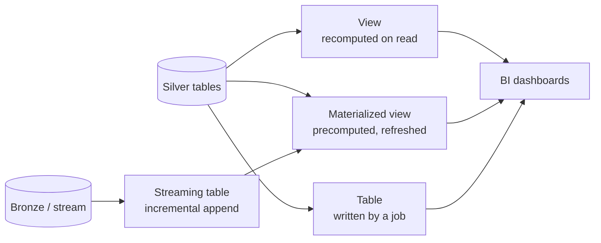

# Gold Layer Objects

## Overview

Gold is where BI and analytics teams read from, so the object type you choose decides freshness, cost, and query speed. The exam guide asks you to understand the difference between **materialized views, views, streaming tables, and tables** in Unity Catalog, and how to build each one. This file compares the four and shows the SQL for each, both standalone in Databricks SQL and inside a Lakeflow pipeline.

> [!abstract]
>
> - **Table** (managed Delta): you control every write (`CREATE TABLE AS`, `INSERT`, `MERGE`). Results are stored
> - **View**: a saved query that is **recomputed on every read** and stores no data
> - **Materialized view**: stores **precomputed results** and refreshes them, incrementally when possible. Good for aggregates that dashboards hit repeatedly
> - **Streaming table**: a UC table with **incremental, append-style processing**. Each refresh processes only new source rows. Good for ingestion and CDC

> [!tip] What the Exam Tests
>
> - Exam guide skill: the difference between, and how to build, Gold layer objects (materialized views, views, streaming tables, tables) for BI and analytics teams in Unity Catalog
> - Choosing the right object for a freshness, cost, or performance requirement
> - Refresh behaviour: on read (view), on refresh or schedule (MV), incremental append (streaming table)
> - Which privileges consumers need (`SELECT`, plus `REFRESH` for materialized views)

---

## Side-by-side comparison

| | **Table** | **View** | **Materialized view** | **Streaming table** |
| :--- | :--- | :--- | :--- | :--- |
| Stores data? | Yes | No | Yes (precomputed result) | Yes |
| When is it computed? | When your code writes | **Every query** | On create, `REFRESH`, schedule, or `TRIGGER ON UPDATE` | On each refresh, **new rows only** |
| Source changes (updates/deletes) | You handle them in code | Always reflected | Reflected on next refresh (incremental or full) | Append-oriented. Earlier rows aren't recomputed |
| Typical Gold use | Curated dimension or fact tables written by jobs | Lightweight semantic layer, column subsets, security | Pre-aggregated KPIs for dashboards | Incrementally maintained event or fact tables |
| Who runs the compute | Your job or warehouse | The querying warehouse, every time | A serverless pipeline | A serverless pipeline |

Sources: [materialized views](https://docs.databricks.com/aws/en/views/materialized), [streaming tables](https://docs.databricks.com/aws/en/tables/streaming).



## Building each object in Unity Catalog

### Table (CTAS or MERGE from a job)

```sql
CREATE OR REPLACE TABLE main.gold.daily_revenue AS
SELECT order_date, region, SUM(amount) AS revenue, COUNT(*) AS orders
FROM main.silver.orders
GROUP BY order_date, region;
```

You own the refresh logic. A scheduled Lakeflow Job re-runs the CTAS, or `MERGE`s only the changed dates.

### View

```sql
CREATE OR REPLACE VIEW main.gold.v_active_customers AS
SELECT customer_id, customer_name, country
FROM main.silver.customers
WHERE is_active = true;
```

- No storage cost. Always current, but every query pays the full computation
- `CREATE TEMPORARY VIEW` is session-scoped and isn't registered in Unity Catalog. Don't use it for shared Gold objects

### Materialized view (standalone, Databricks SQL)

```sql
-- Ad hoc: refresh manually
CREATE OR REPLACE MATERIALIZED VIEW main.gold.mv_revenue_by_region AS
SELECT region, SUM(amount) AS revenue
FROM main.silver.orders
GROUP BY region;

REFRESH MATERIALIZED VIEW main.gold.mv_revenue_by_region;   -- synchronous by default

-- Scheduled (six-field Quartz-style cron)
CREATE OR REPLACE MATERIALIZED VIEW main.gold.mv_revenue_nightly
SCHEDULE CRON '0 30 3 * * ?' AT TIME ZONE 'UTC'
AS SELECT region, SUM(amount) AS revenue FROM main.silver.orders GROUP BY region;

-- Refresh automatically when upstream data changes
CREATE OR REPLACE MATERIALIZED VIEW main.gold.mv_revenue_fresh
TRIGGER ON UPDATE
AS SELECT region, SUM(amount) AS revenue FROM main.silver.orders GROUP BY region;
```

Key facts ([Use standalone materialized views](https://docs.databricks.com/aws/en/views/materialized)):

- Creation is **synchronous**: the command returns after the initial load. `REFRESH ... ASYNC` returns immediately
- Refreshes run on a **serverless pipeline**. The SQL warehouse only coordinates them, and the cost is billed as serverless pipeline DBUs
- **Incremental refresh** merges only new or changed data when possible, which requires Delta sources with **row tracking** enabled. Otherwise a full recompute runs. `EXPLAIN CREATE MATERIALIZED VIEW` shows whether a query can refresh incrementally
- Aggregates and expressions in the `SELECT` need **aliases**
- Standalone MVs run in **triggered** mode only, and **time travel isn't supported**
- The owner, and users granted **`REFRESH`**, can refresh. Readers need `SELECT`

### Streaming table (standalone, Databricks SQL)

```sql
CREATE OR REFRESH STREAMING TABLE main.gold.order_events
SCHEDULE EVERY 1 HOUR
AS SELECT order_id, status, event_ts
FROM STREAM main.silver.order_status_changes;
```

- "A streaming table refresh only evaluates new rows that have arrived after the last update, and appends only the new data" ([Use standalone streaming tables](https://docs.databricks.com/aws/en/tables/streaming))
- Changing the definition doesn't recompute existing rows. `REFRESH STREAMING TABLE ... FULL` reprocesses everything, which is risky when the source has short retention, as Kafka does
- Granting `SELECT` on a streaming table does **not** require granting `SELECT` on its sources

### Inside a Lakeflow pipeline

```sql
-- One pipeline can define the whole medallion chain
CREATE OR REFRESH STREAMING TABLE bronze_orders
AS SELECT * FROM STREAM read_files('/Volumes/main/raw/landing/orders', format => 'json');

CREATE OR REFRESH STREAMING TABLE silver_orders (
  CONSTRAINT valid_amount EXPECT (amount > 0) ON VIOLATION DROP ROW
) AS SELECT * FROM STREAM(bronze_orders);

CREATE OR REFRESH MATERIALIZED VIEW gold_revenue_by_region
AS SELECT region, SUM(amount) AS revenue FROM silver_orders GROUP BY region;
```

```python
from pyspark import pipelines as dp
from pyspark.sql import functions as F

@dp.materialized_view(name="gold_revenue_by_region")
def gold_revenue_by_region():
    return (spark.read.table("silver_orders")
        .groupBy("region")
        .agg(F.sum("amount").alias("revenue")))
```

`@dp.materialized_view` replaces the legacy `@dlt.table` over a batch DataFrame. `@dp.table` over a streaming DataFrame defines a streaming table, and `@dp.temporary_view` replaces `@dlt.view` ([Python reference](https://docs.databricks.com/aws/en/ldp/developer/python-ref)).

> [!note] Legacy syntax
> Older material uses `CREATE LIVE TABLE` (now a materialized view) and `CREATE STREAMING LIVE TABLE` (now a streaming table). If an exam stem shows the `LIVE` keyword, map it to the current object type.

## Worked example: one KPI, four implementations

A BI team needs **daily revenue by region**, refreshed hourly, for a dashboard that about 200 people open each morning.

| Implementation | Freshness | Compute pattern | Verdict |
| :--- | :--- | :--- | :--- |
| `CREATE VIEW ... GROUP BY` | Always current | Full aggregation on **every** tile load, about 200× per morning | Simple, but expensive at this read volume |
| `CREATE MATERIALIZED VIEW ... SCHEDULE EVERY 1 HOUR` | Up to 1 hour old | One refresh per hour, incremental when possible | **Best fit**: read-heavy and hourly freshness is acceptable |
| Streaming table over Silver order events | Minutes | Appends new rows, but an aggregate that must be *re-computed* doesn't fit append-only processing | Use it for the event feed, not for the aggregate |
| Table rebuilt by an hourly Lakeflow Job (`CREATE OR REPLACE TABLE AS`) | Up to 1 hour old | Full rebuild each hour unless you write `MERGE` logic | Works, but you own the refresh code and the scheduling |

The materialized view wins because it combines stored results (cheap reads) with managed refresh (no job code), and it can refresh incrementally when the source supports it.

## Publishing Gold to BI and analytics consumers

Gold objects are ordinary Unity Catalog securables, so access is granted the same way for all four types:

```sql
-- Analysts can browse and read everything in the Gold schema (current and future objects)
GRANT USE CATALOG ON CATALOG main TO `bi_analysts`;
GRANT USE SCHEMA, SELECT ON SCHEMA main.gold TO `bi_analysts`;

-- A reporting service principal may also trigger refreshes of one materialized view
GRANT REFRESH ON main.gold.mv_revenue_by_region TO `reporting-sp`;   -- syntax per "Configure materialized views"
```

- Grants on a schema are **inherited** by current and future objects in it, so new Gold tables and views are readable without extra grants
- Dashboards and BI tools usually query Gold through a **SQL warehouse**. A serverless SQL warehouse is the recommended type for BI and exploratory SQL (see [Compute and Clusters](../01-databricks-intelligence-platform/03-compute-clusters.md))
- Row filters and column masks apply to Gold tables too. See [Domain 7](../07-governance-and-security/04-row-filters-column-masks-abac.md)

## Choosing a Gold object

| Scenario | Best object |
| :--- | :--- |
| A dashboard queries the same heavy aggregation hundreds of times a day | **Materialized view** (pay once per refresh) |
| A team needs a filtered, column-limited projection of Silver that's always current | **View** |
| An append-only event feed must be available in Gold within minutes, processing only new rows | **Streaming table** |
| A fact table needs custom upsert logic (SCD, late corrections) owned by the data team | **Table** maintained by a job with `MERGE` |
| Ad hoc exploration in one notebook session | Temporary view (not a Gold object) |

## Use Cases

- **Executive KPI dashboard**: a materialized view with `TRIGGER ON UPDATE` keeps revenue by region current without per-query compute
- **Self-service semantic layer**: views expose friendly column names over Silver, so analysts don't touch raw tables
- **Near real-time order status**: a streaming table appends status changes every few minutes for an operations dashboard
- **Finance-owned fact table**: a scheduled job `MERGE`s late-arriving corrections into a Gold table with full control

## Common Issues & Errors

### Dashboard Slow on a View

**Scenario:** A Gold view with several joins and aggregations makes every dashboard tile take 30 seconds.
**Fix:** Views recompute on every query. Convert the heavy aggregation to a materialized view, and keep views for light projections.

### Materialized View Always Fully Recomputes

**Scenario:** A nightly MV refresh takes as long as the initial build.
**Fix:** Incremental refresh needs Delta sources with row tracking (`delta.enableRowTracking = true`) and a query shape that supports it. Check with `EXPLAIN CREATE MATERIALIZED VIEW`.

### Streaming Table Ignores an Updated Source Row

**Scenario:** A corrected order in Silver never changes the Gold streaming table.
**Fix:** Streaming tables process new rows only. Rows that were already processed aren't re-evaluated. Use a materialized view, or a `MERGE`-maintained table, when the source updates existing rows.

### Analysts Can't Refresh a Materialized View

**Scenario:** An analyst with `SELECT` gets a permission error running `REFRESH MATERIALIZED VIEW`.
**Fix:** Refreshing requires ownership or the `REFRESH` privilege on the materialized view.

### Temporary View Used as a Shared Gold Object

**Scenario:** A notebook creates `CREATE TEMPORARY VIEW gold_kpis`, but the dashboard team can't find it in Catalog Explorer.
**Fix:** Temporary views exist only for the creating session. Create a permanent `VIEW` (or an MV) in a Unity Catalog schema, and grant `SELECT` to the consumers.

### Gold Refresh Fails After an Owner Leaves

**Scenario:** A scheduled materialized view stops refreshing after its owner's access to the Silver source is removed.
**Fix:** Refreshes run with the owner's permissions, and losing `SELECT` on the source stops them. Transfer ownership to a service principal or group that keeps source access.

## Exam Tips

> [!tip] Exam Tips
>
> - **View** = no storage, recomputed per query. **MV** = stored, refreshed. **Streaming table** = incremental append. **Table** = you write it
> - MVs and streaming tables are created and refreshed by **serverless pipelines**, even when issued from a SQL warehouse
> - Streaming tables process **new rows only**, so source updates call for an MV or `MERGE`
> - `CREATE LIVE TABLE` → MV, `CREATE STREAMING LIVE TABLE` → streaming table (legacy keywords)
> - Readers need `SELECT`. Refreshing an MV needs `REFRESH` (or ownership)

## Key Takeaways

- Pick the Gold object by freshness, cost, and who owns the refresh logic
- Materialized views pre-compute and refresh, incrementally when possible. Views compute on read
- Streaming tables give incremental, append-only maintenance with low latency
- All four are Unity Catalog objects governed by the same privilege model

## Related Topics

- [Data Cleaning and Data Quality](./05-data-cleaning-and-quality.md)
- [Spark SQL Fundamentals (views, temp views)](./01-spark-sql-fundamentals.md)
- [Ingestion Patterns and Lakeflow Connect](../02-data-ingestion-and-loading/01-ingestion-patterns-and-lakeflow-connect.md)
- [Medallion Architecture](../../../shared/fundamentals/medallion-architecture.md)
- [Lakeflow Declarative Pipelines Quick Reference](../../../shared/cheat-sheets/lakeflow-declarative-pipelines-quick-ref.md)

## Official Documentation

- [Use standalone materialized views](https://docs.databricks.com/aws/en/views/materialized)
- [Use standalone streaming tables](https://docs.databricks.com/aws/en/tables/streaming)
- [Lakeflow pipelines Python language reference](https://docs.databricks.com/aws/en/ldp/developer/python-ref)
- [Manage data quality with pipeline expectations](https://docs.databricks.com/aws/en/ldp/expectations)
- [Configure materialized views (privileges, REFRESH)](https://docs.databricks.com/aws/en/sql/mv-st/materialized-configure)

---

**[← Previous: Data Cleaning and Data Quality](./05-data-cleaning-and-quality.md) | [↑ Back to Data Transformation and Modeling](./README.md) | [Next: Spark Tuning Parameters →](./07-spark-tuning-parameters.md)**
