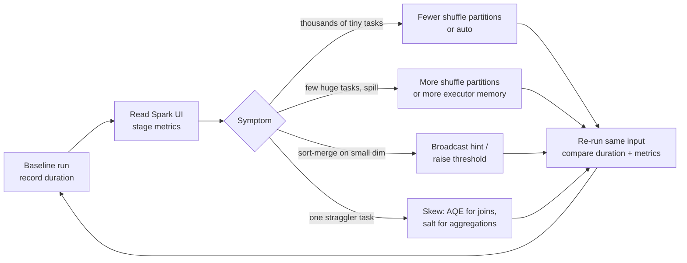

# Spark Tuning Parameters

## Overview

The exam guide names four groups of basic tuning parameters: **`spark.sql.shuffle.partitions`**, **`spark.default.parallelism`**, **`spark.executor.memory` / `spark.driver.memory`**, and **`spark.sql.autoBroadcastJoinThreshold`**. It also expects you to **re-measure performance** after changing them. This file explains what each one controls, its default, where it can be set (classic vs serverless compute), and how Adaptive Query Execution (AQE) changes the picture on Databricks.

> [!abstract]
>
> - **`spark.sql.shuffle.partitions`** (OSS default `200`) sets the number of partitions after a shuffle for joins and aggregations. On Databricks, `auto` lets Spark choose. It is the default on serverless
> - **`spark.default.parallelism`** is the default partition count for **RDD** operations (`parallelize`, `reduceByKey`, `join` on RDDs). It doesn't control DataFrame shuffles
> - **`spark.executor.memory` / `spark.driver.memory`** (OSS default `1g`) set the JVM heap per executor and for the driver. These are compute-level settings and can't be changed in a running session
> - **`spark.sql.autoBroadcastJoinThreshold`** (default **10 MB**, `-1` disables) is the maximum table size broadcast in a join. AQE on Databricks has its own runtime threshold, `spark.databricks.adaptive.autoBroadcastJoinThreshold` (default **30 MB**)

> [!tip] What the Exam Tests
>
> - Exam guide skill: understand the basic tuning parameters and re-measure performance
> - Which knob to turn for a symptom: too many tiny tasks, a few huge spilling tasks, a missed broadcast, or a driver OOM on `collect()`
> - That AQE (on by default) already coalesces shuffle partitions and switches to broadcast joins at runtime
> - That serverless compute exposes only a few Spark properties, `spark.sql.shuffle.partitions` among them

---

## The four parameters

| Parameter | Controls | Default | Raise it when | Lower it when |
| :--- | :--- | :--- | :--- | :--- |
| `spark.sql.shuffle.partitions` | Partitions after a shuffle in DataFrame/SQL joins and aggregations | `200` (Spark OSS). `auto` on serverless | Shuffle partitions are huge and **spill**. Very large data | Data is small, and there are thousands of tiny tasks with high scheduling overhead |
| `spark.default.parallelism` | Default partitions for **RDD** transformations (`join`, `reduceByKey`, `parallelize`) | Largest parent RDD's partition count, or for `parallelize`, the total executor cores (minimum 2) | RDD jobs leave cores idle | Rarely. It has no effect on DataFrame shuffles |
| `spark.executor.memory` | JVM heap per executor | `1g` (Spark OSS) | Executors OOM or spill heavily | Fitting more executors per node |
| `spark.driver.memory` | JVM heap for the driver | `1g` (Spark OSS) | Driver OOM: `collect()`, `toPandas()`, large broadcasts, many small files | — |
| `spark.sql.autoBroadcastJoinThreshold` | Max size (bytes) of a table broadcast to every executor | `10485760` (10 MB). `-1` disables | A dimension slightly over 10 MB should still be broadcast | Broadcasts cause driver/executor memory pressure |

Sources: [Spark configuration](https://spark.apache.org/docs/latest/configuration.html), [Spark SQL performance tuning](https://spark.apache.org/docs/latest/sql-performance-tuning.html).

> [!note]
> `spark.sql.shuffle.partitions` affects the DataFrame/SQL engine, which is what nearly all Databricks code uses. `spark.default.parallelism` affects only the RDD API. Expect a distractor that swaps them.

## Where you can set them

| Compute | How | What you can change |
| :--- | :--- | :--- |
| **Classic compute: compute level** | Compute configuration → **Advanced → Spark → Spark config**, one `key value` per line (or `spark_conf` in the Clusters API) | Anything, including executor/driver memory. Applies to every notebook and job on that compute |
| **Classic compute: session level** | `spark.conf.set("spark.sql.shuffle.partitions", "64")` or `SET spark.sql.shuffle.partitions = 64` | Runtime SQL settings (shuffle partitions, broadcast threshold). **Not** JVM memory |
| **Serverless notebooks and jobs** | `spark.conf.set(...)` / `SET ...` | **Only** a short list: `spark.sql.shuffle.partitions` (default `auto`), `spark.sql.session.timeZone`, `spark.sql.ansi.enabled`, `spark.sql.files.maxPartitionBytes`, `spark.sql.legacy.timeParserPolicy`, `spark.databricks.execution.timeout` |

Source: [Set Spark configuration properties on Databricks](https://docs.databricks.com/aws/en/spark/conf). The same page notes that "Databricks generally recommends against configuring most Spark properties", because legacy settings can override newer default behaviour.

```text
# Classic compute → Advanced → Spark config (compute-level)
spark.executor.memory 16g
spark.driver.memory 8g
spark.sql.shuffle.partitions auto
```

```python
# Session-level (classic or serverless), affects only this SparkSession
spark.conf.set("spark.sql.shuffle.partitions", "64")
spark.conf.set("spark.sql.autoBroadcastJoinThreshold", str(50 * 1024 * 1024))   # 50 MB (classic only)
print(spark.conf.get("spark.sql.shuffle.partitions"))
```

> [!warning] Common Mistake
> `spark.conf.set("spark.driver.memory", "8g")` in a running notebook has no effect. The driver JVM has already started. Apache Spark's docs say driver memory "must not be set through the SparkConf directly in your application" in client mode. Set it in the compute's Spark config and restart the compute.

## Adaptive Query Execution (AQE) on Databricks

AQE re-optimizes the query plan at runtime, using the real sizes measured at shuffle and broadcast boundaries. It is **enabled by default** and applies to non-streaming queries that contain at least one exchange or subquery ([Adaptive query execution](https://docs.databricks.com/aws/en/optimizations/aqe)).

| AQE feature | What it does | Related parameter |
| :--- | :--- | :--- |
| **Coalesce post-shuffle partitions** | Merges small shuffle partitions into reasonably sized ones | `spark.sql.adaptive.coalescePartitions.enabled` (`true`) |
| **Switch join strategy** | Converts a sort-merge join into a broadcast hash join when one side turns out small | `spark.databricks.adaptive.autoBroadcastJoinThreshold` (`30MB`) |
| **Skew join handling** | Splits and replicates skewed partitions in **sort-merge and shuffle-hash joins** | `spark.sql.adaptive.skewJoin.enabled` (`true`) |
| **Empty relation propagation** | Short-circuits parts of a plan that return no rows | — |

> [!important]
> AQE skew handling applies to **joins only**: sort-merge and shuffle-hash, never broadcast joins. A skewed **`groupBy` aggregation** isn't fixed by AQE. Salt the key and aggregate in two stages (see [Spark UI and System Tables](../06-troubleshooting-monitoring-and-optimization/02-spark-ui-and-system-tables.md)).

Setting `spark.sql.shuffle.partitions` to **`auto`** "enables auto-optimized shuffle, which sets the partition count based on the query plan and input data size". This is often a better first move than guessing a number.

## Broadcast joins in practice

```python
from pyspark.sql.functions import broadcast

# Force a broadcast even if statistics put the dimension above the threshold
enriched = facts.join(broadcast(dim_store), "store_id")
```

```sql
SELECT /*+ BROADCAST(s) */ f.*, s.region
FROM main.silver.sales f JOIN main.silver.stores s ON f.store_id = s.store_id;
```

- A `BROADCAST` hint is honoured "even if the size of table … suggested by the statistics is above" `spark.sql.autoBroadcastJoinThreshold` ([SQL performance tuning](https://spark.apache.org/docs/latest/sql-performance-tuning.html))
- Broadcasting a large table moves it through the driver and copies it to every executor, which risks OOM. Broadcast only genuinely small dimensions

## Tune → re-measure loop

The exam guide pairs tuning with **re-measuring**. Change one thing at a time and compare against a baseline:



What to compare on each re-run:

1. **Wall-clock duration** of the job or task: the Lakeflow Jobs run history or matrix view shows it per run
2. **Stage metrics** in the Spark UI: number of tasks, median vs max task duration, shuffle read/write, and spill (memory and disk)
3. **Query plan** in the SQL / DataFrame tab: did `SortMergeJoin` become `BroadcastHashJoin`?

```python
# A minimal before/after timing harness on the same input
import time

def timed(label, fn):
    start = time.time()
    fn()
    print(f"{label}: {time.time() - start:.1f}s")

query = lambda: spark.table("main.silver.sales").groupBy("store_id").count().write.mode("overwrite").saveAsTable("main.scratch.sales_by_store")

spark.conf.set("spark.sql.shuffle.partitions", "200"); timed("200 partitions", query)
spark.conf.set("spark.sql.shuffle.partitions", "auto"); timed("auto partitions", query)
```

> [!note]
> Disk caching and data layout skew single runs. Compare several runs on the same input, preferably on the same compute, before drawing conclusions.

## Symptom → parameter cheat sheet

| Symptom in the Spark UI or logs | Likely fix |
| :--- | :--- |
| 200 tasks of a few KB each on a small dataset | Lower `spark.sql.shuffle.partitions` or set `auto` (AQE coalescing usually handles this already) |
| Shuffle stage tasks spill to disk | Raise shuffle partitions (smaller partitions) or increase executor memory |
| `SortMergeJoin` against a 15 MB dimension | Broadcast hint, or raise `spark.sql.autoBroadcastJoinThreshold` |
| Driver `OutOfMemoryError` after `collect()` | Don't collect large results. Otherwise raise `spark.driver.memory` at compute level |
| One task runs 10× longer than the rest | Skew: AQE handles it for joins; salt the key for aggregations |
| RDD job uses only a few cores | Raise `spark.default.parallelism` or repartition the RDD |

## Use Cases

- **Small dimension, slow join**: a 20 MB store dimension is joined with sort-merge. A broadcast hint cuts the stage from minutes to seconds
- **Spilling aggregation**: raising shuffle partitions from 200 to 800 on a multi-terabyte `groupBy` removes disk spill
- **Over-partitioned small job**: an hourly job over 50 MB of data runs 200 tiny tasks. Switching to `auto` reduces overhead
- **Driver OOM in a reporting notebook**: the fix is to stop calling `toPandas()` on 100 million rows, not to keep growing driver memory

## Common Issues & Errors

### Setting Memory From a Notebook Does Nothing

**Scenario:** `spark.conf.set("spark.executor.memory", "32g")` runs without error, but OOMs continue.
**Fix:** Executor and driver memory are fixed when the JVMs start. Set them in the compute's Spark config and restart the compute. On serverless, memory isn't user-configurable.

### Serverless Rejects a Spark Property

**Scenario:** A notebook moved to serverless can no longer set `spark.sql.autoBroadcastJoinThreshold`.
**Fix:** Serverless supports only a short list of Spark properties. Remove the setting and rely on AQE, or use a `BROADCAST` hint in the query.

### Tuning `spark.default.parallelism` for a DataFrame Job

**Scenario:** An engineer raises `spark.default.parallelism`, but the DataFrame aggregation still runs 200 shuffle tasks.
**Fix:** DataFrame shuffles use `spark.sql.shuffle.partitions`. `spark.default.parallelism` applies to RDD operations.

### Broadcasting a Large Table

**Scenario:** After raising the broadcast threshold to 2 GB, jobs fail with driver OOM.
**Fix:** Broadcast tables pass through the driver and are copied to every executor. Keep the threshold modest and broadcast only small dimensions.

## Exam Tips

> [!tip] Exam Tips
>
> - **Shuffle partitions** = DataFrame/SQL shuffles (default 200, `auto` on Databricks). **Default parallelism** = RDDs
> - **Broadcast threshold** default is 10 MB, and `-1` disables it. AQE's runtime threshold on Databricks is 30 MB
> - Driver/executor **memory** is set at compute level, not with `spark.conf.set` in a session
> - Lowering shuffle partitions makes partitions **bigger**, which worsens spill and skew
> - AQE skew handling covers **joins only**. Skewed aggregations need **salting**
> - Always **re-measure** on the same input after one change

## Key Takeaways

- Four knobs: shuffle partitions, default parallelism, executor/driver memory, broadcast threshold
- AQE (on by default) coalesces partitions, switches to broadcast joins, and splits skewed join partitions at runtime
- Serverless exposes only a handful of Spark properties, and `spark.sql.shuffle.partitions` is one of them
- Tune from Spark UI evidence, change one setting at a time, and re-measure

## Related Topics

- [Joins and Aggregations](./03-joins-aggregations.md)
- [Spark UI and System Tables](../06-troubleshooting-monitoring-and-optimization/02-spark-ui-and-system-tables.md)
- [Compute Troubleshooting (OOM)](../06-troubleshooting-monitoring-and-optimization/05-compute-troubleshooting.md)
- [Spark Configurations Cheat Sheet](../../../shared/cheat-sheets/spark-configurations.md)

## Official Documentation

- [Adaptive query execution](https://docs.databricks.com/aws/en/optimizations/aqe)
- [Set Spark configuration properties on Databricks](https://docs.databricks.com/aws/en/spark/conf)
- [Compute configuration reference (Spark config)](https://docs.databricks.com/aws/en/compute/configure)
- [Apache Spark configuration](https://spark.apache.org/docs/latest/configuration.html)
- [Apache Spark SQL performance tuning](https://spark.apache.org/docs/latest/sql-performance-tuning.html)

---

**[← Previous: Gold Layer Objects](./06-gold-layer-objects.md) | [↑ Back to Data Transformation and Modeling](./README.md)**
