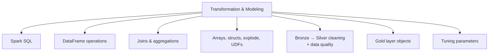

# Data Transformation and Modeling (22 % of Exam)

Domain 3 is the largest domain on the August 2026 exam. It covers the work that turns Bronze into Silver and Gold. You clean nulls and types with PySpark or SQL. You join and union DataFrames, reshape columns and arrays, deduplicate and aggregate. You also need to know the basic Spark tuning parameters, build Gold layer objects (tables, views, materialized views, streaming tables) in Unity Catalog, and apply data quality checks.

## Topics Overview

## Section Contents

| File | Topic | Priority |
| :--- | :--- | :--- |
| [01-spark-sql-fundamentals.md](./01-spark-sql-fundamentals.md) | SQL queries, tables, temp views, catalog operations | High |
| [02-dataframe-operations.md](./02-dataframe-operations.md) | DataFrame API: select, filter, add/drop/rename columns, dedup | High |
| [03-joins-aggregations.md](./03-joins-aggregations.md) | Inner/left/cross/semi/anti joins, broadcast joins, GROUP BY, approximate distinct counts | High |
| [04-advanced-transformations.md](./04-advanced-transformations.md) | Arrays, maps, structs, `explode`, `split`, pivot, UDFs, null handling | High |
| [05-data-cleaning-and-quality.md](./05-data-cleaning-and-quality.md) | Bronze → Silver cleaning, constraints, pipeline expectations | High |
| [06-gold-layer-objects.md](./06-gold-layer-objects.md) | Tables vs views vs materialized views vs streaming tables in UC | High |
| [07-spark-tuning-parameters.md](./07-spark-tuning-parameters.md) | `spark.sql.shuffle.partitions`, `spark.default.parallelism`, executor/driver memory, broadcast threshold, AQE | Medium |

## Official Skill Coverage (August 2026)

| Exam-guide skill (paraphrased) | Where it is covered |
| :--- | :--- |
| Cleaning Bronze into Silver (nulls, data types) with PySpark/SQL | [05](./05-data-cleaning-and-quality.md), [02](./02-dataframe-operations.md), [04](./04-advanced-transformations.md) |
| Combining DataFrames: inner, left, broadcast, multi-key, cross joins; union / union all | [03](./03-joins-aggregations.md) |
| Manipulating columns, rows, and structure: add, drop, split, rename, filter, explode | [02](./02-dataframe-operations.md), [04](./04-advanced-transformations.md) |
| Deduplication and aggregates (count, approximate count distinct, mean, summary) | [02](./02-dataframe-operations.md), [03](./03-joins-aggregations.md), [05](./05-data-cleaning-and-quality.md) |
| Basic tuning parameters and re-measuring performance | [07](./07-spark-tuning-parameters.md) |
| Gold layer objects: materialized views, views, streaming tables, tables | [06](./06-gold-layer-objects.md) |
| Data quality checks and validation rules for Silver and Gold | [05](./05-data-cleaning-and-quality.md) |

## Key Concepts

- **Lazy evaluation**: transformations build a plan; actions (`count`, `show`, `write`) execute it
- **`union` vs `unionByName`**: `union` matches columns by position; `unionByName` matches by name. Both keep duplicates (SQL `UNION ALL` semantics), while SQL `UNION` removes them
- **Gold objects**: a **view** recomputes on every query; a **materialized view** stores precomputed results and refreshes; a **streaming table** appends new data incrementally
- **Expectations**: `CONSTRAINT ... EXPECT (...)` with warn (default), `DROP ROW`, or `FAIL UPDATE`

## Related Resources

- [Spark Fundamentals](../../../shared/fundamentals/spark-fundamentals.md)
- [SQL Essentials](../../../shared/fundamentals/sql-essentials.md)
- [Python Essentials](../../../shared/fundamentals/python-essentials.md)
- [PySpark API Quick Reference](../../../shared/cheat-sheets/pyspark-api-quick-ref.md)
- [Lakeflow Declarative Pipelines Quick Reference](../../../shared/cheat-sheets/lakeflow-declarative-pipelines-quick-ref.md)
- [Spark Configurations Cheat Sheet](../../../shared/cheat-sheets/spark-configurations.md)

## Next Steps

Continue to [04 — Working with Lakeflow Jobs](../04-working-with-lakeflow-jobs/README.md) to orchestrate these transformations.

---

**[← Previous: Data Ingestion and Loading](../02-data-ingestion-and-loading/README.md) | [↑ Back to Certification](../README.md) | [Next: Working with Lakeflow Jobs →](../04-working-with-lakeflow-jobs/README.md)**
