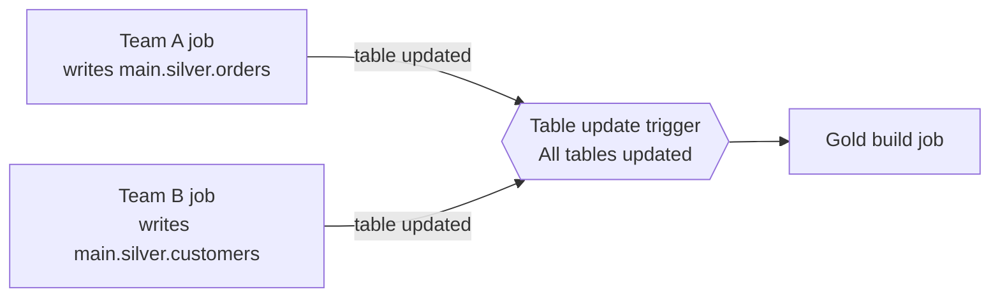

# Scheduling and Triggers

## Overview

A Lakeflow Job starts runs from a **trigger**. The exam guide names three trigger types: **scheduled** (time-based), **file arrival**, and **table update** (both data-driven). It also expects you to choose between time-based and data-driven triggers based on data availability and pipeline dependencies. Continuous and manual runs complete the picture.

> [!abstract]
>
> - **Scheduled**: simple interval, or advanced Quartz cron with a time zone (minimum 10 seconds between runs)
> - **File arrival**: monitors a UC external location or volume and starts a run when new files land
> - **Table update**: starts a run when monitored UC tables (or views, MVs, and streaming tables) change, waiting for *any* or *all* of them
> - **Continuous**: starts a new run whenever the previous one ends. It can't be combined with other triggers

> [!tip] What the Exam Tests
>
> - Exam guide skill: implement job schedules with an understanding of trigger types (scheduled, file arrival, and table update)
> - Exam guide skill: choose between time-based and data-driven triggers based on data availability and pipeline dependencies
> - Reading Quartz cron (`second minute hour day-of-month month day-of-week`) and using `?` correctly

---

## Trigger Types at a Glance

| Trigger | Starts a run when… | Kind | Pick it when |
| :--- | :--- | :--- | :--- |
| **Scheduled** | A time-based schedule fires (simple interval or Quartz cron + time zone) | Time-based | Data arrives at a known time, or consumers need output at a fixed time (for example a 6 AM report) |
| **File arrival** | New files arrive in a monitored **UC external location or volume** | Data-driven | Files land at unpredictable times and should be processed soon after arrival, with no idle compute |
| **Table update** | Monitored UC tables (including views, MVs, streaming tables, OpenSharing tables, system tables) are updated | Data-driven | A job depends on upstream tables produced by *other* jobs or teams |
| **Continuous** | The previous run completes or fails, so a run is always active | Always-on | Streaming workloads that must keep running. It can't be combined with other triggers |
| **None (manual)** | **Run now**, the API, or an external orchestrator | Manual | Ad hoc runs and externally orchestrated runs |
| Model update *(Beta)* | A UC model version or alias changes | Data-driven | ML promotion steps (not on this exam) |

Source: [Automate jobs with schedules and triggers](https://docs.databricks.com/aws/en/jobs/triggers).

- By default only **one run** of a job can be active at a time. Runs that exceed max concurrency are skipped
- Pausing a trigger stops new runs, but active runs continue. Each trigger can be paused independently
- **Multiple triggers** per job (up to five) are in **Beta**

## Scheduled Triggers (Time-Based)

A schedule can be **simple** (every N units; the scheduler picks the first run time) or **advanced** (period, start time, and time zone, optionally shown as cron syntax). "Databricks enforces a minimum interval of 10 seconds between subsequent runs" ([Run jobs on a schedule](https://docs.databricks.com/aws/en/jobs/scheduled)).

### Quartz cron syntax

Advanced schedules use **Quartz** cron: 6 or 7 fields, with seconds first and an optional year ([Quartz CronTrigger tutorial](https://www.quartz-scheduler.org/documentation/quartz-2.3.0/tutorials/crontrigger.html)):

```text
┌ seconds (0-59)
│ ┌ minutes (0-59)
│ │ ┌ hours (0-23)
│ │ │ ┌ day of month (1-31)
│ │ │ │ ┌ month (1-12 or JAN-DEC)
│ │ │ │ │ ┌ day of week (1-7 or SUN-SAT; 1 = Sunday)
│ │ │ │ │ │ ┌ year (optional)
0 0 2 * * ?
```

- `?` means "no specific value". When you constrain day-of-week, put `?` in day-of-month, and vice versa
- Unix cron has 5 fields and no seconds, so don't paste Unix cron into a Quartz schedule

| Schedule | Quartz expression |
| :--- | :--- |
| Every day at 02:00 | `0 0 2 * * ?` |
| Every day at noon | `0 0 12 * * ?` |
| Every hour on the hour | `0 0 * * * ?` |
| Every 15 minutes | `0 0/15 * * * ?` |
| Weekdays at 09:00 | `0 0 9 ? * MON-FRI` |
| Weekdays at 10:15 | `0 15 10 ? * MON-FRI` |
| First day of each month at midnight | `0 0 0 1 * ?` |
| Mondays at midnight | `0 0 0 ? * MON` |

```json
{
  "schedule": {
    "quartz_cron_expression": "0 0 2 * * ?",
    "timezone_id": "America/Los_Angeles",
    "pause_status": "UNPAUSED"
  }
}
```

## Timezones

### Timezone Configuration

```json
{
  "schedule": {
    "quartz_cron_expression": "0 0 9 ? * MON-FRI",
    "timezone_id": "America/New_York"
  }
}
```

### Common Timezone IDs

| Timezone | Identifier |
|----------|-----------|
| UTC | `UTC` |
| US Eastern | `America/New_York` |
| US Central | `America/Chicago` |
| US Mountain | `America/Denver` |
| US Pacific | `America/Los_Angeles` |
| UK | `Europe/London` |
| Europe Central | `Europe/Berlin` |
| Asia Tokyo | `Asia/Tokyo` |
| Australia Sydney | `Australia/Sydney` |

## Scheduling Policies

### Max Concurrent Runs

Prevents multiple instances of the same job from running simultaneously:

```json
{
  "name": "daily_load",
  "max_concurrent_runs": 1,
  "schedule": {
    "quartz_cron_expression": "0 0 * * * ?"
  }
}
```

If a job runs longer than the schedule interval with `max_concurrent_runs: 1`:

- New scheduled runs are skipped
- No queue builds up
- Prevents cascading failures

### Timeout Behavior

```json
{
  "tasks": [
    {
      "timeout_seconds": 3600,
      "max_retries": 2
    }
  ]
}
```

When timeout exceeded:

1. Task is terminated
2. On-failure alerts sent
3. Retry logic triggered (if configured)
4. Overall job run marked as failed

## File Arrival Triggers (Data-Driven)

A file arrival trigger monitors the root or a subpath of a **Unity Catalog external location or volume**, recursively, and makes a "best effort to check for new files every minute" ([Trigger jobs when new files arrive](https://docs.databricks.com/aws/en/jobs/file-arrival-triggers)).

| Setting | Effect |
| :--- | :--- |
| **Minimum time between triggers in seconds** | Cooldown: at most one run per interval (for example `900` = one run per 15 minutes) |
| **Wait after last change in seconds** | Debounce: each new file resets the timer, and the run starts once arrivals pause (for example `60` for batched drops) |

- Only **new** files trigger runs. Overwriting a file with the same name doesn't
- Without file events, a workspace supports at most 50 such triggers, and the location can hold up to 10,000 files. **Enable file events** on the external location to remove the file-count limit
- Permissions: `READ` on the storage location and **CAN MANAGE** on the job
- Inside the triggered job, use **Auto Loader** (with a checkpoint outside the monitored path) to process exactly the new files. `{{job.trigger.file_arrival.location}}` passes the location to the task

## Table Update Triggers (Data-Driven)

A table update trigger runs the job when monitored tables change (updates, merges, deletes), without a continuously running cluster ([Trigger jobs when source tables are updated](https://docs.databricks.com/aws/en/jobs/trigger-table-update)).

| Setting | Effect |
| :--- | :--- |
| **Trigger when** | **Any table is updated** or **All tables are updated** (when you monitor several) |
| **Minimum time between triggers in seconds** | Wait after a run completes before triggering again |
| **Wait after last change in seconds** | Wait after an update before triggering; further updates reset the timer |

- Supported sources: UC managed Delta and Iceberg tables, external Delta tables, materialized views, streaming tables, UC views and metric views (when their dependencies are supported), OpenSharing objects, and system tables
- Up to **10 tables** per trigger
- The job's **Run as** principal needs `SELECT` on each table, plus `USE CATALOG` and `USE SCHEMA`. Without them the trigger can't evaluate, and the job never runs



## Choosing Time-Based vs Data-Driven

| Question | Points to |
| :--- | :--- |
| Does data arrive at an unpredictable time, and should it be processed soon after? | **File arrival** |
| Does the job depend on tables maintained by other jobs or teams, with no shared schedule? | **Table update** (*All tables* when it needs every input fresh) |
| Is the deadline fixed (report by 06:00), or does the source deliver on a fixed timetable? | **Scheduled** |
| Should no compute run, and no empty runs start, during long idle gaps? | Data-driven (file arrival or table update) |
| Must the workload never stop? | **Continuous** |
| Are there dependencies *inside* one pipeline? | Neither: use task dependencies in **one** job DAG |

A scheduled job that polls every 5 minutes "just in case" starts runs that find no data. A data-driven trigger runs only when there's something to do.

## Scheduling Patterns

### Pattern 1: Daily at Specific Time

```json
{
  "name": "daily_analytics",
  "schedule": {
    "quartz_cron_expression": "0 0 6 * * ?",
    "timezone_id": "America/New_York"
  }
}
```

Runs once daily at 6 AM Eastern Time.

### Pattern 2: Multiple Times Per Day

```json
{
  "name": "hourly_load",
  "schedule": {
    "quartz_cron_expression": "0 0 * * * ?"
  }
}
```

Runs every hour at :00.

### Pattern 3: Business Day at Business Hours

```json
{
  "name": "business_hours_refresh",
  "schedule": {
    "quartz_cron_expression": "0 0 9-17 ? * MON-FRI",
    "timezone_id": "America/Chicago"
  }
}
```

Runs every hour (9 AM - 5 PM) Monday-Friday.

### Pattern 4: Staggered Jobs (Avoid Conflicts)

```json
[
  {
    "name": "region_a_load",
    "schedule": {"quartz_cron_expression": "0 0 * * * ?"}
  },
  {
    "name": "region_b_load",
    "schedule": {"quartz_cron_expression": "0 10 * * * ?"}
  },
  {
    "name": "region_c_load",
    "schedule": {"quartz_cron_expression": "0 20 * * * ?"}
  }
]
```

Stagger regional loads to distribute compute load.

## Pause and Resume

### Pause Job from UI

In **Jobs & Pipelines**:

1. Click job row
2. Click "Pause" button
3. No new runs scheduled

### Pause via API

There is no separate pause endpoint. Set the trigger's `pause_status` in the job settings (the `jobs/update` API, or `pause_status` in bundle YAML):

```bash
curl -X POST \
  https://<workspace-host>/api/2.1/jobs/update \
  -H "Authorization: Bearer <token>" \
  -d '{"job_id": 123, "new_settings": {"schedule": {"quartz_cron_expression": "0 0 2 * * ?", "timezone_id": "UTC", "pause_status": "PAUSED"}}}'
```

Set `"pause_status": "UNPAUSED"` to resume. Pausing stops new runs, and active runs continue.

## Manual Trigger

### One-Time Run

```bash
# Run job immediately (ignores schedule)

curl -X POST \
  https://databricks-instance.cloud.databricks.com/api/2.1/jobs/run-now \
  -H "Authorization: Bearer <PAT>" \
  -d '{"job_id": 123}'
```

### Run with Custom Parameters

```bash
curl -X POST \
  https://databricks-instance.cloud.databricks.com/api/2.1/jobs/run-now \
  -H "Authorization: Bearer <PAT>" \
  -d '{
    "job_id": 123,
    "notebook_params": {
      "date": "2025-01-20",
      "environment": "staging"
    }
  }'
```

## Scheduling Best Practices

### Avoid Peak Hours When Possible

```json
{
  "schedule": {
    "quartz_cron_expression": "0 0 2 * * ?",
    "timezone_id": "UTC"
  }
}
```

Off-peak scheduling reduces contention with interactive users.

### Stagger Interdependent Jobs

```text
Job A: 0 0 * * * ?       // Top of every hour
Job B: 0 15 * * * ?      // 15 min past every hour
Job C: 0 30 * * * ?      // 30 min past every hour
```

### Set Appropriate Timeouts

```json
{
  "tasks": [
    {
      "timeout_seconds": 3600,
      "max_retries": 2
    }
  ]
}
```

Prevents hanging jobs from consuming resources.

### Use Max Concurrent Runs for Safety

```json
{
  "max_concurrent_runs": 1
}
```

Prevents duplicate processing if previous run still running.

### Different Schedules for Environments

```json
[
  {
    "name": "daily_load_prod",
    "schedule": {"quartz_cron_expression": "0 0 2 * * ?"}
  },
  {
    "name": "daily_load_test",
    "schedule": {"quartz_cron_expression": "0 0 6 * * ?"}
  }
]
```

Separate schedules by environment prevent cross-environment issues.

## Daylight Saving Time Considerations

When DST changes occur:

- With a time zone that observes DST, "an hourly job is skipped or might appear to be delayed by an hour or two" around the change ([Run jobs on a schedule](https://docs.databricks.com/aws/en/jobs/scheduled))
- Choose **UTC** when runs must happen at absolute intervals
- Document the intended time zone in the job description

## Use Cases

- **Time-Based Batch Scheduling**: Running nightly ETL jobs at 2 AM via cron expressions to process the previous day's data before business users arrive, with timezone-aware scheduling for global teams.
- **Event-Driven Ingestion via File Arrival**: Triggering a job automatically when new files land in cloud storage (S3/ADLS), eliminating polling delays and processing data as soon as it becomes available.

## Common Issues & Errors

### Empty Runs From a Polling Schedule

**Scenario:** A job scheduled every 5 minutes to "check for vendor files" starts hundreds of runs a day, and most find nothing.
**Fix:** Replace the schedule with a **file arrival** trigger on the vendor's UC external location or volume, and use Auto Loader inside the job.

### Cron Schedule Running at Wrong Time Due to Timezone

**Scenario:** A job scheduled for 2 AM local time runs at the wrong hour because the timezone was not explicitly set, defaulting to UTC.
**Fix:** Always set `timezone_id` explicitly in the schedule configuration (e.g., `"timezone_id": "America/New_York"`). Document the intended timezone in the job description for clarity.

### Overlapping Job Runs From File-Arrival Triggers

**Scenario:** A file-arrival trigger fires multiple times in rapid succession (e.g., batch of files landing simultaneously), causing duplicate or concurrent job runs that corrupt downstream tables.
**Fix:** Set **Wait after last change** so a burst of files produces a single run, and **Minimum time between triggers** to cap the frequency. Keep `max_concurrent_runs = 1` so runs never overlap; Auto Loader picks up any files that arrive later on the next run.

## Exam Tips

- The exam guide names three trigger types: **scheduled**, **file arrival**, and **table update**. Know which is time-based and which are data-driven
- "Files arrive at unpredictable intervals, process soon after landing, no idle compute, no empty runs" → **file arrival**
- "Run when upstream tables owned by another team change" → **table update** (choose *All tables* if every input must be fresh)
- Quartz cron has **seconds first**. `?` goes in day-of-month or day-of-week. Weekdays at 9 AM is `0 0 9 ? * MON-FRI`
- Continuous triggers can't be combined with other triggers. Schedules have a 10-second minimum interval

## Key Takeaways

- **Scheduled** = time-based (simple or Quartz cron with a time zone)
- **File arrival** = new files in a UC external location or volume. Debounce with *wait after last change*
- **Table update** = changes to up to 10 monitored UC tables, triggering on *any* or *all*
- **Continuous** = always-on. **Manual** = Run now or the API
- Pick data-driven triggers when data availability, not the clock, decides when work should run

## Related Topics

- [Databricks Jobs](./01-lakeflow-jobs-and-tasks.md)
- [Job Monitoring](../06-troubleshooting-monitoring-and-optimization/01-job-monitoring.md)

## Official Documentation

- [Automate jobs with schedules and triggers](https://docs.databricks.com/aws/en/jobs/triggers)
- [Run jobs on a schedule](https://docs.databricks.com/aws/en/jobs/scheduled)
- [Trigger jobs when new files arrive](https://docs.databricks.com/aws/en/jobs/file-arrival-triggers)
- [Trigger jobs when source tables are updated](https://docs.databricks.com/aws/en/jobs/trigger-table-update)

---

**[← Previous: Lakeflow Jobs and Tasks](./01-lakeflow-jobs-and-tasks.md) | [↑ Back to Working with Lakeflow Jobs](./README.md) | [Next: Control Flow →](./03-control-flow.md)**
