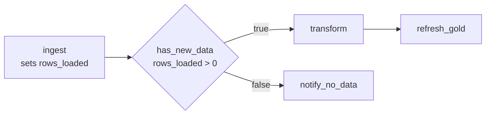

# Control Flow in Lakeflow Jobs

## Overview

A DAG of tasks covers "run B after A". Production pipelines also need **control flow**: retry a flaky task, branch on a condition, loop over a list of inputs, and run cleanup no matter what happened upstream. Lakeflow Jobs provides this with **retries and timeouts**, the **If/else condition** task, the **For each** task, **Run if** dependency conditions, and **task values** for passing data between tasks.

> [!abstract]
>
> - **Retries**: per-task retry policy with a retry interval. When both are set, the **timeout applies to each retry**
> - **If/else condition**: a boolean expression on two operands (job parameters, task values, literals). Downstream tasks depend on its `(true)` or `(false)` outcome
> - **For each**: runs **one nested task** once per element of an input array, with configurable **concurrency** (default 1)
> - **Run if**: *All succeeded* (default), *At least one succeeded*, *None failed*, *All done*, *At least one failed*, *All failed*

> [!tip] What the Exam Tests
>
> - Exam guide skill: implement control flows (retries and conditional tasks such as branching and looping) using Lakeflow Jobs for pipeline orchestration
> - Which task status results from each Run if condition (**Upstream failed** vs **Excluded**)
> - String vs numeric comparison in If/else operators
> - Passing values between tasks with `dbutils.jobs.taskValues` and `{{tasks.<task>.values.<key>}}`

---

## Retries and Timeouts

| Setting | Behaviour |
| :--- | :--- |
| **Retries** | Add a retry policy per task. Most configurations don't retry by default. The **retry interval** is in milliseconds, measured from the start of the failed run to the retry |
| **Timeout** | If a task runs longer than the timeout, its status becomes **Timed Out**. With retries configured, "the timeout applies to each retry" |
| **Metric thresholds → Run duration → Warning** | Expected completion time. Exceeding it raises an event and notification, but doesn't stop the run |
| Serverless / continuous jobs | Serverless jobs auto-optimize retries. Continuous jobs use exponential backoff |

Source: [Configure and edit tasks](https://docs.databricks.com/aws/en/jobs/configure-task).

```yaml
tasks:
  - task_key: call_vendor_api
    notebook_task:
      notebook_path: ../notebooks/call_vendor_api
    max_retries: 3
    min_retry_interval_millis: 60000      # wait 1 minute between attempts
    retry_on_timeout: false
    timeout_seconds: 1800                 # each attempt may run 30 minutes
```

> [!warning] Common Mistake
> A task fails as **Timed Out** at 45 minutes, but needs about 60 minutes for today's data volume. Raise the task's **timeout** above 60 minutes, with headroom. Retries, max concurrent runs, and cluster auto termination don't help.

## If/else Condition Task

The If/else task adds branching: "a boolean operator and a pair of operands" ([Add branching logic with If/else](https://docs.databricks.com/aws/en/jobs/if-else)).

| Operators | Comparison |
| :--- | :--- |
| `==`, `!=` | **String** comparison, so `12.0 == 12` is **false** |
| `>`, `>=`, `<`, `<=` | **Numeric** comparison, so `12.0 >= 12` is **true** |

- Operands: literals, `{{job.parameters.<name>}}`, task parameters, and `{{tasks.<task>.values.<key>}}`. Task values used as operands must be numeric, string, or boolean, and booleans become `"true"` / `"false"`
- Downstream tasks pick a branch in **Depends on**: `<task> (true)` (the default) or `<task> (false)`
- The If/else task fails if the upstream task providing its condition value is disabled



```python
# In the ingest notebook: publish a task value
rows = new_df.count()
dbutils.jobs.taskValues.set(key="rows_loaded", value=rows)
```

```yaml
  - task_key: has_new_data
    depends_on: [{task_key: ingest}]
    condition_task:
      op: GREATER_THAN
      left: "{{tasks.ingest.values.rows_loaded}}"
      right: "0"
  - task_key: transform
    depends_on: [{task_key: has_new_data, outcome: "true"}]
    notebook_task: {notebook_path: ../notebooks/transform}
```

## For Each Task (Looping)

The For each task "runs a nested task in a loop, passing a different set of parameters to each iteration" ([Use a For each task](https://docs.databricks.com/aws/en/jobs/for-each)).

| Aspect | Detail |
| :--- | :--- |
| **Inputs** | A JSON array typed in (5,000-character limit), a job parameter `{{job.parameters.<name>}}`, or a task value `{{tasks.<task>.values.<key>}}` |
| **Nested task** | Exactly one task of any standard type, **except another For each** |
| **Concurrency** | How many iterations run in parallel. **Default 1** |
| **Iteration value** | `{{input}}`, or `{{input.<key>}}` when iterating over objects |
| **Downstream** | Tasks depend on the For each task, not the nested task. Per-iteration task values come back as an ordered list (Beta) |

```yaml
  - task_key: load_each_table
    for_each_task:
      inputs: '[{"table": "orders"}, {"table": "customers"}, {"table": "products"}]'
      concurrency: 3
      task:
        task_key: load_one_table
        notebook_task:
          notebook_path: ../notebooks/load_table
          base_parameters:
            table_name: "{{input.table}}"
```

## Run if Dependencies

Each task's **Run if** condition decides whether it runs, based on its upstream tasks ([Configure task dependencies](https://docs.databricks.com/aws/en/jobs/conditional-tasks)).

| Run if | Runs when | Otherwise marked |
| :--- | :--- | :--- |
| **All succeeded** *(default)* | Every dependency ran and succeeded | `Upstream failed` |
| **At least one succeeded** | One or more dependencies succeeded | `Upstream failed` |
| **None failed** | No dependency failed and at least one ran | `Upstream failed` |
| **All done** | All dependencies finished, **whatever their outcome** | (always runs) |
| **At least one failed** | One or more dependencies failed | `Excluded` |
| **All failed** | Every dependency failed | `Excluded` |

- Upstream `Excluded` counts as success when conditions are evaluated. `Upstream failed` and `Upstream canceled` count as failures
- If **all** of a task's dependencies are excluded, it's excluded too. Exclusion cascades down a chain
- Use **All done** for cleanup tasks such as dropping temp tables or releasing locks, and **At least one failed** for custom failure handling

## Passing Values Between Tasks

```python
# Upstream task (Python notebook)
dbutils.jobs.taskValues.set(key="max_order_date", value="2026-10-25")

# Downstream task (Python notebook)
max_date = dbutils.jobs.taskValues.get(taskKey="ingest", key="max_order_date", debugValue="2026-01-01")
```

- Values must be JSON-serializable, up to 48 KiB, and keys must be strings
- The recommended way to consume a value is a reference in task parameters or conditions: `{{tasks.ingest.values.max_order_date}}`
- `debugValue` is used when the notebook runs interactively outside a job. Databricks doesn't recommend setting `default`

Source: [Use task values to pass information between tasks](https://docs.databricks.com/aws/en/jobs/task-values).

## Run Job Task (Modular Orchestration)

A **Run Job** task triggers another Lakeflow Job as a step. Teams use it to reuse a shared ingestion job inside several downstream orchestrations, instead of copying its tasks.

## Use Cases

- **Skip work when there's nothing new**: If/else on a `rows_loaded` task value skips the Silver and Gold tasks on empty days
- **Load 40 tables with one definition**: For each over a list of table names, with concurrency 5
- **Flaky REST source**: three retries one minute apart on the extraction task only
- **Always clean up**: a final task with Run if **All done** drops staging tables even after failures
- **Custom failure path**: a task with Run if **At least one failed** posts an incident ticket

## Common Issues & Errors

### Task Values Read in the Wrong Task

**Scenario:** `dbutils.jobs.taskValues.get(taskKey="ingest", ...)` fails in a task that doesn't depend on `ingest`.
**Fix:** Task values are read from upstream tasks. Add `ingest` to the reading task's **Depends on**.

### If/else Compares Numbers as Strings

**Scenario:** A condition `{{tasks.count.values.n}} == 10` is false when `n` is `10.0`.
**Fix:** `==` and `!=` compare strings. Use a numeric operator such as `>=`, or publish the value in a consistent format.

### Cleanup Task Never Runs After a Failure

**Scenario:** A cleanup task depends on the transform task with the default Run if, and it's skipped whenever transform fails.
**Fix:** The default is **All succeeded**. Set the cleanup task's Run if to **All done**.

### For Each Runs Iterations One at a Time

**Scenario:** A For each over 30 tables takes hours.
**Fix:** Concurrency defaults to 1. Raise it within the compute's capacity.

## Exam Tips

- **Branching** = If/else condition task. **Looping** = For each task. **Retries** = the task retry policy
- The timeout applies **per attempt** when retries are configured
- Run if **All done** = run regardless (cleanup). The default **All succeeded** marks the task `Upstream failed` when a dependency fails
- `==` / `!=` compare strings. `>`, `<` and the like compare numbers
- A For each has **one** nested task, which can't itself be a For each. Concurrency defaults to 1

## Key Takeaways

- Retries and timeouts handle transient failures and runaway tasks
- If/else routes the DAG on parameters or task values
- For each loops one nested task over an input array, optionally in parallel
- Run if conditions let tasks run on success, failure, or completion of their dependencies
- Task values are the built-in way to pass small results between tasks

## Related Topics

- [Lakeflow Jobs and Tasks](./01-lakeflow-jobs-and-tasks.md)
- [Scheduling and Triggers](./02-scheduling-triggers.md)
- [Job Monitoring (statuses and run history)](../06-troubleshooting-monitoring-and-optimization/01-job-monitoring.md)

## Official Documentation

- [Configure task dependencies](https://docs.databricks.com/aws/en/jobs/conditional-tasks)
- [Add branching logic with the If/else task](https://docs.databricks.com/aws/en/jobs/if-else)
- [Use a For each task to run another task in a loop](https://docs.databricks.com/aws/en/jobs/for-each)
- [Use task values to pass information between tasks](https://docs.databricks.com/aws/en/jobs/task-values)
- [Configure and edit tasks in Lakeflow Jobs](https://docs.databricks.com/aws/en/jobs/configure-task)

---

**[← Previous: Scheduling and Triggers](./02-scheduling-triggers.md) | [↑ Back to Working with Lakeflow Jobs](./README.md)**
