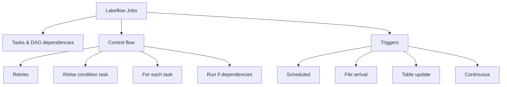

# Working with Lakeflow Jobs (16 % of Exam)

Domain 4 covers orchestration with **Lakeflow Jobs**. You configure common task types (notebook, SQL query, dashboard, pipeline) and wire their dependencies into a DAG. You add control flow: retries, If/else branching, and For each looping. You also pick a trigger: scheduled (time-based), or file arrival and table update (data-driven).

> [!note] Terminology
> "Workflows" and "Databricks Jobs" are legacy names. The exam guide uses **Lakeflow Jobs** throughout, and so do the current docs ([Monitor Lakeflow Jobs](https://docs.databricks.com/aws/en/jobs/monitor)). Job monitoring and run history moved to [Domain 6](../06-troubleshooting-monitoring-and-optimization/README.md) in the August 2026 blueprint.

## Topics Overview

## Section Contents

| File | Topic | Priority |
| :--- | :--- | :--- |
| [01-lakeflow-jobs-and-tasks.md](./01-lakeflow-jobs-and-tasks.md) | Jobs vs tasks, task types, parameters, dynamic value references, multi-task DAGs, compute options | High |
| [02-scheduling-triggers.md](./02-scheduling-triggers.md) | Scheduled (Quartz cron), file arrival, table update, continuous; time-based vs data-driven | High |
| [03-control-flow.md](./03-control-flow.md) | Retries, timeouts, If/else, For each, Run if dependencies, task values | High |

## Official Skill Coverage (August 2026)

| Exam-guide skill (paraphrased) | Where it is covered |
| :--- | :--- |
| Control flows: retries, conditional (branching) and looping tasks | [03](./03-control-flow.md) |
| Common tasks (notebook, SQL query, dashboard, pipeline) and DAG dependencies | [01](./01-lakeflow-jobs-and-tasks.md) |
| Job schedules and trigger types (scheduled, file arrival, table update) | [02](./02-scheduling-triggers.md) |
| Choosing time-based vs data-driven triggers | [02](./02-scheduling-triggers.md) |

## Key Concepts

- **Job vs task**: a job is the orchestration unit with a trigger. Tasks are the nodes in its DAG, and tasks with no dependency on each other run in parallel
- **Run if**: the default is *All succeeded*. *All done* runs cleanup tasks regardless of outcome
- **If/else**: `==` / `!=` compare as strings; `>`, `>=`, `<`, `<=` compare as numbers
- **For each**: runs one nested task per input element. Concurrency defaults to 1
- **Triggers**: scheduled (time-based) vs file arrival / table update (data-driven). Continuous keeps a run always active

## Related Resources

- [Databricks Workspace Fundamentals](../../../shared/fundamentals/databricks-workspace.md)
- [Lakeflow Jobs documentation](https://docs.databricks.com/aws/en/jobs/)

## Next Steps

Continue to [05 — Implementing CI/CD](../05-implementing-cicd/README.md) to version and promote your jobs with Git folders and Declarative Automation Bundles.

---

**[← Previous: Data Transformation and Modeling](../03-data-transformation-and-modeling/README.md) | [↑ Back to Certification](../README.md) | [Next: Implementing CI/CD →](../05-implementing-cicd/README.md)**
