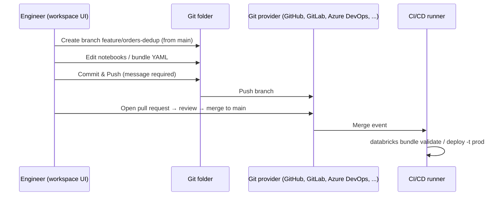

# Git Folders

## Overview

**Databricks Git folders** (formerly Databricks Repos) are "a visual Git client and API that integrates Git repositories within your workspace" ([Databricks Git folders](https://docs.databricks.com/aws/en/repos/)). The exam guide expects you to manage the whole development loop from the workspace UI: clone, create and switch branches, commit and push, pull, and hand off to a **pull request** for review before CI/CD deploys the code.

> [!abstract]
>
> - Create a Git folder by cloning a remote repository. You need configured Git credentials and `CAN MANAGE` on the parent folder
> - The **Git dialog** handles create branch, switch branch, **Commit & Push** (one action, with a required message), pull, merge, rebase, conflict resolution, and reset
> - **Pull requests** are created in your **Git provider's** interface. Git folders handle branches and pushes, and the provider handles review and merge into the default branch
> - Automate Git folders with **service principals**, the Repos API, or Terraform. Deploy with **Declarative Automation Bundles**

> [!tip] What the Exam Tests
>
> - Exam guide skill: manage your code workflow in the workspace UI: create and switch branches in Git folders (formerly Repos), commit and push, and create pull requests using Databricks Git integration
> - Which operations happen in Databricks and which in the Git provider
> - What switching branches does to uncommitted changes and to workspace assets
> - Why **Pull** is the way to sync colleagues' changes, and what **Reset** destroys

---

## The Development Loop



## Git Operations in the Workspace

All operations below are run from the **Git dialog** of a Git folder ([Create and manage Git folders](https://docs.databricks.com/aws/en/repos/git-operations-with-repos)).

| Operation | How | What to know |
| :--- | :--- | :--- |
| **Clone / create** | Workspace → Create → Git folder → repository URL | Needs Git credentials and `CAN MANAGE` on the parent folder. The web terminal's `git clone` also works |
| **Create branch** | Git dialog → **Create Branch** → name + base branch | Branch from the default branch for feature work |
| **Switch branch** | Branch dropdown in the Git dialog | Uncommitted changes can carry over. Switching "might delete workspace assets when the new branch doesn't contain these assets", and switching back recreates them with **new IDs and URLs** |
| **Commit & Push** | Select changes, add a **required** commit message, click **Commit & Push** | Commits and pushes in **one action**. Without permission on the default branch, push a new branch |
| **Pull** | **Pull** in the Git dialog | Updates notebooks and files to the remote version, and **clears notebook state**. Conflicts must be resolved |
| **Merge** | Kebab menu → **Merge** | Recommended over rebase for Git beginners. A clean merge is pushed to the remote |
| **Rebase** | Kebab menu → **Rebase** | Ends with a commit and a **force push**, rewriting history for collaborators |
| **Resolve conflicts** | Edit the file, or **Keep all current** / **Take all incoming**, then **Mark As Resolved** → **Continue Merge/Rebase** | Or abort |
| **Reset** | Git folders UI | Equivalent to `git reset --hard` plus `git push --force`. "You lose all uncommitted and committed changes in both the local and remote version of the branch" |
| **Pull request** | In the **Git provider** | "Use your Git provider's interface to create a pull request and merge it into the default branch" |

> [!note] Exam wording vs docs
> The exam guide mentions "creating pull requests using Databricks Git integration". In the current docs, the Git dialog takes you to your Git provider, where the pull request is opened, reviewed, and merged. Expect answers that pair **Commit & Push in Databricks** with **PR review and merge in the provider**.

## Branching Strategy

```text
main (protected, deployed to prod by CI)
├── feature/orders-dedup     ← work here in your Git folder
├── feature/new-ingest
└── hotfix/null-amounts
```

- One Git folder per engineer per repository, each on its own feature branch. Avoid sharing a Git folder between people
- Protect `main` in the Git provider and require PR review
- Production jobs should **not** run from someone's Git folder. CI deploys a bundle from `main` to the prod workspace, run as a service principal (see [Declarative Automation Bundles](./02-declarative-automation-bundles.md))

## Git Folders vs Notebook Version History

| Need | Notebook revision history | Git folder |
| :--- | :--- | :--- |
| Undo a recent edit to one notebook | Yes | Yes |
| Multiple branches | No | **Yes** |
| Code review via pull requests | No | **Yes** (in the provider) |
| Version notebooks *and* files, SQL, YAML together | No | **Yes** |
| Feed CI/CD deployments | No | **Yes** |

## Automation and CI/CD

- **Service principals** can own and update Git folders programmatically ("Use service principals to programmatically manage Git folders")
- **Terraform** can provision Git folders as infrastructure as code
- For deployments, prefer **Declarative Automation Bundles** run by CI from the merged branch over pointing production jobs at a Git folder

## Use Cases

- **Feature development**: an engineer branches `feature/orders-dedup`, iterates in the workspace, commits and pushes, then opens a PR
- **Hotfix**: branch from `main`, fix, push, and fast-track the PR. CI redeploys the bundle
- **Syncing a teammate's work**: **Pull** brings their merged changes into your Git folder
- **Recovering from a bad local state**: **Reset** throws away local and remote branch changes (use with care)

## Common Issues & Errors

### Notebook Lost Its Job Link After Switching Branches

**Scenario:** A notebook missing on the new branch disappears from the workspace. When the engineer switches back, a job pointing at it fails.
**Fix:** Switching branches can delete and recreate workspace assets with new IDs and URLs. Run production jobs from deployed bundles, not from a personal Git folder.

### Push Rejected on the Default Branch

**Scenario:** Commit & Push to `main` fails with a permission error.
**Fix:** Create a branch, push it, and open a pull request in the Git provider.

### Pull Wipes Notebook Variables

**Scenario:** After **Pull**, an engineer's notebook state (variables, cached DataFrames) is gone.
**Fix:** Pull clears notebook state by design. Re-run the notebook.

### Rebase Breaks a Teammate's Branch

**Scenario:** After a rebase from the UI, a collaborator can't push.
**Fix:** Rebase rewrites history and force-pushes. Prefer **Merge** on shared branches.

## Exam Tips

> [!tip] Exam Tips
>
> - Git folders = the **current name** for Repos
> - **Commit & Push** is one action with a **required** commit message
> - **Pull** syncs remote changes into your Git folder (fetch + merge)
> - Create and switch branches in Databricks. Open, review, and merge **pull requests in the Git provider**
> - Git folders support multiple branches. Notebook version history does not

## Key Takeaways

- Git folders bring branches, commits, pushes, pulls, merges, and conflict resolution into the workspace UI
- Pull requests and protected-branch policies live in the Git provider
- Switching branches can recreate workspace assets with new IDs, and Reset discards work on both local and remote
- CI/CD deploys from the merged branch with bundles, not from personal Git folders

## Related Topics

- [Declarative Automation Bundles](./02-declarative-automation-bundles.md)
- [Databricks Workspace](../01-databricks-intelligence-platform/02-databricks-workspace.md)

## Official Documentation

- [Databricks Git folders](https://docs.databricks.com/aws/en/repos/)
- [Create and manage Git folders (Git operations)](https://docs.databricks.com/aws/en/repos/git-operations-with-repos)

---

**[↑ Back to Implementing CI/CD](./README.md) | [Next: Declarative Automation Bundles →](./02-declarative-automation-bundles.md)**
