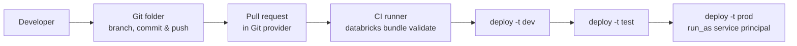

# Implementing CI/CD (10 % of Exam)

Domain 5 covers the code-to-production path. You manage branches, commits, pushes, and pull requests in **Databricks Git folders (formerly Databricks Repos)**. You package jobs, pipelines, and other workspace assets as **Declarative Automation Bundles (formerly Databricks Asset Bundles)**, and use bundle **variables** and **target overrides** to promote one codebase across dev, test, and prod. You drive all of this from the **Databricks CLI** in automated pipelines.

> [!note] Platform update (Oct 2026)
> The rename "Databricks Asset Bundles is now Declarative Automation Bundles" was announced Mar 16, 2026 ([bundles release notes](https://docs.databricks.com/aws/en/release-notes/dev-tools/bundles)). The CLI command group is still `databricks bundle`, and the config file is still `databricks.yml`. Exam stems may abbreviate the product as **DABs**.

## Topics Overview

## Section Contents

| File | Topic | Priority |
| :--- | :--- | :--- |
| [01-git-folders.md](./01-git-folders.md) | Create/clone, branch, switch, commit & push, pull, merge, conflicts, pull requests | High |
| [02-declarative-automation-bundles.md](./02-declarative-automation-bundles.md) | Bundle anatomy, variables, target overrides, deployment modes, `databricks bundle` CLI | High |

## Official Skill Coverage (August 2026)

| Exam-guide skill (paraphrased) | Where it is covered |
| :--- | :--- |
| Code workflow in the workspace UI: Git folder branches, commit & push, pull requests | [01](./01-git-folders.md) |
| Environment-specific config with bundle variables and overrides across dev/test/prod targets | [02](./02-declarative-automation-bundles.md) |
| Deploying bundles to package and promote Lakeflow Jobs, pipelines, and other assets | [02](./02-declarative-automation-bundles.md) |
| Databricks CLI to validate, deploy, and manage bundles in automated CI/CD | [02](./02-declarative-automation-bundles.md) |

## Key Concepts

| Concept | Why it matters |
| :--- | :--- |
| **Git folders** | Visual Git client in the workspace (formerly Repos). Branch, commit & push, pull, merge, and rebase from the UI |
| **Pull requests** | Created in your Git provider's interface. The Git dialog links out to the provider |
| **`databricks.yml`** | Bundle root: `bundle`, `include`, `variables`, `resources`, `targets` |
| **Variables** | `${var.name}`. Values come from `--var`, `BUNDLE_VAR_<name>`, `variable-overrides.json`, target `variables`, or `default`, in that precedence |
| **`mode: development` vs `mode: production`** | Dev prefixes names and pauses triggers. Prod validates Git branch, `run_as`, and paths |
| **CLI** | `databricks bundle validate`, `deploy -t <target>`, `run`, `summary`, `destroy` |

## Related Resources

- [DE Pro — Debugging and Deploying (deeper)](../../data-engineer-professional/08-debugging-and-deploying/README.md)
- [Hands-on Lab 03 — Lakeflow Declarative Pipelines](../../../labs/03-lakeflow-declarative-pipelines.md)
- [Declarative Automation Bundles documentation](https://docs.databricks.com/aws/en/dev-tools/bundles/)

## Next Steps

Continue to [06 — Troubleshooting, Monitoring, and Optimization](../06-troubleshooting-monitoring-and-optimization/README.md).

---

**[← Previous: Working with Lakeflow Jobs](../04-working-with-lakeflow-jobs/README.md) | [↑ Back to Certification](../README.md) | [Next: Troubleshooting, Monitoring, and Optimization →](../06-troubleshooting-monitoring-and-optimization/README.md)**
