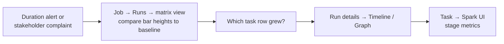

# Job Monitoring

## Overview

Monitoring Lakeflow Jobs means knowing where to look: the **Jobs & Pipelines** list, a job's **Runs** tab (matrix view of run history), and a run's **Graph / Timeline / List** views. You also need to read run and task statuses correctly and get alerted when something breaks.

> [!abstract]
>
> - The **matrix view** shows a job's history: one bar per run, height = duration, colour = status. It is how you spot runs slower than the baseline
> - Run statuses: Queued, Pending, Running, Skipped, Succeeded, **Succeeded with failures**, Failed, Timed Out, Canceling, Canceled. The outcome is decided by **leaf tasks**
> - Task-level states include **Upstream failed** (a dependency failed) and **Excluded** (a branch or Run if condition wasn't met)

> [!tip] What the Exam Tests
>
> - Exam guide skill: identify trends in job performance using the Lakeflow Jobs run history view to compare current execution times against historical baselines
> - Exam guide skill: use the Lakeflow Jobs UI to monitor pipeline health: interpret job statuses, use the DAG task graph to spot upstream blockers, and track run times and failure rates
> - Fixing a **Timed Out** task by raising its timeout, and alerting with notifications

---

## Where to Look in the Jobs UI

| View | What it shows | Use it to |
| :--- | :--- | :--- |
| **Jobs & Pipelines** list | Every job and pipeline you can access, with creator, trigger, and the **last five runs** | Spot failing jobs at a glance |
| **Runs** tab (workspace-wide) | Runs across jobs and pipelines for the last 60 days, a *Finished runs count* graph (48 h), and *Top 5 error types* | Track failure rates and common errors |
| **Job → Runs → matrix view** | One column per run, with a **Run total duration** row and a row per task. Bar **height = duration**, colour = status | **Compare current durations with the historical baseline**, and see which task got slower |
| **Run details → Graph** | The DAG, with each task's status | Find the **upstream blocker** that failed or was skipped |
| **Run details → Timeline** | Task durations, dependencies, and overlap | Find the long pole (critical path) of a run |
| **Run details → List** | Searchable, sortable task list | Filter by status or duration |

Matrix-view colours: **green** = success, **red** = unsuccessful, **pink** = skipped, **yellow** = waiting for retry, **grey** = pending, canceled, or timed out. A warning appears when a run exceeds its expected completion time (the **run duration warning** threshold). Source: [Monitor Lakeflow Jobs](https://docs.databricks.com/aws/en/jobs/monitor).



Run history is kept for **60 days**. For longer trends, query the `system.lakeflow` job tables (see [Spark UI and System Tables](./02-spark-ui-and-system-tables.md)) or join them with `system.billing.usage` for cost.

## Run and Task Statuses

**Run statuses** (from the docs): `Queued`, `Pending`, `Running`, `Skipped`, `Succeeded`, `Succeeded with failures`, `Failed`, `Timed Out`, `Canceling`, `Canceled`.

| Status | Meaning | Typical action |
| :--- | :--- | :--- |
| **Queued** | Waiting because a concurrency limit was reached and queueing is on | Check max concurrent runs |
| **Pending** | Preparing to run, for example while compute starts | Check compute startup if it lasts long |
| **Skipped** | Not started, for example because max concurrent runs was already reached | Previous run still active. Tune the schedule or concurrency |
| **Succeeded with failures** | Some tasks failed, but **all leaf tasks** succeeded | Inspect the failed non-leaf tasks |
| **Failed** | A leaf task failed | Open the failed task's output and logs |
| **Timed Out** | A task exceeded its configured **timeout** | Raise the timeout (each retry gets the full timeout) or speed up the task |
| **Canceled** | Stopped by a user, API, or cancellation propagation | — |

**Task-level conditions** to recognise in the Graph view:

| Task state | Cause |
| :--- | :--- |
| **Upstream failed** | A dependency failed, and the task's Run if (default *All succeeded*) wasn't met. The real problem is **upstream** |
| **Excluded** | A Run if condition such as *At least one failed* wasn't met, or an If/else branch wasn't taken |
| **Waiting for retry** | The task failed and a retry is scheduled |
| **Disabled** | The task was disabled in the job definition and skipped |

A run's overall outcome depends on its **leaf tasks** (tasks with no downstream dependencies). Source: [Monitor Lakeflow Jobs](https://docs.databricks.com/aws/en/jobs/monitor), [Configure task dependencies](https://docs.databricks.com/aws/en/jobs/conditional-tasks).

### Finding the Upstream Blocker

1. Open the failed run → **Graph** view
2. Tasks marked **Upstream failed** aren't the cause. Follow the edges upstream to the first **Failed** or **Timed Out** task
3. Open that task's output and logs, and if needed its **Spark UI**
4. Fix it, then use **Repair run** to re-run only the failed task and its dependents

## Logs and Debugging

### Access Logs from UI

1. In Workflows > Jobs, select job
2. Click on run ID
3. View "Logs" tab
4. Search for errors (Ctrl+F)

### Log Levels in Notebooks

```python
# logging module in Python

import logging

logger = logging.getLogger(__name__)
logger.info("Processing started")
logger.warning("Found duplicate rows")
logger.error("Failed to connect to database")

# print statements (also logged)

print("INFO: Step 1 complete")
print("ERROR: Step 2 failed")
```

### SQL Query Logs

```sql
-- View query execution history (in SQL queries)
SELECT
    query_id,
    query_text,
    execution_time_ms,
    rows_produced
FROM system.query_history
WHERE execution_date > CURRENT_DATE - 1
ORDER BY execution_time_ms DESC
LIMIT 10
```

### Driver and Worker Logs

#### Driver Logs

- Contain job initialization, parameter setup
- Available in job run details
- Useful for understanding early failures

#### Worker Logs

- Task-specific logs from Spark workers
- Less accessible than driver logs
- Check for out-of-memory errors

### Common Log Patterns

```python

# Python job log patterns

# Successful start
# [INFO] Execution started

# Reading data
# [INFO] Reading from /mnt/data/input

# Processing status
# [INFO] Processing 1000000 rows
# [INFO] Completed transformation

# Write operation
# [INFO] Writing results to Delta table

# Success
# [INFO] Pipeline completed successfully

```

### Debugging Failed Jobs

```python

# Add debug output to notebook/script

from datetime import datetime

def debug_log(message):
    """Custom logging helper"""
    print(f"[{datetime.now().isoformat()}] {message}")

try:
    debug_log("Starting ETL")

    # Read data
    df = spark.read.format("delta").load("/mnt/data/raw")
    debug_log(f"Read {df.count()} rows")

    # Transform
    df_clean = df.filter(col("value") > 0)
    debug_log(f"After filter: {df_clean.count()} rows")

    # Write
    df_clean.write.format("delta").mode("overwrite").save("/mnt/data/clean")
    debug_log("Write complete")

except Exception as e:
    debug_log(f"ERROR: {str(e)}")
    raise
```

## Alerts and Notifications

### Email Alerts

```json
{
  "email_notifications": {
    "on_success": ["user@company.com"],
    "on_failure": ["user@company.com", "ops@company.com"]
  }
}
```

### Slack Integration

First, create Slack webhook in Databricks:

1. Admin Console > Integrations > Slack
2. Click "Add"
3. Authorize Databricks in Slack workspace
4. Copy webhook ID

Then configure job:

```json
{
  "webhook_notifications": {
    "on_failure": [
      {
        "id": "slack-webhook-xyz"
      }
    ],
    "on_success": [
      {
        "id": "slack-webhook-xyz"
      }
    ]
  }
}
```

### Custom Alerts via Notebooks

```python

# Send custom alert from notebook

import requests

def send_slack_alert(message, webhook_url):
    payload = {
        "text": message
    }
    requests.post(webhook_url, json=payload)

try:
    # Job logic
    df = spark.read.format("delta").load("/mnt/data/input")

    if df.count() == 0:
        send_slack_alert(
            "WARNING: Input data is empty!",
            os.environ.get("SLACK_WEBHOOK")
        )

except Exception as e:
    send_slack_alert(
        f"ALERT: Job failed - {str(e)}",
        os.environ.get("SLACK_WEBHOOK")
    )
    raise
```

## Performance Metrics

### Job Run Metrics

```python
# Access from API

import requests

response = requests.get(
    "https://databricks-instance.cloud.databricks.com/api/2.1/jobs/get-run",
    headers={"Authorization": f"Bearer {pat_token}"},
    params={"run_id": 123}
)

run_info = response.json()

print(f"State: {run_info['state']}")
print(f"State Message: {run_info['state_message']}")
print(f"Created Time: {run_info['start_time']}")
print(f"Run Duration: {run_info['end_time'] - run_info['start_time']} ms")

# Check task-specific metrics

for task in run_info['tasks']:
    print(f"Task {task['task_key']}: {task['state']}")
```

### Cluster Metrics

During job execution, monitor:

- **Driver CPU/Memory**: Main Spark driver
- **Worker CPU/Memory**: Task execution nodes
- **Shuffle Read/Write**: Data movement overhead
- **GC Time**: Garbage collection pauses

### Tracking Execution Time

```python
# Track within notebook

from datetime import datetime

start = datetime.now()

# ... execute tasks ...

end = datetime.now()
duration = (end - start).total_seconds()

print(f"Job executed in {duration:.2f} seconds")

# Log for monitoring

spark.createDataFrame([
    (duration, datetime.now())
], ["execution_seconds", "run_time"]
).write.mode("append").save("/mnt/metrics/job_duration")
```

## Troubleshooting Common Issues

### Issue 1: Timeout

**Error**: `TaskFailedReason: Task failed due to timeout`

**Causes**: Long-running query, insufficient cluster size, inefficient code

**Solutions**:

- Increase `timeout_seconds` in job config
- Optimize query with OPTIMIZE/Z-order
- Increase cluster worker count
- Add WHERE clause filters early

```json
{
  "timeout_seconds": 7200  // Increase from 3600
}
```

### Issue 2: Out of Memory

**Error**: `java.lang.OutOfMemoryError` or `PySpark MemoryError`

**Causes**: Large DataFrame in memory, no shuffle partitions

**Solutions**:

- Increase cluster worker count
- Add repartitioning
- Use streaming for large files
- Filter early in pipeline

```python
# Repartition to use more workers

df = (spark.read.format("delta").load("/mnt/data/large")
    .repartition(1000))  # Spread across workers
```

### Issue 3: Max Concurrent Runs Skipped

**Error**: Job scheduled but didn't run (status: SKIPPED)

**Cause**: Previous run still executing with `max_concurrent_runs: 1`

**Solutions**:

- Increase `timeout_seconds` to complete faster
- Optimize job code for speed
- Set `max_concurrent_runs: 2` if parallel safe

```json
{
  "max_concurrent_runs": 1,
  "timeout_seconds": 3600
}
```

### Issue 4: Cluster Launch Failure

**Error**: `Cluster failed to start` or `No worker nodes available`

**Causes**: Quota exceeded, instance type unavailable, subnet issues

**Solutions**:

- Check AWS/Azure/GCP quota
- Use different node type
- Check network/VPC configuration
- Retry after quota reset

### Issue 5: Data Quality Issues

**Error**: Job completes but data looks wrong

**Solutions**:

- Add data quality checks
- Log row counts at each stage
- Validate schema changes
- Check for duplicate processing

```python
# Add validation in notebook

row_count_before = spark.read.format("delta").load("/mnt/data/raw").count()
row_count_after = spark.read.format("delta").load("/mnt/data/clean").count()

if row_count_after == 0:
    raise ValueError("Output table is empty!")

if row_count_after > row_count_before * 2:
    raise ValueError("Output has suspiciously high row count!")

print(f"Validation passed: {row_count_after} rows processed")
```

## Monitoring Dashboard Pattern

```python

# Create metrics table to track job health over time

job_metrics = spark.createDataFrame([
    {
        "job_id": 123,
        "run_id": "run_abc",
        "status": "SUCCESS",
        "duration_seconds": 1234,
        "rows_processed": 1000000,
        "run_date": "2025-01-15"
    }
], schema="""
    job_id INT,
    run_id STRING,
    status STRING,
    duration_seconds INT,
    rows_processed INT,
    run_date DATE
""")

(job_metrics.write
    .format("delta")
    .mode("append")
    .save("/mnt/metrics/job_runs"))

# Analyze trends

spark.sql("""
SELECT
    DATE(run_date) as date,
    COUNT(*) as total_runs,
    COUNTIF(status = 'SUCCESS') as successful,
    COUNTIF(status = 'FAILED') as failed,
    AVG(duration_seconds) as avg_duration
FROM job_runs
WHERE job_id = 123
GROUP BY DATE(run_date)
ORDER BY date DESC
""").show()
```

## Audit and Compliance

### Track Who Ran What

```python
# Log execution metadata

from pyspark.sql.functions import lit, current_timestamp, current_user

spark.sql("""
SELECT
    current_user() as user,
    current_timestamp() as execution_time,
    'daily_pipeline' as job_name
""").write.mode("append").save("/mnt/audit/executions")
```

### Job Run API for Integration

```python
# Query job runs programmatically

response = requests.get(
    "https://databricks-instance.cloud.databricks.com/api/2.1/jobs/list-runs",
    headers={"Authorization": f"Bearer {pat_token}"},
    params={"job_id": 123, "limit": 50}
)

runs = response.json()["runs"]

for run in runs:
    print(f"Run {run['run_id']}: {run['state']} - {run['start_time']}")
```

## Use Cases

- **Proactive Pipeline Health Dashboards**: Logging job run metrics (duration, row counts, status) to a Delta table and building Databricks SQL dashboards to track pipeline health trends, SLA adherence, and failure rates over time.
- **Automated Alerting and Escalation**: Configuring email and Slack webhook notifications for job failures, with tiered escalation (e.g., task owner on first failure, on-call team after retry exhaustion) to ensure rapid incident response.

## Common Issues & Errors

### Task Keeps Timing Out as Data Grows

**Scenario:** A task fails as **Timed Out** after 45 minutes. Data volume has grown, and the task now needs about 60 minutes.
**Fix:** Raise the task's **timeout** (for example to 90 minutes). Retries, max concurrent runs, and auto termination don't stop the timeout from killing the task.

### Spark UI Not Loading for Completed Runs

**Scenario:** After a job cluster terminates, the Spark UI link in the job run page becomes inaccessible, making it impossible to debug performance issues from a past run.
**Fix:** Access the Spark UI link while the cluster is still running, or query system tables (`system.compute.clusters`, `system.billing.usage`) for historical metrics. Consider logging key performance counters (row counts, durations) within the notebook itself.

### Alert Fatigue From Noisy Failure Notifications

**Scenario:** Transient errors (e.g., spot instance preemption, brief network blips) trigger failure alerts on every retry attempt, flooding the on-call engineer's inbox with non-actionable notifications.
**Fix:** Configure task-level retries (`max_retries: 2-3`) and set email/webhook notifications to fire only on the final failure after all retries are exhausted, not on each individual attempt.

## Exam Tips

- **Trends over time** → the job's **matrix view** (bar height = duration per run) or `system.lakeflow` tables beyond 60 days
- **Upstream blockers** → the run's **Graph** view. `Upstream failed` tasks point back to the real failure
- **Succeeded with failures** = all leaf tasks succeeded, but some other task failed
- **Timed Out** → raise the task **timeout**. The run-duration **warning** threshold only alerts
- **Skipped** runs usually mean max concurrent runs was already reached
- **Repair run** re-runs failed tasks and their dependents, not the whole DAG

## Key Takeaways

- Jobs & Pipelines list → job Runs tab (matrix view) → run details (Graph, Timeline, List) → task → Spark UI
- Run outcome is decided by leaf tasks. Know Upstream failed vs Excluded
- Notifications (email, webhooks) fire on start, success, failure, and duration thresholds
- Run history is kept for 60 days. Use system tables for longer analysis

## Related Topics

- [Lakeflow Jobs and Tasks](../04-working-with-lakeflow-jobs/01-lakeflow-jobs-and-tasks.md)
- [Scheduling and Triggers](../04-working-with-lakeflow-jobs/02-scheduling-triggers.md)
- [Spark UI Debugging (DE Professional)](../../data-engineer-professional/08-debugging-and-deploying/01-spark-ui-debugging.md)

## Official Documentation

- [Monitor Lakeflow Jobs](https://docs.databricks.com/aws/en/jobs/monitor)
- [Diagnose Lakeflow Jobs performance](https://docs.databricks.com/aws/en/jobs/diagnose-job-performance)
- [Add notifications on a job](https://docs.databricks.com/aws/en/jobs/notifications)
- [Repair a failed job run](https://docs.databricks.com/aws/en/jobs/repair-job-failures)

---

**[↑ Back to Troubleshooting, Monitoring, and Optimization](./README.md) | [Next: Spark UI and System Tables →](./02-spark-ui-and-system-tables.md)**
