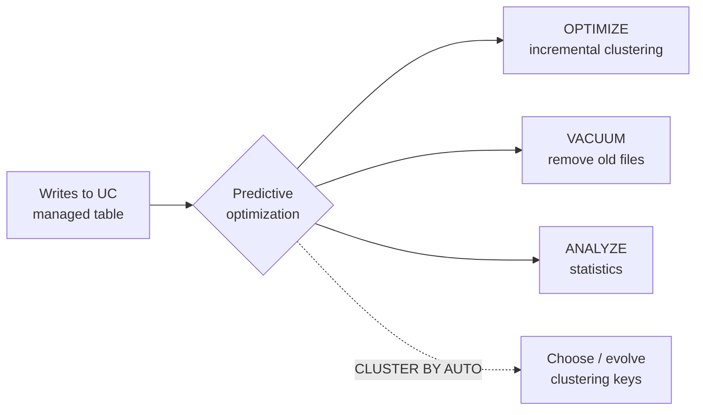

# Liquid Clustering and Predictive Optimization

## Overview

**Liquid Clustering** is Databricks' data-layout technique for Delta (and Iceberg) tables. It "replaces table partitioning and `ZORDER`", and you can change its clustering keys without rewriting existing data. **Predictive optimization** removes table maintenance from your to-do list by running `OPTIMIZE`, `VACUUM`, and `ANALYZE` automatically on Unity Catalog managed tables. Together they are the modern answer to "make this table fast and keep it that way".

> [!abstract]
>
> - Enable clustering with `CLUSTER BY (col, ...)` (up to **four** keys) on `CREATE TABLE` or `ALTER TABLE`. Let Databricks choose keys with `CLUSTER BY AUTO`
> - `OPTIMIZE` clusters incrementally. `OPTIMIZE ... FULL` reclusters everything after a key change
> - Clustering is **not compatible with partitioning or `ZORDER`**
> - **Predictive optimization** runs maintenance on **UC managed tables** only, on serverless jobs compute, and is enabled by default for accounts created on or after Nov 11, 2024

> [!tip] What the Exam Tests
>
> - Exam guide skill: understand the features of Liquid Clustering and predictive optimization
> - When Liquid Clustering beats partitioning or Z-order: high-cardinality filters, skew, fast growth, and changing access patterns
> - What predictive optimization automates, which tables it applies to, and how to enable or disable it per catalog, schema, or table
> - That automatic liquid clustering (`CLUSTER BY AUTO`) requires predictive optimization

---

## Liquid Clustering

### Syntax

```sql
-- New table with explicit keys
CREATE TABLE main.silver.events (
  event_id BIGINT, customer_id BIGINT, event_ts TIMESTAMP, event_type STRING
) CLUSTER BY (customer_id, event_ts);

-- Enable or change keys on an existing unpartitioned table (no rewrite of existing data)
ALTER TABLE main.silver.events CLUSTER BY (event_type, event_ts);

-- Let Databricks choose keys from query patterns (requires predictive optimization)
ALTER TABLE main.silver.events CLUSTER BY AUTO;

-- Remove clustering
ALTER TABLE main.silver.events CLUSTER BY NONE;

-- Trigger clustering
OPTIMIZE main.silver.events;          -- incremental: only new or unclustered data
OPTIMIZE main.silver.events FULL;     -- recluster all data to the current keys (can take hours)

-- Convert a partitioned table (DBR 18.1+)
ALTER TABLE main.silver.legacy_events REPLACE PARTITIONED BY WITH CLUSTER BY (customer_id);
```

Source: [Use liquid clustering for tables](https://docs.databricks.com/aws/en/delta/clustering).

### Key Facts

| Feature | Detail |
| :--- | :--- |
| **Replaces** | Partitioning and `ZORDER`. It's "not compatible" with either |
| **Max keys** | Four. On tables under 10 TB, more keys can slow single-column filters |
| **Changing keys** | `ALTER TABLE ... CLUSTER BY (...)` at any time. Existing data isn't rewritten until reclustered (`OPTIMIZE FULL`) |
| **Incremental** | `OPTIMIZE` rewrites only what needs clustering. Writes can cluster data too |
| **Automatic** | `CLUSTER BY AUTO` picks and evolves keys. Requires predictive optimization |
| **Runtime** | GA for Delta on DBR 15.4 LTS+. Converting partitioned tables needs DBR 18.1+ |
| **Recommended for** | All new tables, especially high-cardinality filter columns, heavy skew, fast-growing tables, concurrent writers, and changing access patterns |

### Liquid Clustering vs Partitioning vs Z-order

| | Partitioning | Z-order | Liquid Clustering |
| :--- | :--- | :--- | :--- |
| Good key cardinality | Low (date, region) | High | Low or high |
| Change keys later | Rewrite the table | Re-run with new columns | `ALTER TABLE ... CLUSTER BY`, no immediate rewrite |
| Small-file / skew risk | High with a bad key choice | — | Handled by clustering |
| Maintenance | Manual | `OPTIMIZE ... ZORDER BY` (full rewrite of the target data) | `OPTIMIZE` (incremental), or automatic with predictive optimization |
| Combine with the others? | — | Not with clustering | **No** partitioning or Z-order |

## Predictive Optimization

"Predictive optimization" automatically runs `OPTIMIZE`, `VACUUM`, and `ANALYZE` on Unity Catalog managed tables, and collects statistics when data is written ([Predictive optimization](https://docs.databricks.com/aws/en/optimizations/predictive-optimization)).

| Aspect | Detail |
| :--- | :--- |
| **Operations** | `OPTIMIZE` (incremental clustering; it doesn't run `ZORDER`), `VACUUM` (default 7-day retention, set by `delta.deletedFileRetentionDuration`), `ANALYZE` |
| **Applies to** | **UC managed tables** (Delta and Iceberg) only. Not external tables, and not tables received through OpenSharing |
| **Default** | Enabled for accounts created on or after **Nov 11, 2024**. Existing accounts were rolled out gradually, with completion expected by August 2026 |
| **Compute and billing** | Runs on serverless jobs compute, billed under a serverless jobs SKU |
| **Observability** | `system.storage.predictive_optimization_operations_history` |
| **Prerequisites** | Premium plan or above, a supported region, and SQL warehouses or DBR 12.2 LTS+ |

```sql
-- Override the account setting at any level; INHERIT returns to the parent's setting
ALTER CATALOG main ENABLE PREDICTIVE OPTIMIZATION;
ALTER SCHEMA main.scratch DISABLE PREDICTIVE OPTIMIZATION;
ALTER TABLE main.silver.events INHERIT PREDICTIVE OPTIMIZATION;

-- What did it do?
SELECT * FROM system.storage.predictive_optimization_operations_history
LIMIT 20;   -- filter by catalog, schema, and table columns per the table reference
```

> [!note]
> With predictive optimization on, "you typically don't need scheduled OPTIMIZE jobs" for clustered tables. Remember that it also runs `VACUUM`, which limits how far back time travel can go (7 days by default).



## Use Cases

- **Customer events table** filtered by `customer_id` (high cardinality) and time: `CLUSTER BY (customer_id, event_ts)` instead of date partitions plus Z-order
- **Unknown or shifting query patterns**: `CLUSTER BY AUTO` lets Databricks pick the keys
- **Hundreds of tables, no maintenance jobs**: predictive optimization handles compaction, vacuum, and statistics
- **Legacy partitioned table with tiny files**: convert with `REPLACE PARTITIONED BY WITH CLUSTER BY`, then `OPTIMIZE`

## Common Issues & Errors

### `CLUSTER BY` Fails on a Partitioned Table

**Scenario:** `ALTER TABLE t CLUSTER BY (customer_id)` fails on a table partitioned by `event_date`.
**Fix:** Clustering isn't compatible with partitioning. On DBR 18.1+, use `REPLACE PARTITIONED BY WITH CLUSTER BY`, or rebuild the table with `CLUSTER BY`.

### New Keys Don't Speed Up Old Data

**Scenario:** After changing clustering keys, queries on historical data are still slow.
**Fix:** Existing data isn't rewritten when keys change. Run `OPTIMIZE ... FULL` to recluster everything.

### Predictive Optimization Not Running on a Table

**Scenario:** An external table never shows up in the predictive optimization history.
**Fix:** Predictive optimization applies only to **UC managed** tables. Convert the table with `ALTER TABLE ... SET MANAGED` (see [Managed and External Tables](../07-governance-and-security/02-managed-and-external-tables.md)), or schedule maintenance yourself.

### `CLUSTER BY AUTO` Never Picks Keys

**Scenario:** Automatic liquid clustering is enabled, but keys stay unset.
**Fix:** Automatic key selection requires predictive optimization. Check that it's enabled for the catalog, schema, or table.

## Exam Tips

> [!tip] Exam Tips
>
> - Liquid Clustering = `CLUSTER BY` (up to 4 keys). It replaces partitioning and Z-order and can't be combined with them
> - Change keys with `ALTER TABLE ... CLUSTER BY` (no immediate rewrite). `OPTIMIZE FULL` reclusters all data
> - `CLUSTER BY AUTO` needs predictive optimization
> - Predictive optimization = automatic `OPTIMIZE` + `VACUUM` + `ANALYZE` on **UC managed tables only**
> - Enable or disable it with `ALTER CATALOG | SCHEMA | TABLE ... ENABLE | DISABLE | INHERIT PREDICTIVE OPTIMIZATION`

## Key Takeaways

- Liquid Clustering is the recommended layout for new tables: flexible keys, incremental clustering, and a fix for skew
- Predictive optimization automates maintenance and pairs with automatic clustering
- Both favour **Unity Catalog managed tables**, another reason Databricks recommends them

## Related Topics

- [Delta Optimization (OPTIMIZE, Z-order, VACUUM)](./03-delta-optimization.md)
- [Spark UI and System Tables](./02-spark-ui-and-system-tables.md)
- [Managed and External Tables](../07-governance-and-security/02-managed-and-external-tables.md)
- [Performance Optimization Cheat Sheet](../../../shared/cheat-sheets/performance-optimization.md)

## Official Documentation

- [Use liquid clustering for tables](https://docs.databricks.com/aws/en/delta/clustering)
- [Predictive optimization for Unity Catalog managed tables](https://docs.databricks.com/aws/en/optimizations/predictive-optimization)

---

**[← Previous: Delta Optimization](./03-delta-optimization.md) | [↑ Back to Troubleshooting, Monitoring, and Optimization](./README.md) | [Next: Compute Troubleshooting →](./05-compute-troubleshooting.md)**
