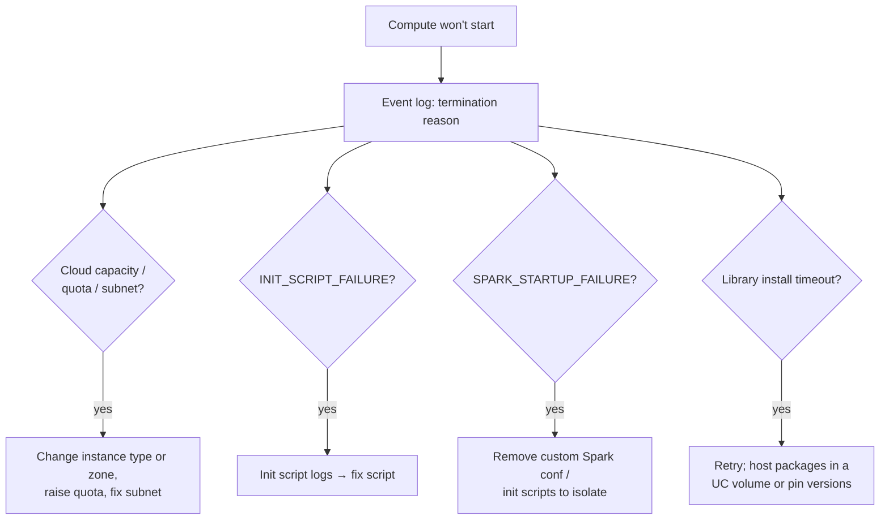

# Compute Troubleshooting

## Overview

The exam guide asks you to diagnose three classes of compute problem: **cluster startup failures**, **library conflicts**, and **out-of-memory (OOM)** errors. Each leaves a distinct trail in the compute **event log**, the **driver logs**, or the **Spark UI**. This file maps symptoms to causes and fixes, using Databricks' documented termination codes and library precedence rules.

> [!abstract]
>
> - **Startup failures**: read the termination reason or code in the compute event log. Typical causes are cloud capacity or quota limits, subnet IP exhaustion, failing init scripts, and Spark failing to start
> - **Library conflicts**: notebook-scoped (`%pip`) libraries take precedence over compute-scoped ones, which take precedence over Databricks Runtime built-ins. Installing a conflicting version of a core package can break the Python REPL
> - **OOM**: driver OOM usually comes from pulling data to the driver (`collect()`, `toPandas()`, huge broadcasts). Executor OOM or spill comes from oversized partitions, skew, or wide rows
> - Check the **event log** (lifecycle), **driver logs** (stdout, stderr, log4j), and the **Spark UI** (executors, stages)

> [!tip] What the Exam Tests
>
> - Exam guide skill: diagnose cluster startup failures, library conflicts, and out-of-memory issues
> - Telling driver OOM apart from executor OOM, and the right fix for each
> - Where to look first: event log, driver logs, Spark UI, or init-script logs
> - Why notebook-scoped libraries and pinned versions avoid conflicts

---

## Where the Evidence Lives

| Source | Contains | Retention / notes |
| :--- | :--- | :--- |
| **Compute event log** | Lifecycle events: creation, start, termination, resize, configuration edits | 60 days. Exportable as CSV or Excel |
| **Driver logs** | stdout, stderr, and Log4j output from notebooks, jobs, and libraries | Configure log delivery to keep them longer |
| **Spark UI → Executors / Stages** | Executor memory, GC time, failed tasks, spill | Shows only the latest compute session after a restart |
| **Init script logs** | Output of cluster-scoped init scripts | First stop when the code is `INIT_SCRIPT_FAILURE` |
| **Run details (jobs)** | Duration breakdown: queued, waiting for resources, library installation, running | Shows *where* the time went before code even ran |

Sources: [Manage classic compute](https://docs.databricks.com/aws/en/compute/clusters-manage), [Diagnose Lakeflow Jobs performance](https://docs.databricks.com/aws/en/jobs/diagnose-job-performance).

## Cluster Startup Failures

| Termination code (examples) | Cause | Fix |
| :--- | :--- | :--- |
| `CLOUD_PROVIDER_LAUNCH_FAILURE` | The cloud provider failed to launch the VM | Retry later. Escalate with the provider if it persists |
| `CLOUD_PROVIDER_RESOURCE_STOCKOUT_DUE_TO_MISCONFIG` | No capacity for the requested instance type or zone because of restrictive settings | Enable flexible node types, or change the zone or instance type |
| `AWS_RESOURCE_QUOTA_EXCEEDED` (and cloud equivalents) | The launch would exceed an account quota | Request a quota increase, or use other instance types or regions |
| `AWS_INSUFFICIENT_FREE_ADDRESSES_IN_SUBNET_FAILURE` | "Not enough free addresses in subnet" | Use another zone or `auto`, or expand the subnet CIDR |
| `INIT_SCRIPT_FAILURE` | A cluster-scoped init script couldn't load or exited non-zero | Read the init script logs, then fix the path, permissions, or command |
| `SPARK_STARTUP_FAILURE` | The Spark driver didn't start within the timeout | Remove custom Spark configs and init scripts to isolate the cause, or try another instance type |
| `INVALID_ARGUMENT` | Bad parameters, missing secrets, or permission problems | Correct the flagged setting and verify the secret scope and key |

Source: [Classic compute termination error codes](https://docs.databricks.com/aws/en/compute/troubleshooting/cluster-error-codes). The Databricks Knowledge Base also documents **library installation timeouts** (for example "Library installation timed out after 1800 seconds"), which are often intermittent network problems fixed by a re-run or restart ([Cluster failed to launch](https://kb.databricks.com/clusters/cluster-failed-launch)).



> [!tip]
> Serverless compute removes most startup failures: no instance types, quotas, or init scripts to manage. If a scheduled job keeps failing to provision classic compute, moving it to serverless is often the simplest fix.

## Library Conflicts

When code runs `import <library>`, the copy with the highest precedence wins ([Install libraries](https://docs.databricks.com/aws/en/libraries/)):

1. Current working directory (Git folders only)
2. Git folder root (Git folders only)
3. **Notebook-scoped libraries** (`%pip install`)
4. **Compute-scoped libraries**
5. **Databricks Runtime built-in libraries**
6. Current working directory (outside Git folders)
7. Workspace files appended to `sys.path`

| Symptom | Likely cause | Fix |
| :--- | :--- | :--- |
| `ImportError` / `AttributeError` after a library was added | A compute-scoped library overrode a Runtime built-in version | Pin a version compatible with the Runtime, or isolate it as a notebook-scoped library |
| Two notebooks on one cluster need different versions | Compute-scoped libraries are shared by all notebooks | Use notebook-scoped `%pip install pkg==x.y` in each notebook, or separate compute |
| Python commands start returning **Cancelled** after a package change | A conflicting version of a core package (for example numpy or pandas) broke the REPL | Remove the conflicting library and reinstall the correct version ([KB](https://kb.databricks.com/python/python-command-cancelled)) |
| A library resolves differently from run to run | Installed by an init script, whose order relative to built-ins can vary | Databricks "does not recommend installing libraries with init scripts". Use compute libraries or `requirements.txt` |
| Library files edited by unknown users | Stored in DBFS | DBFS library storage is deprecated (and disabled by default on DBR 15.1+). Use UC volumes or workspace files |

```python
# Notebook-scoped and pinned: isolated from other notebooks on the same compute
%pip install pandas==2.2.2
dbutils.library.restartPython()   # restart Python so the new version is imported
```

On **serverless**, manage dependencies with **environments** (base environments) instead of compute libraries. On DBR 15.0+, `requirements.txt` files can manage Python dependencies.

## Out-of-Memory Errors

| Where | Typical message / sign | Common causes | Fixes |
| :--- | :--- | :--- | :--- |
| **Driver** | `java.lang.OutOfMemoryError` on the driver, "driver is temporarily unavailable", notebook detached | `collect()` / `toPandas()` on large data, broadcasting a large table, very many small files tracked on the driver | Keep data distributed: write results to a table, `display()` / `limit()`. Don't broadcast big tables. Raise `spark.driver.memory` (compute level) only when needed |
| **Executor** | Executor lost or OOM, tasks retried, heavy **spill** | Oversized shuffle partitions, **skew**, wide rows or large arrays, caching too much | `spark.sql.shuffle.partitions=auto` or more partitions. Fix skew (salting). Select fewer columns. Use larger or memory-optimized workers. Unpersist unused caches |
| **Python worker** | Python process killed in a UDF | Python UDFs or pandas UDFs holding large batches | Use built-in functions. Reduce the Arrow batch size or the data per group |

```python
# Anti-pattern: pulls 200 million rows to the driver
pdf = spark.table("main.silver.events").toPandas()          # driver OOM

# Pattern: aggregate in Spark, collect only the small result
summary = (spark.table("main.silver.events")
    .groupBy("event_type").count()
    .toPandas())                                             # a handful of rows
```

See [Spark Tuning Parameters](../03-data-transformation-and-modeling/07-spark-tuning-parameters.md) for memory settings, and [Spark UI and System Tables](./02-spark-ui-and-system-tables.md) for reading spill and skew.

## Use Cases

- **Nightly job stuck in Pending, then terminated**: the event log shows a subnet IP exhaustion code, and moving to another zone fixes it
- **Pipeline breaks after a "harmless" library upgrade**: a compute-scoped pandas upgrade conflicts with the Runtime, so it is pinned and moved to notebook scope
- **Report notebook crashes the driver**: `toPandas()` replaced with a Spark aggregation plus a small collect
- **Join stage loses executors**: skew is salted, and shuffle partitions are set to `auto`

## Common Issues & Errors

### Treating Every OOM as "Add More Workers"

**Scenario:** A driver OOM after `collect()` persists even after doubling the worker count.
**Fix:** Workers don't add driver memory. Stop collecting large data to the driver, or raise driver memory at compute level.

### Init Script Change Takes a Cluster Down

**Scenario:** After an edit to a cluster-scoped init script, the cluster terminates with `INIT_SCRIPT_FAILURE`.
**Fix:** Read the init script logs, then fix the script (path, permissions, failing command) and restart. Prefer compute libraries or environments to init-script installs.

### Library Version Differs Between Dev and Prod

**Scenario:** Code works on a dev cluster but fails in the prod job with an `AttributeError`.
**Fix:** The two computes run different Runtime built-ins or library versions. Pin versions in the job's libraries or environment, and use an LTS runtime for jobs.

## Exam Tips

> [!tip] Exam Tips
>
> - Startup failure → **event log termination reason** first. Init script failure → **init script logs**
> - Library precedence: **notebook-scoped (`%pip`) > compute-scoped > Runtime built-ins**
> - Use notebook-scoped libraries or pinned versions to avoid conflicts. Avoid init-script installs and DBFS-hosted libraries
> - **Driver OOM** ← `collect()` / `toPandas()` / large broadcast. **Executor OOM or spill** ← big partitions, skew, wide rows
> - More workers fix neither driver OOM nor a single skewed task

## Key Takeaways

- The event log, driver logs, and Spark UI each answer a different "why did it fail?"
- Termination codes point to cloud capacity, quota, network, init-script, or Spark startup causes
- Library precedence explains most version conflicts. Isolate and pin
- Diagnose OOM by *where* it happens (driver vs executor), then fix the data pattern before adding memory

## Related Topics

- [Compute and Clusters](../01-databricks-intelligence-platform/03-compute-clusters.md)
- [Spark Tuning Parameters](../03-data-transformation-and-modeling/07-spark-tuning-parameters.md)
- [Spark UI and System Tables](./02-spark-ui-and-system-tables.md)
- [Performance Troubleshooting (appendix)](../../../shared/appendix/performance-troubleshooting.md)

## Official Documentation

- [Classic compute termination error codes](https://docs.databricks.com/aws/en/compute/troubleshooting/cluster-error-codes)
- [Manage classic compute](https://docs.databricks.com/aws/en/compute/clusters-manage)
- [Install libraries](https://docs.databricks.com/aws/en/libraries/)
- [Diagnose Lakeflow Jobs performance](https://docs.databricks.com/aws/en/jobs/diagnose-job-performance)

---

**[← Previous: Liquid Clustering and Predictive Optimization](./04-liquid-clustering-and-predictive-optimization.md) | [↑ Back to Troubleshooting, Monitoring, and Optimization](./README.md)**
