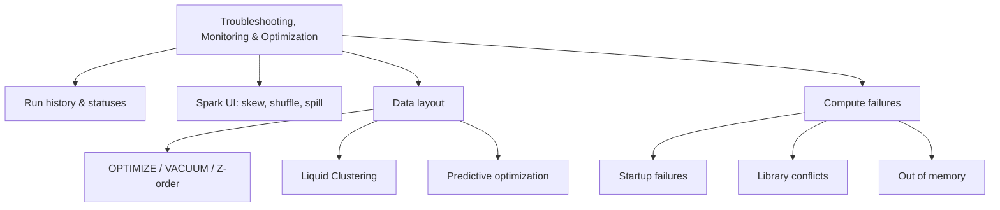

# Troubleshooting, Monitoring, and Optimization (10 % of Exam)

Domain 6 covers keeping pipelines healthy and fast. You read the **Lakeflow Jobs** run history to compare durations against a baseline, and interpret job statuses and task graphs to find upstream blockers. You diagnose skew, shuffle, and disk spill from Spark UI stage metrics. You know what **Liquid Clustering** and **predictive optimization** do, and you can troubleshoot cluster startup failures, library conflicts, and out-of-memory errors.

## Topics Overview

## Section Contents

| File | Topic | Priority |
| :--- | :--- | :--- |
| [01-job-monitoring.md](./01-job-monitoring.md) | Jobs & Pipelines list, matrix view, run statuses, graph/timeline views, notifications, repair runs | High |
| [02-spark-ui-and-system-tables.md](./02-spark-ui-and-system-tables.md) | Stage summary metrics, skew, shuffle, spill, AQE limits, system tables | High |
| [03-delta-optimization.md](./03-delta-optimization.md) | `OPTIMIZE`, Z-order, `VACUUM`, statistics, file sizing | Medium |
| [04-liquid-clustering-and-predictive-optimization.md](./04-liquid-clustering-and-predictive-optimization.md) | `CLUSTER BY`, `CLUSTER BY AUTO`, `OPTIMIZE FULL`, predictive optimization | High |
| [05-compute-troubleshooting.md](./05-compute-troubleshooting.md) | Termination codes, init scripts, library precedence and conflicts, driver/executor OOM | High |

## Official Skill Coverage (August 2026)

| Exam-guide skill (paraphrased) | Where it is covered |
| :--- | :--- |
| Job performance trends from Lakeflow Jobs run history vs historical baselines | [01](./01-job-monitoring.md) |
| Monitoring pipeline health in the Jobs UI: statuses, DAG task graph, run times, failure rates | [01](./01-job-monitoring.md) |
| Spark UI stage-level metrics for skew, shuffling, and disk spill | [02](./02-spark-ui-and-system-tables.md) |
| Features of Liquid Clustering and predictive optimization | [04](./04-liquid-clustering-and-predictive-optimization.md), [03](./03-delta-optimization.md) |
| Cluster startup failures, library conflicts, out-of-memory issues | [05](./05-compute-troubleshooting.md) |

## Key Concepts

- **Matrix view**: a single job's run history, one bar per run. Bar height is duration and colour is status, so a growing bar shows a regression against the baseline
- **Run outcome**: decided by leaf tasks. *Succeeded with failures* means some tasks failed but every leaf task succeeded
- **Skew test**: in a stage's Summary Metrics, if the Max task duration is at least 50 % above the 75th percentile, the stage may be skewed
- **AQE skew handling**: applies to sort-merge and shuffle-hash joins only, not broadcast joins and not `groupBy` aggregations. For aggregations, salt the key
- **Liquid Clustering**: replaces partitioning and Z-order (it can't be combined with either). Use up to four keys, which you can change without rewriting data
- **Predictive optimization**: runs `OPTIMIZE`, `VACUUM`, and `ANALYZE` automatically on UC managed tables

## Related Resources

- [Performance Optimization Cheat Sheet](../../../shared/cheat-sheets/performance-optimization.md)
- [Performance Troubleshooting](../../../shared/appendix/performance-troubleshooting.md)
- [DE Pro — Monitoring and Alerting (deeper)](../../data-engineer-professional/04-monitoring-and-alerting/README.md)

## Next Steps

Finish with [07 — Governance and Security](../07-governance-and-security/README.md).

---

**[← Previous: Implementing CI/CD](../05-implementing-cicd/README.md) | [↑ Back to Certification](../README.md) | [Next: Governance and Security →](../07-governance-and-security/README.md)**
