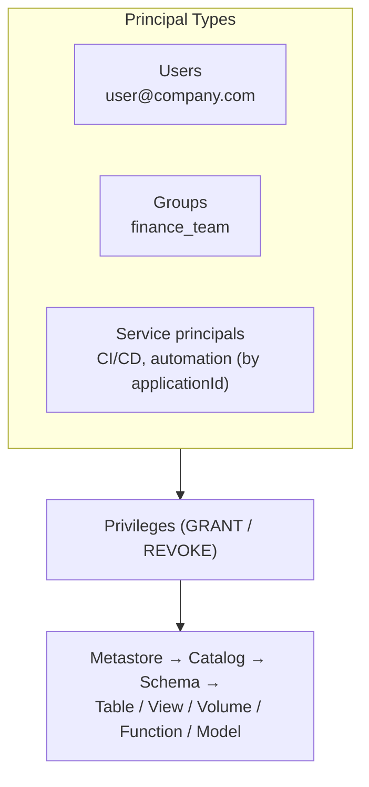

# Access Control and Permissions

## Overview

Access Control and Permissions in Unity Catalog provide fine-grained control over who can access what data. The privilege model is role-based and hierarchical, allowing delegation of access management throughout the organization.

> [!abstract]
>
> - Principals: users, groups, and service principals. Grant to **groups** wherever possible
> - To reach an object you need `USE CATALOG` + `USE SCHEMA`, plus the object privilege (`SELECT`, `MODIFY`, ...). Grants on a parent are inherited by current and future children
> - `GRANT` adds and `REVOKE` removes. The classic `DENY` statement is **legacy Hive metastore only**. Unity Catalog's deny mechanism is the ABAC DENY policy (Beta)

> [!tip] What the Exam Tests
>
> - Exam guide skill: configure access controls using the UI and SQL by applying GRANT, REVOKE, and DENY to principals at the right level of the hierarchy
> - The minimum privileges for a scenario (for example, read one table without the rest of the schema)
> - Who can grant: the owner, a user with `MANAGE`, the parent's owner, or a metastore admin

---

## Principals: Users, Groups, and Service Principals



| Principal | Identified by | Use for |
| :--- | :--- | :--- |
| **User** | Email | Individuals. Avoid granting to individuals in production |
| **Group** | Group name | **Default choice**: access follows membership changes automatically |
| **Service principal** | Application ID | Jobs, CI/CD, and bundle deployments (`run_as`) |

Principal names with special characters (such as `@` or `-`) must be enclosed in **backticks** ([Manage privileges](https://docs.databricks.com/aws/en/data-governance/unity-catalog/manage-privileges/)).

## Securable Hierarchy and Inheritance

```text
Metastore
└── Catalog                       USE CATALOG, CREATE SCHEMA, BROWSE, ...
    └── Schema                    USE SCHEMA, CREATE TABLE, CREATE VOLUME, CREATE FUNCTION, ...
        ├── Table / View / MV     SELECT, MODIFY, REFRESH (MV)
        ├── Volume                READ VOLUME, WRITE VOLUME
        ├── Function              EXECUTE
        └── Model                 EXECUTE
External locations / storage credentials: CREATE EXTERNAL TABLE, READ FILES, WRITE FILES, ...
```

- **Inheritance**: a privilege granted on a catalog or schema applies to the objects inside it, **including future objects**. `GRANT SELECT ON SCHEMA main.gold` covers every current and future table and view in `main.gold`
- **Usage privileges**: `USE CATALOG` and `USE SCHEMA` are "required to interact with any object inside" the catalog or schema, but they **do not themselves grant access to data**

Source: [Unity Catalog privileges reference](https://docs.databricks.com/aws/en/data-governance/unity-catalog/manage-privileges/privileges).

## Key Privileges

| Privilege | Allows |
| :--- | :--- |
| `USE CATALOG` / `USE SCHEMA` | Reach objects inside the catalog or schema (no data access by themselves) |
| `BROWSE` | Discover objects and view metadata **without** usage privileges (recommended on catalogs) |
| `SELECT` | "Query data from a table, view, materialized view, or OpenSharing share" |
| `MODIFY` | "Insert, update, and delete data in a table" |
| `CREATE SCHEMA` | Create a schema in a catalog |
| `CREATE TABLE` | "Create tables or views in a schema" |
| `CREATE MATERIALIZED VIEW` / `CREATE VOLUME` / `CREATE FUNCTION` | Create those objects in a schema |
| `REFRESH` | Manually refresh a materialized view |
| `READ VOLUME` / `WRITE VOLUME` | Read or change files in a volume |
| `EXECUTE` | Run a function, or load a registered model |
| `CREATE EXTERNAL TABLE` | Create external tables on an external location |
| `READ FILES` / `WRITE FILES` | Direct path access through an external location (volumes recommended instead) |
| `MANAGE` | "Manage privileges, transfer ownership, rename, and drop an object" |
| `ALL PRIVILEGES` | All applicable privileges, **except** `EXTERNAL USE SCHEMA`, `EXTERNAL USE LOCATION`, `MANAGE`, and `READ METADATA` |

> [!note] Legacy names
> `USAGE`, `READ_METADATA`, and `CREATE_TABLE` (with underscores) belong to the legacy Hive metastore table ACL model. In Unity Catalog use `USE CATALOG`, `USE SCHEMA`, `BROWSE`, and `CREATE TABLE`.

## GRANT and REVOKE

```sql
-- Minimum privileges to read ONE table (not the whole schema)
GRANT USE CATALOG ON CATALOG prod TO `analysts`;
GRANT USE SCHEMA  ON SCHEMA  prod.analytics TO `analysts`;
GRANT SELECT      ON TABLE   prod.analytics.revenue TO `analysts`;

-- Read everything in a schema, now and in future
GRANT USE SCHEMA, SELECT ON SCHEMA prod.analytics TO `analysts`;

-- Engineers may create and write tables in the silver schema
GRANT USE SCHEMA, CREATE TABLE, MODIFY, SELECT ON SCHEMA prod.silver TO `data_engineers`;

-- Service principal used by the production job
GRANT USE CATALOG ON CATALOG prod TO `6d5c1f2e-orders-sp-application-id`;
GRANT USE SCHEMA, SELECT, MODIFY ON SCHEMA prod.silver TO `6d5c1f2e-orders-sp-application-id`;

-- Discover without reading data
GRANT BROWSE ON CATALOG prod TO `all_employees`;

-- Remove privileges
REVOKE MODIFY ON SCHEMA prod.silver FROM `data_engineers`;
REVOKE SELECT ON TABLE prod.analytics.revenue FROM `user@company.com`;

-- Inspect
SHOW GRANTS ON TABLE prod.analytics.revenue;
SHOW GRANTS `analysts` ON SCHEMA prod.analytics;
```

- Syntax: `GRANT <privilege> ON <securable-type> <name> TO <principal>` and `REVOKE <privilege> ON <securable-type> <name> FROM <principal>`
- "A `REVOKE` statement succeeds even if the specified privileges were not granted in the first place"
- **REVOKE removes a grant made at that level**. If the principal also gets the privilege through a parent object or a group, access remains until those grants are revoked too

### Using the UI

In **Catalog Explorer**, open the catalog, schema, or table → **Permissions** tab → **Grant** (or select a grant → **Revoke**). Choose the principal and privileges. Ownership is changed on the object's **Overview** tab (the edit icon next to **Owner**).

### Who Can Grant

- The object's **owner** (who has all privileges on it)
- The owner of the **parent catalog or schema**
- A user with **`MANAGE`** on the object
- A **metastore admin**. Account admins can also grant directly on the metastore

Ownership transfer is done with `ALTER <securable> <name> OWNER TO <principal>`, for example `ALTER TABLE prod.analytics.revenue OWNER TO accounting`. It can be done by the current owner, a metastore admin, the parent container's owner, or a user with `MANAGE` ([Manage privileges](https://docs.databricks.com/aws/en/data-governance/unity-catalog/manage-privileges/)).

## DENY: Legacy Statement vs ABAC DENY Policies

The exam guide lists **DENY** alongside GRANT and REVOKE. The current docs split it into two different things:

| | Classic `DENY` statement | ABAC **DENY policy** (Beta) |
| :--- | :--- | :--- |
| Applies to | **Only** the legacy `hive_metastore` catalog ("This function is not supported by Unity Catalog") | Unity Catalog, attached at metastore (Beta), catalog, or schema |
| Syntax | `DENY SELECT ON TABLE hive_metastore.default.t TO user` | `CREATE POLICY ... DENY MANAGE ACCESS CONTROL FOR <securable_type> [WHEN ...]` |
| What it blocks | Any privilege. "Denying a privilege takes precedent over any explicit or implicit grant" | Today, only **`MANAGE ACCESS CONTROL`**: the ability to grant or revoke, change ownership, and manage policies |
| Undo | `REVOKE` the same privilege from the same principal | `DROP POLICY` |
| Visibility | `SHOW GRANTS` | `SHOW EFFECTIVE POLICIES` (not `SHOW GRANTS`) |

Sources: [DENY](https://docs.databricks.com/aws/en/sql/language-manual/security-deny), [ABAC DENY policies](https://docs.databricks.com/aws/en/data-governance/unity-catalog/abac/deny-policies).

How to answer DENY questions:

- To stop someone from **reading data** in Unity Catalog, **don't grant** the privilege, or **REVOKE** it (including from the groups they belong to). Restrict *rows or columns* with **row filters, column masks, or ABAC** (see [Row Filters, Column Masks, and ABAC](./04-row-filters-column-masks-abac.md))
- A `DENY` that overrides grants applies to the **legacy Hive metastore**. In Unity Catalog, the deny concept is the ABAC DENY policy, which currently governs only `MANAGE ACCESS CONTROL`

## Best Practices

- **Least privilege**: grant only what the role needs, at the narrowest sensible level
- **Grant to groups**, never to individuals in production
- **Organize by schema** (`bronze`, `silver`, `gold`, `finance`) so one schema-level grant covers a whole layer
- **Separate environments** with catalogs (`dev`, `test`, `prod`) and give production write access only to service principals
- **Run jobs as service principals** (`run_as`), not personal identities
- Give broad discovery with `BROWSE`, not `SELECT`

## Auditing Access

```sql
-- Recent permission changes and table reads (column names per the audit log schema)
SELECT event_time, user_identity.email, action_name, request_params
FROM system.access.audit
WHERE service_name = 'unityCatalog'
  AND action_name IN ('updatePermissions', 'getTable')
ORDER BY event_time DESC
LIMIT 100;
```

## Permission Scenarios

| Scenario | Grants |
| :--- | :--- |
| Analysts read every Gold object | `USE CATALOG` on `prod`. `USE SCHEMA`, `SELECT` on `prod.gold` |
| Analyst reads one table only | `USE CATALOG`, `USE SCHEMA`, and `SELECT` on that **table** |
| Engineers build Silver | `USE CATALOG`. `USE SCHEMA`, `CREATE TABLE`, `MODIFY`, `SELECT` on `prod.silver` |
| Ingestion SP writes raw files | `READ VOLUME`, `WRITE VOLUME` on the landing volume |
| Everyone can find datasets | `BROWSE` on the catalog |
| A team must lose access | `REVOKE` from the group (and check other groups and parent-level grants) |

## Use Cases

- **Group-based access management**: grants to `finance_team` follow membership changes automatically
- **Production identity**: jobs run as a service principal that holds `MODIFY` only on the schemas it writes
- **Self-service discovery**: `BROWSE` on catalogs lets people find data and request access without reading it

## Common Issues & Errors

### GRANT Succeeds But User Still Cannot Access Data

**Scenario:** An admin runs `GRANT SELECT ON TABLE ...` and the user still gets a permission error.
**Fix:** The user also needs `USE CATALOG` and `USE SCHEMA` on the parents. Grants on a child don't grant traversal of its parents.

### Access Remains After REVOKE

**Scenario:** After `REVOKE SELECT ... FROM user`, the user can still query the table.
**Fix:** They have it through a group or a schema-level grant. Revoke at the level, and from the principal, that actually granted it.

### DENY Fails in Unity Catalog

**Scenario:** `DENY SELECT ON TABLE prod.gold.revenue TO contractors` fails.
**Fix:** The classic `DENY` statement works only on `hive_metastore`. In Unity Catalog, revoke or withhold the grant, use filters, masks, or ABAC for partial access, or use an ABAC DENY policy (Beta) to remove `MANAGE ACCESS CONTROL`.

### Using Legacy Privilege Names

**Scenario:** `GRANT USAGE ON SCHEMA prod.gold TO analysts` doesn't give analysts what they expect in Unity Catalog.
**Fix:** Use the Unity Catalog privileges `USE CATALOG` / `USE SCHEMA` (and `BROWSE` for discovery).

## Exam Tips

- Reading one table = `USE CATALOG` + `USE SCHEMA` + `SELECT` on the table
- Grants on a catalog or schema are inherited by **current and future** child objects
- Three principal types: users, groups, **service principals**. Grant to groups
- `ALL PRIVILEGES` excludes `MANAGE` (and a few external-use privileges)
- The classic **DENY** statement is **Hive metastore only**. Unity Catalog's deny is the ABAC DENY policy (Beta), limited to `MANAGE ACCESS CONTROL`
- Owners, parent owners, `MANAGE` holders, and metastore admins can grant and transfer ownership

## Key Takeaways

- **Principals**: users, groups, service principals
- **Hierarchy**: metastore → catalog → schema → objects, with downward inheritance
- **GRANT / REVOKE** in SQL or in Catalog Explorer's Permissions tab
- **DENY**: legacy Hive metastore statement vs Unity Catalog ABAC DENY policy
- **Least privilege + groups + service principals** is the production pattern

## Related Topics

- [Unity Catalog Basics](./01-unity-catalog-basics.md)
- [Managed and External Tables](./02-managed-and-external-tables.md)
- [Row Filters, Column Masks, and ABAC](./04-row-filters-column-masks-abac.md)
- [Unity Catalog Quick Reference](../../../shared/cheat-sheets/unity-catalog-quick-ref.md)

## Official Documentation

- [Manage privileges in Unity Catalog](https://docs.databricks.com/aws/en/data-governance/unity-catalog/manage-privileges/)
- [Unity Catalog privileges reference](https://docs.databricks.com/aws/en/data-governance/unity-catalog/manage-privileges/privileges)
- [DENY (legacy Hive metastore)](https://docs.databricks.com/aws/en/sql/language-manual/security-deny)
- [ABAC DENY policies (Beta)](https://docs.databricks.com/aws/en/data-governance/unity-catalog/abac/deny-policies)

---

**[← Previous: Managed and External Tables](./02-managed-and-external-tables.md) | [↑ Back to Governance and Security](./README.md) | [Next: Row Filters, Column Masks, and ABAC →](./04-row-filters-column-masks-abac.md)**
