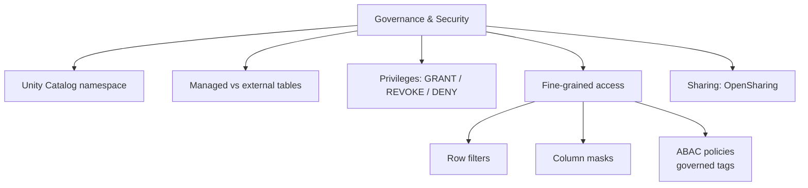

# Governance and Security (15 % of Exam)

Domain 7 covers Unity Catalog as the governance layer. You differentiate **managed and external tables** and perform basic operations on them: create, modify, drop, and convert in both directions. You configure access with **GRANT, REVOKE, and DENY** for users, groups, and service principals at the right level of the hierarchy. You also restrict visibility with **row filters and column masks**, and at scale with **Unity Catalog ABAC policies**.

> [!important] DENY in Unity Catalog
> The exam guide lists **DENY** next to GRANT and REVOKE. In the current docs, the classic `DENY` SQL statement applies only to the legacy `hive_metastore` catalog and "is not supported by Unity Catalog". Unity Catalog's deny mechanism is the **ABAC DENY policy (Beta)**, which today can deny only `MANAGE ACCESS CONTROL`. See [03-access-control-permissions.md](./03-access-control-permissions.md#deny-legacy-statement-vs-abac-deny-policies) for the full picture ([DENY reference](https://docs.databricks.com/aws/en/sql/language-manual/security-deny), [ABAC DENY policies](https://docs.databricks.com/aws/en/data-governance/unity-catalog/abac/deny-policies)).

## Topics Overview

## Section Contents

| File | Topic | Priority |
| :--- | :--- | :--- |
| [01-unity-catalog-basics.md](./01-unity-catalog-basics.md) | Metastore, three-level namespace, catalogs, schemas, volumes, external locations | High |
| [02-managed-and-external-tables.md](./02-managed-and-external-tables.md) | Managed vs external, create/alter/drop/UNDROP, `SET MANAGED` / `UNSET MANAGED` | High |
| [03-access-control-permissions.md](./03-access-control-permissions.md) | Principals, privileges, inheritance, GRANT / REVOKE, DENY, ownership | High |
| [04-row-filters-column-masks-abac.md](./04-row-filters-column-masks-abac.md) | Row filters, column masks, `is_account_group_member()`, dynamic views, ABAC policies | High |
| [05-data-sharing.md](./05-data-sharing.md) | Delta Sharing (now OpenSharing): shares, recipients | Low (not in the August 2026 outline) |

## Official Skill Coverage (August 2026)

| Exam-guide skill (paraphrased) | Where it is covered |
| :--- | :--- |
| Managed vs external tables; create, modify, delete, convert between them | [02](./02-managed-and-external-tables.md), [01](./01-unity-catalog-basics.md) |
| GRANT, REVOKE, and DENY to users, groups, and service principals via UI and SQL | [03](./03-access-control-permissions.md) |
| Column-level masking and row-level security by user group | [04](./04-row-filters-column-masks-abac.md) |
| Unity Catalog ABAC policies for central row filtering and column masking | [04](./04-row-filters-column-masks-abac.md) |

## Key Concepts

- **Three-level namespace**: `catalog.schema.object`
- **Usage privileges**: `USE CATALOG` + `USE SCHEMA` are required to reach any object, but they don't grant data access by themselves
- **Inheritance**: a grant on a catalog or schema covers current *and future* child objects
- **Managed tables**: UC owns lifecycle and layout. After `DROP`, data can be recovered with `UNDROP` for 7 days by default
- **External tables**: `DROP` removes metadata only, and the files remain in your storage
- **Row filter / column mask**: a SQL UDF attached with `SET ROW FILTER` or `SET MASK`, typically gated with `is_account_group_member()`
- **ABAC**: `CREATE POLICY ... ROW FILTER | COLUMN MASK ... FOR TABLES` attached at catalog, schema, or table level and matched by governed tags

## Related Resources

- [Unity Catalog Basics](../../../shared/fundamentals/unity-catalog-basics.md)
- [Unity Catalog Quick Reference](../../../shared/cheat-sheets/unity-catalog-quick-ref.md)
- [Governance & Security Interview Prep](../../../shared/interview-prep/governance-security.md)

## Next Steps

You've completed the topic folders. Test yourself with the [Practice Questions](../resources/practice-questions/README.md) and the [Mock Exams](../resources/mock-exam/README.md).

---

**[← Previous: Troubleshooting, Monitoring, and Optimization](../06-troubleshooting-monitoring-and-optimization/README.md) | [↑ Back to Certification](../README.md)**
