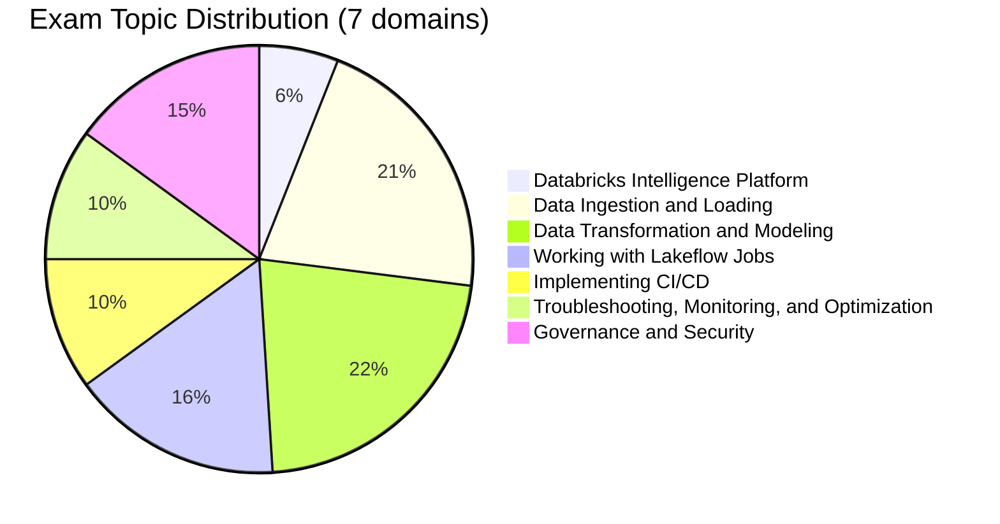

# Databricks Data Engineer Associate

> [!important]
> **What changed in the August 2026 exam guide** (exam published May 4, 2026; guide updated Aug 6, 2026)
>
> - **7 officially weighted domains**, with weights published for the first time since the May 2026 refresh: Databricks Intelligence Platform 6 %, Data Ingestion and Loading 21 %, Data Transformation and Modeling 22 %, Working with Lakeflow Jobs 16 %, Implementing CI/CD 10 %, Troubleshooting, Monitoring, and Optimization 10 %, Governance and Security 15 %
> - The exam guide now states it explicitly: **45 scored questions plus up to 10 unscored items** in 90 minutes. The extra time for unscored items is already included
> - **Recertification:** take the *Data Engineer Associate Renewal Exam* or the current full exam
> - CI/CD wording is now **Declarative Automation Bundles (formerly Databricks Asset Bundles)** and **Databricks Git folders (formerly Databricks Repos)**
> - New prep guidance points to the **AI Prep Guide**, and hands-on practice in **Databricks Free Edition**
> - Sample questions were refreshed. The skew question is now a `groupBy` aggregation, where AQE skew-join handling doesn't help and you salt the key instead
> - Pass / fail: **Databricks does not publish a numeric passing score**
>
> The topic folders below now map **1 : 1 to the 7 official domains**. The official PDF is the source of truth: [August 2026 exam guide (PDF)](https://www.databricks.com/sites/default/files/2026-10/Databricks-Certified-Data-Engineer-Associate-Exam-Guide-August-2026.pdf).

> [!note] Platform update (Oct 2026)
> Some product names have changed since the guide was written. The exam's wording is used throughout this guide, and the current names are noted where they appear:
>
> - **Lakeflow Declarative Pipelines** was renamed **Lakeflow Spark Declarative Pipelines** on Nov 12, 2025 ([release notes](https://docs.databricks.com/aws/en/release-notes/product/2025/november)). The docs also use the short form "Lakeflow pipelines"
> - **Databricks Asset Bundles** was renamed **Declarative Automation Bundles** on Mar 16, 2026 ([bundles release notes](https://docs.databricks.com/aws/en/release-notes/dev-tools/bundles))
> - **Delta Sharing** is now **OpenSharing** as of Jun 10, 2026 ([release notes](https://docs.databricks.com/aws/en/release-notes/product/2026/june))
> - **Community Edition** retired at the end of 2025. Use [Databricks Free Edition](https://docs.databricks.com/aws/en/getting-started/free-edition) for hands-on practice ([Free Edition limitations](https://docs.databricks.com/aws/en/getting-started/free-edition-limitations))
> - The certification page now calls the platform the **Databricks Data + AI Platform**. The exam's domain 1 is still named "Databricks Intelligence Platform"

## Exam Overview

| Detail              | Information                                  |
| ------------------- | -------------------------------------------- |
| **Certification**   | Databricks Certified Data Engineer Associate |
| **Exam guide**      | [August 2026 (PDF)](https://www.databricks.com/sites/default/files/2026-10/Databricks-Certified-Data-Engineer-Associate-Exam-Guide-August-2026.pdf). Exam published May 4, 2026; **exam guide updated Aug 6, 2026** |
| **Scored questions**| 45 multiple-choice (plus up to 10 unscored items) |
| **Duration**        | 90 minutes (includes time for unscored items) |
| **Result**          | Pass / fail (no published threshold)         |
| **Languages**       | English, Japanese, Portuguese (BR), Korean   |
| **Code in stems**   | SQL when possible, otherwise Python          |
| **Experience**      | 6+ months hands-on with Databricks (recommended) |
| **Prerequisites**   | None required; related training highly recommended |
| **Recertification** | Every 2 years: Renewal Exam or current full exam. See the [Renewal Guide](../../shared/appendix/renewal-guide.md) |
| **Cost**            | $200 USD (plus applicable taxes)             |
| **Delivery**        | Online proctored or test center              |
| **Test aides**      | None allowed                                 |

## Exam Domain Weights (official — August 2026)

| Domain | Weight | ≈ Questions (of 45) |
| :--- | :---: | :---: |
| Databricks Intelligence Platform | 6 % | ~3 |
| Data Ingestion and Loading | 21 % | ~9 |
| Data Transformation and Modeling | 22 % | ~10 |
| Working with Lakeflow Jobs | 16 % | ~7 |
| Implementing CI/CD | 10 % | ~5 |
| Troubleshooting, Monitoring, and Optimization | 10 % | ~4 |
| Governance and Security | 15 % | ~7 |

Question counts are estimates from the weights. Databricks publishes percentages, not per-domain counts.

## Study Topics

The folder structure matches the August 2026 official 7-domain blueprint 1 : 1. Read in order. Each folder's `README.md` maps its files to the official skill bullets.

### Core Topics

| Section | Weight | Topics |
| :--- | :---: | :--- |
| [01 — Databricks Intelligence Platform](./01-databricks-intelligence-platform/README.md) | 6 % | Architecture, workspace, compute and cost models, Delta Lake, time travel |
| [02 — Data Ingestion and Loading](./02-data-ingestion-and-loading/README.md) | 21 % | Ingestion patterns, Lakeflow Connect (standard and managed connectors), COPY INTO, Auto Loader, JDBC/REST, semi-structured data |
| [03 — Data Transformation and Modeling](./03-data-transformation-and-modeling/README.md) | 22 % | Spark SQL, DataFrames, joins, aggregations, cleaning, data quality, Gold layer objects, tuning parameters |
| [04 — Working with Lakeflow Jobs](./04-working-with-lakeflow-jobs/README.md) | 16 % | Tasks and DAGs, control flow (retries, If/else, For each), triggers (scheduled, file arrival, table update) |
| [05 — Implementing CI/CD](./05-implementing-cicd/README.md) | 10 % | Git folders, Declarative Automation Bundles (variables, targets, deploy), Databricks CLI |
| [06 — Troubleshooting, Monitoring, and Optimization](./06-troubleshooting-monitoring-and-optimization/README.md) | 10 % | Run history, job statuses, Spark UI (skew, shuffle, spill), Liquid Clustering, predictive optimization, compute failures |
| [07 — Governance and Security](./07-governance-and-security/README.md) | 15 % | Unity Catalog, managed vs external tables, GRANT / REVOKE / DENY, row filters, column masks, ABAC |

### Practice & Resources

| Resource | Description |
| :--- | :--- |
| [Practice Questions](./resources/practice-questions/README.md) | Questions grouped by the 7 official domains |
| [Mock Exam 1](./resources/mock-exam/README.md) | Full-length practice exam (45 questions) |
| [Mock Exam 2](./resources/mock-exam-2/README.md) | Alternative practice exam (45 questions) |
| [Exam Tips](./resources/exam-tips.md) | Strategies and exam format guide |
| [Final Review](./resources/final-review.md) | Exam-morning cram scan |
| [Official Links](./resources/official-links.md) | Documentation and registration links |

## Interview Preparation

After completing this certification, explore design and architecture questions:

- [Interview Prep Resource](../../shared/interview-prep/README.md) - System design, Delta Lake internals, pipeline architecture, and more

## Prerequisites

Before starting this certification, review:

- [Databricks Workspace](../../shared/fundamentals/databricks-workspace.md)
- [Delta Lake Basics](../../shared/fundamentals/delta-lake-basics.md)
- [Spark Fundamentals](../../shared/fundamentals/spark-fundamentals.md)
- [Platform Architecture](../../shared/fundamentals/platform-architecture.md)
- [Unity Catalog Basics](../../shared/fundamentals/unity-catalog-basics.md)

## Study Progress Tracker

### Phase 1: Platform and ingestion

- [ ] 01 — Databricks Intelligence Platform (architecture, compute, Delta Lake)
- [ ] 02 — Data Ingestion and Loading (Lakeflow Connect, COPY INTO, Auto Loader, JDBC/REST)

### Phase 2: Transformation and orchestration

- [ ] 03 — Data Transformation and Modeling (cleaning, joins, Gold layer objects, data quality, tuning)
- [ ] 04 — Working with Lakeflow Jobs (tasks, control flow, triggers)

### Phase 3: Production readiness

- [ ] 05 — Implementing CI/CD (Git folders, Declarative Automation Bundles, Databricks CLI)
- [ ] 06 — Troubleshooting, Monitoring, and Optimization (run history, Spark UI, Liquid Clustering)
- [ ] 07 — Governance and Security (managed vs external, privileges, masking, ABAC)

### Phase 4: Practice

- [ ] Complete hands-on tasks in [Databricks Free Edition](https://docs.databricks.com/aws/en/getting-started/free-edition)
- [ ] Complete practice questions (aim for 70 %+ per domain)
- [ ] Take Mock Exam 1 (under timed conditions)
- [ ] Review weak areas
- [ ] Take Mock Exam 2

## Official Resources

- [Databricks Certification Page](https://www.databricks.com/learn/certification/data-engineer-associate)
- [August 2026 exam guide (PDF)](https://www.databricks.com/sites/default/files/2026-10/Databricks-Certified-Data-Engineer-Associate-Exam-Guide-August-2026.pdf)
- [Databricks Documentation](https://docs.databricks.com/)
- [Databricks Academy](https://www.databricks.com/learn/training)
- [Databricks Free Edition](https://docs.databricks.com/aws/en/getting-started/free-edition)

## Recommended Path

1. Complete this **Data Engineer Associate** certification
2. Progress to [Data Engineer Professional](../data-engineer-professional/README.md) for advanced topics
3. Reference [Learning Paths](../../learning-paths/README.md) for recommended progression
