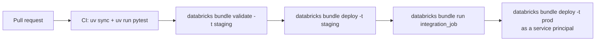
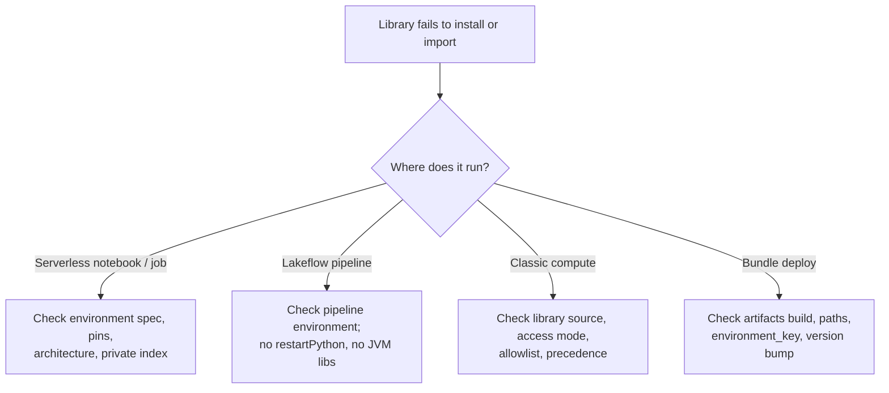

# Python Project Structure and Dependencies

## Overview

Production Databricks code is a Python project, not a pile of notebooks: a bundle root with `databricks.yml`, resource definitions, an importable package under `src/`, tests, and a `pyproject.toml` that declares dependencies. This page covers how to lay that project out for Declarative Automation Bundles, and how to troubleshoot libraries that fail to install or conflict on serverless compute, Lakeflow Pipelines, and bundle-deployed jobs.

> [!abstract]
>
> - A bundle has exactly one `databricks.yml` at its root; every other config file (for example `resources/*.yml`) must be listed in `include`.
> - Shared logic lives in a package under `src/`, built into a wheel by the `artifacts` mapping (`type: whl`) and installed through job `environments`, pipeline `environment`, or task `libraries`.
> - Each runtime has its own dependency mechanism: serverless uses environments (base environment + `dependencies`), pipelines use the pipeline environment, classic compute uses compute-scoped, notebook-scoped, or task libraries.
> - Most installation failures come from unpinned versions, cached environments, unsupported mechanisms (init scripts, PySpark installs, restarting Python in a pipeline), CPU-architecture-specific wheels, or private repositories that aren't configured.

> [!tip] What the Exam Tests
>
> - "Implement scalable Python project structures for Declarative Automation Bundles (formerly Databricks Asset Bundles / DABs) to support modular development and CI/CD integration."
> - "Apply troubleshooting techniques to dependency conflicts and installation failures for external libraries (PyPI, local wheels, source archives) across serverless, pipeline, and bundle-deployed environments."
> - Choosing where a dependency must be declared (job environment, pipeline environment, notebook environment, cluster library) for a given compute type.
> - Matching an installation symptom to its root cause and the documented fix.

> [!note] Platform update (Oct 2026)
> Databricks Asset Bundles were renamed **Declarative Automation Bundles** on March 16, 2026. The CLI command group is still `databricks bundle ...`. Source: [Declarative Automation Bundles release notes](https://docs.databricks.com/aws/en/release-notes/dev-tools/bundles)

---

## Bundle Project Structure

### Start from a template

`databricks bundle init` creates a bundle from a template. If you don't name one, the CLI prompts with the default templates.

```bash
databricks bundle init default-python   # job + ETL pipeline + Python package, requires uv
databricks bundle init pydabs           # same idea, but resources defined in Python
databricks bundle init /path/to/custom-template
```

| Template | What it generates |
| :--- | :--- |
| `default-minimal` | Empty bundle with only required files and catalog variables |
| `default-python` | Python bundle with a job and an ETL pipeline; requires `uv` |
| `pydabs` | `default-python` variant that uses Python instead of YAML for resource configuration |
| `default-sql` | Job that runs SQL queries on a SQL warehouse |
| `default-scala` | Builds a Scala JAR configured for serverless compute |
| `dbt-sql` | dbt-core project deployed as a job with a dbt task |
| `mlops-stacks` | Full MLOps Stacks project |

During `default-python` initialization the CLI asks whether to include a sample notebook job, an ETL pipeline, a stub (sample) Python package, whether to **use serverless**, the default catalog, and whether to use a personal schema per user. Since CLI 0.258.0 the template builds the wheel with `uv` and `pyproject.toml`; since CLI 0.276.0 it follows Lakeflow Pipelines conventions (pipeline source as files, not notebooks).

### A layout that scales

```text
my_project/
├── databricks.yml                # bundle name, include, artifacts, variables, targets
├── pyproject.toml                # package metadata, dependencies, build backend
├── uv.lock                       # optional lock file (uv lock)
├── README.md
├── resources/
│   ├── my_project.job.yml        # Lakeflow Jobs definitions
│   └── my_project_etl.pipeline.yml
├── src/
│   ├── my_project/               # importable package -> built into a wheel
│   │   ├── __init__.py
│   │   ├── main.py               # entry point for python_wheel_task
│   │   └── transforms.py         # pure DataFrame -> DataFrame functions
│   └── my_project_etl/
│       └── transformations/      # Lakeflow Pipelines source files
└── tests/
    └── test_transforms.py        # run locally with: uv run pytest
```

| Element | Why it supports modular development and CI/CD |
| :--- | :--- |
| One `databricks.yml` + `include` | Keeps the root small; teams add `resources/*.yml` files without editing a shared monolith |
| `resources/` split per job or pipeline | Each workload is reviewed and deployed as code; target overrides change only what differs per environment |
| `src/<package>/` | Logic is importable by jobs, pipelines, notebooks, and tests, and versioned as one wheel |
| `pyproject.toml` | Single source of truth for runtime and dev dependencies (`[dependency-groups]`) |
| `tests/` | `uv run pytest` runs in CI before `databricks bundle deploy` |
| `targets` (`dev`, `prod`) | Same code promoted across workspaces with `mode: development` / `mode: production` |

### `databricks.yml`: include, artifacts, variables, targets

```yaml
bundle:
  name: my_project

include:
  - resources/*.yml            # every config file other than databricks.yml must be included

artifacts:
  python_artifact:
    type: whl                  # whl, jar, or tgz
    build: uv build --wheel    # runs locally before upload
    path: .                    # folder that holds pyproject.toml / setup.py
    # dynamic_version: true    # patch the wheel version with the build timestamp

variables:
  catalog:
    description: Target catalog
    default: dev_catalog

targets:
  dev:
    mode: development          # [dev <user>] prefix, schedules paused
    default: true
  prod:
    mode: production
    variables:
      catalog: prod_catalog
```

Key facts about these mappings:

- `include` paths are globs relative to the file that declares them, and `include` can appear only as a top-level mapping.
- `artifacts.<name>.build` is optional. For wheels, if you omit it the CLI runs `python setup.py bdist_wheel`; if you omit `path`, it looks for `setup.py` in the bundle root.
- `dynamic_version: true` (CLI 0.245.0+, `type: whl` only) patches the wheel version from the file timestamp, so you can redeploy new code without editing the version in `setup.py` or `pyproject.toml`. The `artifacts_dynamic_version` target preset does the same per target; `default-python` turns it on for `dev` when you choose classic compute.
- If a wheel is already built and you only want to deploy it, omit `artifacts`; the CLI deploys the `whl` files listed in `libraries`.
- To install a wheel on a cluster running Databricks Runtime 12.2 LTS or below, add the top-level `experimental: python_wheel_wrapper: true` mapping.

### `pyproject.toml` for a bundle

```toml
[project]
name = "my_project"
version = "0.0.1"
requires-python = ">=3.10,<3.13"
dependencies = [
    # Runtime dependencies for jobs and pipelines in this project.
    "numpy==1.25.2",
]

[dependency-groups]
dev = [
    "pytest",
    "databricks-connect>=15.4,<15.5",
]

[project.scripts]
main = "my_project.main:main"

[build-system]
requires = ["hatchling"]
build-backend = "hatchling.build"
```

Runtime dependencies go under `[project] dependencies`; local tooling (pytest, Databricks Connect, linters) goes in a dev dependency group so it never ships to the cluster. The documented template notes that, for pipelines, dependencies are cached during development, so add them to the pipeline's `environment` section as well.

### Wiring the package into jobs and pipelines

Paths inside a resource file are relative to that file, so a resource in `resources/` refers to `../src/...` and `../dist/*.whl`.

```yaml
# resources/my_project.job.yml
resources:
  jobs:
    my_project_job:
      name: my_project_job
      tasks:
        # Serverless: Python wheel / script tasks must reference an environment
        - task_key: main
          python_wheel_task:
            package_name: my_project
            entry_point: main
          environment_key: default
      environments:
        - environment_key: default
          spec:
            environment_version: "4"
            dependencies:
              - ../dist/*.whl          # the wheel built by the artifacts mapping
              - simplejson==3.19.*
```

```yaml
# Classic job compute: attach the wheel as a task library instead
tasks:
  - task_key: main
    new_cluster:
      spark_version: 15.4.x-scala2.12
      node_type_id: i3.xlarge
      num_workers: 1
    python_wheel_task:
      package_name: my_project
      entry_point: main
    libraries:
      - whl: ../dist/*.whl
      - pypi:
          package: numpy==1.25.2
```

```yaml
# resources/my_project_etl.pipeline.yml
resources:
  pipelines:
    my_project_etl:
      name: my_project_etl
      catalog: ${var.catalog}
      schema: my_project
      serverless: true
      root_path: ../src/my_project_etl
      libraries:
        - glob:
            include: ../src/my_project_etl/transformations/**
      environment:
        dependencies:
          - --editable ${workspace.file_path}   # install the bundle's own pyproject.toml
```

| Workload | Where the wheel / package goes | Notes |
| :--- | :--- | :--- |
| Serverless Python wheel or script task | `environments[].spec.dependencies` + task `environment_key` | `environment_key` is required for Python script, Python wheel, and dbt tasks on serverless |
| Serverless notebook task | Notebook's own environment (Environment side pane) or a job-level environment | Task `libraries` are not supported for notebook tasks on serverless |
| Classic job task | Task `libraries` (`whl`, `pypi`, `maven`, `jar`, `requirements`) | Libraries cannot be declared on a shared job cluster definition |
| Serverless pipeline | Pipeline `environment.dependencies` (CLI 0.258+) | `environment_version` can also be set (preview) |

### Defining resources in Python

Python support for bundles (GA October 27, 2025, CLI 0.275.0+) lets you define, generate, and mutate resources in Python alongside YAML. Initialize with `databricks bundle init pydabs`, then point `databricks.yml` at the loader:

```yaml
python:
  venv_path: .venv                # environment that has databricks-bundles installed
  resources:
    - 'resources:load_resources'  # function that returns the Python-defined resources
  mutators:
    - 'mutators:add_email_notifications'
```

```python
from databricks.bundles.core import Bundle, Resources, load_resources_from_current_package_module
from databricks.bundles.jobs import Job


def create_job(country: str) -> Job:
    return Job.from_dict({
        "name": f"my_job_{country}",
        "tasks": [{"task_key": "nb", "notebook_task": {"notebook_path": "files/my_notebook.py"}}],
    })


def load_resources(bundle: Bundle) -> Resources:
    resources = load_resources_from_current_package_module()
    for country in ["US", "NL"]:
        resources.add_resource(f"my_job_{country}", create_job(country))
    return resources
```

Use this when many near-identical jobs come from metadata (one per country or source system). A mutator that raises an exception aborts the deployment.

### Sharing code across notebooks, files, and pipelines

| Approach | When to use | Key behaviour |
| :--- | :--- | :--- |
| Import from workspace files | Code co-versioned with the notebooks in the same bundle or Git folder | DBR 11.3+ adds the notebook's directory (Git folder: repo root) to `sys.path`; DBR 13.3+ distributes `sys.path` directories to executors |
| `sys.path.append(os.path.abspath(".."))` | Module lives in another directory | Manually appended paths have the lowest import precedence |
| Build a wheel | Code reused across bundles, pipelines, or teams | Versioned artifact; bump the version (or use `dynamic_version`) when the code changes |
| Pipeline `utilities/` folder | Helpers specific to one pipeline | Pipeline root is on `sys.path`, so `from utilities import my_utils` works |
| Path in the pipeline environment (`-e /Workspace/.../shared/`) | Shared module used by several pipelines | Makes the folder importable from every source file in the pipeline |
| `%run` | Legacy notebook includes | Docs suggest moving shared functions into workspace files and importing them, so notebooks and modules stay in sync |

On serverless compute the working directory is not guaranteed, so relative file paths and relative imports can fail; use absolute paths and import shared code as workspace files.

### CI/CD flow



Deployment commands, targets, and CI pipelines are covered in [Declarative Automation Bundles — Part 1](../08-debugging-and-deploying/03-declarative-automation-bundles-part1.md) and [CI/CD Integration — Part 1](../08-debugging-and-deploying/05-cicd-integration-part1.md).

---

## Dependency Mechanisms by Environment

| Environment | Declare dependencies with | Not supported |
| :--- | :--- | :--- |
| Serverless notebook | Environment side pane: base environment + Dependencies; `%pip` / `%uv pip` (environment version 5+) | Init scripts, compute policies, compute-scoped libraries, JAR libraries in notebooks, Maven coordinates |
| Serverless job task | Job `environments` spec (`environment_version`, `dependencies`) referenced by `environment_key` | Task `libraries` for notebook tasks |
| Lakeflow Pipelines | Pipeline Environment settings (`environment.dependencies`); workspace-file imports | `dbutils.library.restartPython()`, JVM (Scala/Java) libraries; init scripts on serverless pipelines |
| Classic compute | Compute-scoped libraries, notebook-scoped `%pip`, job task `libraries`, init scripts (not recommended) | DBFS-root libraries on DBR 15.1+ (disabled by default) |
| Unity Catalog Python UDF | `ENVIRONMENT (dependencies = '[...]', environment_version = '...')` in `CREATE FUNCTION` | See [UDFs and Unity Catalog Functions](./02-udfs-and-unity-catalog-functions.md) |

Environment versions, base environments, and memory settings for serverless are covered in [Databricks Compute — Part 2](./09-databricks-compute-part2.md).

### Dependency entry formats

Serverless notebook, job, and pipeline dependencies accept any line that is valid in a `requirements.txt` file:

```text
simplejson==3.19.*                                    # PyPI, pinned
/Workspace/Shared/libs/my_pkg-0.1.0-py3-none-any.whl  # wheel in workspace files (absolute path)
/Volumes/main/default/libs/my_pkg-0.1.0-py3-none-any.whl  # wheel in a UC volume
/Workspace/helper_utils                               # unpackaged project folder with pyproject.toml
-r /Workspace/Shared/requirements.txt                 # requirements file
--index-url https://<private-repo>/simple             # private index
git+https://github.com/databricks/databricks-cli      # VCS source
```

### Local wheels and source archives

- **Where to store files:** Unity Catalog volumes or workspace files. Library files in the DBFS root are deprecated and disabled by default on DBR 15.1+ because any user can modify them.
- **Volume uploads:** uploading to a volume renames files (spaces, periods, hyphens become underscores), but wheel filenames are left unchanged because pip requires periods in the version and hyphens as separators.
- **Source projects:** a directory containing `pyproject.toml` or `setup.py` can be added as a serverless dependency or a pipeline environment entry. For classic compute, the Workspace library source accepts wheels, zipped wheelhouses (`*.wheelhouse.whl`), ZIP, tar, and `requirements.txt` files.
- **Eggs:** supported only on DBR 13.3 LTS and below with dedicated or no-isolation shared access, and never from volumes or workspace files. Use wheels or PyPI.
- **CPU architecture:** serverless compute can run on `aarch64` or `x86_64`, and the architecture can change between runs. A wheel with native (C) extensions built for one architecture fails on the other. Prefer pure-Python wheels (`py3-none-any`), or ship both variants constrained with a `platform_machine` environment marker.

### Private package repositories

```python
token = dbutils.secrets.get(scope="scope", key="key")
```

```bash
%pip install --index-url https://<user>:$token@<your-package-repository>.com/<path/to/repo> <package>==<version> --extra-index-url https://pypi.org/simple/
```

- On serverless, dependencies are resolved before your code runs, and compute-scoped environment variables aren't supported, so a proxy set at runtime has no effect. Put `--index-url` / `--extra-index-url` in the dependency specification instead.
- Workspace admins can configure **default package repositories** (Settings → Compute → Default Package Repositories, or the `databricks-package-management` secret scope with keys `pip-index-url`, `pip-extra-index-urls`, `pip-cert`). They apply to notebooks, jobs, Lakeflow Pipelines, and Databricks Apps; an index URL specified in code or a notebook takes precedence over the workspace default.
- Changes to the repository secrets take effect after reattaching (serverless notebooks), rerunning (serverless jobs), restarting the compute (classic), or on the next pipeline run.

### Notebook-scoped installs and restarting Python

- `%pip` doesn't restart the Python process. After installing or upgrading a package that's already loaded, run `dbutils.library.restartPython()`. Install everything at the top of the notebook, then restart, because the restart clears Python state.
- On DBR 11.3 LTS+, `%pip`, `%sh pip`, and `!pip` all install notebook-scoped libraries.
- `%uv pip` (serverless environment version 5+) is faster than `%pip` and shares the same virtual environment, but it doesn't check for conflicts against preinstalled libraries.
- `%pip uninstall` can't remove a library that ships with Databricks Runtime or was installed as a cluster library; it can only revert a different version you installed.
- Lakeflow Pipelines don't support `dbutils.library.restartPython()`, so declare all Python dependencies in the pipeline environment instead of installing them at runtime.

### Python library precedence

When two libraries share a name, `import` loads the one with the highest precedence:

1. Current working directory (Git folders only)
2. Git folder root directory (Git folders only)
3. Notebook-scoped libraries (`%pip install`)
4. Compute-scoped libraries (UI, CLI, or API)
5. Libraries included in Databricks Runtime (init-script installs can land before or after these)
6. Current working directory (outside Git folders)
7. Workspace directories manually appended to `sys.path`

---

## Troubleshooting Dependency Conflicts and Installation Failures



| Symptom | Likely cause | Fix |
| :--- | :--- | :--- |
| Serverless notebook session stops with an error after adding a dependency | The package is PySpark or pulls PySpark in as a dependency | Remove it and reset the environment (arrow next to **Apply** → **Reset to defaults**) |
| Serverless job keeps running the old code of your custom package | Environment cache: same package version, so the cached install is reused | Bump the package version, or set `dynamic_version: true` on the bundle artifact |
| Wheel installs on one run and fails on the next | Native wheel built for one CPU architecture; serverless can switch between `aarch64` and `x86_64` | Use `py3-none-any` wheels or both variants with `platform_machine` markers |
| Behaviour changes between runs with no code change | Unpinned dependency resolved to a newer version | Pin with `==` (and keep a lock file); Databricks recommends pinning for jobs |
| New version installed, but `import` still shows the old one | Python process not restarted, or a higher-precedence copy is loaded | `dbutils.library.restartPython()`; check library precedence |
| Private package works on classic but not on serverless | Runtime proxy variables are ignored by serverless dependency installation | `--index-url` / `--extra-index-url` in the dependency spec, or a default package repository |
| Pipeline update fails on `restartPython()` or a mid-pipeline install | Not supported in Lakeflow Pipelines | Declare the package in the pipeline Environment settings |
| JAR / Maven library needed in a pipeline | Pipelines support only SQL and Python | Move JVM logic to a job task on compute that supports JARs |
| Init script or cluster library has no effect on serverless | Not supported on serverless | Use a base environment or notebook/job environment dependencies |
| Python wheel task on serverless fails validation | No environment configured for the task | Add an `environments` entry and set `environment_key` |
| Notebook task on serverless ignores task `libraries` | Task libraries aren't supported for serverless notebook tasks | Use the notebook's environment or a job-level environment |
| Library stored in DBFS root won't install on DBR 15.1+ | DBFS-root library storage disabled by default | Move it to a UC volume or workspace files |
| Maven or JAR install blocked on standard access mode | Coordinates and paths must be allowlisted | Ask an admin to add them to the allowlist |
| Two Maven packages need different versions of a transitive dependency | Load order decides which version wins | Use the **Exclusions** field to drop the conflicting dependency |
| Local `pytest` against Databricks Connect breaks after `pip install pyspark` | Databricks Connect and PySpark are mutually exclusive in one environment | Keep only `databricks-connect` in that virtual environment |
| Relative import or file path fails only on serverless | Working directory isn't guaranteed | Use absolute `/Workspace/...` or `/Volumes/...` paths |

To inspect what was installed on a serverless notebook, open the Environment side pane: the **Installed** tab lists packages and **pip logs** at the bottom shows the install log.

---

## Beta: `pyproject.toml`-Driven Serverless Environments

> [!note] Platform update (Oct 2026)
> Two Beta features released October 22, 2026 let `pyproject.toml` define the serverless environment: **serverless job environments from `pyproject.toml`** (notebook and Python script tasks; configurable in the Jobs UI, Jobs API, or a bundle) and **Shared Serverless for Asset Bundles** (notebooks and files in one bundle share serverless compute and the environment defined in the bundle-root `pyproject.toml`). A workspace admin must enable **Project-Scoped Shared Compute** on the Previews page. Source: [October 2026 release notes](https://docs.databricks.com/aws/en/release-notes/product/2026/october)

```toml
[project]
name = "my-project"
version = "0.1.0"
dependencies = ["cowsay==6.1"]

[build-system]                    # only needed to install the project itself
requires = ["hatchling"]
build-backend = "hatchling.build"

[tool.databricks.environment]
environment_version = "6"         # serverless environment version
```

```yaml
resources:
  jobs:
    my_project_job:
      name: my-project-job
      environments:
        - environment_key: project
          spec:
            project_environment: ../pyproject.toml   # must be the only environment-source field
      tasks:
        - task_key: main
          environment_key: project
          spark_python_task:
            python_file: ../src/main.py
```

- Requires serverless environment version 5+, `pyproject.toml` in workspace files, and Databricks CLI 1.21.0+ for `project_environment` in a bundle.
- With `project_environment`, omit `environment_version`, `base_environment`, and `dependencies` from the spec; set them in `pyproject.toml`.
- Installing the project itself needs a build backend and an up-to-date `uv.lock` (`uv lock`). With a missing or stale lock file, the runtime falls back to `uv pip install -r pyproject.toml`, which installs only the listed dependencies without enforcing locked versions. Check with `%uv lock --check`.
- In Shared Serverless, `%uv add <package>` updates `pyproject.toml`, `uv.lock`, and the shared environment; run `%uv sync` after editing `pyproject.toml` directly. Compute is shared per user and per serverless usage policy.

---

## Use Cases

- **Multi-team ETL monorepo**: Each team owns `resources/<team>_*.yml` and a sub-package under `src/`; `include: resources/*.yml` picks up new files without edits to the root config, and one wheel ships the shared transformations.
- **Serverless job with a private library**: The job `environments` spec lists `--extra-index-url` and the pinned internal package, so the same bundle deploys unchanged to dev and prod workspaces.
- **Fast iteration on a custom wheel**: `dynamic_version: true` on the artifact means every `bundle deploy` produces a new version, so serverless jobs never reuse a stale cached install.

## Common Issues & Errors

### Resource file is not deployed

**Scenario:** A new `resources/ingest.job.yml` exists, but `bundle deploy` doesn't create the job.

**Fix:** Add the file (or a matching glob) to the top-level `include` array. Only `databricks.yml` is read automatically.

### Wheel path not found at deploy time

**Scenario:** `libraries: - whl: ./dist/*.whl` fails from a file in `resources/`.

**Fix:** Paths in a resource file resolve relative to that file; use `../dist/*.whl`.

### Build step fails on the CI runner

**Scenario:** `bundle deploy` stops while running the artifact `build` command.

**Fix:** Install the build tool on the runner (`uv` for `uv build --wheel`, or Poetry / `setuptools` + `wheel`), and run the same build locally first.

### Mixed environment fields with a project environment

**Scenario:** A job spec sets both `project_environment` and `dependencies`.

**Fix:** `project_environment` must be the only environment-source field; move dependencies into `pyproject.toml`.

## Exam Tips

> [!tip]
>
> - A bundle has **one** `databricks.yml`; every other config file must be listed in `include`.
> - Shared code belongs in `src/<package>/`, built as a `whl` artifact; tests run locally with `uv run pytest`.
> - On **serverless**, Python wheel and script tasks need `environment_key` + an `environments` spec. Init scripts, cluster libraries, and compute policies don't exist there.
> - Custom package changed but serverless still runs old code → **bump the version** (or `dynamic_version: true`).
> - Pipelines: declare packages in the **pipeline environment**; `restartPython()` and JVM libraries are not supported.
> - Never install PySpark (directly or transitively) on serverless; never mix `databricks-connect` and `pyspark` locally.
> - Store wheels in **UC volumes or workspace files**, not the DBFS root.

## Key Takeaways

- **Bundle root**: `databricks.yml` (name, `include`, `artifacts`, `variables`, `targets`) plus `resources/`, `src/<package>/`, `tests/`, and `pyproject.toml` is the documented, template-generated layout.
- **Artifacts**: `type: whl` with `build: uv build --wheel` builds the wheel locally before upload; `dynamic_version: true` patches the version on each deploy.
- **Dependency placement**: serverless jobs use `environments` + `environment_key`; serverless notebooks use the Environment side pane; pipelines use `environment.dependencies`; classic compute uses task or compute-scoped `libraries`.
- **Formats**: any `requirements.txt` line works for serverless and pipeline dependencies, including volume or workspace wheel paths, project folders, `-r` files, and `--index-url`.
- **Private repos**: put index URLs in the dependency spec or configure default package repositories; runtime proxies don't affect serverless installs.
- **Architecture**: serverless may run on `aarch64` or `x86_64`; prefer `py3-none-any` wheels.
- **Python for bundles**: `pydabs` template, `python.resources` loader and `python.mutators`, for generating many resources from metadata.
- **Beta (Oct 22, 2026)**: `project_environment: ../pyproject.toml` and Shared Serverless for Asset Bundles need the Project-Scoped Shared Compute preview and environment version 5+.

## Related Topics

- [UDFs and Unity Catalog Functions](./02-udfs-and-unity-catalog-functions.md) - `ENVIRONMENT` clause for UDF dependencies
- [Databricks Compute — Part 2](./09-databricks-compute-part2.md) - Serverless environment versions, performance mode, high memory
- [Unit Testing — Part 1](./11-unit-testing-part1.md) - Testing the package in `src/`
- [Declarative Automation Bundles — Part 1](../08-debugging-and-deploying/03-declarative-automation-bundles-part1.md) - Bundle commands and targets
- [CI/CD Integration — Part 1](../08-debugging-and-deploying/05-cicd-integration-part1.md) - Pipelines that deploy bundles
- [DBFS and UC Volumes](../07-data-governance/03-dbfs-and-uc-volumes.md) - Where to store wheels

## Official Documentation

- [Declarative Automation Bundles project templates](https://docs.databricks.com/aws/en/dev-tools/bundles/templates)
- [Build a Python wheel file using Declarative Automation Bundles](https://docs.databricks.com/aws/en/dev-tools/bundles/python-wheel)
- [Declarative Automation Bundles configuration](https://docs.databricks.com/aws/en/dev-tools/bundles/settings)
- [Bundle configuration reference (artifacts, include, presets)](https://docs.databricks.com/aws/en/dev-tools/bundles/reference)
- [Declarative Automation Bundles library dependencies](https://docs.databricks.com/aws/en/dev-tools/bundles/library-dependencies)
- [Bundle configuration in Python](https://docs.databricks.com/aws/en/dev-tools/bundles/python/)
- [Bundle configuration examples](https://docs.databricks.com/aws/en/dev-tools/bundles/examples)
- [Develop pipelines with Declarative Automation Bundles](https://docs.databricks.com/aws/en/dev-tools/bundles/pipelines-tutorial)
- [Configure the serverless environment](https://docs.databricks.com/aws/en/compute/serverless/dependencies)
- [Use Shared Serverless for Git folders and bundles](https://docs.databricks.com/aws/en/compute/serverless/notebooks/shared-serverless)
- [Serverless compute limitations](https://docs.databricks.com/aws/en/compute/serverless/limitations)
- [Manage Python dependencies for pipelines](https://docs.databricks.com/aws/en/ldp/developer/external-dependencies)
- [Import Python modules from Git folders or workspace files](https://docs.databricks.com/aws/en/ldp/import-workspace-files)
- [Install libraries](https://docs.databricks.com/aws/en/libraries/)
- [Notebook-scoped Python libraries](https://docs.databricks.com/aws/en/libraries/notebooks-python-libraries)
- [Compute-scoped libraries](https://docs.databricks.com/aws/en/libraries/cluster-libraries)
- [Install libraries from a package repository](https://docs.databricks.com/aws/en/libraries/package-repositories)
- [Configure default package repositories](https://docs.databricks.com/aws/en/admin/workspace-settings/default-package-repositories)
- [Work with Python and R modules](https://docs.databricks.com/aws/en/files/workspace-modules)
- [Testing for Databricks Connect for Python](https://docs.databricks.com/aws/en/dev-tools/databricks-connect/python/testing)

---

**[↑ Back to Section](./README.md) | [Next: UDFs and Unity Catalog Functions →](./02-udfs-and-unity-catalog-functions.md)**
