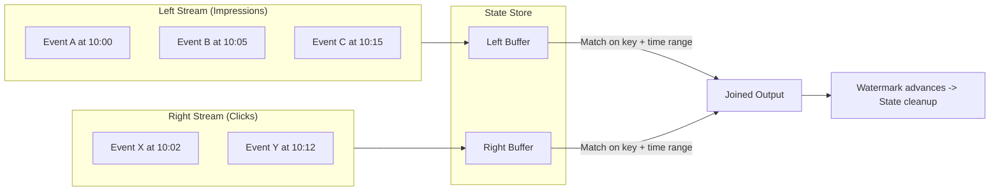
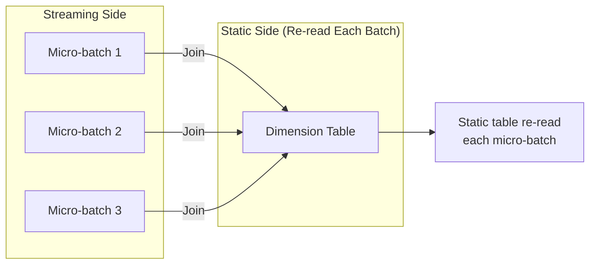
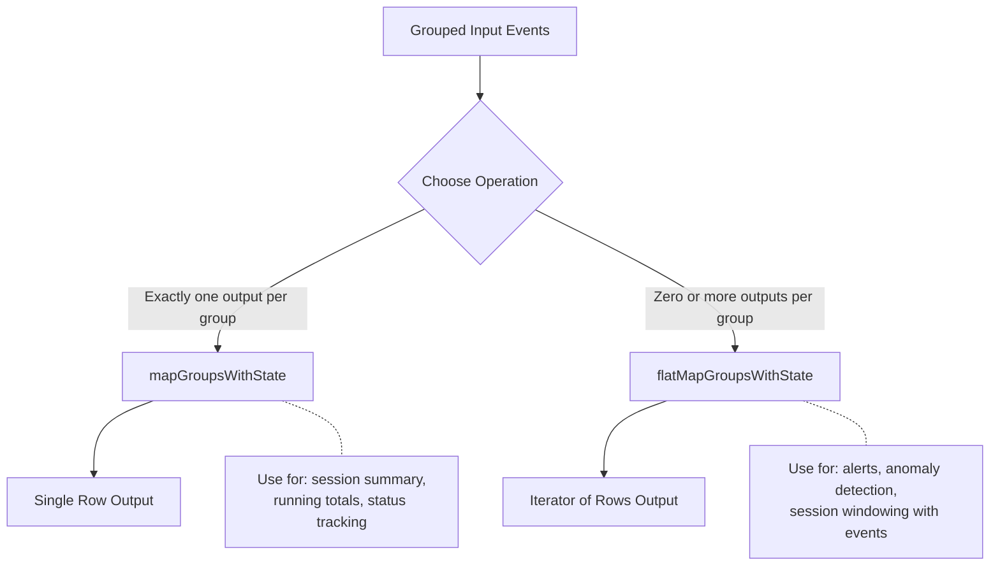

# Streaming Joins & Stateful Operations — Part 1

## Overview

This part covers advanced Structured Streaming join patterns and arbitrary stateful operations: stream-stream joins, stream-static joins, and `mapGroupsWithState` / `flatMapGroupsWithState`. Advanced watermarking and streaming deduplication are in [Part 2](./05-streaming-joins-stateful-part2.md).

> For streaming basics (triggers, output modes, sources, sinks, foreachBatch), see [Structured Streaming](./04-structured-streaming-part1.md).

> [!abstract]
>
> - **Stream-stream joins**: inner joins need watermarks on both sides plus a time range condition; outer joins need a watermark on the opposite side
> - **Stream-static joins** need no watermark on the static side; an uncached static DataFrame is re-read each micro-batch
> - **Arbitrary state**: `mapGroupsWithState` emits one record per group per batch, `flatMapGroupsWithState` zero or more, with processing-time or event-time timeouts

> [!tip] What the Exam Tests
>
> - Apply Structured Streaming stateful-processing semantics, including watermarks, output modes, foreachBatch, and checkpoints for fault-tolerant exactly-once state recovery.
> - Identify the watermark and join-predicate requirements for each stream-stream join type
> - Choose between built-in aggregations and custom stateful operations for a scenario

## Stream-Stream Joins

Stream-stream joins combine two unbounded streaming DataFrames. Both sides must buffer state until matching records arrive, making watermarks essential for bounding state.

### Architecture



### Inner Stream-Stream Join

Both streams must define watermarks. A time range condition in the join predicate bounds how long state is retained.

```python
from pyspark.sql.functions import expr

# Define watermarks on BOTH streams

impressions = (
    spark.readStream
    .format("delta")
    .load("/data/impressions")
    .withWatermark("impression_time", "2 hours")
)

clicks = (
    spark.readStream
    .format("delta")
    .load("/data/clicks")
    .withWatermark("click_time", "3 hours")
)

# Inner join with time range condition

joined = impressions.join(
    clicks,
    expr("""
        impressions.ad_id = clicks.ad_id AND
        click_time >= impression_time AND
        click_time <= impression_time + INTERVAL 1 HOUR
    """)
)

query = (
    joined.writeStream
    .format("delta")
    .option("checkpointLocation", "/checkpoints/impression_clicks")
    .outputMode("append")
    .start("/output/impression_clicks")
)
```

```sql
-- SQL equivalent for stream-stream inner join
CREATE OR REFRESH STREAMING TABLE impression_clicks AS
SELECT
    i.ad_id,
    i.impression_time,
    c.click_time,
    c.user_id,
    TIMESTAMPDIFF(SECOND, i.impression_time, c.click_time) AS time_to_click
FROM STREAM(impressions) i
JOIN STREAM(clicks) c
    ON i.ad_id = c.ad_id
    AND c.click_time >= i.impression_time
    AND c.click_time <= i.impression_time + INTERVAL 1 HOUR;
```

### Outer Stream-Stream Joins

Outer joins produce NULL-padded results when no match is found within the watermark window. The requirements differ by join type.

```python

# Left outer join: RIGHT side must have watermark
# Left rows emit with NULLs if no right match found after watermark

left_outer_joined = impressions.join(
    clicks,
    expr("""
        impressions.ad_id = clicks.ad_id AND
        click_time >= impression_time AND
        click_time <= impression_time + INTERVAL 1 HOUR
    """),
    "leftOuter"
)

# Right outer join: LEFT side must have watermark

right_outer_joined = impressions.join(
    clicks,
    expr("""
        impressions.ad_id = clicks.ad_id AND
        click_time >= impression_time AND
        click_time <= impression_time + INTERVAL 1 HOUR
    """),
    "rightOuter"
)
```

### Stream-Stream Join Requirements

| Join Type | Left Watermark | Right Watermark | Time Range Condition | Output Mode |
| :--- | :--- | :--- | :--- | :--- |
| Inner | Required | Required | Required for state cleanup | Append |
| Left Outer | Optional | **Required** | Required | Append |
| Right Outer | **Required** | Optional | Required | Append |
| Full Outer | Required | Required | Required | Append |

### Time Range Condition Explained

The time range condition in the join predicate controls how long buffered state is retained on each side.

```python

# The time range condition determines state retention
# Without it, state grows unboundedly even with watermarks

# Example: clicks must occur within 1 hour after impression

expr("""
    click_time >= impression_time AND
    click_time <= impression_time + INTERVAL 1 HOUR
""")

# This means:
#   - Impressions are buffered up to: watermark(click) + 1 hour
#   - Clicks are buffered up to: watermark(impression) + 0
#   - Wider range = more state retained = more memory

```

| Time Range Width | State Size | Late Match Tolerance | Use Case |
| :--- | :--- | :--- | :--- |
| 1 minute | Small | Very low | Real-time correlation |
| 1 hour | Medium | Moderate | Ad click attribution |
| 24 hours | Large | High | Daily event matching |

### Practice Question: Stream-Stream Joins

You have two streaming DataFrames, `orders` and `shipments`. You want to join them so that every order appears in the output, even if no matching shipment is found within 48 hours. Both streams have watermarks defined. Which join type should you use?

A) Inner join
B) Left outer join
C) Right outer join
D) Cross join

> [!success]- Answer
> **Correct Answer: B**
>
> A left outer join ensures every row from the left stream (orders) appears in the output. If no matching shipment arrives within the time range defined by the watermark, the shipment columns are filled with NULLs. Inner join would drop unmatched orders. Right outer would guarantee all shipments appear, not all orders.

## Stream-Static Joins

Stream-static joins combine a streaming DataFrame with a batch (static) DataFrame, commonly used for enrichment lookups such as adding dimension data to streaming events.

### Key Behavior



### Stream-Static Join Code

```python
# Static dimension table (read as batch)

dim_products = spark.table("catalog.schema.dim_products")

# Streaming events

event_stream = (
    spark.readStream
    .format("delta")
    .load("/data/sales_events")
)

# Stream-static join (no watermark needed on static side)

enriched = event_stream.join(
    dim_products,
    event_stream.product_id == dim_products.product_id,
    "left"
)

query = (
    enriched.writeStream
    .format("delta")
    .option("checkpointLocation", "/checkpoints/enriched_sales")
    .outputMode("append")
    .start("/output/enriched_sales")
)
```

```sql
-- SQL stream-static join pattern
CREATE OR REFRESH STREAMING TABLE enriched_sales AS
SELECT
    e.*,
    p.product_name,
    p.category,
    p.price
FROM STREAM(sales_events) e
LEFT JOIN dim_products p
    ON e.product_id = p.product_id;
```

### Stream-Static vs Stream-Stream Comparison

| Aspect | Stream-Static | Stream-Stream |
| :--- | :--- | :--- |
| Static side re-read | Each micro-batch | N/A (both streaming) |
| Watermark required | Not on static side | Both sides (for inner) |
| State management | No state for static | State for both sides |
| Dimension changes | Picked up each batch | N/A |
| Use case | Enrichment / lookup | Correlating two event streams |
| Memory impact | Low (broadcast possible) | High (state buffering) |

### When Static Data Changes

The static DataFrame is re-read at the start of each micro-batch. If the underlying table is updated between batches, new micro-batches will see the updated data. However, there is no guarantee of consistency within a single micro-batch if the static table is being written to concurrently.

```python

# Pattern: Force refresh of static table
# Option 1: The default behavior re-reads automatically

dim_table = spark.table("catalog.schema.dim_products")

# Option 2: Cache control for large static tables

dim_table = spark.table("catalog.schema.dim_products").cache()

# WARNING: Cached tables are NOT re-read each batch
# Only use cache if the static table rarely changes

```

### Practice Question: Stream-Static Joins

A data engineer has a streaming pipeline that enriches click events with user profile data from a Delta table. The user profile table is updated hourly. The streaming query uses a processing time trigger of 30 seconds. How often does the streaming query see updates to the user profile table?

A) Only at query start
B) Every 30 seconds (each micro-batch)
C) Every hour when the table updates
D) Never, unless the query is restarted

> [!success]- Answer
> **Correct Answer: B**
>
> In a stream-static join, the static DataFrame is re-read at the start of each micro-batch. With a 30-second processing time trigger, the static table is re-read every 30 seconds, so any updates to the user profile table are picked up at the next micro-batch boundary. This is a key behavioral difference from caching the static table.

## Stateful Streaming Operations

### mapGroupsWithState vs flatMapGroupsWithState

Both enable arbitrary stateful processing beyond built-in aggregations. The key difference is output cardinality.



### mapGroupsWithState Deep Dive

Returns exactly one output record per group per micro-batch.

```python
from pyspark.sql.streaming import GroupState, GroupStateTimeout
from pyspark.sql.types import StructType, StructField, StringType, LongType, DoubleType

# Define output schema

output_schema = StructType([
    StructField("device_id", StringType()),
    StructField("event_count", LongType()),
    StructField("avg_temperature", DoubleType()),
    StructField("last_event_time", StringType())
])

def update_device_stats(key, events, state: GroupState):
    """Track running statistics per device."""
    # Handle timeout (state expiry)
    if state.hasTimedOut:
        old_state = state.get
        state.remove()
        return (key[0], old_state["count"], old_state["avg_temp"], "EXPIRED")

    # Get current state or initialize
    if state.exists:
        current = state.get
    else:
        current = {"count": 0, "sum_temp": 0.0, "avg_temp": 0.0}

    # Process new events
    event_list = list(events)
    new_count = current["count"] + len(event_list)
    new_sum = current["sum_temp"] + sum(e.temperature for e in event_list)
    new_avg = new_sum / new_count
    last_time = str(max(e.event_time for e in event_list))

    # Update state
    new_state = {
        "count": new_count,
        "sum_temp": new_sum,
        "avg_temp": new_avg
    }
    state.update(new_state)

    # Set timeout (state expires if no new events within 30 minutes)
    state.setTimeoutDuration("30 minutes")

    return (key[0], new_count, new_avg, last_time)

# Apply mapGroupsWithState

result = (
    sensor_stream
    .withWatermark("event_time", "10 minutes")
    .groupByKey(lambda row: (row.device_id,))
    .mapGroupsWithState(
        update_device_stats,
        outputSchema=output_schema,
        outputMode="update",
        timeoutConf=GroupStateTimeout.ProcessingTimeTimeout
    )
)
```

### flatMapGroupsWithState Deep Dive

Returns zero or more output records per group per micro-batch.

```python
from typing import Iterator, Tuple

alert_schema = StructType([
    StructField("device_id", StringType()),
    StructField("alert_type", StringType()),
    StructField("value", DoubleType()),
    StructField("timestamp", StringType())
])

def detect_anomalies(
    key: Tuple,
    events: Iterator,
    state: GroupState
) -> Iterator[Tuple]:
    """Emit alerts when temperature exceeds thresholds."""
    # Handle timeout
    if state.hasTimedOut:
        state.remove()
        return iter([])

    # Get or initialize state
    if state.exists:
        history = state.get
    else:
        history = {"readings": [], "alert_count": 0}

    alerts = []
    event_list = list(events)

    for event in event_list:
        history["readings"].append(event.temperature)

        # Keep only last 10 readings
        if len(history["readings"]) > 10:
            history["readings"] = history["readings"][-10:]

        # Check for spike: current reading > 2x average
        avg = sum(history["readings"]) / len(history["readings"])
        if event.temperature > 2 * avg and len(history["readings"]) >= 5:
            history["alert_count"] += 1
            alerts.append((
                key[0],
                "TEMPERATURE_SPIKE",
                event.temperature,
                str(event.event_time)
            ))

        # Check for sustained high temperature
        if all(r > 100 for r in history["readings"][-5:]):
            alerts.append((
                key[0],
                "SUSTAINED_HIGH_TEMP",
                event.temperature,
                str(event.event_time)
            ))

    # Update state
    state.update(history)
    state.setTimeoutDuration("1 hour")

    return iter(alerts)

# Apply flatMapGroupsWithState

alerts = (
    sensor_stream
    .withWatermark("event_time", "10 minutes")
    .groupByKey(lambda row: (row.device_id,))
    .flatMapGroupsWithState(
        detect_anomalies,
        outputSchema=alert_schema,
        outputMode="append",
        timeoutConf=GroupStateTimeout.ProcessingTimeTimeout
    )
)
```

### GroupState Timeout Types

| Timeout Type | Trigger Condition | Requires Watermark | Use Case |
| :--- | :--- | :--- | :--- |
| `ProcessingTimeTimeout` | Wall clock time since last event | No | Idle session expiry |
| `EventTimeTimeout` | Watermark passes the timeout timestamp | Yes | Event-time based expiry |
| `NoTimeout` | Never expires | No | Permanent state (use with caution) |

```python

# Processing time timeout
# State expires based on wall clock (system time)

state.setTimeoutDuration("30 minutes")

# Event time timeout
# State expires when watermark passes the set timestamp

state.setTimeoutTimestamp(event_time_ms + 3600000)  # 1 hour in ms

# No timeout (dangerous - state grows forever)
# Only appropriate when number of keys is bounded and small

```

### When to Use Custom Stateful Operations vs Built-in

| Scenario | Recommended Approach |
| :--- | :--- |
| Windowed counts, sums, averages | Built-in aggregations + watermark |
| Distinct counts per window | Built-in `approx_count_distinct` |
| Custom session definitions | `flatMapGroupsWithState` |
| Running totals across windows | `mapGroupsWithState` |
| Anomaly detection with history | `flatMapGroupsWithState` |
| Complex state machines | `flatMapGroupsWithState` |
| Simple deduplication | `dropDuplicatesWithinWatermark` |

---

**[Next: Streaming Joins & Stateful Operations — Part 2 →](./05-streaming-joins-stateful-part2.md)**
