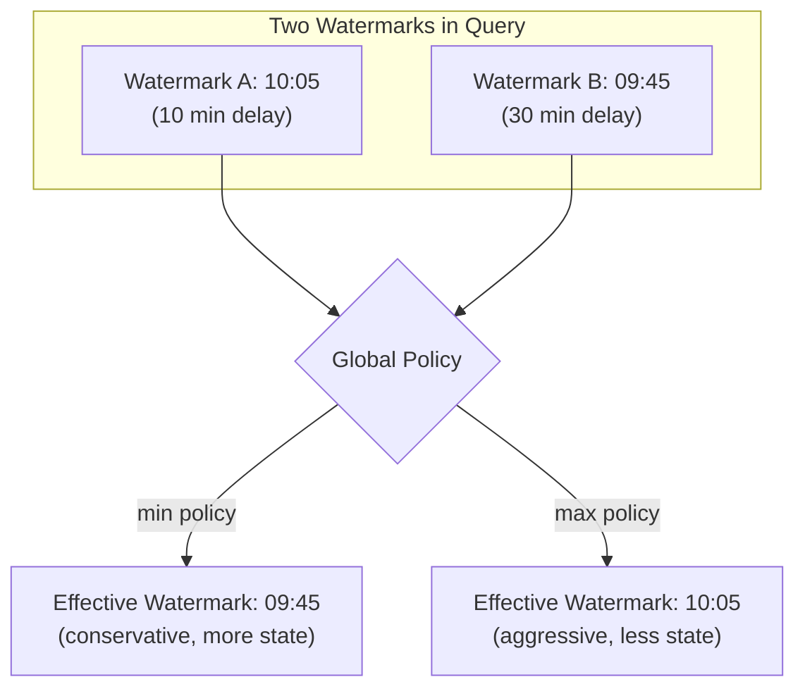
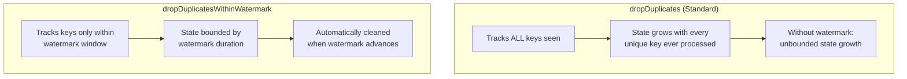

# Streaming Joins & Stateful Operations — Part 2

## Overview

This part covers advanced watermarking (multiple watermarks, the global watermark policy, boundary behavior, and state cleanup) and streaming deduplication, plus use cases, common issues, and exam tips for the whole topic.

> For stream-stream joins, stream-static joins, and `mapGroupsWithState` / `flatMapGroupsWithState`, see [Part 1](./05-streaming-joins-stateful-part1.md).

> [!abstract]
>
> - **Global watermark policy**: with several watermarks, `min` (default) follows the slowest stream and `max` the fastest
> - **Boundary behavior**: events with `event_time >= watermark` are processed, earlier events are dropped, and watermark advancement cleans up window state
> - **Streaming deduplication**: `dropDuplicatesWithinWatermark` bounds state to the watermark window; pair it with `foreachBatch` + MERGE for end-to-end exactly-once

> [!tip] What the Exam Tests
>
> - Apply Structured Streaming stateful-processing semantics, including watermarks, output modes, foreachBatch, and checkpoints for fault-tolerant exactly-once state recovery.
> - Predict which events a watermark keeps and when window state is cleaned up
> - Pick a streaming deduplication method that keeps state bounded

## Advanced Watermarking

### Multiple Watermarks in a Query

When a streaming query involves multiple operators that each define watermarks (for example, a stream-stream join followed by a windowed aggregation), Spark must reconcile them using a global watermark policy.

```python
# Stream A with 10-minute watermark

stream_a = (
    spark.readStream.format("delta").load("/data/stream_a")
    .withWatermark("event_time_a", "10 minutes")
)

# Stream B with 30-minute watermark

stream_b = (
    spark.readStream.format("delta").load("/data/stream_b")
    .withWatermark("event_time_b", "30 minutes")
)

# Join produces a query with two watermarks

joined = stream_a.join(
    stream_b,
    expr("""
        stream_a.key = stream_b.key AND
        event_time_b >= event_time_a AND
        event_time_b <= event_time_a + INTERVAL 5 MINUTES
    """)
)
```

### Global Watermark Policy

When multiple watermarks exist, Spark uses a global policy to determine the effective watermark for the entire query.

```python
# Set global watermark policy

spark.conf.set(
    "spark.sql.streaming.multipleWatermarkPolicy",
    "min"  # default: uses the MINIMUM watermark
)

# Alternative: use the maximum watermark

spark.conf.set(
    "spark.sql.streaming.multipleWatermarkPolicy",
    "max"
)
```

| Policy | Behavior | Data Safety | State Size |
| :--- | :--- | :--- | :--- |
| `min` (default) | Uses the slowest watermark | Safer (less data dropped) | Larger (more state retained) |
| `max` | Uses the fastest watermark | Aggressive (more data dropped) | Smaller (state cleaned sooner) |



### Watermark Propagation Through Operations

Watermarks propagate through transformations but have specific rules.

| Operation | Watermark Behavior |
| :--- | :--- |
| `filter`, `select`, `map` | Watermark passes through unchanged |
| `union` of two streams | Min of both watermarks |
| Stream-stream join | Both watermarks retained, global policy applies |
| Aggregation | Watermark used for state cleanup |
| `flatMapGroupsWithState` | Watermark available via `state.getCurrentWatermarkMs()` |

### Watermark Boundary Edge Cases

Understanding exact boundary behavior is critical for exam questions.

```python

# Watermark = max(event_time) - threshold
# Example: threshold = 10 minutes, max event_time seen = 10:25
# Watermark = 10:15

# Events arriving at exactly the watermark boundary:
#   event_time = 10:15 -> PROCESSED (not dropped)
#   event_time = 10:14 -> DROPPED (strictly less than watermark)
#   event_time = 10:16 -> PROCESSED

```

| Event Time | Watermark (10:15) | Result |
| :--- | :--- | :--- |
| 10:16 | 10:15 | Processed |
| 10:15 | 10:15 | Processed (at boundary = included) |
| 10:14 | 10:15 | Dropped (before boundary) |
| 10:00 | 10:15 | Dropped |

> **Key rule**: Events at exactly the watermark boundary are **included**, not dropped. The condition is `event_time >= watermark`, not `event_time > watermark`.

### Impact on State Store Cleanup

Watermark advancement triggers state cleanup for completed windows.

```python

# Window: 10:00-10:10, Watermark delay: 10 minutes
# When max event_time = 10:25 -> watermark = 10:15
# Window 10:00-10:10 end (10:10) < watermark (10:15) -> state cleaned
# Window 10:05-10:15 end (10:15) <= watermark (10:15) -> state cleaned
# Window 10:10-10:20 end (10:20) > watermark (10:15) -> state retained

```

### Practice Question: Watermark Policy

A streaming query joins two streams. Stream A has a watermark delay of 5 minutes and Stream B has a watermark delay of 30 minutes. The global watermark policy is set to "min". Stream A's max event time is 11:00 and Stream B's max event time is 10:50. What is the effective watermark for state cleanup?

A) 10:20 (Stream B: 10:50 - 30 min)
B) 10:55 (Stream A: 11:00 - 5 min)
C) 10:37 (average of both watermarks)
D) 10:50 (max of the two event times minus min delay)

> [!success]- Answer
> **Correct Answer: A**
>
> With the "min" policy, the effective watermark is the minimum of all individual watermarks. Stream A's watermark = 11:00 - 5 min = 10:55. Stream B's watermark = 10:50 - 30 min = 10:20. The minimum is 10:20, which becomes the effective global watermark. This is conservative: state is retained longer, reducing the chance of dropping late data from either stream.

## Streaming Deduplication

### dropDuplicates vs dropDuplicatesWithinWatermark



### dropDuplicatesWithinWatermark

This method only deduplicates events that arrive within the watermark window of each other. It is more memory-efficient but may not catch duplicates that arrive far apart.

```python
from pyspark.sql.functions import col

# Efficient: dedup only within watermark window

deduped = (
    event_stream
    .withWatermark("event_time", "15 minutes")
    .dropDuplicatesWithinWatermark(["transaction_id"])
)

query = (
    deduped.writeStream
    .format("delta")
    .option("checkpointLocation", "/checkpoints/deduped_events")
    .outputMode("append")
    .start("/output/deduped_events")
)
```

```sql
-- SQL streaming deduplication with watermark
CREATE OR REFRESH STREAMING TABLE deduped_transactions AS
SELECT *
FROM STREAM(raw_transactions)
-- Note: In Lakeflow Pipelines, deduplication is handled via AUTO CDC (formerly APPLY CHANGES INTO)
-- For standard SQL streaming, use Python API
```

### Deduplication State Comparison

| Method | State Contents | State Growth | Cleanup |
| :--- | :--- | :--- | :--- |
| `dropDuplicates(["id"])` | All unique IDs ever seen | Unbounded (without watermark) | Only with watermark on event time column |
| `dropDuplicates(["id", "event_time"])` | ID + event_time pairs | Bounded by watermark | Watermark cleans old pairs |
| `dropDuplicatesWithinWatermark(["id"])` | IDs within watermark window | Bounded by watermark | Automatic on watermark advance |

### Exactly-Once Guarantees with Deduplication

Combining streaming deduplication with checkpoint-based exactly-once delivery.

```python
def idempotent_dedup_write(batch_df, batch_id):
    """Combine streaming dedup with MERGE for end-to-end exactly-once."""
    from delta.tables import DeltaTable

    # Deduplicate within the micro-batch
    deduped = batch_df.dropDuplicates(["transaction_id"])

    # MERGE into target for cross-batch deduplication
    target = DeltaTable.forName(spark, "catalog.schema.transactions")

    target.alias("t").merge(
        deduped.alias("s"),
        "t.transaction_id = s.transaction_id"
    ).whenNotMatchedInsertAll(
    ).execute()

# Streaming with foreachBatch for exactly-once dedup

query = (
    event_stream
    .withWatermark("event_time", "10 minutes")
    .dropDuplicatesWithinWatermark(["transaction_id"])
    .writeStream
    .foreachBatch(idempotent_dedup_write)
    .option("checkpointLocation", "/checkpoints/exact_once_dedup")
    .start()
)
```

### Practice Question: Streaming Deduplication

A streaming pipeline processes IoT sensor readings. Duplicate readings can arrive up to 5 minutes apart. The pipeline must minimize memory usage while preventing duplicates. Which approach is most appropriate?

A) `dropDuplicates(["sensor_id", "reading_time"])` without watermark
B) `dropDuplicates(["sensor_id"])` with a 5-minute watermark
C) `dropDuplicatesWithinWatermark(["sensor_id", "reading_time"])` with a 5-minute watermark
D) `foreachBatch` with MERGE on sensor_id

> [!success]- Answer
> **Correct Answer: C**
>
> `dropDuplicatesWithinWatermark` with a 5-minute watermark is ideal because it only tracks keys within the watermark window, minimizing memory usage. Option A has no watermark, causing unbounded state growth. Option B deduplicates on sensor_id alone, which would drop all but the first reading per sensor. Option D works but uses more resources and is more complex than necessary.

## Use Cases

- **Ad click attribution**: join an impressions stream to a clicks stream with watermarks on both sides and a time range condition (for example, clicks within 1 hour of the impression)
- **Dimension enrichment**: join an event stream to a dimension table with a stream-static join; no watermark is needed on the static side
- **Custom sessions and anomaly detection**: use `flatMapGroupsWithState` for custom session definitions, anomaly detection with history, and other state machines
- **Duplicate sensor readings**: use `dropDuplicatesWithinWatermark` with a watermark as long as the gap between duplicates (for example, 5 minutes)

## Common Issues & Errors

### Join State Grows Despite Watermarks

**Scenario:** A stream-stream join has watermarks on both sides, but state keeps growing.
**Fix:** Add a time range condition to the join predicate. Watermarks alone do not bound join state.

### Stream-Static Join Misses Dimension Changes

**Scenario:** Updates to the dimension table stop appearing in the joined output.
**Fix:** A cached static DataFrame is not re-read each micro-batch. Remove `.cache()` unless the static table rarely changes.

### Deduplication State Runs Out of Memory

**Scenario:** `dropDuplicates(["id"])` without a watermark keeps every key ever seen.
**Fix:** Add a watermark and use `dropDuplicatesWithinWatermark`, which only tracks keys inside the watermark window.

### Group State Never Expires

**Scenario:** State kept by `mapGroupsWithState` or `flatMapGroupsWithState` grows forever.
**Fix:** `NoTimeout` never expires state. Set `ProcessingTimeTimeout`, or `EventTimeTimeout` together with a watermark.

## Exam Tips

1. **Inner stream-stream joins** - watermarks on both sides plus a time range condition in the join predicate
2. **Outer stream-stream joins** - left outer needs the right-side watermark; right outer needs the left-side watermark; full outer needs both
3. **Stream-static joins** - no watermark on the static side; an uncached static side is re-read each micro-batch
4. **`mapGroupsWithState` vs `flatMapGroupsWithState`** - exactly one output record per group vs zero or more
5. **Timeouts** - `ProcessingTimeTimeout` uses wall clock time; `EventTimeTimeout` needs a watermark
6. **Global watermark policy** - `min` (default) keeps more state and drops less late data; `max` cleans state sooner and drops more
7. **Watermark boundary** - events with `event_time >= watermark` are processed; earlier events are dropped
8. **`dropDuplicatesWithinWatermark`** - bounds deduplication state to the watermark window

## Key Takeaways

- **Stream-stream inner joins require watermarks on both sides** and a time range condition in the join predicate; watermarks alone are not sufficient — without a time range condition, state grows unboundedly
- **Left outer join**: the right-side stream must have a watermark; right outer join: the left-side stream must have a watermark; full outer: both sides need watermarks
- **Stream-static joins** re-read the static side at each micro-batch (unless cached); no watermark is needed on the static side, and changes to the static table are automatically picked up each batch
- **`mapGroupsWithState`** emits exactly one output record per group per micro-batch; **`flatMapGroupsWithState`** emits zero or more, enabling alerts and complex state machine patterns
- **`ProcessingTimeTimeout`** expires based on wall clock time (no watermark needed); **`EventTimeTimeout`** expires when the watermark advances past a set timestamp (watermark required)
- **Global watermark policy `min`** (default) uses the slowest watermark, retaining more state but reducing late-data loss; `max` uses the fastest watermark, cleaning state sooner but dropping more late events
- **Events at exactly the watermark boundary are included** (condition is `event_time >= watermark`, not `>`); events strictly before the watermark are dropped
- **`dropDuplicatesWithinWatermark`** bounds deduplication state to the watermark window, unlike `dropDuplicates` which tracks all keys ever seen

## Related Topics

- [Structured Streaming — Part 1](./04-structured-streaming-part1.md) - Triggers, output modes, sources, sinks, and basic watermarking
- [Structured Streaming — Part 2](./04-structured-streaming-part2.md) - State store management, `foreachBatch`, and checkpoints
- [Streaming Monitoring & Optimization](../04-monitoring-and-alerting/06-streaming-monitoring-optimization.md) - Back-pressure, monitoring and troubleshooting, state store deep dive
- [Data Deduplication](../03-data-manipulation/03-data-deduplication.md) - Batch and streaming deduplication patterns

## Official Documentation

- [Stream-Stream Joins](https://docs.databricks.com/structured-streaming/stream-stream-joins.html)
- [Stateful Streaming](https://docs.databricks.com/structured-streaming/stateful-streaming.html)
- [Watermarks](https://docs.databricks.com/structured-streaming/watermarks.html)
- [Streaming Deduplication](https://docs.databricks.com/structured-streaming/dedup.html)

---

**[← Previous: Streaming Joins & Stateful Operations — Part 1](./05-streaming-joins-stateful-part1.md) | [↑ Back to Section](./README.md) | [Next: Declarative Pipelines →](./06-declarative-pipelines.md)**
