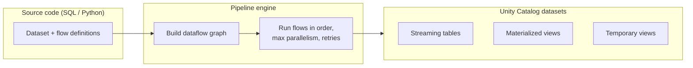
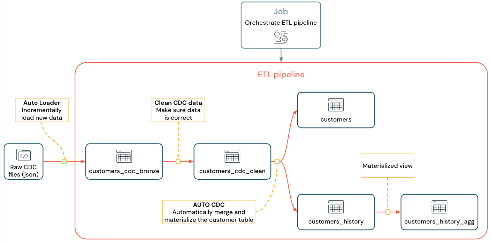
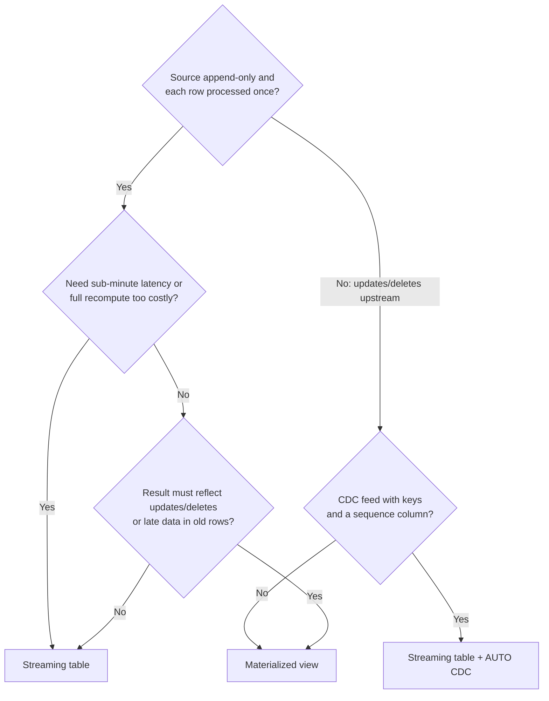

# Declarative Pipelines

## Overview

Lakeflow Pipelines let you declare streaming tables, materialized views, and views in SQL or Python; the engine builds the dependency graph, manages checkpoints and retries, and refreshes results incrementally where it can. This file covers the dataset types, the current `pyspark.pipelines` (`dp`) API, Auto Loader ingestion, run modes, and the two exam decisions: **streaming table vs materialized view** and **Structured Streaming vs Spark Declarative Pipelines**.

> [!note] Platform update (Oct 2026)
> The exam says **Lakeflow Pipelines**. The docs renamed Lakeflow Declarative Pipelines to **Lakeflow Spark Declarative Pipelines** on Nov 12, 2025, and also use the short form "Lakeflow pipelines". The open-source framework underneath is **Apache Spark™ Declarative Pipelines (SDP)**, part of Apache Spark from 4.1. The Python `dlt` module has been replaced by `pyspark.pipelines` (`from pyspark import pipelines as dp`). `import dlt` still works, but Databricks recommends `pipelines`. Sources: [November 2025 release notes](https://docs.databricks.com/aws/en/release-notes/product/2025/november), [Lakeflow pipelines Python language reference](https://docs.databricks.com/aws/en/ldp/developer/python-ref)

> [!abstract]
>
> - **Streaming table**: each source row is processed once (append-only source); built for ingestion (Auto Loader, Kafka) and AUTO CDC targets
> - **Materialized view**: its result always matches the batch query; it refreshes incrementally on serverless when the query allows, and reflects late updates and deletes
> - **Python API**: `@dp.table` (streaming table), `@dp.materialized_view`, `@dp.temporary_view`; **SQL**: `CREATE OR REFRESH STREAMING TABLE ... FROM STREAM ...`
> - **Lakeflow Pipelines add on top of SDP**: AUTO CDC, expectations, the queryable event log, update flows and foreachBatch sinks, and continuous mode

> [!tip] What the Exam Tests
>
> - Create production-ready data pipelines for streaming data using Lakeflow Pipelines and Auto Loader
> - Choose between a streaming table and a materialized view for a given latency, cost, and refresh requirement
> - Choose between Spark Structured Streaming and Apache Spark™ Declarative Pipelines for scalable ETL given operational constraints
> - Predict what a full refresh, a triggered run, or a continuous run does to each dataset type

---

## Pipeline Architecture





*Lakeflow pipeline DAG showing Bronze → Silver → Gold data flow between tables.*

You never call `writeStream`, `save()`, or `toTable()` in pipeline code. Python dataset functions return a DataFrame, and the engine decides how to write it. The docs warn against `collect()`, `count()`, `toPandas()`, `save()`, `saveAsTable()`, `start()`, and `toTable()` inside dataset definitions, because the source code is evaluated several times during planning.

## Dataset Types

| Type | SQL | Python | How records are processed | Typical use |
| :--- | :--- | :--- | :--- | :--- |
| Streaming table | `CREATE OR REFRESH STREAMING TABLE` | `@dp.table` returning a streaming DataFrame | Each record processed **once** (assumes append-only source) | Ingestion, low-latency transforms, AUTO CDC targets |
| Materialized view | `CREATE OR REFRESH MATERIALIZED VIEW` | `@dp.materialized_view` returning a batch DataFrame | Results recomputed **as needed** to match the current source state; incremental when possible | Joins, aggregations, gold tables read by many consumers |
| View | `CREATE TEMPORARY VIEW` | `@dp.temporary_view` | Evaluated on demand, not persisted | Intermediate logic and checks inside one pipeline |

Both streaming tables and materialized views are Unity Catalog managed **Delta** tables. A streaming table can receive several flows (append flows, AUTO CDC flows); a materialized view always has exactly the one flow implied by its query.

## Streaming Table vs Materialized View — Decision Guide

The exam frames this as "latency, cost, and refresh requirement". The deciding question is usually: **must the result reflect changes to rows that were already processed?**

| Requirement in the scenario | Choose | Why |
| :--- | :--- | :--- |
| Ingest ever-growing files or Kafka events exactly once | Streaming table | Processes each new input row once; MVs should not be defined on sources that do not retain history (Kafka) or on Auto Loader ingest |
| Aggregate must reflect **late-arriving updates to prior days** or deletes upstream | Materialized view | Always equal to the batch query result, even when data arrives late or out of order |
| Join where dimension changes must update old results | Materialized view | Stream joins do not recompute when the dimension changes ("fast but wrong"); MVs recompute joins |
| Lowest latency (seconds), continuous processing | Streaming table in a continuous pipeline | MV refresh latency is seconds to minutes and MVs are not designed for low-latency use |
| A full recompute of the source would be cost-prohibitive (very large, append-only) | Streaming table | Guarantees exactly-once incremental processing; an MV may fall back to a full recompute |
| Source rows get deleted or archived after processing but must stay downstream | Streaming table | A later full recompute of an MV would lose rows missing from the source |
| Pre-computed gold aggregate read by dashboards on a schedule | Materialized view | Cached result, refreshed on a schedule, incremental on serverless |
| Apply inserts/updates/deletes from a CDC feed | Streaming table + AUTO CDC flow | See [AUTO CDC API](./07-auto-cdc-api.md) |

> [!important] Model scenario (exam guide sample)
> A gold object aggregates daily order totals from bronze; BI reads it on a schedule; the aggregate must reflect the full history, **including late-arriving updates to prior days**. Answer: a **materialized view**. It incrementally maintains the full aggregate, can be refreshed on a schedule, and reflects late changes. A streaming table would only process newly appended rows and would not recompute earlier aggregates.

### Refresh, scheduling, and cost levers

- **Incremental refresh needs serverless.** Materialized views refreshed by serverless pipelines (or SQL warehouses) refresh incrementally when the query supports it; on classic compute they are **always fully recomputed**.
- **Cost model**: by default (`REFRESH POLICY AUTO`) Databricks picks the cheaper of incremental refresh and full recompute. `INCREMENTAL` prefers incremental, `INCREMENTAL STRICT` fails rather than fall back to a full recompute, and `FULL` always recomputes. `REFRESH POLICY` is **Beta**.
- **Source tables**: enabling deletion vectors, row tracking, and change data feed on MV sources helps incremental refresh; some operators require row tracking.
- **Check the technique used**: the event log `planning_information` event reports `FULL_RECOMPUTE`, `NO_OP`, or an incremental technique such as `ROW_BASED` or `GROUP_AGGREGATE`.
- **Scheduling**: datasets in a pipeline refresh when the pipeline runs (triggered on a job schedule, or continuously). Standalone MVs and STs created in Databricks SQL can carry `SCHEDULE EVERY <n> HOURS`, `SCHEDULE CRON '...'`, or `TRIGGER ON UPDATE [AT MOST EVERY <interval>]`, and always run in triggered mode.

```sql
-- Standalone materialized view (Databricks SQL) with its own refresh schedule
CREATE OR REPLACE MATERIALIZED VIEW main.gold.daily_order_totals
SCHEDULE EVERY 1 HOUR
AS SELECT order_date, SUM(amount) AS total_amount
FROM main.silver.orders
GROUP BY order_date;
-- Alternative: TRIGGER ON UPDATE refreshes when upstream Delta sources change (at most once per minute by default)
```



## SQL Syntax

### Streaming tables

```sql
-- Auto Loader ingestion: read_files with the STREAM keyword
CREATE OR REFRESH STREAMING TABLE bronze_orders
COMMENT "Raw orders from the landing volume"
AS SELECT *, _metadata.file_path AS source_file
FROM STREAM read_files(
  '/Volumes/main/landing/orders/',
  format => 'json'
);

-- Kafka ingestion
CREATE OR REFRESH STREAMING TABLE bronze_kafka_events
AS SELECT
  CAST(key AS STRING) AS event_key,
  CAST(value AS STRING) AS event_value,
  topic, partition, offset, timestamp
FROM STREAM read_kafka(
  bootstrapServers => 'broker:9092',
  subscribe => 'events-topic'
);

-- Downstream streaming table with an expectation
CREATE OR REFRESH STREAMING TABLE silver_orders (
  CONSTRAINT valid_order_id EXPECT (order_id IS NOT NULL) ON VIOLATION DROP ROW
)
CLUSTER BY (order_date)
AS SELECT order_id, customer_id, CAST(order_date AS DATE) AS order_date, total_amount
FROM STREAM bronze_orders
WHERE order_status <> 'cancelled';

-- Streaming read of a source that has update/delete commits
CREATE OR REFRESH STREAMING TABLE silver_orders_from_changing_source
AS SELECT * FROM STREAM main.ops.orders WITH (SKIPCHANGECOMMITS);
```

A streaming read fails if it encounters a change or delete commit in its source. `skipChangeCommits` ignores those commits; it does not propagate them. To propagate changes, read the change data feed and use AUTO CDC.

### Materialized views

```sql
CREATE OR REFRESH MATERIALIZED VIEW gold_daily_sales
AS SELECT
  order_date,
  COUNT(*) AS order_count,
  SUM(CAST(total_amount AS DECIMAL(18,2))) AS total_sales
FROM silver_orders
GROUP BY order_date;

-- Explicit refresh policy (Beta)
CREATE OR REFRESH MATERIALIZED VIEW gold_customer_ltv
REFRESH POLICY INCREMENTAL STRICT
AS SELECT c.customer_id, c.segment, SUM(o.total_amount) AS lifetime_value
FROM silver_customers c
LEFT JOIN silver_orders o ON c.customer_id = o.customer_id
GROUP BY c.customer_id, c.segment;
```

Do not use `STREAM` in a materialized view query. Sums over `FLOAT`/`DOUBLE` can force a full refresh; casting to `DECIMAL` keeps the query incrementalizable.

### Temporary views

```sql
CREATE TEMPORARY VIEW v_enriched_orders
AS SELECT o.*, p.product_name, p.category
FROM silver_orders o
JOIN silver_products p ON o.product_id = p.product_id;
```

> [!warning] `LIVE.` is legacy
> Older material references pipeline datasets as `LIVE.table_name` and `STREAM(LIVE.table_name)`. The LIVE virtual schema is **deprecated** and belongs to the legacy publishing mode. In the default publishing mode, `LIVE.` is silently ignored and unqualified names resolve to the pipeline's configured catalog and schema. Source: [LIVE schema (legacy)](https://docs.databricks.com/aws/en/ldp/live-schema)

## Python Syntax (`pyspark.pipelines`)

```python
from pyspark import pipelines as dp
from pyspark.sql.functions import col, current_timestamp, count, sum

# Streaming table: @dp.table + a streaming read
@dp.table(name="bronze_orders", comment="Raw orders from the landing volume")
def bronze_orders():
    return (
        spark.readStream.format("cloudFiles")
        .option("cloudFiles.format", "json")
        .option("cloudFiles.inferColumnTypes", "true")
        .load("/Volumes/main/landing/orders/")
    )

# Streaming table with expectations, reading another pipeline dataset
@dp.table(name="silver_orders", cluster_by=["order_date"])
@dp.expect_or_drop("valid_order_id", "order_id IS NOT NULL")
@dp.expect_or_drop("valid_amount", "total_amount > 0")
def silver_orders():
    return (
        spark.readStream.table("bronze_orders")
        .filter(col("order_status") != "cancelled")
        .select(
            "order_id",
            "customer_id",
            col("order_date").cast("date").alias("order_date"),
            col("total_amount").cast("decimal(18,2)").alias("total_amount"),
            current_timestamp().alias("processed_at"),
        )
    )

# Materialized view: @dp.materialized_view + a batch read
@dp.materialized_view(name="gold_daily_sales", refresh_policy="auto")
def gold_daily_sales():
    return (
        spark.read.table("silver_orders")
        .groupBy("order_date")
        .agg(count("*").alias("order_count"), sum("total_amount").alias("total_sales"))
    )

# Temporary view: computed when queried, not published
@dp.temporary_view(name="v_recent_orders")
def v_recent_orders():
    return spark.read.table("silver_orders").filter("order_date >= date_sub(current_date(), 30)")
```

| Older `dlt` code | Current `dp` code |
| :--- | :--- |
| `import dlt` | `from pyspark import pipelines as dp` |
| `@dlt.table` returning a batch DataFrame | `@dp.materialized_view` (`@dp.table` still works for both, but MVs should use `@dp.materialized_view`) |
| `@dlt.view` | `@dp.temporary_view` |
| `@dlt.table(temporary=True)` | `@dp.table(private=True)` (private: not published to the catalog, persists for the pipeline's lifetime) |
| `dlt.read("t")` / `dlt.read_stream("t")` | Current docs examples use `spark.read.table("t")` / `spark.readStream.table("t")` |
| `dlt.apply_changes(...)` | `dp.create_auto_cdc_flow(...)` |
| `@dlt.expect...` | `@dp.expect...` |

Common decorator arguments (`@dp.table`, `@dp.materialized_view`): `name`, `comment`, `spark_conf`, `table_properties`, `path`, `partition_cols`, `cluster_by`, `cluster_by_auto`, `schema`, `row_filter` (Public Preview), `private`. `refresh_policy` exists only on `@dp.materialized_view`.

> [!warning] Python loops that define tables
> Pipelines evaluate dataset functions lazily. A function inside a `for` loop that reads the loop variable directly makes every table load the **last** value. Pass the value as a default argument (`def t(name=t_name)`) or wrap the decorator in a factory function. Source: [Develop pipeline code with Python](https://docs.databricks.com/aws/en/ldp/developer/python-dev)

## Auto Loader in Pipelines

Databricks recommends Auto Loader plus streaming tables for incremental ingestion from cloud object storage or Unity Catalog volumes. In SQL, `read_files` invokes Auto Loader when used with `STREAM` (older material uses `cloud_files()`); in Python, use `spark.readStream.format("cloudFiles")`.

```sql
CREATE OR REFRESH STREAMING TABLE bronze_events
AS SELECT * FROM STREAM read_files(
  '/Volumes/main/landing/events/',
  format => 'json',
  schemaHints => 'event_id STRING, event_time TIMESTAMP',
  schemaEvolutionMode => 'addNewColumns'
);
```

```python
@dp.table(name="bronze_events")
def bronze_events():
    return (
        spark.readStream.format("cloudFiles")
        .option("cloudFiles.format", "json")
        .option("cloudFiles.schemaHints", "event_id STRING, event_time TIMESTAMP")
        .option("cloudFiles.schemaEvolutionMode", "rescue")
        .load("/Volumes/main/landing/events/")
    )
```

In a pipeline you do **not** set `cloudFiles.schemaLocation` or a checkpoint location; Databricks manages schema location and checkpoint information for you.

| `cloudFiles.schemaEvolutionMode` | Behavior when a new column appears |
| :--- | :--- |
| `addNewColumns` (default when no schema is provided) | Stream fails with `UnknownFieldException` after adding the columns; the restart continues with the new schema |
| `addNewColumnsWithTypeWidening` | Like `addNewColumns`, and widens supported types (int → long); Public Preview |
| `rescue` | Schema never evolves and the stream does not fail; new columns go to the rescued data column |
| `failOnNewColumns` | Stream fails and does not restart until you update the schema or remove the file |
| `none` (default when a schema is provided) | Schema does not evolve, new columns are ignored, the stream does not fail |

Because `addNewColumns` deliberately fails the stream once, the docs recommend running Auto Loader so it restarts automatically (for example, with Lakeflow Jobs); after the restart it continues with the evolved schema. For more Auto Loader detail see [Auto Loader](../02-data-ingestion-and-acquisition/01-auto-loader.md).

## Reading Message Buses and Existing Tables

```python
@dp.table(name="bronze_kafka")
def bronze_kafka():
    return (
        spark.readStream.format("kafka")
        .option("kafka.bootstrap.servers", "broker:9092")
        .option("subscribe", "orders")
        .option("startingOffsets", "earliest")
        .load()
        .selectExpr("CAST(key AS STRING) AS key", "CAST(value AS STRING) AS value", "timestamp")
    )

# Existing Unity Catalog table as a streaming source
@dp.table(name="orders_from_delta")
def orders_from_delta():
    return spark.readStream.table("main.ops.orders")

# Small or static reference data: batch read into a materialized view
@dp.materialized_view(name="dim_country")
def dim_country():
    return spark.read.table("main.ref.countries")
```

Do not define a materialized view directly over Kafka: Kafka does not keep history, so a recompute cannot rebuild the result.

## Spark Structured Streaming vs Spark Declarative Pipelines — Decision Guide

Both run the same Spark streaming engine. The difference is **who owns the operational work**: you (Structured Streaming in a notebook or script scheduled by Lakeflow Jobs), or the pipeline engine (SDP / Lakeflow Pipelines).

| Concern | Spark Structured Streaming (+ Lakeflow Jobs) | Spark Declarative Pipelines / Lakeflow Pipelines |
| :--- | :--- | :--- |
| Programming model | Procedural: you write `readStream ... writeStream ... start()` | Declarative: you declare datasets and flows; the engine plans the writes |
| Checkpoints | You set and manage `checkpointLocation` per query | Managed per flow; reset automatically on full refresh |
| Orchestration and dependencies | You order queries and tasks (multiple tasks or queries in a job) | Dependency graph inferred from code; flows run in order with maximum parallelism |
| Retries and recovery | Configure the job (continuous trigger restarts failed runs with exponential backoff) | Built in: retries escalate from Spark task to flow to whole pipeline |
| Sinks and custom writes | Any sink: `foreachBatch`, `foreach`, JDBC, multiple targets in one batch | Streaming tables, MVs, and sinks (Delta, Kafka, Event Hubs, custom Python data sources); `@dp.foreach_batch_sink` for custom per-batch logic (Lakeflow only) |
| Output modes and triggers | Full control (append, update, complete; `processingTime`, `availableNow`, real-time mode) | Append and update flows are exposed; trigger set per pipeline mode or `pipelines.trigger.interval` |
| Data quality | Hand-written filters and assertions | Expectations (warn / drop / fail) with metrics in the event log (Lakeflow only) |
| CDC / SCD | Hand-written `MERGE` in `foreachBatch` (with ordering and dedup logic) | AUTO CDC handles ordering, SCD 1/2 (Lakeflow only) |
| Lineage and monitoring | Streaming query listener / metrics you collect | Unity Catalog lineage, pipeline graph, queryable event log |
| Continuous on serverless | Serverless notebooks and jobs support only `Trigger.AvailableNow()` and `Trigger.Once()` | Continuous mode is supported on serverless pipelines |
| Portability | Any Spark runtime | SDP code runs on Apache Spark 4.1+; AUTO CDC, expectations, event log, and continuous mode are Databricks additions |

Choose **Structured Streaming** when you need fine-grained control the pipeline does not expose: custom `foreachBatch` logic across several systems, complete output mode, arbitrary stateful processing you tune yourself, explicit checkpoint management, or a specific trigger. Choose **Declarative Pipelines** when the priority is managed orchestration, automatic retries and checkpoints, expectations, AUTO CDC, and lineage with less code. Databricks recommends Lakeflow pipelines for most new ETL workloads.

```python
# Structured Streaming: you own trigger, checkpoint, sink, and idempotency
from delta.tables import DeltaTable

def upsert_batch(batch_df, batch_id):
    (DeltaTable.forName(spark, "main.silver.orders").alias("t")
        .merge(batch_df.alias("s"), "t.order_id = s.order_id")
        .whenMatchedUpdateAll()
        .whenNotMatchedInsertAll()
        .execute())

(spark.readStream.table("main.bronze.orders")
    .writeStream
    .foreachBatch(upsert_batch)          # at-least-once: keep it idempotent
    .option("checkpointLocation", "/Volumes/main/chk/orders_upsert")
    .trigger(availableNow=True)
    .start())
```

```python
# Same intent declaratively: the pipeline owns checkpoint, retries, ordering
from pyspark import pipelines as dp

dp.create_streaming_table("silver_orders")
dp.create_auto_cdc_flow(
    target="silver_orders",
    source="bronze_orders",
    keys=["order_id"],
    sequence_by="updated_at",
    stored_as_scd_type=1,
)
```

Middle ground: `@dp.foreach_batch_sink` gives pipeline-managed checkpoints with custom per-batch Python. You still own downstream cleanup: on a full refresh `batch_id` restarts at 0 and the pipeline does not clean data it wrote to external targets.

## Pipeline Configuration


*Lakeflow pipeline settings panel showing target schema, development mode, and trigger type.*

```yaml
# databricks.yml (Declarative Automation Bundle) — pipeline resource
resources:
  pipelines:
    orders_pipeline:
      name: "orders-pipeline-${bundle.target}"
      catalog: ${var.catalog}
      schema: sales            # use schema; `target` is the deprecated legacy field
      serverless: true         # recommended for new pipelines; omit clusters
      continuous: false        # triggered; run on a job schedule
      channel: CURRENT         # PREVIEW tests upcoming runtime changes
      configuration:
        source_path: /Volumes/main/landing/orders/
      libraries:
        - glob:
            include: ../src/transformations/**
      notifications:
        - email_recipients:
            - data-team@example.com
          alerts:
            - on-update-failure
            - on-flow-failure
```

Read a configuration value in Python with `spark.conf.get("source_path")`. Pipeline **parameters** (`parameters:` map, referenced as `:name` in SQL source) are a separate feature for SQL code. Editions: `CORE` (streaming ingest), `PRO` (adds CDC), `ADVANCED` (adds expectations, the default). Serverless pipelines can use AUTO CDC.

## Run Modes, Retries, and Refresh Semantics

| | Triggered (`continuous: false`, default) | Continuous (`continuous: true`) |
| :--- | :--- | :--- |
| Stops | When all tables are refreshed from data available at start | Runs until manually stopped |
| Freshness fit | Every 10 minutes, hourly, daily | Every 10 seconds to a few minutes |
| Cost | Compute only while updating | Always-running compute |

Pipeline mode is independent of dataset type: both STs and MVs update in either mode. Databricks recommends running a continuous pipeline from a **continuous job** rather than the pipeline's built-in continuous setting; the job's mode overrides the pipeline's.

**Run behavior** depends on how the update starts. "Run now" or editor updates of a triggered pipeline use fast-start, debugging-focused behavior: the cluster is reused (two hours by default) and pipeline retries are disabled so errors surface immediately. Updates started from Jobs or the API, and all continuous updates, use automatic retry and restart behavior. `pipelines.maxFlowRetryAttempts` defaults to two retries per flow; `pipelines.numUpdateRetryAttempts` defaults to five for triggered pipelines and unlimited for continuous ones. The `development` flag (default `false`) selects development or production mode.

| Update type | Materialized view | Streaming table |
| :--- | :--- | :--- |
| Refresh (default) | Brought up to date; incremental when cheaper | Processes only new records |
| Full refresh | Recomputed from sources | **Clears data and checkpoints** and reprocesses all source records |
| Reset streaming flow checkpoints (API) | Not applicable | Clears checkpoints but keeps table data |

```bash
# Start an update; --full-refresh resets all tables first
databricks pipelines start-update <pipeline-id>
databricks pipelines start-update <pipeline-id> --full-refresh

# Refresh only selected tables (request body fields of the updates API)
databricks pipelines start-update <pipeline-id> \
  --json '{"refresh_selection": ["silver_orders"], "full_refresh_selection": ["gold_daily_sales"]}'
```

A full refresh of a streaming table can **lose data** when the source no longer holds it (short Kafka retention, lifecycle-deleted files, compliance deletes). Set `pipelines.reset.allowed = false` on tables that must never be fully refreshed.

## Use Cases

- **Clickstream ingestion with a gold rollup**: a streaming table ingests JSON events from a volume with Auto Loader; a materialized view computes daily active users and is refreshed incrementally on a serverless pipeline that a job triggers hourly.
- **Schema drift in front-end events**: Auto Loader `rescue` mode keeps the bronze stream running when developers add fields; new fields land in `_rescued_data` for later promotion.
- **Choosing the engine**: a team that must write each micro-batch to an operational database and a Kafka topic, with custom retry logic, keeps that job on Structured Streaming `foreachBatch`; the rest of the medallion flow moves to a Lakeflow pipeline for expectations and lineage.

## Common Issues & Errors

| Symptom | Likely cause | Fix |
| :--- | :--- | :--- |
| Streaming table fails reading an upstream table | Upstream had `UPDATE`/`DELETE`/`MERGE` commits | Read with `skipChangeCommits`, or read the change data feed and use AUTO CDC; or use an MV |
| Gold aggregate ignores corrections to old rows | Built as a streaming table | Rebuild as a materialized view |
| MV is fully recomputed every run | Classic compute, unsupported operator, `FLOAT` sum, missing row tracking on sources | Use serverless; check `planning_information`; cast to `DECIMAL`; enable row tracking; `REFRESH POLICY INCREMENTAL STRICT` to fail fast |
| Changing a streaming table's query does not change old rows | Each row is processed once | Full refresh, if the source still holds the data |
| Data missing after a full refresh | Source retention shorter than table history | Protect the table with `pipelines.reset.allowed = false` |
| All loop-generated tables contain the same data | Late binding of the loop variable | Pass the value as a default argument or use a factory function |
| Unqualified table not found after migrating code | Default publishing mode resolves names to the pipeline catalog/schema, not the workspace default | Fully qualify external tables |
| Unbounded stateful stream fails with memory pressure | No watermark on an aggregation or join | Add a watermark (see [Streaming Joins and Stateful Processing](./05-streaming-joins-stateful-part1.md)) |

## Exam Tips

> [!tip]
>
> - **Late updates to old aggregates → materialized view.** Append-only, exactly-once, lowest latency → streaming table.
> - **Kafka or Auto Loader ingest → streaming table**, never an MV (the source cannot be recomputed).
> - **Incremental MV refresh requires serverless**; on classic compute MVs fully recompute.
> - **Full refresh of a streaming table clears data and checkpoints** and can drop records the source no longer holds.
> - **Structured Streaming** = control (`foreachBatch`, custom sinks, explicit checkpoints, any output mode). **Declarative Pipelines** = managed orchestration, retries, checkpoints, expectations, AUTO CDC, lineage.
> - **AUTO CDC, expectations, the event log, and continuous mode are Lakeflow-only**; plain SDP on Apache Spark does not have them.
> - Current Python API: `from pyspark import pipelines as dp`; `@dp.table` (ST), `@dp.materialized_view`, `@dp.temporary_view`. `LIVE.` is legacy.

## Key Takeaways

- **Streaming tables** process each appended source row once and are the default for ingestion and AUTO CDC targets; **materialized views** always equal the batch result of their query and reflect late changes; **views** are not persisted.
- **The exam decision**: if the result must reflect updates or late data in previously processed rows, choose a materialized view; if you need exactly-once, low-latency processing of a growing source, choose a streaming table.
- **Cost**: MVs refresh incrementally only on serverless, using a cost model (`REFRESH POLICY` can force or forbid incremental). STs avoid recompute entirely but cannot revise old rows without a full refresh.
- **Auto Loader in pipelines**: `STREAM read_files(...)` in SQL or `format("cloudFiles")` in Python; schema location and checkpoints are managed by the pipeline.
- **Structured Streaming vs SDP**: choose Structured Streaming for control over `foreachBatch`, sinks, state, triggers, and checkpoints; choose Declarative Pipelines for managed orchestration, retries, expectations, AUTO CDC, and lineage.
- **Run behavior**: UI/editor runs of triggered pipelines disable retries for fast debugging; job/API and continuous runs retry automatically.
- **Naming**: exam "Lakeflow Pipelines" = docs "Lakeflow Spark Declarative Pipelines"; Python moved from `dlt` to `pyspark.pipelines` (`dp`), with `import dlt` still working.

## Related Topics

- [AUTO CDC API](./07-auto-cdc-api.md) — CDC flows into streaming tables, SCD Type 1 and 2
- [Expectations and Data Quality](../03-data-manipulation/06-expectations-data-quality.md) — warn, drop, fail, quarantine
- [Structured Streaming — Part 1](./04-structured-streaming-part1.md) — triggers, output modes, checkpoints
- [Streaming Joins and Stateful Processing](./05-streaming-joins-stateful-part1.md) — watermarks and state
- [Auto Loader](../02-data-ingestion-and-acquisition/01-auto-loader.md) — file ingestion options
- [Lakeflow Jobs — Part 1](./08-lakeflow-jobs-part1.md) — scheduling pipelines
- [Lakeflow Event Logs](../04-monitoring-and-alerting/02-lakeflow-event-logs.md) — monitoring updates and refresh techniques

## Official Documentation

- [Pipeline concepts](https://docs.databricks.com/aws/en/ldp/concepts/)
- [Streaming tables](https://docs.databricks.com/aws/en/ldp/concepts/streaming-tables)
- [Materialized views](https://docs.databricks.com/aws/en/ldp/concepts/materialized-views)
- [Incremental refresh for materialized views](https://docs.databricks.com/aws/en/ldp/incremental-refresh)
- [REFRESH POLICY clause (pipelines)](https://docs.databricks.com/aws/en/ldp/developer/ldp-sql-ref-create-materialized-view-refresh-policy)
- [Apache Spark Declarative Pipelines](https://docs.databricks.com/aws/en/ldp/concepts/spark-declarative-pipelines)
- [Lakeflow pipelines Python language reference](https://docs.databricks.com/aws/en/ldp/developer/python-ref)
- [Pipeline SQL language reference](https://docs.databricks.com/aws/en/ldp/developer/sql-ref)
- [CREATE STREAMING TABLE (pipelines)](https://docs.databricks.com/aws/en/ldp/developer/ldp-sql-ref-create-streaming-table)
- [CREATE MATERIALIZED VIEW (Databricks SQL)](https://docs.databricks.com/aws/en/sql/language-manual/sql-ref-syntax-ddl-create-materialized-view)
- [Load data in pipelines](https://docs.databricks.com/aws/en/ldp/load)
- [Auto Loader schema inference and evolution](https://docs.databricks.com/aws/en/ingestion/cloud-object-storage/auto-loader/schema)
- [Triggered vs. continuous pipeline mode](https://docs.databricks.com/aws/en/ldp/concepts/pipeline-mode)
- [Run a pipeline update](https://docs.databricks.com/aws/en/ldp/updates)
- [Pipeline properties reference](https://docs.databricks.com/aws/en/ldp/properties)
- [Use ForEachBatch to write to arbitrary data sinks in pipelines](https://docs.databricks.com/aws/en/ldp/for-each-batch)
- [Procedural vs. declarative data processing](https://docs.databricks.com/aws/en/data-engineering/procedural-vs-declarative)
- [Production considerations for Structured Streaming](https://docs.databricks.com/aws/en/structured-streaming/production)
- [`databricks pipelines` CLI commands](https://docs.databricks.com/aws/en/dev-tools/cli/reference/pipelines-commands)

---

**[← Previous: Streaming Joins & Stateful Operations — Part 2](./05-streaming-joins-stateful-part2.md) | [↑ Back to Section](./README.md) | [Next: AUTO CDC API →](./07-auto-cdc-api.md)**
